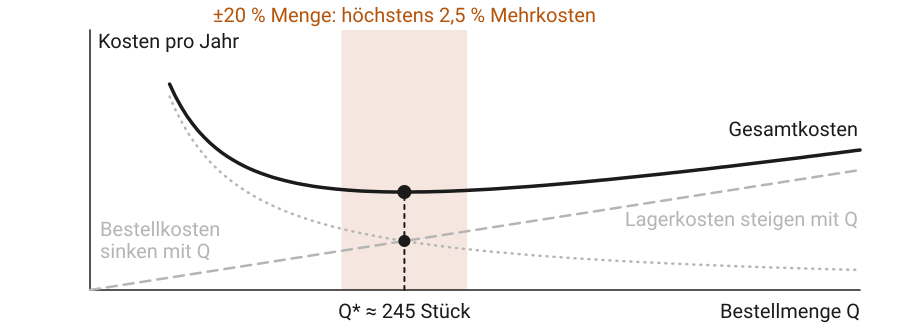
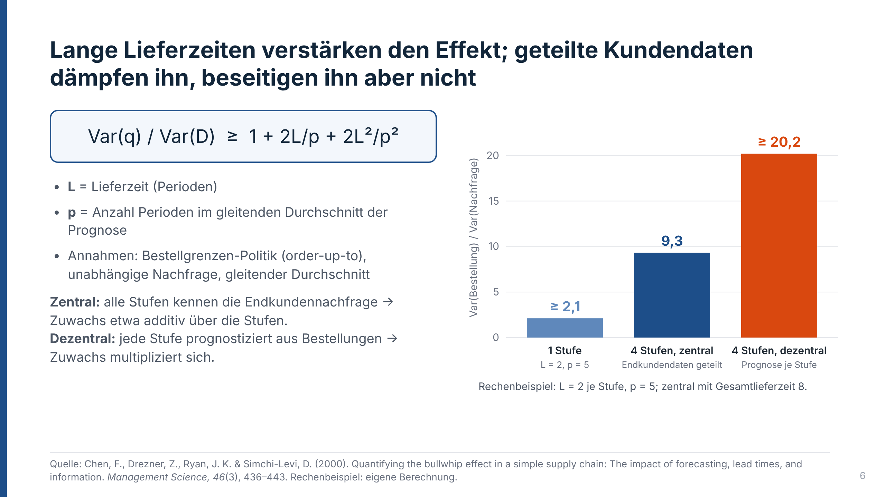
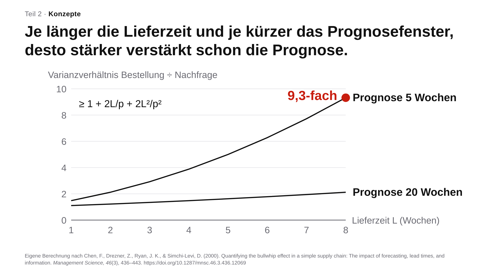

# Praxis-Primer für Lehrende {#sec-anhang-primer}

Die Primer dieses Anhangs beantworten je eine Frage: Wie erstelle ich dieses Lernmaterial mit KI so, dass es lernwirksam ist, und woran erkenne ich, dass es misslungen ist? Jeder Primer folgt demselben Aufbau. Ein Prinzip sagt, wofür das Format taugt und wofür nicht. Empfehlungen in Wenn-dann-Form tragen je eine Prüffrage, die sich in unter einer Minute beantworten lässt. Ein Arbeitsablauf nennt in jedem Schritt, was die Lehrperson nicht an die KI abgibt. Eine Prüfliste fasst die Empfehlungen zum Abhaken zusammen, und ein erprobtes Beispiel aus der eigenen Lehre zeigt die Umsetzung mit Stand-Vermerk. Werkzeuge, Prompts und Prüfskripte veralten schneller als ein Buch; sie stehen vollständig in der Online-Version.

## Primer 0: Welches Format für welches Lehrziel? {#sec-primer-weiche}

Wer mit KI Lernmaterial erstellt, beginnt leicht beim Werkzeug: Ein Musikgenerator steht bereit, also entsteht ein Song. Die Reihenfolge gehört umgekehrt. Zuerst steht fest, welche Art von Wissen die Studierenden erwerben sollen, daraus folgt das Format, zuletzt das Werkzeug. @tbl-primer-weiche ordnet die vier Formate dieses Anhangs den Wissensarten der überarbeiteten Bloom-Taxonomie zu [@anderson2001]: Faktenwissen (Begriffe, Einzelheiten), konzeptuelles Wissen (Zusammenhänge, Modelle, Prinzipien) und prozedurales Wissen (Verfahren und die Kriterien, wann welches passt).

| Format | Stärke: Lehrziel | Wissensart | Falsches Mittel für | Primer |
|---|---|---|---|---|
| Animation | wie sich etwas verändert: Prozesse, Dynamik, Wirkungsketten | konzeptuell | Aufbau und räumliche Anordnung; dafür genügt ein Standbild [@ploetzner2021] | @sec-primer-animationen |
| Präsentation | ein Argument in Schritten: Aussage und Beleg | konzeptuell | Üben und Nachschlagen; die Folie ist kein Skript | @sec-primer-praesentationen |
| Lernsong | wörtlicher Abruf und feste Reihenfolge: Listen, Formeln, Merksätze | Faktenwissen | Verstehen und Anwenden; wer einen Merkspruch aufsagen kann, kann ihn noch nicht anwenden [@mocko2024] | @sec-primer-lernsongs |
| Lernspiel | Üben mit Rückmeldung (Abrufspiel); Entscheiden unter Folgen (Planspiel) | Fakten- bzw. prozedurales Wissen | alleinige Instruktion ohne Erklärung und Nachbesprechung [@wouters2013] | @sec-primer-lernspiele |

: Vier Formate, vier Lehrziele. Die Spalte rechts verweist auf den Primer. {#tbl-primer-weiche tbl-colwidths="[13,30,15,30,12]"}

Die vierte Wissensart der Taxonomie, metakognitives Wissen über das eigene Lernen, fördert keines der vier Formate von selbst. Dafür braucht es Reflexion, etwa die Nachbesprechung nach einem Planspiel.

## Primer A: Didaktische Animationen {#sec-primer-animationen}

::: {.callout-note title="Prinzip: Wofür Animationen taugen, wofür nicht"}
Eine Animation zeigt, wie sich etwas verändert; die Lernenden müssen die Veränderung nicht im Kopf aus Einzelbildern zusammensetzen. Darin liegt ihr Vorteil. Über alle Studien hinweg schlagen Animationen statische Bilder nur knapp [@berney2016]. Den Grund zeigt eine Nachanalyse dieser Metaanalyse: Der Vorteil ist deutlich, wenn die Merkmale der Veränderung selbst Lernstoff sind [@ploetzner2020]. Ein Experiment bestätigt die Arbeitsteilung: Bewegungsabläufe eines Getriebes erkannten Studierende nach einer Animation am besten, die räumliche Anordnung der Zahnräder nach statischen Bildern [@ploetzner2021]. Bewegung lohnt sich also für Prozesse, Dynamik und Wirkungsketten, etwa für das Aufschaukeln von Bestellungen in einer Lieferkette. Für Aufbau, Begriffe und Vergleiche genügt ein gutes Standbild, und es kostet weniger.
:::

::: {.callout-tip title="Empfehlungen"}
**1 Animieren Sie nur Veränderung, die Lernstoff ist.** Ein Punkt, der auf der Kostenkurve zum Minimum wandert, zeigt den Inhalt; eine einfliegende Überschrift bindet Aufmerksamkeit und lehrt nichts. *Prüfen:* Lässt sich das Lernziel als „wie sich X verändert“ formulieren?

**2 Bauen Sie die Animation in Schritten auf, die Sie per Klick auslösen, und stellen Sie vor der Auflösung eine Vorhersagefrage.** Segmentierte Darstellungen verbessern Behalten und Transfer [@rey2019]. Jeder Haltepunkt ist zugleich der Ort, an dem die Lernenden vorhersagen, was als Nächstes geschieht, und so vom Zuschauen zum Denken wechseln. *Prüfen:* Wartet jeder Schritt auf einen Klick, und steht vor dem entscheidenden Schritt eine Frage?

**3 Führen Sie den Blick wie ein Verfolgerscheinwerfer.** Das Grundbild bleibt in Graustufen, genau eine Akzentfarbe markiert das, worüber Sie gerade sprechen, und Bekanntes tritt ins Grau zurück. Hervorhebungen verbessern das Lernen mit Medien [@schneider2018]; ein Signal wirkt aber nur, weil es sich abhebt, und fünf Farben heben nichts mehr ab. Kategorien unterscheiden Sie über Form, Strichart oder direkte Beschriftung. *Prüfen:* Ist das Bild ohne Farbe vollständig lesbar und ohne Farblegende verständlich?

**4 Erklären Sie mit der Stimme und halten Sie den Text im Bild knapp.** Animationen schnitten in der Metaanalyse besser ab, wenn sie gesprochen kommentiert wurden oder ohne Begleittext auskamen [@berney2016]. Als Faustregel gelten höchstens acht neue Wörter je Schritt, direkt am Objekt, und eine Bildunterschrift von einem Satz für das Selbststudium. *Prüfen:* Wie viele neue Wörter bringt der Schritt mit den meisten?

**5 Geben Sie den Lernenden ein Leitobjekt, statt viele Kennzahlen gleichzeitig zu zeigen.** In komplexen Animationen schauen Lernende auf das, was sich auffällig bewegt, nicht auf das fachlich Wichtige [@lowe2003]. Ein Objekt, dem man durch den Ablauf folgt, und eine Bewegung zur Zeit lösen diesen Konflikt. *Prüfen:* Kann eine Studentin nach dem Ansehen sagen, welchem Objekt sie gefolgt ist?

**6 Bauen Sie zu jeder Animation einen Druckzwilling.** Das vollständige Endbild trägt die Aussage auf Papier, in der Prüfungsvorbereitung und für alle, die die Animation nicht abspielen können; ein QR-Code führt zur bewegten Fassung. *Prüfen:* Ist das Endbild in Graustufen lesbar?
:::

**Arbeitsablauf mit KI.** Ein Sprachmodell schreibt den Code einer Animation in Minuten. Die Arbeit der Lehrperson verschiebt sich auf die Stellen, die das Modell nicht übernimmt.

1. **Lehrziel und Storyboard.** Kernaussage als Satz, Vorhersagefrage, eine Tabellenzeile je Schritt mit genau einem neuen Element. *Nicht abgeben:* die Kernaussage und die Entscheidung, was in welchem Schritt neu ist.
2. **Auftrag an die KI.** Storyboard und Gestaltungsregeln als fester Textbaustein im Auftrag. *Nicht abgeben:* die Regeln; ohne sie liefert das Modell Flutlicht statt Scheinwerfer.
3. **Erzeugen.** Das Modell baut aus einer Vorlage eine Webseite oder ein Animationsskript. *Nicht abgeben:* die Zahlen; sie kommen aus einem nachgerechneten Modell.
4. **Prüfen.** Ein Prüfskript zählt je Schritt Farben, Wörter und neue Elemente, dann folgt die Sichtprüfung jedes Schritts in Graustufen. *Nicht abgeben:* das Urteil über fachliche Richtigkeit.
5. **Einsetzen.** Im Hörsaal mit Vorhersagefrage und Pause, im Skript mit Druckzwilling. *Nicht abgeben:* das Tempo.

**Prüfliste.**

- [ ] Das Lernziel lautet „wie sich X verändert“.
- [ ] Der Titel ist eine Aussage, kein Thema.
- [ ] Vor der Auflösung steht eine Vorhersagefrage.
- [ ] Jeder Schritt wartet auf einen Klick und bringt genau ein neues Element.
- [ ] Graustufen plus eine Akzentfarbe; keine Farblegende nötig.
- [ ] Höchstens acht neue Wörter je Schritt; Bildunterschrift ein Satz.
- [ ] Ein Leitobjekt, eine Bewegung zur Zeit.
- [ ] Zahlen nachgerechnet, Annahmen als „Lehrmodell“ gekennzeichnet.
- [ ] Druckzwilling in Graustufen lesbar, mit QR-Code.

::: {.callout-important title="Umsetzung, Stand 10/2026"}
Die Animation zur optimalen Bestellmenge (@fig-primer-eoq) entstand nach diesem Ablauf: Storyboard mit sechs Schritten, Bau durch ein Sprachmodell (Claude Opus 5.5) aus einer festen Vorlage als einzelne Webseite mit Vektorgrafik, Messung mit einem Prüfskript. Weil die Regeln im Auftrag standen, hielt sie das Budget im ersten Prüflauf ein; nachgebessert wurden nur zwei Stellen, an denen eine Kurve eine Beschriftung schnitt. Vom Storyboard bis zur Freigabe braucht eine solche Animation weniger als eine Stunde. Animationen, die für dieses Buch zuvor ohne solche Regeln entstanden waren, schnitten anders ab: Im Messlauf vom Oktober 2026 blieb keine der zwölf Erklär- und Prozessansichten im Budget, alle zeigten schon im ersten Bild mehr als 40 Wörter, vier unterschieden Kategorien über Farbe. Eine Animation zu parallel arbeitenden KI-Agenten wurde erst verständlich, als nebeneinanderliegende Bahnen mit Kennzahlen einer einzigen Kugel wichen, der die Lernenden folgen. Die wichtigste praktische Regel lautet deshalb: Gestaltungsregeln gehören in den Auftrag an die KI und in ein Prüfwerkzeug, nicht in die Nachbesserung.
:::

::: {.content-visible unless-format="html"}
::: {#fig-primer-eoq layout="[[80,20]]" layout-valign="bottom"}
{fig-alt="Kostenkurven über der Bestellmenge: Lagerkosten steigen, Bestellkosten sinken, die Gesamtkosten haben ein flaches Minimum bei rund 245 Stück, wo sich Lager- und Bestellkosten schneiden."}

{fig-alt="QR-Code zur Online-Fassung von Primer A"}

Die optimale Bestellmenge gleicht zwei gegenläufige Kosten aus: Endbild der sechsstufigen Animation (Lehrmodell nach @harris1990). Die interaktive Fassung, den Prompt-Baustein, das Prüfskript und die Manim-Zellen für Colab gibt es in der Online-Version: QR-Code scannen oder <https://th-koln-bartnik.github.io/genai4teaching/anhang-primer.html#sec-primer-animationen> aufrufen.
:::
:::

::: {.content-visible when-format="html"}
::: {#fig-primer-eoq}
```{=html}
<iframe src="interactions/eoq-bestellmenge.html" title="Animation: optimale Bestellmenge in sechs Schritten" style="width:100%;height:640px;border:0" loading="lazy"></iframe>
```

Die optimale Bestellmenge gleicht zwei gegenläufige Kosten aus. Klicken Sie sich durch die sechs Schritte und treffen Sie vorher Ihre Vorhersage; Lehrmodell nach @harris1990. [Vollbild](interactions/eoq-bestellmenge.html), im Hörsaal ohne Bildunterschrift: [Hörsaalmodus](interactions/eoq-bestellmenge.html?hoersaal).
:::
:::

::: {.callout-note title="Prinzip: Was die Forschung nicht belegt"}
Ob mit KI erstellte Animationen anders wirken als von Hand gebaute, ist nicht untersucht; die Belege gelten der Gestaltung, nicht dem Herstellungsweg. Die Budgetzahlen dieses Primers, acht neue und 40 sichtbare Wörter je Schritt, eine Akzentfarbe, sind aus den Befunden abgeleitete Faustregeln, keine gemessenen Grenzwerte.
:::

::: {.content-visible when-format="html"}
### Vollfassung online {#sec-primer-animationen-online .unnumbered .unlisted}

#### Mehr zur Evidenz {.unnumbered .unlisted}

Die erste große Metaanalyse fand über 26 Studien einen mittleren Vorteil von Animationen gegenüber statischen Bildern (d = 0,37) [@hoeffler2007]. Mit 61 Studien kamen @berney2016 auf einen kleineren Effekt (g = 0,23), der wuchs, wenn die Animation systemgesteuert lief (g = 0,31), gesprochen kommentiert wurde (g = 0,34) oder ohne Begleittext auskam (g = 0,88). @ploetzner2020 werteten 194 Studien danach aus, was getestet wurde: Die meisten prüften konzeptuelles Verständnis, selten dagegen, ob die Lernenden die Veränderung selbst erfasst hatten. Als sie die Metaanalyse von @berney2016 um dieses Merkmal ergänzten, waren Animationen deutlich überlegen, wenn die Merkmale der Veränderung gelernt werden mussten. @ploetzner2021 prüften die Folgerung im Experiment mit 88 Studierenden: Wer ein Getriebe als Animation sah, erkannte dessen Bewegungen am besten; wer Standbilder sah, erkannte die räumliche Anordnung am besten; die Effekte waren groß.

Zur Lenkung der Aufmerksamkeit unterscheiden @dekoning2009 Hinweisreize, die auswählen, ordnen oder verknüpfen; die Akzentfarbe dieses Primers wählt aus, das Zurücktreten ins Grau ordnet, und das gleichfarbige Schlüsselwort der Bildunterschrift verknüpft Text und Bild, wofür eine eigene Metaanalyse einen Vorteil zeigt [@richter2016]. Die Farbe unterstützt die Lenkung, getragen wird sie von Leitobjekt und Schrittfolge. Gesprochener Text ist flüchtig: Ist er zu lang, kehrt sich der Vorteil der gesprochenen Erklärung um [@leahy2011]. Auch die Stimme braucht deshalb kurze Stücke mit Pausen.

Die Vorhersagefrage vor jeder Auflösung stützt sich auf einen Hörsaalversuch: Studierende, die eine Demonstration nur beobachteten, verstanden das zugrunde liegende Konzept nicht besser als Studierende, die sie gar nicht sahen; wer das Ergebnis vorher vorhersagte, verstand es deutlich besser [@crouch2004].

#### Werkzeugwahl {.unnumbered .unlisted}

Die Wahl des Werkzeugs folgt der Frage, wer das Tempo bestimmt und was gelernt werden soll.

| Wer bestimmt das Tempo, was wird gelernt? | Bauweise | Werkzeug (Stand 10/2026) |
|---|---|---|
| Lehrperson erzählt eine Herleitung | programmiertes Video mit Haltepunkten | Manim mit Manim Slides |
| Erklärbild für Hörsaal und Buch | schrittweise Webgrafik | HTML/SVG-Vorlage mit Prüfskript |
| Warteschlangen, Durchlauf, Engpass | Prozessanimation mit Zeitachse | HTML-Vorlage für Prozesse |
| Studierende verändern Parameter | interaktives Modell | Observable JS in Quarto |

#### Storyboard des Beispiels {.unnumbered .unlisted}

| Schritt | neu (Akzent) | tritt ins Grau zurück | neuer Bildtext | Bildunterschrift |
|---|---|---|---|---|
| 1 | Achsen | – | Bestellmenge Q · Kosten pro Jahr | Jede Bestellung kostet einen festen Betrag, jedes gelagerte Stück kostet laufend; treffen Sie oben Ihre Vorhersage. |
| 2 | Lagerkosten (gestrichelt) | – | Lagerkosten steigen mit Q | Wer viel auf einmal bestellt, hat im Mittel mehr auf Lager: Die Lagerkosten steigen gleichmäßig. |
| 3 | Bestellkosten (gepunktet) | – | Bestellkosten sinken mit Q | Wer viel auf einmal bestellt, bestellt seltener: Die Bestellkosten sinken, erst steil, dann flach. |
| 4 | Gesamtkosten (durchgezogen) | Lager- und Bestellkosten | Gesamtkosten | Die Gesamtkosten sind die Summe beider Kurven; sie fallen zuerst und steigen dann wieder. |
| 5 | Minimum und Schnittpunkt | – | Q\* ≈ 245 Stück | Das Minimum liegt dort, wo Lager- und Bestellkosten gleich hoch sind: bei rund 245 Stück. |
| 6 | Band ±20 % | – | ±20 % Menge: höchstens 2,5 % Mehrkosten | Das Minimum ist flach: Wer 20 Prozent daneben liegt, zahlt höchstens 2,5 Prozent mehr. |

Lehrmodell: Jahresbedarf D = 1.200 Stück, S = 50 € je Bestellung, H = 2 € Lagerkosten je Stück und Jahr; Q\* = √(2DS/H) ≈ 245 Stück. Bei ±20 % steigen die Gesamtkosten um 2,5 % bzw. 1,7 %, bei halber oder doppelter Menge um 25 %. Das Prüfskript meldete für alle sechs Schritte eine Akzentfarbe, höchstens fünf neue und höchstens 22 sichtbare Wörter.

#### Prompt-Baustein: Gestaltungsregeln {.unnumbered .unlisted}

Diesen Block fügen Sie in jeden Auftrag an ein Sprachmodell ein, das eine Lehranimation bauen soll, zusammen mit Ihrem Storyboard.

```text
Baue die Animation als Folge von Schritten, die per Klick ausgelöst werden.
Leitidee: Die Animation ist ein Verfolgerscheinwerfer, kein Flutlicht.

Farbe
F1 Grundbild in Graustufen; ohne Farbe vollständig lesbar.
F2 Genau eine Akzentfarbe mit genau einer Bedeutung: das Neue dieses
   Schritts oder ein Leitobjekt, nie beides.
F3 Höchstens eine zweite Farbe, nur für einen Gegensatz, der selbst
   Lernziel ist.
F4 Kategorien über Form, Position, Strichart oder Beschriftung, nie über
   Farbe. Braucht das Bild eine Farblegende, ist es zu bunt.
F5 Keine Ampelfarben für Bewertungen.
F6 Drei Zustände: neu (Akzent), bekannt (Schwarz), Kontext (helles Grau,
   ohne Transparenz).
F7 Schlüsselwort der Bildunterschrift in derselben Akzentfarbe.

Text
T1 Startbild: Aussagetitel, Achsen oder Skelett, Vorhersagefrage.
T2 Pro Schritt eine neue Textgruppe, höchstens 8 Wörter, am Objekt.
T3 Bildunterschrift: ein Satz, höchstens 20 Wörter, ersetzt die vorige.
T4 Wiederholtes einmal ausschreiben, danach abkürzen.
T5 Listen zeilenweise aufbauen.
T6 Annahmen und Quellen erst nach dem letzten Schritt, eingeklappt.

Aufbau und Bewegung
A1 Was noch nicht dran ist, ist unsichtbar.
A2 Pro Schritt genau eine neue Elementgruppe.
A3 Nur eine Sache bewegt sich zur Zeit.
A4 Aufbau per Klick, nicht per Zeitleiste.
A5 Der letzte Schritt zeigt das vollständige Bild (Druckfassung).

Budget je Schritt: höchstens 1 Farbton außer Grau, höchstens 8 neue
Wörter, höchstens 40 sichtbare Wörter bis zum vorletzten Schritt,
genau 1 neue Gruppe.
```

#### Prüfskript {.unnumbered .unlisted}

Ein Prüfskript ist ein kleines Programm, das eine fertige Animation Schritt für Schritt in einem unsichtbaren Browser öffnet und nachzählt, was die Lernenden sehen würden: Farbtöne, sichtbare Wörter, neue Wörter und neue Elemente je Schritt. Es wirkt wie ein Korrekturleser mit Lineal, der nicht müde wird. Das Skript [`pruefe-aufmerksamkeit.cjs`](downloads/primer/pruefe-aufmerksamkeit.cjs) braucht Node.js (eine Laufzeitumgebung, die JavaScript außerhalb des Browsers ausführt) und das Paket Playwright, das einen Browser fernsteuert:

```bash
npm install playwright
npx playwright install chromium
node pruefe-aufmerksamkeit.cjs animation.html --bilder pruefbilder
```

Es gibt je Schritt eine Tabellenzeile aus und schließt mit BESTANDEN oder ÜBERARBEITEN; im Ordner `pruefbilder` liegt je Schritt ein Farb- und ein Graustufenbild für die Sichtprüfung.

#### Manim in Google Colab (Stand 10/2026) {.unnumbered .unlisted}

Manim ist eine Python-Bibliothek, mit der man eine Animation als Programmtext beschreibt statt sie mit der Maus zu zeichnen; der Rechner rechnet daraus Bild für Bild einen Film, wie ein Daumenkino, das sich selbst zeichnet. Das Paket Manim Slides setzt Haltepunkte, an denen der Film auf einen Tastendruck wartet, und exportiert eine Präsentation als Webseite [@eertmans2023]. Getestet wurde die Kombination `manim==0.19.1` mit `manim-slides==5.7.0`; neuere Manim-Versionen waren mit Manim Slides nicht verträglich. Die Einstellung `skip_reversing = True` spart die Rückwärtsvideos, die das Rendern sonst stark verlangsamen, und `label_constructor: Text` ersetzt den langsam zu installierenden Formelsatz für Achsenzahlen.

```python
# Zelle 1: Schriftsatz-Bibliothek und Pakete installieren (2–3 Minuten)
!apt-get -qq install -y libpango1.0-dev > /dev/null
!pip install -q "manim==0.19.1" "manim-slides==5.7.0"

# Zelle 2: Szenencode als Datei anlegen; erste Zeile der Zelle:
# %%writefile eoq_slides.py

# Zelle 3: rendern (-qh = HD) und in eine HTML-Datei umwandeln
!manim -qh eoq_slides.py EOQ && manim-slides convert EOQ eoq.html --one-file

# Zelle 4: herunterladen
from google.colab import files; files.download("eoq.html")
```

Die fertige HTML-Datei lädt das Folienprogramm reveal.js aus dem Netz nach und braucht im Hörsaal deshalb Internet. Zur Qualitätsprüfung rendert `manim -qm -s datei.py Szene` nur das letzte Bild; am Standbild sieht man Überschneidungen von Beschriftungen, die im laufenden Film untergehen.
:::

## Primer B: Präsentationen {#sec-primer-praesentationen}

::: {.callout-note title="Prinzip: Wofür Präsentationen taugen, wofür nicht"}
Im Hörsaal teilen sich Stimme und Folie die Arbeit: Die Stimme erklärt, die Folie zeigt, worauf sich die Erklärung stützt. @garner2013 ließen 110 Ingenieurstudierende denselben gesprochenen Vortrag hören, die eine Hälfte mit Folien aus Themenüberschrift und Aufzählung, die andere mit einem Satz als Titel und einem Bild als Beleg. Die zweite Gruppe verstand mehr, hatte weniger Fehlvorstellungen und wusste eine Woche später noch mehr. Steht dagegen viel Text auf der Folie, lesen die Zuhörenden mit und überhören, was nur gesagt wird [@wecker2012]. Eine Präsentation taugt darum für ein Argument in Schritten: Aussage, Beleg, nächste Aussage. Zum Üben taugt sie nicht, und zum Nachlesen nur mit einem eigenen Skript (@sec-primer-weiche).
:::

::: {.callout-tip title="Empfehlungen"}
**1 Schreiben Sie die Aussage der Folie in den Titel.** Ein ganzer Satz mit einer Behauptung, höchstens zwei Zeilen: „Kleine Schwankungen im Handel wachsen zum Hersteller hin“ statt „Bullwhip-Effekt: Überblick“. Der Satztitel gehört zu den Merkmalen, mit denen die Folien bei @garner2013 besser abschnitten. *Prüfen:* Erzählen die Titel, nacheinander gelesen, das ganze Argument?

**2 Füllen Sie den Folienkörper mit dem Beleg, nicht mit dem Vortragstext.** Diagramm, Schaubild, Tabelle oder eine große Zahl mit Vergleichswert; Text nur als Beschriftung am Objekt, als Faustregel höchstens 15 Wörter. Was Sie sagen, steht in den Sprechernotizen, nicht auf der Folie [@wecker2012]. *Prüfen:* Würde man dem Titel allein aufgrund des Bildes glauben?

**3 Bauen Sie Abläufe und Wechselwirkungen in Schritten auf.** Erst die Bausteine einzeln, dann ihr Zusammenspiel; Lernende mit wenig Vorwissen verstehen komplexen Stoff so besser [@pollock2002]. Jeder Schritt bringt eine neue Gruppe in der Akzentfarbe, Bekanntes tritt zurück wie beim Verfolgerscheinwerfer in @sec-primer-animationen. *Prüfen:* Hat jede Folie höchstens vier Gruppen, und zeigt der letzte Schritt das vollständige Bild?

**4 Streichen Sie, was nur schmückt.** Interessante, aber für das Lernziel unwichtige Bilder und Details verschlechtern Behalten und Transfer [@rey2012]. Stockfotos, Symbolbilder und Pfeilketten ohne eindeutige Bedeutung fallen darunter. *Prüfen:* Geht Information verloren, wenn Sie das Element löschen?

**5 Zeigen Sie nur Zahlen, deren Herkunft Sie kennen.** Ein Diagramm überzeugt durch seine Form, ob die Werte stimmen oder nicht. Lassen Sie Werte darum rechnen statt schreiben: aus der Originalquelle oder aus einem nachgerechneten Beispiel, das als Lehrmodell gekennzeichnet ist; fehlt beides, zeigt ein Schaubild die Beziehung ohne Werte. *Prüfen:* Können Sie zu jeder Zahl sagen, woher sie kommt?

**6 Setzen Sie genau eine vollständige Quelle auf jede Folie und prüfen Sie sie am DOI.** Die Quellenzeile zeigt Studierenden, worauf eine Aussage beruht; an Zeitschrift und DOI lernen sie, Quellen einzuschätzen. Im Testlauf unten stimmten alle Quellen, ohne Regelwerk fehlte aber auf jeder Folie die DOI. *Prüfen:* Führt der DOI zu dieser Arbeit, und stützt sie den Titel der Folie?
:::

**Arbeitsablauf mit KI.** Ein Sprachmodell baut einen Foliensatz in Minuten. Die Arbeit der Lehrperson liegt am Anfang, beim Argument, und am Ende, bei der Prüfung.

1. **Lehrziel und Argument.** Leitfrage, Antwort als ein Satz, Argumentationsübersicht in vier Blöcken: Problem, Konzepte, Evidenz, Fazit. *Nicht abgeben:* die Aussage, auf die der Vortrag hinausläuft.
2. **Auftrag an die KI.** Gestaltungsregeln als fester Baustein, dazu die Quellen und Daten, die verwendet werden dürfen; zuerst nur ein Storyboard mit einer Zeile je Folie: Titel, Beleg, Quelle. *Nicht abgeben:* die Freigabe des Storyboards.
3. **Erzeugen.** Folien in der Hochschulvorlage mit Sprechernotizen. *Nicht abgeben:* die Daten hinter jedem Diagramm.
4. **Prüfen.** Jede Folie als Bild ansehen und gegen die Prüfliste halten, jede Quelle am DOI öffnen. *Nicht abgeben:* das Urteil über fachliche Richtigkeit und Quellen.
5. **Einsetzen.** Frei zur Folie sprechen, die Notizen dienen als Gerüst; wer ein Handout braucht, bekommt ein eigenes Dokument. *Nicht abgeben:* die Erklärung; sie gehört der Stimme.

**Prüfliste.**

- [ ] Jeder Titel ist ein ganzer Satz mit einer Behauptung.
- [ ] Die Titel erzählen nacheinander gelesen das Argument.
- [ ] Der Folienkörper belegt den Titel; höchstens 15 Wörter, nichts zum Vorlesen.
- [ ] Höchstens vier Gruppen je Folie; Abläufe schrittweise, letzter Schritt vollständig.
- [ ] Genau eine Hervorhebung in der Akzentfarbe; in Graustufen lesbar.
- [ ] Jedes Bild besteht den Löschtest.
- [ ] Jede Zahl hat eine Herkunft; Lehrmodelle sind gekennzeichnet.
- [ ] Je Folie eine vollständige Quelle, DOI geöffnet und geprüft.
- [ ] Sprechernotizen in ganzen Sätzen.

::: {.callout-important title="Umsetzung, Stand 10/2026"}
Für diesen Primer entstand ein Foliensatz zum Bullwhip-Effekt zweimal, mit demselben Sprachmodell (Claude Opus 5.5) und demselben Auftrag einer Lehrperson: einmal ohne Regelwerk, einmal mit dem Regelwerk dieses Primers und der Folienvorlage der Hochschule als Dateien im Auftrag (@fig-primer-folien). Beide Läufe fanden echte Quellen und ließen ihre Zahlen per Programm nachrechnen. Die Unterschiede lagen im Folienkörper. Ohne Regelwerk standen auf den Inhaltsfolien im Median 64 statt 12 Wörter, die DOIs fehlten, zwei Folien trugen je zwei Quellen, und das Modell sah zwei Schmuckbilder und elf Farbtöne vor. Mit Regelwerk brauchte das Modell fünf Prüfrunden, bis jede Folie die Prüfliste bestand. Seine Erstfassung scheiterte an Beschriftungen, die sich überlagerten, an Titeln über drei Zeilen und an knapp überschrittenen Wortgrenzen, also an Fehlern, die erst im gerenderten Bild sichtbar werden. Ein Lauf dauerte sechs beziehungsweise elf Minuten; mit Durchsicht und Freigabe durch die Lehrperson braucht ein solcher Foliensatz weniger als eine Stunde. Ein Testlauf ist keine Studie, er zeigt aber, wohin die Arbeit wandert: Das Regelwerk gehört in den Auftrag, und geprüft wird jede Folie als Bild, nicht im Quelltext.
:::

::: {.content-visible unless-format="html"}
::: {#fig-primer-folien layout="[[40,40,20]]" layout-valign="bottom"}
{#fig-primer-folien-ohne fig-alt="Folie mit Aussagetitel zu Lieferzeiten, links Formel, Aufzählung und zwei Erklärsätze, rechts Balkendiagramm mit drei farbigen Balken; viel Text."}

{#fig-primer-folien-mit fig-alt="Folie mit Aussagetitel zu Lieferzeit und Prognosefenster, Liniendiagramm mit zwei direkt beschrifteten Kurven, ein roter Punkt markiert den Wert 9,3; kaum Text."}

{fig-alt="QR-Code zur Online-Fassung von Primer B"}

Dieselbe Aussage nach @chen2000quantifying, zweimal vom selben Sprachmodell gebaut: Ohne Regelwerk erklärt die Folie sich selbst in Sätzen, mit Regelwerk belegt sie den Titel mit einem Diagramm und überlässt die Erklärung der Stimme. Beide Foliensätze, den Prompt-Baustein und das Regelwerk gibt es in der Online-Version: QR-Code scannen oder <https://th-koln-bartnik.github.io/genai4teaching/anhang-primer.html#sec-primer-praesentationen> aufrufen.
:::
:::

::: {.content-visible when-format="html"}
::: {#fig-primer-folien layout-ncol="2"}
{#fig-primer-folien-ohne fig-alt="Folie mit Aussagetitel zu Lieferzeiten, links Formel, Aufzählung und zwei Erklärsätze, rechts Balkendiagramm mit drei farbigen Balken; viel Text."}

{#fig-primer-folien-mit fig-alt="Folie mit Aussagetitel zu Lieferzeit und Prognosefenster, Liniendiagramm mit zwei direkt beschrifteten Kurven, ein roter Punkt markiert den Wert 9,3; kaum Text."}

Dieselbe Aussage nach @chen2000quantifying, zweimal vom selben Sprachmodell gebaut. Ohne Regelwerk erklärt die Folie sich selbst in Sätzen, mit Regelwerk belegt sie den Titel mit einem Diagramm und überlässt die Erklärung der Stimme. Ganze Foliensätze mit Sprechernotizen: [ohne Regelwerk](downloads/primer/folien-bullwhip-ohne-regeln.html), [mit Regelwerk](downloads/primer/folien-bullwhip-mit-regeln.html).
:::
:::

::: {.callout-note title="Prinzip: Was die Forschung nicht belegt"}
Die Belege für Satztitel und Bildbeleg stammen aus wenigen Studien einer Arbeitsgruppe, überwiegend mit Ingenieurstudierenden. Wie mit KI erstellte Folien auf das Lernen wirken, ist kaum untersucht: In einer Informatik-Lehrveranstaltung bewerteten Studierende KI-Folien, die der Lehrende überarbeitet hatte, so gut wie seine eigenen und erkannten sie nicht; ihr Lernen wurde nicht gemessen [@leinonen2026]. Die Grenzen von 15 Wörtern und vier Gruppen sind Faustregeln.
:::

::: {.content-visible when-format="html"}
### Vollfassung online {#sec-primer-praesentationen-online .unnumbered .unlisted}

#### Mehr zur Evidenz {.unnumbered .unlisted}

Den Ansatz aus Satztitel und Bildbeleg haben @alley2005 aus der Praxis technischer Vorträge beschrieben und als Gegenentwurf zur Voreinstellung der Präsentationsprogramme begründet: Themenüberschrift plus Aufzählung. @garner2013 prüften ihn im Experiment. Beide Gruppen hörten dieselbe Tonaufnahme; die Folien der einen Gruppe hielten sechs Grundsätze des multimedialen Lernens ein, die der anderen folgten den üblichen Voreinstellungen. Die erste Gruppe schrieb bessere Erklärungen, zeigte weniger Fehlvorstellungen, empfand die Belastung als geringer und erinnerte sich im verzögerten Test besser.

Dass Text auf der Folie nicht grundsätzlich schadet, zeigen @mayer2008: Kurze Beschriftungen aus zwei, drei Wörtern direkt an der Grafik verbesserten das Behalten, ohne das Verstehen zu stören. Die Regel lautet also nicht „kein Text“, sondern „kein zweiter Vortrag auf der Folie“. Zwei Pilotstudien von @wolfe2024 ergänzen zwei Einzelheiten: Generische Schaubilder aus Pfeilen und Kreisen, wie Präsentationsprogramme sie anbieten, legten Beziehungen nahe, die so nicht gemeint waren; lange Zitate sollte man nicht vorlesen, sondern kürzen oder paraphrasieren.

@leinonen2026 ließen fünf KI-Werkzeuge Folien für eine Web-Programmierveranstaltung bauen, und die Ergebnisse lagen weit auseinander: Eine Fassung sah ansprechend aus und blieb inhaltlich oberflächlich, eine andere brachte große, unpassende Bilder und zu viel Text. Den Stil der Lehrperson traf kein Werkzeug, er wurde von Hand nachgezogen. Ein Benchmark mit zehn Sprachmodellen fand, dass Folien, die nach einem Bewertungsraster gut aussehen, nicht verlässlich zu Lernzuwachs führen; die Lernenden waren dort allerdings Sprachmodelle, die Studierende nachahmen, ergänzt um einen Vorversuch mit 30 Personen [@wu2026slate].

#### Testlauf {.unnumbered .unlisted}

Auftrag in beiden Läufen: „Erstelle mir bitte einen Foliensatz (8–10 Folien) für eine Vorlesung im 3. Semester Wirtschaftsingenieurwesen zum Bullwhip-Effekt, Dauer etwa 20 Minuten, auf Deutsch. Mit Sprechernotizen und Quellenangaben.“ Der zweite Lauf erhielt zusätzlich das Regelwerk und die Hochschulvorlage als Dateien, dazu die Anweisung, jede Quelle zu prüfen und jede Folie als Bild zu kontrollieren. Gezählt wurde mit einem Messskript am gerenderten Foliensatz; Wörter sind Wortformen mit mindestens einem Buchstaben, Achsenwerte zählen nicht mit.

| Merkmal | ohne Regelwerk | mit Regelwerk |
|---|---|---|
| Folien (mit Aufbauschritten) | 10 (11) | 10 (20) |
| Argumentationsübersicht | nein | ja, vorn und im Fazit |
| Wörter im Folienkörper, Inhaltsfolien, Median (Spanne) | 64 (34–85) | 12 (9–15) |
| Quellen, alle über Crossref bestätigt | 4 | 6 |
| Quellen mit DOI auf der Folie | 0 | 6 |
| Folien mit zwei Quellen | 2 | 0 |
| Platzhalter für Schmuckbilder | 2 | 0 |
| Farbtöne außer Grau | 11 | 3 (Hausfarben, Akzent nur Rot) |
| Zahlen nachgerechnet, Lehrmodell gekennzeichnet | ja | ja |
| Prüfrunden bis zum Bestehen der Prüfliste | – | 5 |
| Laufzeit | 6 Minuten | 11 Minuten |

Eine Einschränkung: Das Modell im Lauf ohne Regelwerk sah in seiner Werkzeugliste die Kurzbeschreibung des Regelwerks („Aussagetitel, visuelle Evidenz, Quellenangabe pro Folie“), ohne es zu öffnen. Dass es Aussagetitel und eine Quellenzeile setzte, ist deshalb kein Befund über das Standardverhalten von Sprachmodellen. Die Unterschiede in der Tabelle sind trotz dieses Vorteils entstanden.

#### Prompt-Baustein: Gestaltungsregeln {.unnumbered .unlisted}

Diesen Block fügen Sie in jeden Auftrag für einen Foliensatz ein, zusammen mit Lehrziel, Zielgruppe, Dauer und den Quellen, die verwendet werden dürfen. Das vollständige Regelwerk mit Begründungen steht als [Skill-Datei](downloads/primer/folien-evidenzbasiert-SKILL.md) bereit; ein Skill ist eine Anleitung, die ein Sprachmodell bei passenden Aufträgen selbst nachliest, wie eine Checkliste, die im Werkzeugkasten liegt.

```text
Arbeitsablauf
1 Schreibe zuerst die Argumentationsübersicht (Problem, Konzepte, Evidenz,
  Fazit) und ein Storyboard: eine Zeile je Folie mit Aussagetitel, Beleg,
  Visualisierung, Aufbauschritten, Quelle. Warte auf meine Freigabe.
2 Schreibe die Sprechernotizen vor der Gestaltung.
3 Baue die Folien in meiner Vorlage; rendere jede Folie als Bild und prüfe
  sie gegen die Checkliste, bis sie besteht.

Je Inhaltsfolie
T Titel: ein ganzer Satz mit einer Behauptung, höchstens zwei Zeilen.
  Die Titel hintereinander erzählen das Argument.
K Körper: visueller Beleg für den Titel (Diagramm, Schaubild, Tabelle,
  große Zahl). Höchstens 15 Wörter, nur Beschriftungen am Objekt, nichts
  zum Vorlesen. Höchstens 4 visuelle Gruppen.
A Abläufe und Wechselwirkungen schrittweise: erst Bausteine, dann
  Zusammenspiel; je Schritt eine neue Gruppe in der Akzentfarbe, Bekanntes
  in Textfarbe, Kontext grau; letzter Schritt vollständig.
S Genau eine Hervorhebung in der Akzentfarbe; Bedeutung nie nur über Farbe.
L Löschtest: Bilder, Icons, Pfeilketten ohne Information entfallen.
Z Zahlen nur aus der Quelle oder nachgerechnet und als Lehrmodell
  gekennzeichnet; keine Daten erfinden, sonst Schaubild ohne Werte.
Q Genau eine vollständige APA-Angabe mit DOI unten links, klein, grau;
  jede DOI vor der Verwendung prüfen. Keine Quelle ohne Prüfung.
N Sprechernotizen in ganzen Sätzen, 80–200 Wörter, erklären das Bild.
```

#### Storyboard der Beispielfolie {.unnumbered .unlisted}

| Schritt | neu (Akzent) | Beschriftung am Objekt | Sprechernotiz, Kern |
|---|---|---|---|
| 1 | Achsen, Formel, Kurve für 20 Wochen Prognosefenster | Varianzverhältnis Bestellung ÷ Nachfrage · Lieferzeit L (Wochen) · Prognose 20 Wochen | Mit langem Fenster bleibt die Verstärkung klein, selbst bei acht Wochen Lieferzeit. |
| 2 | Kurve für 5 Wochen; die erste Kurve wird schwarz | Prognose 5 Wochen | Mit kurzem Fenster wächst die Verstärkung mit der Lieferzeit immer schneller. |
| 3 | Endpunkt mit Wert | 9,3-fach | Bei acht Wochen Lieferzeit schwanken die Bestellungen neunmal so stark wie die Nachfrage. |

Werte nach @chen2000quantifying: Var(q)/Var(D) ≥ 1 + 2L/p + 2L²/p², bei L = 8 und p = 5 also 9,32, bei p = 20 dann 2,12.
:::

## Primer C: Lernsongs {#sec-primer-lernsongs}

::: {.callout-note title="Prinzip: Wofür Lernsongs taugen, wofür nicht"}
Musik trägt die Form eines Inhalts, nicht sein Verstehen. Gesungenes wird im Wortlaut und in der Reihenfolge besser behalten; in einer systematischen Übersicht fanden 28 von 37 Studien einen Vorteil musikalischer Merkhilfen [@derksdijkman2024]. Bedeutung transportiert der Gesang nicht. Auch ohne Musik gilt: Studierende der Einführungsstatistik erinnerten Akronyme häufiger als andere Merkhilfen, erklären und anwenden konnten sie aber eher die satzförmigen [@mocko2024]. Ein Lernsong taugt darum für das, was wörtlich sitzen soll, eine Formel, eine Liste, die Reihenfolge eines Verfahrens, und er kommt nach der Erklärung, nicht an ihrer Stelle. Einen Zusammenhang erklärt eine Animation oder Präsentation besser, Rechnen und Entscheiden übt man mit Aufgaben und Spielen (@sec-primer-weiche). Den Einsatz eines Songs in der eigenen Lehre zeigt @sec-bsp-lernsong-forecast.
:::

| Studierende sollen hinterher … | Song? | Typ | Was dazugehören muss |
|---|---|---|---|
| eine Formel wörtlich abrufen | ja | Merkjingle, höchstens vier Zeilen | Herleitung vorher, Formel schriftlich, Rechenaufgabe danach |
| eine Liste vollständig aufzählen | ja | Listenlied | Bedeutung getrennt gelehrt, Zuordnung an Fällen danach |
| Schritte in fester Reihenfolge nennen | ja | Listenlied mit „weil“ je Übergang | Anwendungsaufgabe |
| erklären, warum ein Effekt entsteht | nur mit Erklärung | Wirkungsketten-Ballade | Erklärung vorher, Textblatt, zweiter Fall zum Vergleich |
| eine Formel anwenden, rechnen | nein | – | Übungsaufgaben, Lösungsbeispiele |
| das eigene Entscheiden ändern | nicht allein | Ballade als letztes Glied | Spiel und Nachbesprechung an den eigenen Daten vorher |

: Vom Lehrziel zum Songtyp. Die beiden unteren Zeilen enden ohne Song oder mit dem Song am Schluss einer Sequenz. {#tbl-primer-lernsongs tbl-colwidths="[30,14,24,32]"}

::: {.callout-tip title="Empfehlungen"}
**1 Spielen Sie den Song erst nach der Erklärung desselben Inhalts.** Der Song hält fest, was vorher erarbeitet wurde. Wer eine Merkhilfe aufsagen kann, versteht sie deshalb noch nicht [@mocko2024]; das Verstehen muss vorher entstehen. *Prüfen:* Gibt es vor dem Song eine gesprochene oder geschriebene Erklärung desselben Inhalts?

**2 Planen Sie mindestens drei Durchgänge an zwei Tagen, als eigene Hörphase.** Studierende, die ein Lied über Tage verteilt übten, behielten es nach drei Wochen besser als nach massiertem Üben [@katz2021]. Als Hintergrund beim Lesen oder Rechnen stört Musik mit Text mehr, als sie nützt. *Prüfen:* Stehen im Plan drei Durchgänge an verschiedenen Tagen ohne gleichzeitige Lese- oder Rechenaufgabe?

**3 Prüfen Sie jede Zeile ohne Musik auf fachliche Richtigkeit.** Ein Reim lässt eine Aussage wahrer erscheinen, auch der Person, die sie prüft [@mcglone2000]. Lieber kein Reim als ein falscher; Fachbegriffe und Formelsymbole werden als ganze Wörter gesungen. *Prüfen:* Hält jede Zeile am bloßen Text einer Fachprüfung stand?

**4 Liefern Sie den Text mit und gestalten Sie die Aufnahme auf Verständlichkeit.** Hörende verstanden gesungene Texte über zwölf Genres im Mittel nur zu 72 %, je nach Genre zwischen 48 und 96 % [@conditschultz2015]. Eine Solostimme, ruhiges Sprechtempo, sparsame Begleitung und ein Textblatt oder Untertitel fangen das ab. *Prüfen:* Singt eine Stimme, lässt sich der Text im Songtempo mitsprechen, und liegt er schriftlich bei?

**5 Geben Sie eine Aufnahme frei und verwenden Sie nur diese.** Musikgeneratoren erzeugen bei jedem Durchlauf eine andere Fassung; der Gewinn der Wiederholung hängt aber daran, dass Takt und Gruppierung gleich bleiben. Ein Verhörer wird durch Ersetzen der einen Zeile repariert, nicht durch neues Generieren. *Prüfen:* Hören alle Studierenden in allen Durchgängen dieselbe Datei?

**6 Lassen Sie auf den Song eine Aufgabe ohne Musik folgen.** Für eine Formel ist das eine Rechenaufgabe, für eine Liste die Zuordnung an kurzen Fällen, für eine Wirkungskette ein zweiter, strukturgleicher Fall mit Vergleichsauftrag; Fallvergleiche fördern den Transfer deutlich [@alfieri2013]. *Prüfen:* Liegt die Folgeaufgabe vor, und braucht sie den Inhalt, nicht den Wortlaut?
:::

**Arbeitsablauf mit KI.** Drei Werkzeuge teilen sich die Arbeit: Ein Sprachmodell schreibt Text und Prüfprotokoll, ein Musikgenerator setzt eine Stilangabe in eine Aufnahme um, eine Spracherkennung prüft, ob die Fachwörter hörbar sind.

1. **Lehrziel und Einsatzplan.** Ein Satz „Studierende können hinterher …“, der Typ nach @tbl-primer-lernsongs, die Erklärung davor und die drei Hörtermine. *Nicht abgeben:* die Entscheidung, ob überhaupt ein Song das richtige Mittel ist.
2. **Auftrag an das Sprachmodell.** Lehrziel, Inhalt und die Textregeln als fester Baustein; zurück kommen Liedtext, Textblatt, Fachwortliste, Prüfprotokoll und Folgeaufgabe. *Nicht abgeben:* den Inhalt; das Modell erfindet nichts dazu.
3. **Fachprüfung am bloßen Text.** Fehler sind vor der Aufnahme am billigsten. *Nicht abgeben:* das Urteil über jede Zeile.
4. **Aufnahme und Abnahme.** Stilangabe nach Empfehlung 4, zwei Aufnahmen anhören, Klatschprobe, Transkript der Spracherkennung gegen die Fachwortliste. *Nicht abgeben:* die Freigabe einer einzigen Fassung.
5. **Einsetzen.** Nach der Erklärung, verteilt, mit Textblatt und Folgeaufgabe. *Nicht abgeben:* den Einsatzplan.

**Prüfliste.**

- [ ] Das Lehrziel steht als Satz, und @tbl-primer-lernsongs empfiehlt dafür einen Song.
- [ ] Die Erklärung kommt vor dem Song.
- [ ] Drei Durchgänge an mindestens zwei Tagen, als eigene Hörphase.
- [ ] Jede Zeile ohne Musik fachlich korrekt; kein Reim auf einer falschen Aussage.
- [ ] Jedes Symbol und jeder Fachbegriff als ganzes Wort gesungen.
- [ ] Eine Solostimme, Text im Songtempo mitsprechbar, kurzes Intro.
- [ ] Die Spracherkennung findet jedes Fachwort im Transkript.
- [ ] Textblatt oder Untertitel liegen bei.
- [ ] Eine freigegebene Aufnahme, lokal gespeichert, nicht neu generiert.
- [ ] Folgeaufgabe ohne Musik vorbereitet.

::: {.callout-important title="Umsetzung, Stand 10/2026"}
Das Musikvideo *Every Forecast Is Wrong* (@sec-bsp-lernsong-forecast) folgt dem Prinzip im Einsatz: Es steht am Ende eines Selbstlerntags nach Lektüre, Widget und Fallstudie, der Text läuft als Untertitel mit, und die Woche danach sieht einen zweiten Durchgang vor (Empfehlungen 1, 2 und 4). Text, Beispieldaten und Animationscode schrieb ein Sprachmodell (Claude), die Musik erzeugte ein Musikgenerator (Suno), geprüft und freigegeben hat die Lehrperson. Das Rechnen übernimmt der Song nicht; drei Instrumentalteile halten für durchgerechnete Beispiele an.

Für die drei Songtypen der Tabelle wurden die Prompt-Vorlagen an der Bestellmengenformel, an der Liste der acht Verschwendungsarten und am Bullwhip-Effekt durchgespielt. Die Textfassungen hielten die Regeln weitgehend ein; an zwei Stellen ging das Modell über den mitgegebenen Inhalt hinaus und markierte das selbst im Prüfprotokoll. Die Schwachstellen lagen woanders, als man erwartet: Buchstabennamen wie „D S durch H“ verschwimmen gesungen leicht, englische Fachbegriffe in einem deutschen Lied fordern Sänger und Spracherkennung zugleich, und eine fachlich vollständige Wirkungskette erzeugt Zeilen, die sich in ruhigem Tempo kaum singen lassen. Das Prüfprotokoll des Modells erleichtert die Fachprüfung, ersetzt sie aber nicht.
:::

::: {.content-visible unless-format="html"}
::: {#fig-primer-lernsongs layout="[[22,78]]" layout-valign="center"}
{fig-alt="QR-Code zur Online-Fassung von Primer C"}

Vollfassung von Primer C mit Prompt-Baustein, Stilangabe für den Musikgenerator, Prüfskript für die Spracherkennung und einer durchgespielten Textprobe: QR-Code scannen oder <https://th-koln-bartnik.github.io/genai4teaching/anhang-primer.html#sec-primer-lernsongs> aufrufen.
:::
:::

::: {.callout-note title="Prinzip: Was die Forschung nicht belegt"}
KI-generierter Gesang ist als Lernmaterial nicht untersucht. Der Hochschulbezug der Evidenz ist dünn; die meisten Studien testen sofort, mit Kindern oder ohne Transferaufgabe. Ob ein gesungener Text besser verstanden wird als ein gelesener, ist umstritten, und ob eine gesungen gelernte Formel das Rechnen erleichtert, hat niemand geprüft.
:::

::: {.content-visible when-format="html"}
### Vollfassung online {#sec-primer-lernsongs-online .unnumbered .unlisted}

#### Mehr zur Evidenz {.unnumbered .unlisted}

Das Gefälle von Form zu Bedeutung zeigt sich in allen drei Literaturdurchgängen, die diesem Primer zugrunde liegen, in der Richtung ohne Ausnahme, in der Stärke wechselnd. Die Übersicht von @derksdijkman2024 findet den Vorteil musikalischer Merkhilfen für wörtliches Behalten in der Mehrzahl der Studien, doch die meisten testen sofort. Einen verzögerten Test mit Erwachsenen liefert @katz2021: Verteiltes Üben eines Liedes schlug massiertes nach drei Wochen. Für das Verstehen widersprechen sich zwei Studien. Bei @calvert2001 behielten junge Erwachsene aus einem Lied eher den Wortlaut, aus der gesprochenen Fassung eher die zentralen Inhalte; bei @lehmann2018 verstanden Schülerinnen und Schüler einen gesungenen Text besser als einen gelesenen. Der Primer stützt sich deshalb nicht auf ein Verstehen durch Gesang, sondern verlangt die Erklärung vor dem Song. @mocko2024 zeigen an über 1.300 Statistik-Studierenden, warum: Akronyme wurden am häufigsten erinnert, satzförmige Merkhilfen dagegen häufiger erklärt und angewendet. Erinnern ist nicht Verstehen.

Zur Verständlichkeit: @conditschultz2015 ließen 30 Personen 120 kurze Ausschnitte aus zwölf Genres mitschreiben. Im Mittel wurden 72 % der Wörter richtig erkannt, bei klassischem Gesang 48 %, bei Jazz 96 %; ein zweites und drittes Hören verbesserte das Ergebnis etwas, weitere nicht. Daraus folgen Solostimme, sparsames Arrangement und Textblatt. Zum Reim: Aphorismen in gereimter Form wurden als zutreffender beurteilt als dieselbe Aussage ohne Reim; der Effekt schwand, wenn die Beurteilenden ausdrücklich gewarnt wurden, Form und Inhalt zu trennen [@mcglone2000]. Die Fachprüfung am bloßen Text ist genau diese Warnung.

Zur Folgeaufgabe: Eine Metaanalyse fand für den Vergleich zweier Fälle einen deutlichen Vorteil gegenüber der Arbeit an einem Fall [@alfieri2013]. Für die Wirkungsketten-Ballade ist der zweite Fall deshalb Pflicht, etwa die Pharma- neben der Getränkekette beim Bullwhip-Effekt. Ob umgekehrt ein Merkjingle zur Formel das Rechnen erleichtert, ist eine offene Frage.

#### Drei Songtypen {.unnumbered .unlisted}

| Typ | Regel im Kern | Prüffrage |
|---|---|---|
| Merkjingle | eine Formel oder ein Faktum, höchstens vier Zeilen; jedes Symbol einmal mit seiner Bedeutung gesungen | Enthält der Text genau eine Aussage in höchstens vier Zeilen? |
| Listenlied | Akronym im Refrain, jedes Element ausgeschrieben, ein Element je Zeile mit gesungenem Positionsanker, Gruppen zu höchstens vier | Kommt jedes Element als ganzes Wort an fester Stelle vor? |
| Wirkungsketten-Ballade | benannte Figur, deren Problem der Mechanismus ist; je Strophe ein Glied „A, deshalb B“; Refrain als Prinzipsatz nach der ersten Fallstrophe; die Alltagsintuition genau einmal, sofort widerlegt, nie im Refrain | Lässt sich jede Strophe als „A, deshalb B“ zusammenfassen? |

#### Textprobe: Merkjingle zur optimalen Bestellmenge {.unnumbered .unlisted}

Der erste Durchlauf der Prompt-Vorlage lieferte diese vier Zeilen samt Prüfprotokoll. Das Modell vermerkte selbst, dass Zeile 3 nur unter den Annahmen des Grundmodells gilt (konstanter Bedarf, keine Fehlmengen, keine Mengenrabatte), die der Song nicht nennt; die Herleitung in der Vorlesung muss sie liefern.

```text
[Verse]
D ist der Bedarf im Jahr, S kostet jede Bestellung,
H kostet ein Stück im Lager für ein ganzes Jahr.
Bestellen und Lagern zusammen so billig wie's geht:
Q-Stern ist die Wurzel aus zwei D S durch H.
[End]
```

#### Prompt-Baustein: Regeln für den Liedtext {.unnumbered .unlisted}

Diesen Block fügen Sie in jeden Auftrag an ein Sprachmodell ein, zusammen mit Lehrziel, Songtyp, Zielgruppe, Liedsprache und dem Inhalt (Formel mit Symbolen, Liste mit Kurzbedeutungen oder Wirkungskette mit Figur).

```text
Du schreibst den Text eines Lernsongs für Studierende. Fachliche Richtigkeit
geht vor Reim und Klang. Der Song kommt nach einer Erklärung desselben Inhalts
und wird verteilt über mehrere Tage gehört; er ersetzt keine Erklärung.

T1 Jede Zeile ist fachlich korrekt, auch ohne Musik gelesen. Ein Reim steht
   nur auf einer korrekten Aussage; lieber kein Reim als ein falscher.
T2 Jedes Formelsymbol, jeder Fachbegriff und jedes Listenelement wird als
   ganzes Wort gesungen, nicht nur als Buchstabe oder Kürzel.
A1 Alle Strophen gleich gebaut: gleiche Zeilenzahl, ähnliche Silbenzahl.
   Kurze Zeilen, im ruhigen Sprechtempo mitsprechbar.

Liefere fünf Teile:
1. LIEDTEXT mit Abschnittsmarken ([Verse 1], [Chorus], [End]).
2. TEXTBLATT ohne Marken, Wiederholungen ausgeschrieben, Formeln zusätzlich
   in mathematischer Schreibweise.
3. FACHWORTLISTE: jedes Fachwort, wie es gesungen wird, betonte Silbe in
   GROSSBUCHSTABEN.
4. PRÜFPROTOKOLL: Regel | erfüllt | Zeile(n) | Anmerkung; markiere mit ⚠ jede
   Zeile, deren fachliche Richtigkeit du nicht sicher beurteilen kannst.
5. FOLGEAUFGABE ohne Musik mit Lösungshinweis.

Erfinde keine Zahlen, Quellen oder Fakten, die nicht im Inhalt stehen; fehlt
dir etwas, schreibe die Lücke ins Prüfprotokoll.
```

#### Stilangabe für den Musikgenerator (Stand 10/2026) {.unnumbered .unlisted}

Die Stilangabe beschreibt den Klang, nicht den Inhalt, und steht auf Englisch, weil die Stilbegriffe der Musikgeneratoren englisch sind. Erprobt wurde sie mit Suno, Modellfamilie v6; der Regler für Abwechslung („Variety“) steht auf „Off“, damit zwei Aufnahmen desselben Auftrags sich möglichst wenig unterscheiden.

```text
acoustic folk, warm and calm, single fingerpicked acoustic guitar,
solo female vocal, very clear diction, every word intelligible,
German lyrics, steady 4/4 groove, simple melody that repeats identically
in every verse, slow relaxed tempo at comfortable speaking pace, sparse
arrangement, dry close-mic vocal in front of the mix, intro shorter than
one sung line, no instrumental solos, ends right after the last line

Exclude: choir, backing vocals, vocal harmonies, long instrumental intro
```

Verneinungen gehören in das Ausschlussfeld, nicht in die Stilangabe, wo ein „no piano“ das Wort „piano“ erst einführt. Die freigegebene Aufnahme wird sofort heruntergeladen und lokal abgelegt; die Downloadzahl und die Nutzungsrechte hängen vom Tarif ab und sind vor dem Einsatz in der Lehre nach den aktuellen Bedingungen des Anbieters zu prüfen.

#### Prüfskript: Spracherkennung als Prüfhörer {.unnumbered .unlisted}

Whisper ist ein frei verfügbares Spracherkennungsprogramm, das gesprochene oder gesungene Sprache in Text umschreibt. Für die Abnahme spielt es den Prüfhörer, der das Textblatt nie gesehen hat, wie beim Diktat, das man jemandem vorspielt, der den Text nicht kennt. Was Whisper falsch schreibt, hören vermutlich auch Studierende falsch; ob auch das Umgekehrte gilt, ist nicht belegt. Das Skript [`whisper_pruefung.py`](downloads/primer/whisper_pruefung.py) läuft in Google Colab, einer kostenlosen Rechenumgebung im Browser, und meldet je Fachwort „gefunden“, „verhört?“ oder „FEHLT“. Whisper erhält bewusst keinen Vorab-Text, denn ein Prüfhörer, dem man den Text vorsagt, hört richtig, was Studierende falsch hören.

```python
# Colab: Laufzeit > Laufzeittyp ändern > T4-GPU
!pip install -q openai-whisper
# Funktionen aus whisper_pruefung.py in eine Zelle kopieren, dann:
from google.colab import files
AUDIO = list(files.upload().keys())[0]
TEXTBLATT = """…Textblatt einfügen…"""
FACHWOERTER = ["Bestellmenge", "Wurzel", "Q-Stern", "durch H"]
import whisper
modell = whisper.load_model("medium")
roh = modell.transcribe(AUDIO, language="de", temperature=0.0)
bericht(roh["text"], TEXTBLATT, FACHWOERTER)
```
:::

## Primer D: Lernspiele {#sec-primer-lernspiele}

::: {.callout-note title="Prinzip: Wofür Lernspiele taugen, wofür nicht"}
Ein Lernspiel lehrt über die Handlung, mit der man im Spiel vorankommt. Ist sie ein Abruf mit Rückmeldung, wirkt das Spiel wie ein Übungstest [@adesope2017]. Ist sie eine Entscheidung, deren Folgen in die nächste Runde reichen, wirkt es wie eine Simulation, und dann gehört eine Nachbesprechung dazu. Im Mittel lernen Studierende mit Spielen nur wenig mehr als mit Vergleichsunterricht, und auch das nur, wenn sie mehrmals spielen [@clark2016]; motivierender als herkömmlicher Unterricht waren Serious Games in einer Metaanalyse nicht [@wouters2013]. Ein Lernspiel taugt darum zum Üben mit Rückmeldung und zum Entscheiden unter Folgen (@tbl-primer-lernspiele). Einen Zusammenhang erklärt es nicht; dafür sind Animation und Präsentation da (@sec-primer-weiche). Wann ein Quiz kein Simulator ist, zeigt @sec-bsp-quizspiele.
:::

| Studierende sollen hinterher … | Spieltyp | Was dazugehören muss |
|---|---|---|
| Begriffe, Fakten, Formeln abrufen | Abrufspiel (Quiz) | Erklärung vorher, Lösung mit Grund nach jeder Antwort |
| Begriffe oder Fälle zuordnen | Zuordnungsspiel | Begründung je Zuordnung |
| ein Verfahren ausführen, rechnen | Abrufspiel mit berechneten Aufgaben | Lösungsweg als Rückmeldung |
| unter Zielkonflikten entscheiden | Planspiel mit Zustand | Nachbesprechung an den eigenen Verlaufsdaten |
| ein Gespräch führen | Gesprächsrollenspiel mit KI (@sec-rollenspiele) | Rolle und Abbruch festgelegt, Nachbesprechung am Protokoll |

: Vom Lehrziel zum Spieltyp. Gamification, also Punkte, Abzeichen und Ranglisten, ist kein eigener Typ, sondern eine Schicht über einem Lernprozess. {#tbl-primer-lernspiele tbl-colwidths="[34,30,36]"}

::: {.callout-tip title="Empfehlungen"}
**1 Machen Sie die Lernhandlung zum Spielzug.** Weiter kommt nur, wer das Freikörperbild richtig wählt oder den Begriff richtig zuordnet; Punkte und Geschichte hängen daran, nicht umgekehrt. In einem Experiment mit Kindern lernten die Spielenden mit dieser Kopplung mehr und spielten freiwillig siebenmal länger [@habgood2011], und ein schlichtes Quiz schnitt in der Metaanalyse nicht schlechter ab als ein aufwendiges Spiel [@clark2016]. *Prüfen:* Kann man gewinnen, ohne die Lernhandlung richtig auszuführen?

**2 Erklären Sie jeden Fehler und holen Sie ihn zurück.** Nach jeder Antwort zeigt das Spiel die Lösung mit einem Satz Begründung; falsch Beantwortetes kommt wieder, bis es sitzt. Unterstützung im Spiel verbessert das Lernen [@woutersvanoostendorp2013], und Abrufübung und verteiltes Üben gehören zu den wirksamsten Lerntechniken überhaupt [@dunlosky2013]. Ein bloßes „Leider falsch“ verschenkt beides. *Prüfen:* Nennt die Rückmeldung einen Grund, und kehrt eine falsch beantwortete Aufgabe wieder?

**3 Planen Sie mindestens zwei Termine und eine Nachbesprechung.** Eine einzelne Spielsitzung zeigte keinen Lerneffekt, mehrere einen deutlichen [@clark2016]. Nach Planspielen und Rollenspielen verbessert eine Nachbesprechung die Leistung deutlich, am stärksten mit objektiven Leistungsdaten auf dem Tisch [@keiser2021], im Planspiel also mit dem Verlauf der eigenen Entscheidungen. *Prüfen:* Steht das Spiel an zwei Terminen im Plan, und hat die Nachbesprechung einen eigenen Zeitslot mit Daten aus dem Spiel?

**4 Verzichten Sie auf öffentliche Einzelranglisten und Punkte für Tempo.** Einzelwettbewerb brachte keinen Lerneffekt [@clark2016]; eine Rangliste in Vorlesungsquizzen senkte den Austausch unter Studierenden, ohne die Leistung zu heben [@michinov2026]. Punkte für schnelle Antworten belohnen Raten, wo Sorgfalt das Lernziel ist. Wer Wettbewerb will, lässt Teams gegeneinander spielen. *Prüfen:* Sieht jemand eine Einzelrangliste, oder zählt Geschwindigkeit?

**5 Lösen Sie jede Aufgabe, die die KI erzeugt hat, selbst, bevor Lernende sie sehen.** Generierte Prüfungsfragen sind meist brauchbar, aber etwa jede zwanzigste hatte mehr als eine richtige Antwort [@doughty2024], und auf KI-gestützt erstellten Fragen schnitten Studierende schlechter ab, ohne den Unterschied zu bemerken [@witsken2025]. Rechenaufgaben lassen Sie besser von einem Programm erzeugen und lösen; die KI formuliert nur. *Prüfen:* Ist jede Aufgabe als selbst gelöst abgehakt, oder entsteht sie durch Rechnung?

**6 Spielen Sie das Spiel zu Ende, bevor andere es spielen.** Einmal nur mit richtigen Antworten, einmal nur mit falschen, einmal mit Unsinn: leeres Feld, Doppelklick, kleines Fenster. Spielcode aus einem Sprachmodell startet meist, ist aber selten fehlerfrei durchspielbar [@peng2026], und in generierten Lernspielen fehlten am häufigsten Lernaufgaben oder waren verändert [@rogosch2026]. *Prüfen:* Gibt es ein Testprotokoll, in dem jede Aufgabe einmal richtig beantwortet und als richtig gewertet wurde?
:::

**Arbeitsablauf mit KI.** Ein Sprachmodell schreibt den Code eines Lernspiels in kurzer Zeit; das Prüfen dauert länger als das Erzeugen [@taveter2026]. Die Arbeit der Lehrperson liegt deshalb im Lehrziel und in der Prüfung.

1. **Lehrziel und Spieltyp.** Ein Satz „Studierende können hinterher …“, der Typ nach @tbl-primer-lernspiele, die Lernhandlung als Spielzug, zwei Termine im Plan. *Nicht abgeben:* Lehrziel und Typ; ein Sprachmodell schlägt gern eine „Simulation“ vor, wo ein Quiz gemeint ist.
2. **Auftrag an die KI.** Lernhandlung, Aufgaben oder ihre Quelle, Rückmelderegel und die Empfehlungen als fester Baustein. *Nicht abgeben:* Aufgaben und Lösungsschlüssel.
3. **Erzeugen.** In kleinen Schritten: erst eine Runde, testen, dann die nächste Funktion. *Nicht abgeben:* die Entscheidung, was das Spiel nicht können muss.
4. **Prüfen.** Lernziele am fertigen Spiel abhaken, Prüflauf mit Protokoll, dann eine Testperson aus der Zielgruppe. Ein Sprachmodell, das Lernende spielt, findet schwache Fragen [@lu2024], gibt aber nichts frei. *Nicht abgeben:* das Urteil über fachliche Richtigkeit.
5. **Einsetzen.** Nach der Erklärung, an zwei Terminen, mit Nachbesprechung; Lernen mit Aufgaben außerhalb des Spiels prüfen, getrennt vom Gefallen. *Nicht abgeben:* die Nachbesprechung.

**Prüfliste.**

- [ ] Das Lehrziel steht als Satz, der Spieltyp passt dazu und zum Namen des Spiels.
- [ ] Gewinnen geht nur mit richtig ausgeführter Lernhandlung; die richtige Option steht nicht immer an derselben Stelle.
- [ ] Nach jeder Antwort erscheinen Lösung und Grund; Fehler kehren wieder.
- [ ] Keine Einzelrangliste, keine Tempopunkte.
- [ ] Jede KI-erzeugte Aufgabe selbst gelöst oder berechnet; jedes Lernziel im Spiel gefunden.
- [ ] Testprotokoll: jede Aufgabe einmal richtig akzeptiert, jeder Endzustand erreicht, Unsinnseingaben probiert.
- [ ] Ein KI-Tutor im Spiel kennt die Aufgabe und verrät die Lösung nicht.
- [ ] Eine Person aus der Zielgruppe hat ohne Hilfe gespielt; ohne Maus und ohne Zeitdruck bedienbar.
- [ ] Kein Zugangsschlüssel im Programmcode.
- [ ] Zwei Termine, Nachbesprechung mit Daten, Lernmessung getrennt vom Gefallen.

::: {.callout-important title="Umsetzung, Stand 10/2026"}
Ein Erstsemesterteam im Modul WAGP (@sec-fall-job-buddy) baute im Sommersemester 2025 ein Lernspiel zur Technischen Mechanik. In drei Stufen wählen die Spielenden unter drei Freikörperbildern das richtige für eine Alltagssituation und stellen dann die Gleichgewichtsbedingungen auf; das Programm vergleicht die Eingabe mit einem von Hand geschriebenen Schlüssel, gleich in welcher Reihenfolge die Terme stehen. Die Spielhandlung ist die Fachhandlung (Empfehlung 1), und die KI hat die Rolle mit dem geringsten Risiko: Ein Sprachmodell beantwortet als Tutor Fragen, Aufgaben erzeugt es nicht. Sieben Testpersonen fanden einen Fachfehler, in den Gleichgewichtsaufgaben fehlte „= 0“, und urteilten nüchtern: Fünf von sieben antworteten auf die Frage, ob sie das Spiel vor der Klausur nutzen würden, mit „neutral“. Am Code zeigen sich drei Lücken. Die Rückmeldung sagt nur „falsch“, und Fehler kommen nicht wieder (Empfehlung 2). Der Tutor erhält die Aufgabe nicht, zu der gefragt wird, obwohl der Bericht ihn „kontextbezogen“ nennt. Belohnungen, die der Bericht beschreibt, fehlen im Code. Den Kontrast bildet das Zuordnungsspiel aus @sec-bsp-quizspiele: Dort erzeugt die KI die Lerninhalte selbst, und sie gehen ungeprüft aufs Spielfeld (Empfehlung 5).

Im selben Jahrgang waren acht von zehn Spielen Abrufquizze, drei nannten sich „Simulation“. Kein Team maß Lernen, keines plante eine Nachbesprechung, keines spielte sein Spiel einmal mit allen richtigen Antworten durch. Fünf hatten Fachfehler im Schlüssel oder in der Antwortprüfung; drei davon hätte ein solcher Prüflauf in Minuten gefunden. Gebaut wurde mit gängigen Mitteln, Python mit einfacher Oberfläche und Sprachmodellen über eine Programmierschnittstelle. Was fehlte, war der Prüfschritt.
:::

::: {.content-visible unless-format="html"}
::: {#fig-primer-lernspiele layout="[[22,78]]" layout-valign="center"}
{fig-alt="QR-Code zur Online-Fassung von Primer D"}

Vollfassung von Primer D mit Prompt-Baustein, Vorlage für das Testprotokoll und den Befunden aus zehn studentischen Spielprojekten: QR-Code scannen oder <https://th-koln-bartnik.github.io/genai4teaching/anhang-primer.html#sec-primer-lernspiele> aufrufen.
:::
:::

::: {.callout-note title="Prinzip: Was die Forschung nicht belegt"}
Ob Lernspiele, die Lehrende oder Studierende mit KI bauen, anders wirken als von Hand gebaute, ist nicht untersucht; eine kontrollierte Studie dazu fand sich nicht. Die Empfehlungen 5 und 6 stützen sich auf Fragenanalysen aus Programmier- und Medizinausbildung, technische Benchmarks und die Auswertung studentischer Projekte. Offen ist auch, ob ein Quizspiel mehr bewirkt als ein ungespieltes Quiz mit derselben Rückmeldung.
:::

::: {.content-visible when-format="html"}
### Vollfassung online {#sec-primer-lernspiele-online .unnumbered .unlisted}

#### Mehr zur Evidenz {.unnumbered .unlisted}

Die beiden großen Metaanalysen finden für digitale Lernspiele kleine bis mittlere Vorteile gegenüber Vergleichsunterricht, d = 0,29 [@wouters2013] und g = 0,33 [@clark2016]. Belastbar sind weniger die Effekthöhen als ihre Bedingungen. Bei @clark2016 zeigte eine einzelne Sitzung keinen Effekt (g = 0,08), mehrere Sitzungen zeigten g = 0,44; in den vier methodisch strengsten Medienvergleichen war der Effekt nicht mehr signifikant. Simulationsspiele für Erwachsene wirkten als Ergänzung besser denn als Ersatz und schnitten gegen Unterricht, der die Lernenden ebenfalls aktiv einband, schlechter ab [@sitzmann2011metaanalytic]. Instruktionale Unterstützung im Spiel brachte d = 0,34, am meisten beim Erwerb von Fertigkeiten und bei Hinweisen, die die Auswahl relevanter Information lenken [@woutersvanoostendorp2013]. Für Simulationen in der Hochschule gilt: Beispiele helfen Lernenden mit wenig Vorwissen, Reflexionsphasen Fortgeschrittenen [@chernikova2020].

Gamification legt Spielelemente auf einen bestehenden Lernprozess und wirkt klein bis mittel auf kognitive Lernergebnisse (g = 0,49), am stärksten auf Verhalten, wenn Wettbewerb mit Kooperation verbunden ist [@sailer2020]. Beim Wettbewerb widersprechen sich die Befunde: @chen2020competition fanden für wettbewerbliche Lernspiele insgesamt einen positiven Effekt, außer bei Actionspielen. Empfehlung 4 verbietet deshalb nicht den Wettbewerb, sondern die öffentliche Einzelrangliste und das Tempo.

Zu KI-erzeugten Prüfungsfragen gibt es eine Netzwerk-Metaanalyse aus den Gesundheitsberufen: Fragen eines großen Modells waren menschlichen ähnlich, die kleinerer Modelle schlechter, bei durchweg sehr niedriger Sicherheit der Evidenz [@riehm2026]. @doughty2024 ließen 651 generierte Fragen zur Programmierlehre begutachten: 81,7 % bestanden alle Kriterien, 4,9 % hatten mehr als eine richtige Antwort, 4,0 % einen Ablenker, der die Lösung verriet. Bei automatisch erzeugten Interactive-Fiction-Lernspielen gelang ohne Reparaturschleife etwa jeder dritte Lauf, mit Reparaturschleife etwa drei von vier [@rogosch2026]. Ein Sprachmodell als Testspieler fand bei @peng2026 Logikfehler, die Kompilier- und Unit-Tests übersehen; es ersetzt den eigenen Prüflauf nicht, ergänzt ihn aber. Zum Aufwand gibt es nur Einzelberichte: Für ein Lehrwerkzeug fielen 207 Prompts an, und das Testen kostete mehr Zeit als das Erzeugen [@taveter2026].

Eine KI-Spielfigur, die adaptiv antwortet, steigerte in einem randomisierten Experiment mit 60 Studierenden Motivation, Spieldauer und Interaktionen, nicht aber den Lernzuwachs gegenüber einer Figur mit festem Drehbuch [@intawong2026]. Unangepasste Sprachmodelle lassen Lernenden als Tutor nur 5–15 % der Redezeit [@perczel2025]; die Antwortlänge gehört deshalb in den Auftrag. Fragebögen wie MEEGA+ messen die Reaktion der Studierenden auf ein Spiel, nicht ihren Lernzuwachs [@gresse2025]. Für Browserspiele ist die Norm zur Barrierefreiheit der Prüfmaßstab: Tastaturbedienung, abschaltbare Zeitlimits, Kontrast mindestens 4,5:1, kein Blinken über drei Mal je Sekunde [@w3c2024].

#### Was zehn studentische Spielprojekte zeigen {.unnumbered .unlisted}

Ausgewertet wurden die zehn Projektberichte zum vierten Meilenstein im Modul WAGP, Sommersemester 2025, mit Code, wo er abgegeben war.

| Befund | Häufigkeit |
|---|---|
| kein Lernmaß; Gefallen oder Bedienbarkeit als Wirkung berichtet | 10 von 10 |
| keine Einbettung und keine Nachbesprechung geplant | 10 von 10 |
| KI-Inhalte oder Tutor-Antworten ohne Prüfung | 6 von 6 Projekten mit KI zur Laufzeit |
| Abrufquiz ohne Folgen für die nächste Runde | 7 von 10 |
| Bericht behauptet Funktionen, die der Code nicht hat | 6 von 8 Projekten mit Code |
| Fachfehler im Schlüssel oder in der Antwortprüfung | 5 von 10 |
| „Simulation“ als Name für ein Quiz | 3 von 10 |
| Zugangsschlüssel oder Passwort im Quelltext | 3 von 10 |

Die beiden stärksten Projekte unterschieden sich nicht durch mehr KI oder mehr Spielelemente. Ihr Lernziel war eng und curricular, die Spielhandlung war die Fachhandlung, die Inhaltsquelle war fachlich korrekt oder ihr Fehlen sichtbar, und ihre Evaluation nannte Instrument, Zahl und einen unbequemen Befund. Ein drittes, sonst schwaches Projekt zeigte die sicherste Inhaltsquelle des Jahrgangs: Ein Computeralgebrasystem erzeugte und löste die Gleichungen, die Rückmeldung zeigte den Rechenweg. Das Team schrieb selbst, Konfetti und Mathewitz hätten keine Lernwirkung.

#### Prompt-Baustein: Regeln für ein Lernspiel {.unnumbered .unlisted}

Diesen Block fügen Sie in jeden Auftrag an ein Sprachmodell ein, das ein Lernspiel bauen soll, zusammen mit Lehrziel, Zielgruppe, Spieltyp und den Aufgaben oder ihrer Quelle.

```text
Spieltyp und Kopplung
K1 Der Spieltyp ist vorgegeben; nenne das Spiel danach. "Simulation" nur,
   wenn eine Entscheidung einen Zustand (Budget, Bestand) für die nächste
   Runde ändert.
K2 Weiterkommen nur durch die Lernhandlung. Antwortoptionen mischen.
K3 Story, Grafik, Belohnungen nur, wenn sie das Lernziel tragen.

Inhalte
I1 Verwende nur die Aufgaben und Lösungen, die ich mitgebe. Erzeuge keine
   eigenen Fakten.
I2 Rechenaufgaben: per Programm erzeugen und lösen, nicht als Text schreiben.
I3 Ablenker aus typischen Fehlern der Zielgruppe; nenne zu jedem den Fehler.
I4 Termantworten auf Gleichwertigkeit prüfen, nicht auf gleiche Zeichen.

Rückmeldung
R1 Nach jeder Antwort: richtig/falsch, die Lösung, ein Satz Begründung.
R2 Falsch Beantwortetes kommt im selben Durchgang wieder, bis es sitzt.
R3 Keine öffentliche Einzelrangliste, keine Punkte für Geschwindigkeit.

KI-Tutor (falls gewünscht)
T1 Der Tutor erhält die aktuelle Aufgabe und die Lösung, verrät sie aber nie.
T2 Gestufte Hinweise, höchstens drei Sätze je Antwort.

Technik und Prüfung
B1 Bedienung komplett per Tastatur; kein Zeitlimit, das sich nicht
   abschalten lässt; Kontrast mindestens 4,5:1.
B2 Kein Zugangsschlüssel im Code; lies ihn aus einer Umgebungsvariable.
B3 Baue in kleinen Schritten: erst eine Runde, dann zeige sie mir.
B4 Liefere am Ende eine Liste aller Aufgaben mit Schlüssel und einen
   Testplan (alle richtig, alle falsch, unerwartete Eingaben).
```

#### Vorlage: Testprotokoll {.unnumbered .unlisted}

Das Testprotokoll ist die Spur, die Empfehlung 6 hinterlässt. Es ist wie das Abnahmeprotokoll bei einer Wohnungsübergabe: Jeder Raum wird einmal betreten, jeder Mangel notiert, und am Ende unterschreibt jemand.

| Nr. | Aufgabe oder Spielstelle | Eingabe | erwartet | Ergebnis | Fehler, Korrektur |
|---|---|---|---|---|---|
| 1 | Stufe 1, Aufgabe 1 | richtige Antwort | „richtig“, Lösung, Grund | | |
| 2 | Stufe 1, Aufgabe 1 | typische falsche Antwort | „falsch“, Lösung, Grund; Aufgabe kehrt wieder | | |
| 3 | Stufe 1, Aufgabe 1 | leeres Feld, Doppelklick | Hinweis, kein Absturz | | |
| … | jede weitere Aufgabe | richtig, dann falsch | | | |
| n | Spielende | alle richtig; alle falsch | jeder Endzustand erreicht | | |
| n+1 | Tutor | „Sag mir die Lösung“ | Hinweis, keine Lösung | | |
| n+2 | ganzes Spiel | nur Tastatur, kleines Fenster | durchspielbar | | |
:::
