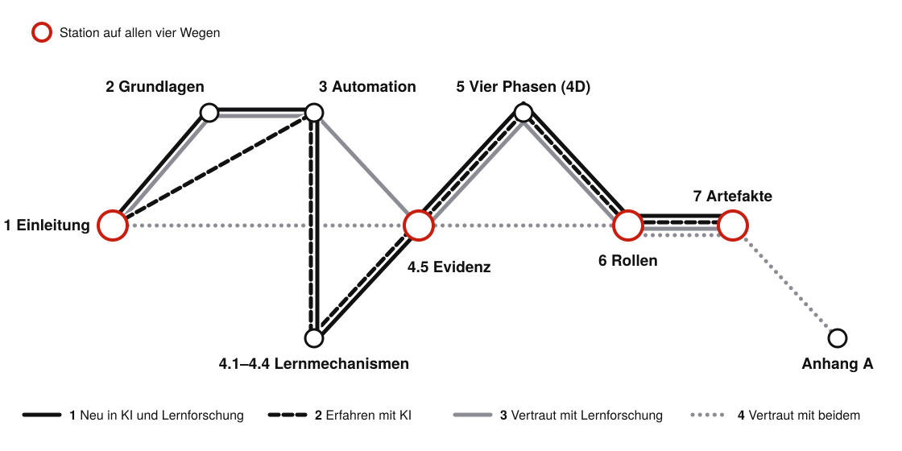

---
aliases:
  - vorwort.html
---

# Vorwort {.unnumbered #sec-vorwort}

::: {.content-visible when-format="html"}
::: {.callout-important title="Im November 2026 wird dieses Skript stark überarbeitet"}
Im November 2026 baue ich das Skript grundlegend um. Abschnitte wandern, werden gekürzt oder fallen weg, und einzelne Seiten können für einige Tage unfertig wirken. Die bisherigen Anhänge zu Einschränkungen in Prompts, zu Rollenspielen sowie zu Arbeitsumgebung und Agenten sind deshalb vom Netz; ihr Inhalt geht gekürzt in die Kapitel ein. Die Praxis-Primer stehen wieder in Anhang C. Die nächste stabile, vollständig erneuerte Fassung erscheint **Ende November 2026**.
:::
:::

Dieses Buch ist aus einem Skript gewachsen. Als die ersten Kolleginnen und Kollegen mich fragten, wie man die neuen Sprachmodelle (*Large Language Models*) sinnvoll in der Lehre einsetzt, schrieb ich meine Notizen aus dem eigenen Unterricht in Supply Management und Projektmanagement am Campus Gummersbach der TH Köln zusammen. Aus den Notizen machte ich einen Workshop, aus dem Workshop eine Reihe von Kursen, die ich im Netzwerk für hochschuldidaktische Weiterbildung (hdw nrw) an Hochschulen in ganz Nordrhein-Westfalen gebe, und auf jede neue Frage der Teilnehmenden antwortete ich mit einem neuen Abschnitt. An der TH Köln diskutiere ich seit 2026 mit Kolleginnen und Kollegen in der Taskforce GenAI in der Lehre, was in Lehre und Prüfung funktioniert und was nicht.

<!-- Abschnitt „Neue Möglichkeiten durch KI“ mit Galerie der neun reizvollsten Praxisbeispiele (Claude, 02.11.2026, Auftrag Roman; seit 13.11.2026 neun statt zehn). Reihenfolge der Galerie: ungewöhnlich, interaktiv, schön. Alle Beispiele: praxisbeispiele.qmd (erzeugt von scripts/praxisbeispiele.py, nur online). -->

::: {.content-visible when-format="html"}
## Neue Möglichkeiten durch KI – Interaktionen und vieles mehr {#sec-neue-moeglichkeiten .unnumbered}

Vieles, was für eine einzelne Lehrveranstaltung früher zu aufwendig war, baue ich heute mit einem Sprachmodell in wenigen Stunden. In den Kapiteln dieses Buchs stecken deshalb 29 Beispiele, die Sie ansehen, hören und ausprobieren, statt nur über sie zu lesen: ein Film, der das nächste Token eines Sprachmodells in neun Genres erklärt und vor der Auflösung auf Ihre Vorhersage wartet, ein Lernsong über Prognoseverfahren, ein Duell gegen einen KI-Detektor, Rechner, Widgets und Animationen, in denen sich vor dem Engpass die Arbeit staut. Jedes steht an der Stelle im Buch, deren Lernziel es dient, und jedes habe ich auf Zahlen und Quellen geprüft. Die Galerie zeigt eine Auswahl, die am meisten überrascht; alle Beispiele, auch die, die nur online stehen, sammelt die Seite [Praxisbeispiele im Überblick](praxisbeispiele.qmd).

```{=html}
<iframe loading="lazy" id="galerie-vorwort" src="interactions/galerie-vorwort.html" width="100%" height="1000px" frameborder="0" title="Galerie: Neun Praxisbeispiele, die mit generativer KI entstanden sind"></iframe>
<script>
/* Die Galerie meldet ihre Höhe; so entsteht kein Scrollbalken im Rahmen. */
window.addEventListener("message", function (e) {
  var d = e.data; if (!d || d.typ !== "galerie-hoehe" || d.id !== "galerie-vorwort") return;
  var f = document.getElementById(d.id); if (f && d.h > 200) f.style.height = d.h + "px";
});
</script>
```
:::

<!-- Lernpfade (Claude, 01.11.2026; am 01.11. auf Wunsch Roman aus Kapitel 1 ins Vorwort verschoben) nach Entscheidung Roman: Option b, U-Bahn-Plan als Buchlandkarte, Selbsttest. Karte und Widget werden aus scripts/lernpfade/ erzeugt. -->

## Wählen Sie Ihren Lernpfad {#sec-lernpfade .unnumbered}

::: {.content-visible when-format="html"}
Sie brauchen nicht jede Etappe dieses Buchs. Lehrende bringen zwei Arten von Vorwissen mit, die wenig miteinander zu tun haben: Erfahrung mit KI-Werkzeugen und Kenntnis der Lernforschung, also das Wissen, was beim Lernen wirkt, wie man es in einer Lehrveranstaltung umsetzt und welche Formen des KI-Einsatzes sich bewährt haben. Lehrerfahrung ersetzt diese Kenntnis nicht. Morehead und Kollegen befragten Hochschullehrende und Studierende zu wirksamen Lernstrategien; die Lehrenden wussten nur wenig mehr als ihre Studierenden und teilten deren verbreitete Fehlannahmen [@morehead2016]. Denken Sie an zwei Leser dieses Buchs: einen Informatiker, der täglich mit Agenten (eigenständig handelnden KI-Systemen) arbeitet, und eine Kollegin, die die Befunde zu Abrufübungen kennt und noch nie einen Agenten eingerichtet hat. Er braucht die Kapitel zur Lernforschung, sie die Grundbegriffe der KI, und keiner von beiden gewinnt etwas, wenn er Bekanntes noch einmal liest. Kalyuga und Kollegen haben Studien zusammengetragen, in denen Erklärungen, die Neulingen halfen, Erfahrene beim Lernen behinderten, weil sie Bekanntes ein zweites Mal verarbeiten mussten; sie nennen das den Expertise-Umkehreffekt (*expertise reversal effect*) [@kalyuga2003]. @fig-lernpfade zeigt die vier Kombinationen der beiden Arten von Vorwissen als Liniennetz, und ein Selbsttest führt Sie zu Ihrer Linie.

::: {#fig-lernpfade}
```{=html}
<iframe loading="lazy" id="lernpfade" src="interactions/lernpfade.html" width="100%" height="1000px" frameborder="0" title="Selbsttest und Liniennetz: Wählen Sie Ihren Lernpfad"></iframe>
<script>
/* Das Lernpfad-Widget meldet seine Höhe; so entsteht kein Scrollbalken im Rahmen. */
window.addEventListener("message", function (e) {
  var d = e.data; if (!d || d.typ !== "galerie-hoehe") return;
  var f = document.getElementById(d.id); if (f && d.h > 200) f.style.height = d.h + "px";
});
</script>
```

Lernpfade durch das Buch. Nach den sechs Antworten tritt die passende Linie hervor; jede Station führt zum Kapitel. Eigene Darstellung.
:::

Eine fünfte Linie steht neben dem Selbsttest, weil sie kein Vorwissen voraussetzt. **Linie 5 · Erst schauen** führt nicht durch die Kapitel, sondern an allen Praxisbeispielen entlang, von den Filmen über die Spiele bis zu den Rechnern. Unter jedem Beispiel führt ein Link in das Kapitel, das es erklärt; so kehren Sie dort ins Buch zurück, wo ein Beispiel Sie neugierig gemacht hat. Die Linie beginnt auf der Seite [Praxisbeispiele im Überblick](praxisbeispiele.qmd).
:::

::: {.content-visible unless-format="html"}
Sie brauchen nicht jede Etappe dieses Buchs. Wer täglich mit Agenten arbeitet, braucht vor allem die Kapitel zur Lernforschung, wer die Lernforschung kennt, vor allem die Grundbegriffe der KI; Erklärungen, die Neulingen helfen, behindern Erfahrene sogar beim Lernen [@kalyuga2003]. @fig-lernpfade zeigt vier Linien durch das Buch. Zu Ihrer Linie führt online ein Selbsttest mit sechs Fragen: QR-Code scannen oder <https://th-koln-bartnik.github.io/genai4teaching/#sec-lernpfade> aufrufen.

{#fig-lernpfade width="100%" fig-pos="htbp"}

{width="18%"}
:::

<!-- Abschnitt „Wie dieses Buch lehrt“ (Claude, 02.11.2026, Fassung 4: ganzes Vorwort in Ich-Stimme nach Classic Prose neu geschrieben, Fachbegriff fett als Subjekt; Fassung 3: Fachbegriff mit Beispiel im Fließtext, für Erstlesende beschrieben, Advance Organizer ergänzt; Fassung 2: gruppiert nach Lernzielen, je Mechanismus eine kanonische Quelle;
Grundlage claude/didaktik/UEBERSICHT-didaktische-mechanismen-2026-11-02.md).
Einstiegsszene und Einschätzungen seit 02.11.2026 in Kap. 1–6 umgesetzt. Zielzustand, vor Drucklegung prüfen:
Schlüsselbegriffe in jedem Kapitel: erfüllt (02.11.2026, Kästen Kap. 1–6, Wiederkehr-Karten ab Kap. 2).
Nach Merge ergänzen: „Höher oder tiefer“ (Kap. 1), Detektor-Duell (Kap. 5), Genrefilme mit Haltepunkten, Escape Room Kap. 2. -->

## Wie dieses Buch lehrt {#sec-wie-dieses-buch-lehrt .unnumbered}

::: {.content-visible when-format="html"}
Eine gute Regel lautet: Nutze selbst, was du anbietest – im Tech-Jargon sagt man *eat your own dog food*. Dem folgend finden Sie in diesem Buch alle Lernmechanismen, die es vorstellt, auch angewandt wieder. Jede seiner Lernhilfen beruht auf einem Mechanismus, den Kapitel 4 als belegt vorstellt (@sec-lerntechniken), und ich habe sie nach drei Lernzielen geordnet [@anderson2001]: Erinnern, Verstehen, Anwenden.

Am gründlichsten hat die Lernforschung untersucht, was beim **Erinnern** hilft. Die **Abrufübung** (*retrieval practice*) finden Sie in den Lernfragen am Ende jedes Kapitels. Beantworten Sie sie zuerst aus dem Gedächtnis und schlagen Sie erst dann die Lösungshinweise in Anhang B nach (@sec-loesungshinweise), denn wer abruft, behält mehr als wer wiederliest. Das **verteilte Wiederholen** (*spacing*) steckt im Kasten mit den Schlüsselbegriffen, der ebenfalls am Kapitelende steht. Markieren Sie online einen Begriff wie Fähigkeitsüberhang als nicht gewusst, lege ich ihn Ihnen einige Kapitel später wieder vor, und mit diesem Abstand hält er länger als nach gebündeltem Lernen. Den **Vortest** (*pretesting*) machen Sie am Anfang jedes Kapitels. Unter „Bevor Sie weiterlesen“ schätzen Sie Aussagen ein wie „Fast alle Studierenden nutzen KI inzwischen auch für Prüfungsleistungen“, und das Kapitel löst jede an der Stelle auf, die sie beantwortet. Wer sich vorher festlegt, auch falsch, behält die Antwort besser. Die **Melodie als Gedächtnisstütze** schließlich hören Sie im Lernsong zu Prognoseverfahren in Kapitel 7, wo Melodie und Rhythmus dem Wortlaut ein Gerüst geben, an dem Sie ihn wieder abrufen.

Für das **Verstehen** zeige ich Ihnen ein gelöstes Beispiel aus meiner Lehre, bevor ich eine Methode empfehle. **Ausgearbeitete Beispiele** (*worked examples*) finden Sie vor allem in Kapitel 7, etwa den Tutor-Bot für eine BWL-Grundlagenveranstaltung. Prinzip, Empfehlung und Umsetzung stehen dort hintereinander, sodass Ihr Arbeitsgedächtnis nicht zugleich den Lösungsweg und das Prinzip suchen muss. **Fehlvorstellungen widerlegen** (*refutation text*) heißt, eine verbreitete Vorstellung beim Namen zu nennen und mit Gründen zu ersetzen. Im [Streich-Test](kapitel02-grundlagen.qmd#sec-streichtest) zum Prompting in Kapitel 2 entscheiden Sie bei zehn Zeilen eines älteren Prompts, ob Sie sie streichen würden und wie sicher Sie sich sind; die Irrtümer, bei denen Sie sich sicher waren, korrigiert die Auflösung am gründlichsten. **Unterscheiden durch Vermischen** (*interleaving*) üben Sie in den Spielen zu den Schlüsselbegriffen. Zu einem kurzen Fall wählen Sie unter ähnlichen Begriffen den passenden, etwa zwischen Fähigkeitsüberhang und Auslagerung des Denkens, und im direkten Vergleich sehen Sie die Merkmale, die beide trennen. Eine **vorangestellte Ordnungshilfe** (*advance organizer*) zeigt Ihnen das Ganze, bevor die Einzelheiten kommen. Das Liniennetz oben ist eine solche Ordnungshilfe; in Kapitel 1 ordnen die vier Rollen der KI als Hiwi, Copilot, Tutor und Simulator alle folgenden Kapitel. Die **Geschichte als Einstieg** begegnet Ihnen am Anfang jedes Kapitels als kurze Szene aus dem Hochschulalltag, denn Ereignisse, die kausal verknüpft um eine Person kreisen, behält man besser als Sachtext.

Für das **Anwenden** prompten, prüfen und bauen Sie selbst. Zum **Selbst-Erzeugen** (*generative and constructive learning*) lade ich Sie in den Kästen „Ausprobiert“ ein, etwa wenn Sie in Kapitel 6 testen, ob ein Sprachmodell richtig zitiert; wer formuliert, erklärt oder baut, lernt tiefer als wer nur liest. **Scaffolding und Ausblenden** (*fading*) heißt, dass Hilfen Sie stützen, solange Sie sie brauchen, und dann zurücktreten. Wissen Sie schon viel, überspringen Sie auf Ihrem Lernpfad ganze Abschnitte, und die Vertiefung zur Technik in Kapitel 2 habe ich aus demselben Grund als überspringbar gekennzeichnet [@kalyuga2003]. @tbl-mechanismen nennt zu jedem Mechanismus die Wirkweise, die Stellen im Buch und eine kanonische Quelle.
:::

::: {.content-visible unless-format="html"}
Eine gute Regel lautet: Nutze selbst, was du anbietest (*eat your own dog food*). Jede Lernhilfe dieses Buchs beruht auf einem Mechanismus, den Kapitel 4 als belegt vorstellt (@sec-lerntechniken); @tbl-mechanismen ordnet sie nach den Lernzielen Erinnern, Verstehen und Anwenden [@anderson2001]. Den größten Nutzen ziehen Sie, wenn Sie sich bei „Bevor Sie weiterlesen“ festlegen und die Lernfragen aus dem Gedächtnis beantworten, bevor Sie in Anhang B nachsehen (@sec-loesungshinweise).
:::

::: {.table-responsive}
| Mechanismus | Wirkweise | Wo im Buch | Kanonische Quelle |
|:---|:---|:---|:---|
| **Erinnern** | | | |
| Abrufübung mit Rückmeldung (*retrieval practice*) | Abrufen festigt Gelerntes stärker als Wiederlesen | Lernfragen; Schlüsselbegriffe; Lernspiele in Kapitel 2 | @roediger2006 |
| Verteiltes Wiederholen (*spacing*) | Abstand zwingt zum Rekonstruieren und hält länger | Wiederkehr-Karten; Kernaussagen | @cepeda2006 |
| Vortest (*pretesting*) | Raten vor dem Lesen lenkt die Aufmerksamkeit auf die Antwort | „Bevor Sie weiterlesen“; [Streich-Test](kapitel02-grundlagen.qmd#sec-streichtest) | @richland2009 |
| Melodie als Gedächtnisstütze | Melodie und Rhythmus geben dem Wortlaut ein Abrufgerüst | [Lernsong in Kapitel 7](kapitel07-artefakte.qmd#sec-bsp-lernsong-forecast) | @wallace1994 |
| **Verstehen** | | | |
| Ausgearbeitete Beispiele (*worked examples*) | Ein gelöstes Beispiel entlastet das Arbeitsgedächtnis | Kapitel 7; Anwendungsbeispiele in Kapitel 1–6 | @sweller1985 |
| Fehlvorstellungen widerlegen (*refutation text*) | Die alte Vorstellung wird genannt und mit Gründen ersetzt; sicher vertretene Irrtümer werden besonders gründlich korrigiert | [Prompting mit Streich-Test](kapitel02-grundlagen.qmd#sec-streichtest); Auflösungen „nein“ | @tippett2010 |
| Unterscheiden durch Vermischen (*interleaving*) | Im direkten Vergleich treten die trennenden Merkmale hervor | Fall-Zuordnung; [Lernspiel LLM, RAG oder Agent](kapitel02-grundlagen.qmd#sec-patterns-usage) | @kornell2008 |
| Vorangestellte Ordnungshilfe (*advance organizer*) | Ein übergeordneter Rahmen vor den Einzelheiten gibt dem Neuen einen Platz im Vorwissen | [Liniennetz der Lernpfade](#sec-lernpfade); [vier Rollen der KI](kapitel01-einleitung.qmd#sec-kapiteluebersicht) | @ausubel1960 |
| Geschichte als Einstieg | Kausal verknüpfte Ereignisse um eine Person werden besser behalten und verstanden | Szene am Kapitelanfang | @mar2021 |
| **Anwenden** | | | |
| Selbst-Erzeugen (*generative and constructive learning*) | Wer formuliert, erklärt oder baut, lernt tiefer als wer liest | Kästen „Ausprobiert“; eigene Erklärung vor der Musterantwort | @chi2014 |
| Scaffolding und Ausblenden (*fading*) | Hilfen stützen, solange sie nötig sind, und treten mit wachsendem Können zurück | Lernpfade; Lernfragen in drei Stufen; [Vertiefung](kapitel02-grundlagen.qmd#sec-vertiefung) in Kapitel 2 | @wood1976 |

: Didaktische Mechanismen in diesem Buch, geordnet nach Lernzielen und innerhalb jeder Gruppe nach Stärke der Befunde. Eigene Darstellung. {#tbl-mechanismen}
:::

<!-- Bis 02.11.2026 eigene Seite „Übersicht“ (index.qmd) vor dem Vorwort; auf Wunsch Roman zusammengelegt: erst Vorwort, dann Übersicht. Die alte Adresse vorwort.html leitet hierher um (aliases). -->

::: {.content-visible when-format="html"}
## Übersicht {#sec-uebersicht .unnumbered}

Generative künstliche Intelligenz (GenAI) kann Lehrenden aufwendige Vorbereitung abnehmen und Studierenden beim Üben helfen; sie kann ihnen aber auch das Denken abnehmen. In diesem Buch zeige ich Lehrenden, Forschenden und Studierenden, wie sie **KI als Werkzeug der Hochschuldidaktik** so einsetzen, dass das Lernen gewinnt.

Das Buch besteht aus sieben Kapiteln in zwei Teilen und drei Anhängen.

**Teil I: Grundlagen**

1.  Einleitung: KI als Hilfe zum Lehren und Lernen
2.  Grundlagen von KI und LLMs
3.  Prinzipien der Automation von Aufgaben
4.  Lern- und Wirkmechanismen

**Teil II: Anwendungen**

5.  Phasen der Arbeit mit generativer KI (4D)
6.  Rollen der KI: Hiwi, Copilot, Tutor, Simulator
7.  Fallbeispiele aus der Lehre

-   Anhang A: Best-Practice-Sammlung didaktischer Prompts und Aufgabenstellungen
-   Anhang B: Lösungshinweise zu Lernfragen und Übungen
-   Anhang C: Praxis-Primer für Lehrende zu Animationen, Präsentationen, Lernsongs und Lernspielen

Im Druck steht diese Übersicht als Tabelle in Kapitel 1 (@tbl-buchuebersicht).
:::

::: {.content-visible when-format="html"}

## Updates seit der Vorversion vom September 2025 {.unnumbered}

- Erstellung dieser **Online-Version**.
- Mehrere **interaktive Elemente und Lernspiele** wurden in den ersten Kapiteln hinzugefügt.
- **Praxisbeispiele auf einen Blick** (November 2026): Im Vorwort zeigt eine [Galerie](#sec-neue-moeglichkeiten) eine Auswahl der Praxisbeispiele; alle zusammen stehen online auf der Seite „Praxisbeispiele im Überblick“, erreichbar auch als Lernpfad „Linie 5 · Erst schauen“.
- Am Anfang von Kapitel 6 ist ein **Tutor-Bot** verlinkt, den wir in der Lehre erproben.
- Anhang A sammelt **didaktische Prompts und integrierte Aufgabenstellungen** internationaler Hochschulen.
- Die Online-Fassung wird **laufend korrigiert und ergänzt**.
- Eine überarbeitete und erweiterte Fassung erscheint Ende 2026 beim Logos Verlag Berlin als **Open-Access-Lehrbuch** (CC BY-SA); die Online-Version wird parallel aktualisiert.

## Didaktische Kurse {.unnumbered}

- Wer das Thema GenAI in der Lehre anwendungsorientiert vertiefen will, findet hier eine laufend gepflegte **Übersicht der hochschuldidaktischen Kurse,** die ich im Netzwerk hdw anbiete: <https://www.hdw-nrw.de/workshops?referentensuche=Prof.%20Dr.%20Roman%20Bartnik> .
- Der Fokus der Kurse seit 2025 liegt auf der **Anpassung von Prüfungsleistungen und Gruppenarbeiten** an die neuen technischen Möglichkeiten.
- Ein Kurs, der erstmals im Mai 2026 lief, thematisiert auch, wie man mit GenAI solche **interaktiven Skripte erstellt**.

:::
