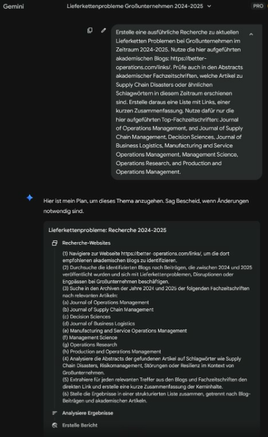
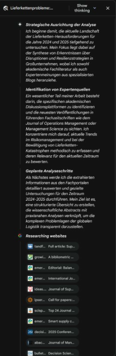
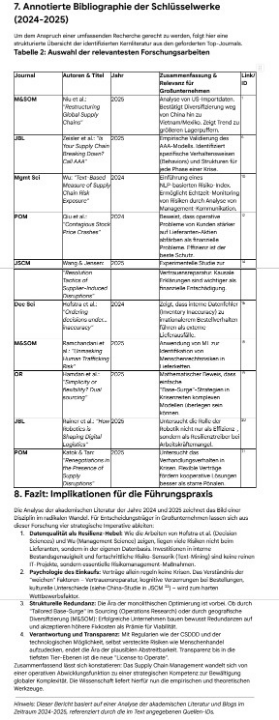
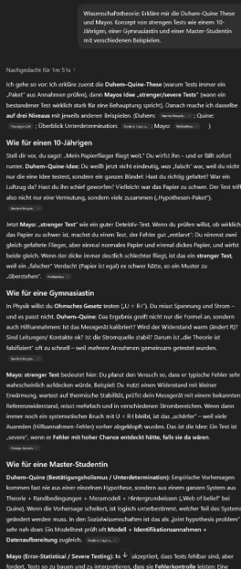
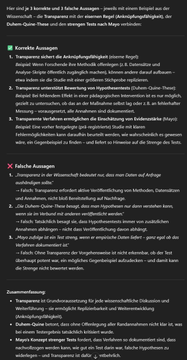
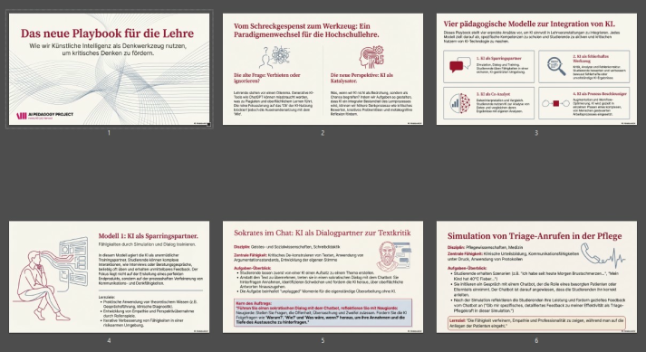
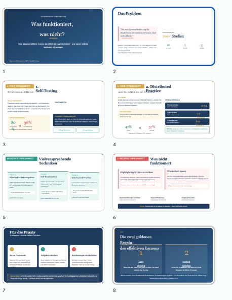

# Einleitung {#sec-einleitung}

::: {.callout-note title="Lernziele"}
Nach diesem Kapitel können Sie …

- die zwei Lehrprobleme benennen, bei denen generative KI helfen kann: begrenzte Zeit für individuelle Förderung und der hohe Aufwand wirksamer Lehrmethoden;
- die drei Ebenen Modell, App und Harness unterscheiden und begründen, warum kostenlose oder automatisch gewählte Modellvarianten für Lehraufgaben oft nicht ausreichen;
- an Beispielen beschreiben, welche Aufgaben in Recherche, Aufgabenerstellung und Forschung Sprachmodelle inzwischen übernehmen und wo Fachwissen zur Prüfung der Ergebnisse unverzichtbar bleibt;
- die Befunde zur Nutzung durch Studierende einordnen und erklären, warum Hochschulen Prüfungsleistungen anpassen und KI-Kompetenz vermitteln müssen;
- das Risiko der kognitiven Entlastung („verkümmernde Muskeln“) mit dem Konzept der erwünschten Schwierigkeiten verbinden.
:::

::: {.callout-note title="Leitfragen"}
*Versuchen Sie eine Antwort, bevor Sie weiterlesen; die Kernaussagen am Kapitelende greifen die Fragen in derselben Reihenfolge auf.*

1. Bei welchen Lehrproblemen hilft generative KI tatsächlich, und wo hilft sie nicht?
2. Warum liefert dasselbe Sprachmodell in zwei verschiedenen Zugängen sehr unterschiedliche Ergebnisse?
3. Wofür nutzen Studierende Sprachmodelle heute, und fühlen sie sich darauf vorbereitet?
4. Was gefährdet das Lernen stärker: das Täuschen in Prüfungen oder das Auslagern des Denkens?
:::

## KI als Hilfe für die Lehre {#sec-ki-hilfe}

**Wie kann uns generative künstliche Intelligenz** (KI) **in der Lehre helfen**? Hoffnung besteht hier für zwei typische Probleme: Erstens haben Studierende **individuelle Bedürfnisse**, aber wir haben nur **begrenzte Zeit**, auf diese einzugehen. Wie können wir Einzelne möglichst intensiv fördern, ohne vor Arbeit unterzugehen? Zweitens ist der **Aufwand gerade für effektive Lehrmethoden** oft sehr hoch, so etwa für häufige niedrigschwellige Tests oder individuelles Feedback zu Studienarbeiten [s. etwa @hattie2023, Kap. 13; @brown2014]. Wer lehrt, fühlt sich aus Zeit- und Stoffdruck oft gezwungen, Abstriche von idealen Lehrsetups zu machen [@henderson2007; @schmidt2005, S. 104–105]. Gerade Lehrmethoden, die didaktisch sinnvoll, aber mit höherem Aufwand verbunden sind, drohen dabei auf der Strecke zu bleiben [s. etwa @dunlosky2013; @roediger2012].

Was mit generativer KI inzwischen möglich ist, zeigt die folgende Galerie an drei Beispielen aus der Lehre: ein Video-Teaser und ein Rechen-Widget zu einem Fall, dazu eine Prozessanimation [@goldratt2014; @little1961]. Blättern Sie mit den Pfeilen; die Erläuterung steht unter jedem Beitrag.

::: {.content-visible when-format="html"}
<iframe src="interactions/galerie-animationen.html" width="100%" height="900px" frameborder="0" title="Galerie: Lernmedien, die mit generativer KI entstanden sind">

</iframe>
:::

::: {.content-visible unless-format="html"}
{#fig-qr-galerie width="32%" fig-align="center"}
:::

**Für die Lehre** erschließen sich durch die großen KI-Sprachmodelle (LLM = Large Language Models) neue Möglichkeiten. Sie sind, wie es eine Analyse des MIT Professors Andrew McAfee auf den Punkt bringt, „**generally faster**“ [@mcafee2024]. Lehrende können mit KI-Unterstützung etwa deutlich schneller eine Recherche durchführen, ein Set von Übungsaufgaben erstellen, mehrere Anwendungsbeispiele pro Konzept hinzufügen, Quizfragen zur schnellen Lernüberprüfung generieren oder mit den Studierenden Rollenspiele durchführen [@meincke2024; @mollick2023a]. Der Berg ist noch da, aber mit dem E-Bike kommt man weiter.

:::: {.callout-note title="Anwendungsbeispiel: Fehlende Lateinkenntnisse versperren den Zugang zu den Quellen"}
**Problem ohne KI.** Wer mittelalterliche Geschichte studiert, braucht Latein und für Handschriften auch Transkriptionsfähigkeit. Nicht alle Studierenden bringen das mit, und Lehrveranstaltungen zum Mittelalter werden häufig gemieden.

**Problem mit KI.** ChatGPT, Transkribus und Google Übersetzer öffnen den Zugang zu den Quellen, machen aber Fehler, die Anfängern ohne Latein kaum auffallen.

**Das Dilemma.** Cristina Andenna und Miriam Weiss (Universität des Saarlandes) haben das Seminar „ChatGPT und Mediävistik“ als Held:innenreise in zwölf Etappen angelegt. Die Studierenden transkribieren, übersetzen und deuten einen Quellentext selbst; die Werkzeuge treten als „Mentoren“ auf, mal hilfreich, mal nicht. Die Schwierigkeit liegt bei den Lehrenden: Bei offensichtlichen Fehlern der KI greifen sie nicht ein, damit die Studierenden den Prozess selbst durchleben. Das kostet Zeit und die Gewissheit, dass am Ende alles stimmt, und es nimmt den Lehrenden keine Arbeit ab: Die Arbeit der Studierenden mit KI muss eng begleitet werden.

**Was das für wirksames Lernen heißt.** *Evaluiert über Selbsteinschätzungen vor und nach der Lehrveranstaltung.* Die Begleitforschung fand signifikante Verbesserungen der digitalen Kompetenzen und der intrinsischen Motivation; gemessen wurde die Einschätzung der Studierenden, nicht ihre Leistung [@wannemacher2025, Case 146]. Das Nicht-Eingreifen erhält eine erwünschte Schwierigkeit [@bjork2011]: Den Fehler der Maschine selbst zu finden, ist die eigentliche Lernaufgabe.

Quelle: @wannemacher2025, Case 146.

::: {.content-visible unless-format="html"}
{width="18%"}
:::
::::

## Was möglich ist: Praktische Beispiele für Recherche, Übungsaufgaben, Erklärungen {#sec-2025-examples}
"KI nutzen" heißt seit der agentischen Wende (s. @sec-weiterentwicklung) nicht mehr nur "chatten mit dem Bot", sondern **Delegation an Agenten** [@mollick2025e]: Man delegiert Aufgaben, die KI nutzt Werkzeuge und arbeitet mehrstufig, prüft also selbstständig Zwischenergebnisse. Praktisch unterschieden wir dabei drei Ebenen: **Modelle** (das Sprachmodell selbst, etwa das Flaggschiff eines großen Labors), **Apps** (die Oberfläche, z.B. die Texteingabe im Browser des Chat-Interfaces) und **Harnesses** („Arbeitsgeschirr“ oder Werkzeugkasten, etwa Web-Recherche, Zugriff auf einen Ordner mit Daten oder die Fähigkeit zum Rechnen mit Programmiersprachen wie Python; ausführlich in @sec-harness). Wichtig für die Lehre: **Wenig Kosten heißt oft auch wenig(er) Nutzen** ("No such thing as a free lunch", hört man die Ökonomen murmeln...[@friedman1975]). Viele Plattformen locken Nutzer in kostenlose Tarife oder per „Auto“-Auswahl in **schwächere Modellvarianten**, denen dann das iterative Vorgehen fehlt (*reasoning*), oft ohne oder nur mit sehr begrenztem Harness-Werkzeugkasten. Das wirkt zunächst „gut genug“, erhöht aber das Risiko von Fehlern, veralteten Informationen und oberflächlichem Denken. Für die Lehre heißt das: Wer GenAI als Lehrassistenz nutzen will, sollte **bewusst eine starke Modellvariante** und einen passenden Harness wählen – und Ergebnisse grundsätzlich didaktisch gegenprüfen.

**Drei Beispiele zeigen, was mit schlauen Modellen und gut gefülltem Werkzeugkasten möglich ist** (die Beispiele stammen aus dem Winter 2025/26). Erstens die Recherche: Wir suchen neue Fallstudien zu Lieferkettenproblemen. Als Recherche-Hiwi durchsucht das Sprachmodell akademische Blogs und Fachzeitschriften, legt dafür zunächst einen Suchplan an, arbeitet ihn in mehreren Schritten ab und zeigt dabei seinen „Denkprozess“; nach etwa fünf Minuten liegt ein erster Bericht von 13 Seiten vor (@fig-ergebnis-bericht zeigt den Auszug mit der tabellarischen Zusammenfassung der Forschungsartikel).

::: {.content-visible when-format="html"}
{#fig-deep-research-plan fig-align="center"}

{#fig-denkprozess fig-align="center"}
:::

{#fig-ergebnis-bericht fig-align="center"}

Zweitens Erklärungen und Tests: Wir bitten das Chat-Interface, zwei Konzepte aus der Wissenschaftstheorie einfach und mit Beispielen zu erklären, die Duhem-Quine-These (warum Wissenschaft nur graduell, mosaikbauend zu Erkenntnissen kommt) und Mayos „strenge Tests“ (severe testing, nach denen sich wissenschaftliche Aussagen graduell auf ihre Belastbarkeit bewerten lassen), und anschließend Multiple-Choice-Fragen dazu vorzuschlagen. Beides liefert das Modell in brauchbarer Qualität; die fachliche Prüfung bleibt bei uns.

::: {.content-visible when-format="html"}
{#fig-konzepte fig-align="center"}

{#fig-testfragen fig-align="center"}
:::

Drittens Folien: Starke Sprachmodelle generieren **professionelle Präsentationen in Minuten.** Seit Ende 2025 setzen Bildmodelle auch Text in Bildern korrekt und damit komplexe Infografiken [@willison2025a]; das Sprachmodell *Claude* bringt eine Anleitung („Skill“) von 3.500 Wörtern mit, die ihm Schritt für Schritt erklärt, wie es eine PowerPoint-Präsentation erstellt und prüft [@anthropic2025a]. Wir bitten zwei Systeme, aus Überblicksartikeln Folien zu bauen: zur Frage, welche Lerntechniken für Studierende besonders gut funktionieren (s. @sec-grundbegriffe), und zur Frage, wie sich Aufgabenstellungen mit intensiver GenAI-Nutzung verbinden lassen (s. @sec-prompts). Nach wenigen Minuten liegen 15 beziehungsweise 8 Folien vor, grafisch ansprechend und mit kleineren Formatierungsfehlern wie falschen Zeilenumbrüchen (@fig-folien-claude).

::: {.content-visible when-format="html"}
{#fig-folien-notebooklm fig-align="center"}
:::

{#fig-folien-claude fig-align="center"}

Der Rest des Buches zeigt, wo solche Hilfen in der Lehre sinnvoll sind und wo sie das Lernen gefährden.

## Nutzung von GenAI in der Forschung {#sec-forschung}

**Immer mehr typische Forschungstätigkeiten** – ein zentraler Ausbildungsinhalt der Hochschulen – **übernimmt die KI**, und zwar auf hohem Niveau. Ein Überblicksartikel von Anton Korinek im Journal of Economic Literature vom Dezember 2024 fasst die deutlich höhere Qualität des Outputs zusammen: „die derzeitige Generation von LLMs ist in hohem Maße in der Lage, die wichtigsten Erkenntnisse von Forschungsarbeiten zu verarbeiten" [@korinek2024, S. 3, Übersetzung RB mit DeepL]. Wie das aussieht, zeigt eine interaktive Visualisierung von über 6000 Konferenzbeiträgen, die ein Sprachmodell jeweils zusammengefasst und in einfacher Sprache erklärt hat („explain it like I'm 5“) [@alammara]: <https://jalammar.github.io/assets/neurips_2025.html>.

**Wie kann GenAI uns bei der Forschung direkt unterstützen?** Google demonstrierte 2025 ein mehrstufiges Modell für die Pharma-Forschung (*'AI co-scientist'*), das den Forschenden zeitintensive Zwischenschritte abnimmt [@gottweis2025] (s. @fig-coscientist). Auch im Peer-Review werden zunehmend Sprachmodelle eingesetzt – mit allen Vor- und Nachteilen, die das mit sich bringt [@naddaf2025].

![Google's Co-Scientist Ansatz an einem Beispiel aus der Pharmaforschung [@gottweis2025].](images/co-scientist-design.jpg){#fig-coscientist fig-align="center"}

In Fallstudien, die OpenAI im November 2025 veröffentlicht hat (also keine neutrale Quelle), nennen Forschende als Mehrwert vor allem eine **außerordentliche Zeitersparnis bei Routinetätigkeiten**, speziell bei Verfahren und Wissensquellen, die sie bewerten können, deren Aneignung ohne Sprachmodell aber deutlich länger dauern würde [@bubeck2025]. Dieselben Berichte zeigen **klare Warnsignale**: Auch starke Sprachmodelle vertreten falsche Ergebnisse überzeugend, und **erst eigenes Fachwissen *und* Erfahrung im kritischen Umgang mit dem Tool erzeugen den Mehrwert** – man muss das Terrain kennen *und* lernen, den Sportwagen Sprachmodell zu fahren.

Die Galerie zu Beginn dieses Kapitels zeigt, was dabei herauskommen kann, wenn Lehrende solche Modelle nicht nur zum Schreiben, sondern zum Bauen von Lernwerkzeugen einsetzen.

**Wie ein Laie im Cockpit eines Verkehrsflugzeugs** können Lehrende oft schwer entscheiden, welche der neuen Möglichkeiten der eigenen Lehre nützen. Virtuelle Realität, Blockchain, Roboter, Internet der Dinge: Vieles wurde schon ins Rampenlicht gestellt und wieder vergessen [@allen2024]. Eine Grundskepsis, ob ein neuer technischer Zugang didaktischen Nutzen bringt, ist daher Selbstschutz [für eine wirkungsbasierte Übersicht von Technologien s. etwa @hattie2023, Kap.14]. Zugleich stehen Lehrende in einer paradoxen Spannung zwischen ihren Identitäten als Experten und als Innovatoren [@fischer2024]: Ausgestrahlte Kompetenz gehört zu ihrem Wertversprechen und lädt zur Abwehr ungewohnter Technologien ein; andererseits sollen sie zu Neugier anleiten und den Umgang mit Technologien erleichtern, die auch ihnen selbst neu sind.

## Weiterentwicklungen der Sprachmodelle: Reasoning und Agenten {#sec-weiterentwicklung}

Seit 2025 „denken“ die großen Sprachmodelle besser „nach“ – sogenannte „Reasoning“-Modelle sind breit verfügbar. Aus didaktischer Sicht ist das auch deshalb interessant, weil man Lernenden damit Denkstrategien vorführen kann, speziell Hypothesenbildung und Prüfung (etwa [@brown2014], S. 90–94, "generative learning", oder die Studien von Willemain zur Modellierung von Problemen durch Experten [@willemain1994; @willemain1995]). Die Modelle gehen schrittweise vor und prüfen ihre eigenen Antworten, bevor sie ein Ergebnis anbieten – Prüfschritte, die man zuvor durch komplexe Prompts induzieren musste; warum diese zusätzliche „Denkzeit“ die Ergebnisse verbessert, zeigt @sec-capabilities. In der Konsequenz werden die Sprachbots immer selbstständiger; für diese Wende Ende 2025 hat sich der Begriff **„Agentic Turn“** eingebürgert [@willison2025; @steinberger2025; @mollick2025]: Als Nutzer solcher Reasoning Modelle verbringen wir weniger Zeit damit, über die ‚Zaubersprüche‘ einzelner Prompts nachzudenken und mehr Zeit in ‚Mitarbeitergesprächen‘ – Anleitung und Kritik der digitalen „Agenten“ – Sprachmodelle, die selbstständig und auf hohem Niveau mehrere Arbeitsschritte durchführen. Insgesamt steigt seit 2023 die Qualität der Aufgaben, die Sprachmodelle erledigen können, rasant. Empirische Untersuchungen zeigen, dass die Sprachmodelle immer längere Aufgaben auf hohem Niveau erledigen können [@kwa2025].

Die neuen Modelle sind außerdem günstiger und effizienter geworden: die Kosten pro Interaktion sind stark gesunken. Für Antworten auf naturwissenschaftliche Fragen auf Promotionsniveau fielen die niedrigsten Kosten zwischen Januar 2025 und Juli 2026 um den Faktor 725 [@emberson2026]; Daten und Rechenbeispiel stehen in @sec-capabilities. Die Modelle halluzinieren (weiterhin, also Vorsicht, aber) deutlich seltener als ihre Vorgänger: OpenAI gibt für seine 2025er Generation ca. 1 % Halluzinationen der Antworten statt ca. 5 % bei den Vorgängermodellen an, je nach Komplexität der Frage und erlaubter „Bedenkzeit“ [@openai2025b].

Weiterhin hat sich die **Internetsuche mit LLMs deutlich verbessert**. Während man früher noch oft über sinnlose oder erfundene Ergebnisse lachte, stellt die Suche über die großen Chat-Interfaces oder spezielle Suchanbieter wie Perplexity eine große Zeitersparnis dar: „a useful tool to provide up-to-date answers to questions that are grounded in facts found on the internet, together with the requisite citations—a crucial capability for researchers“ [@korinek2024, S. 3]. Das gilt zunehmend für die stärksten allgemeinen Modelle und erst recht für Anbieter, die auf Forschungsrecherche (und Studierende) spezialisiert sind, wie Elicit oder Paperpal. Auch breite Internet-Recherchen und Textproduktionen sind zunehmend komplett delegierbar („deep research“), mit deutlichen Auswirkungen auf den Arbeitsprozess in der Wissensarbeit (s. etwa @schwarcz2025 für juristische Recherchen, @korinek2024 für Ökonomie und @liang2025 für PR-Tätigkeiten).

**Auch komplexe Texte können die Sprachmodelle erstellen, prüfen und verbessern**, etwa mit vorgefertigten **„Skills“**: detaillierten Ablaufbeschreibungen, die man dem Modell modular mitgibt [@openai2025a; @anthropic2025a]. Aufbau und Beispiele zeigt @sec-agenten-praxis.

## Wie nutzen Studierende und Lehrende GenAI? {#sec-nutzung}

**Für Studierende sind GenAI Chatbots zum Standard für Informationssuche und Schreibaufgaben geworden**: So berichten 92 % der befragten britischen Vollzeitstudierenden (n=1.041, Erhebung im Dezember 2024), dass sie KI-Tools wie ChatGPT regelmäßig verwenden, und 88 % geben an, solche Tools für Prüfungsleistungen („for assessments“) zu nutzen [@freeman2025]. Deutsche Daten des CHE-Centrum für Hochschulentwicklung bestätigen dies: Im Wintersemester 2025/26 nutzten 81 Prozent von 28.584 befragten Studierenden an 202 Hochschulen KI-Werkzeuge mindestens wöchentlich, und jede zweite Person nutzte sie „als Tutor bzw. Lernpartner“, mit großen Fachunterschieden zwischen Wirtschaftsinformatik (72 Prozent) und Jura (19 Prozent) [@horstmann2026check].

**Wofür genau nutzen Studierende GenAI?** Studierende berichten, dass sie sich am häufigsten Konzepte erklären lassen, Artikel zusammenfassen oder Ideen für Schreib- und Forschungsprojekte sammeln [@freeman2025]. Nutzungsstudien zeigen sogar noch stärkeren Einsatz speziell für Schreibprojekte (s. @fig-llm-nutzung): Wie eine Auswertung von 1 Million anonymisierten Chats zwischen Usern mit Universitätskonto und dem Sprachmodell zeigt, verwenden Studierende die KI-Bots vor allem zum **Erstellen neuer Inhalte und das Analysieren komplexer Themen**, was höheren Ebenen der Bloomschen Taxonomie entspricht (s. @fig-llm-nutzung-bloom). Ein Großteil der befragten britischen Studierenden gibt an, Prüfungsleistungen durch GenAI zu unterstützen. Dieser Anteil sprang zwischen den Erhebungszeiträumen Ende 2023 und 2024 von der Hälfte auf fast 90 % [53 % auf 88 %, @freeman2025].

![Wofür Studierende LLMs nutzen [@handa2025].](images/script01-01.svg){#fig-llm-nutzung fig-align="center"}

**Hochschulen müssen insofern sicherstellen, dass Prüfungsleistungen nicht entwertet und Studierende die produktive Nutzung solcher Tools erlernen**. Studierende dürfen einerseits wesentliche kognitive Aufgaben nicht vollständig an GenAI delegieren: Aufgaben und Prüfungsleistungen müssen angepasst werden. Weiterhin entsteht ein **neuer Bedarf an Kompetenzschulung**, den Studierende wie Unternehmen äußern: der produktive Umgang mit den neuen GenAI Tools muss eingeübt werden. **Deutsche Studierende fühlen sich hierauf nicht gut vorbereitet**: In der CHE-Befragung vom Wintersemester 2024/25 bewerteten sie das bestehende Angebot zum Erwerb von KI-Kompetenzen mit nur 2,7 von 5 Sternen [@che2025ki].

![Schwerpunkte der Nutzung von LLMs (Claude) durch Studierende nach der Bloom'schen Taxonomie [@handa2025].](images/script01-02.svg){#fig-llm-nutzung-bloom}

Die zunehmende Verwendung von KI in der Lehre hat gute Gründe. Wie oft eine neue Technologie genutzt wird, hängt nach dem **Technology Acceptance Model** (TAM, s. @fig-tam) von der **wahrgenommenen Benutzerfreundlichkeit** (perceived ease of use) und der **wahrgenommenen Nützlichkeit** (perceived usefulness) ab [@marangunic2015b]. Generative KI wie ChatGPT decken sichtlich beide Aspekte ab: Sie sind einfach zu nutzen [@kestin2025; @lee2025; @monib2025; @naddaf2025] und erzeugen einen deutlichen Mehrwert, wie Studierende und Lehrende in einer Vielzahl von Umfragen der letzten zwei Jahren berichten [@heidt2025; @morgan2024; @ou2024]. Lehrende ziehen nach: Meta-Untersuchungen zeigen ein extremes Wachstum an Publikationen zur Nutzung von LLM im Hochschulalltag [@ma2025; @ogunleye2024].

{#fig-tam fig-align="center"}

**Auch außerhalb der Hochschule steigt die Nutzung**. Eine Reihe von Studien zeigen **erhöhte Produktivität von Büroarbeitenden mit LLM-Unterstützung**: der Kundensupport arbeitet 15 % schneller, wenn das Sprachmodell Antwortoptionen vorschlägt und Verweise auf interne technische Dokumentation anbietet [@brynjolfsson2025], Programmierer programmieren schneller [@peng2023], Consultants sind produktiver bei komplexen Beratungsprojekten [@dellacqua2023] und Sprachmodelle wie ChatGPT können eine Vielzahl kleiner Aufgaben beschleunigen [@handa2025] und werden insofern speziell zur Texterstellung millionenfach als Hilfsmittel im Beruf genutzt: Von Kundenbewertungen über Pressemitteilungen und Stellenanzeigen [@liang2025].

Schauen wir auf die Abnehmer unserer Graduierten: **Wie nutzen die Unternehmen solche Sprachmodelle?** Eine Studie vom Dezember 2025 zur Nutzung von GenAI in Unternehmen stellt ein extremes Wachstum fest sowie einen deutlichen Unterschied in der Nutzung von erfahrenen und weniger routinierten Usern [@chatterji2025a]. Der OpenAI-Report zeigt, dass die Nutzung von Sprachmodellen in Unternehmen 2025 deutlich *breiter und tiefer* wird: ChatGPT-Enterprise-Nachrichten stiegen im Jahresvergleich etwa um das Achtfache, gleichzeitig wachsen wiederholbare Arbeitsabläufe stark (Nutzung von Projects/Custom GPTs \~19-fach seit Jahresbeginn; rund 20 % der Enterprise-Nachrichten laufen bereits über solche strukturierten Workflows). Gleichzeitig bleibt bei fortgeschritteneren Funktionen noch viel ungenutztes Potenzial. Vor allem der Mehrwert von Funktionen wie *Deep Research* (Delegation ausführlicher Recherchen), *Reasoning* (schrittweises, sorgfältiges Antworten mit deutlich höherer Qualität) und *Datenanalyse* mit Coding Tools wie Codex werden von Praktikern mit Firmen-Lizenz noch sehr selten genutzt. Selbst unter monatlich aktiven Enterprise-Nutzern haben 19 % noch nie Datenanalyse, 14 % noch nie Reasoning und 12 % noch nie (Deep) Search genutzt (bei täglich Aktiven sinkt das auf 3 %, 1 % und 1 %).

## Risiken und Nebenwirkungen {#sec-risiken}

Die Metapher mit dem E-Bike trägt allerdings auch, was die **Risiken und Nebenwirkungen** angeht: Ab wann lässt die maschinelle Unterstützung wichtige Muskeln verkümmern? Solche Gefahren bestehen – wie empirische Studien zeigen, erfordern die neuen Workflows der Wissensarbeit durch KI-Unterstützung auch neue Formen der kritischen Auseinandersetzung mit den Inhalten.

**Wird der Umgang mit GenAI nicht geübt, droht ein Rückgang des kritischen Denkens.** Eine Studie von 319 Wissensarbeitern zeigt, dass sich das **Gewicht zwischen den Einzelaufgaben der Wissensarbeit mit LLMs verschiebt**: Der Aufwand für die Recherchen selbst sinkt, es steigt andererseits der Aufwand für Management-ähnliche Aufgaben: Koordination der Einzelaufgaben für Mensch und Maschine, kritische Prüfung der berichteten Ergebnisse und die Integration von Ergebnissen in den Gesamtprozess (etwa zur Erstellung eines Gesamtberichtes, einer Test-Spezifikation oder eines Protokolls) [@lee2025].

Im Gegensatz zur einfachen Faktensuche im Internet werden hier nicht nur ein paar dornige Zweige im Aufgabenbündel mechanisch ‚geerntet‘, sondern **gleich das gesamte Bündel fertig verschnürt bereitgestellt.** Schlimmstenfalls droht das, was ein Artikel von @walsh2025 prägnant betitelt: **„Everybody is cheating their way through college“.** Wenn klassische Projektaufgaben quasi auf Knopfdruck erstellt werden können, droht diese Form von Leistung sinnlos zu werden. Mit etwas Lust an Dramatik können wir uns Endzeit-Szenarien vorstellen, in denen **Lehrende klagend durch die Trümmer ihrer schönen Portfolio-Prüfungen stolpern:** Die Homework-Apocalypse [@mollick2023].

**Aber so schlimm muss es nicht werden.** Plausible Ansätze, Lehrformate auf die allgemeine Nutzung von GenAI hin umzugestalten existieren bereits. Unser Ziel dabei muss sein, dass erwünschte Schwierigkeiten nach @bjork2011 beibehalten oder sogar verstärkt werden, auch wenn die meisten Studierenden zu Hause starke Sprachmodelle nutzen können.

Wie kann man also verhindern, dass die Studierenden kritische kognitive Aufgaben allein den KI-Systemen übergeben? Lehre heißt in diesem Kontext auch, empfohlene Arbeitsweisen mit der neuen Technik zu üben. Wie das gehen kann, sehen wir in den folgenden Kapiteln.

:::: {.callout-note title="Anwendungsbeispiel: Die KI schreibt, bevor Studierende selbst etwas herausgefunden haben"}
**Problem ohne KI.** Eine Hausarbeit mit eigener Recherche ist aufwendig: Fragen entwickeln, Gesprächspartner finden, Notizen ordnen, schreiben.

**Problem mit KI.** Ein Sprachmodell liefert den fertigen Essay in Sekunden, auch wenn niemand mit einem Menschen gesprochen hat. Die Studierenden lernen dabei nicht, wo das Werkzeug hilft und wo es nur plausibel klingt.

**Der Lösungsansatz.** Jon Ippolito legt die Aufgabe als „Sandwich“ an. Am Anfang sammelt die KI ungewöhnliche Interviewfragen. In der Mitte befragen die Studierenden zwei bis drei Menschen, die vom Thema betroffen sind oder sich darin auskennen. Am Ende macht die KI aus den Notizen eine Gliederung, einen Entwurf und drei mögliche Schlussfolgerungen; die Studierenden messen sie an ihrer eigenen Feldforschung, überarbeiten den Text und geben ihn mit dem Verlauf ihrer Prompts ab. Eine kurze Reflexion hält fest, wo die KI geholfen und wo sie versagt hat.

**Was das für wirksames Lernen heißt.** *Unterrichtsentwurf, keine Ergebnisse berichtet.* Was die Studierenden selbst erhoben haben, wird zum Maßstab, an dem sie den KI-Text prüfen. Die Aufgabe übt damit genau die Prüf- und Integrationsarbeit, deren Anteil an der Wissensarbeit mit KI wächst [@lee2025].

Ablauf und Prompt: @sec-prompt-ai-sandwich. Quelle: @ippolito2025 (AI Pedagogy Project, metaLAB at Harvard).

::: {.content-visible unless-format="html"}
{width="18%"}
:::
::::

::: {.callout-tip title="Kernaussagen"}
1. Generative KI ist für die Lehre ein Kraftverstärker: Der Berg bleibt, aber mit dem E-Bike kommt man weiter. Sie senkt vor allem den Aufwand für Methoden, die didaktisch wirksam, aber zeitintensiv sind.
2. „KI nutzen“ heißt zunehmend, Aufgaben an Agenten zu delegieren. Ergebnisqualität hängt von der Kombination aus starkem Modell, passender Oberfläche und Werkzeugkasten (Harness) ab; wer am Modell spart, spart meist am Ergebnis.
3. Der Mehrwert entsteht erst durch eigenes Fachwissen und Erfahrung im kritischen Umgang mit dem Werkzeug. Auch starke Modelle vertreten falsche Ergebnisse überzeugend.
4. Studierende nutzen Sprachmodelle längst flächendeckend, besonders für Schreibaufgaben und Prüfungsleistungen, fühlen sich aber auf den produktiven Umgang schlecht vorbereitet.
5. Die Hauptgefahr ist nicht das Täuschen, sondern die Auslagerung des Denkens. Lehre muss erwünschte Schwierigkeiten erhalten, auch wenn zu Hause starke Modelle verfügbar sind.
:::

::: {.callout-note title="Lernfragen"}
**Wiederholen**

1. Bei welchen zwei Lehrproblemen kann generative KI helfen?
2. Warum ist für das Lernen die Auslagerung des Denkens gefährlicher als das Täuschen in Prüfungen, und welches Konzept der Lernforschung beschreibt, was dabei verloren geht?

**Anwenden**

3. Erklären Sie ohne Nachschlagen den Unterschied zwischen Modell, App und Harness an einem Beispiel aus Ihrem Fach. Welche Ebene fehlt den kostenlosen Zugängen Ihrer Hochschule?
4. Welche Lehrmethode haben Sie in den letzten Semestern aus Zeitgründen nicht umgesetzt, obwohl Sie von ihrer Wirkung überzeugt sind? Welchen Teil des Aufwands könnte ein Sprachmodell übernehmen, und welcher Teil muss bei Ihnen bleiben?

**Beurteilen**

5. Bei welcher Aufgabe in Ihrer Lehrveranstaltung würde ein Studierender durch KI-Nutzung am meisten an Lernwirkung verlieren? Woran würden Sie das erkennen?
6. Auch starke Modelle vertreten falsche Ergebnisse überzeugend. Profitieren Studierende mit wenig Vorwissen dann mehr oder weniger von KI als Fortgeschrittene? Begründen Sie Ihre Einschätzung.

Lösungshinweise: @sec-loesungshinweise.
:::

## Kapitelübersicht {#sec-kapiteluebersicht}

Im folgenden Kapitel werden wir zunächst einige Grundbegriffe (@sec-grundbegriffe) klären: Was sind große Sprachmodelle und was ist mit Begriffen wie Token, Prompt und RAG gemeint? Welche Modellklassen und Zugänge können Lehrende nutzen und welche Empfehlungen für Prompts sind belastbar? Dann fragen wir nach Zielen (@sec-didaktik): Welche Art von Wissen und Methoden unterscheidet und empfiehlt die Lernforschung? Welche didaktischen Wirkmechanismen können durch KI genutzt werden, um typische Probleme der Hochschullehre anzugehen? Im Abschnitt 4 schauen wir auf Praxisbeispiele (@sec-szenarien) für vier Anwendungsfelder von Sprachmodellen an Hochschulen: KI als Hiwi (direkte Arbeitserleichterung), KI als Copilot (Unterstützung beim Schreiben und Coden) und KI als Tutor (Feedback und Lernunterstützung) sowie KI als Simulator (Role Play und Goal Play). Kapitel 5 (@sec-umsetzung) behandelt Prüfungen, Richtlinien und den Einbau von KI in einen ganzen Kurs; Kapitel 6 (@sec-fallbeispiele) zeigt Beispiele aus der eigenen Lehre, geordnet nach der Art des Wissens, das Studierende erwerben. Im Appendix finden Sie eine breite Sammlung von didaktischen Prompts und auf GenAI ausgerichteten Aufgabenstellungen von führenden Hochschulen. Dabei erläutern wir zunächst, wie die Prompts aufgebaut sind (@sec-prompts-ueberblick) und zeigen dann eine Liste strukturierter Best-Practice Beispiele (@sec-prompts).
