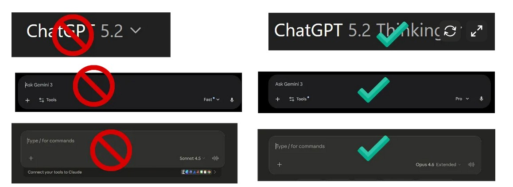
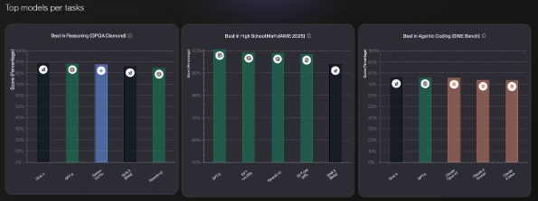
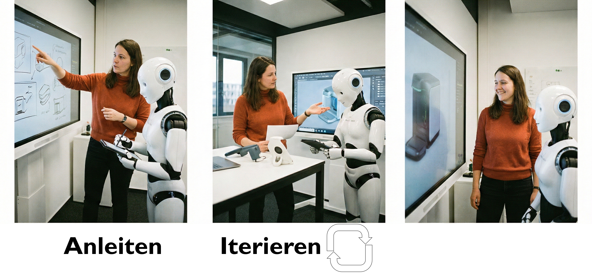

# Grundbegriffe {#sec-grundbegriffe}

<!-- Entwurf (Claude, 17.10.2026) nach notes/schablone-lernziele-kernaussagen.md; Freigabe und Anpassung durch Roman -->
::: {.callout-note title="Lernziele"}
Nach diesem Kapitel können Sie …

- in Laiensprache erklären, wie ein Sprachmodell Text in Tokens zerlegt, als Zahlen verarbeitet und Wort für Wort neuen Text erzeugt;
- die drei Nutzungsmuster LLM, RAG und Agent unterscheiden und für eine Lehraufgabe das passende Muster auswählen;
- beschreiben, warum Sprachmodelle halluzinieren und welche Folgen das für den Einsatz in der Lehre hat;
- die Jagged Frontier erklären und daraus ableiten, warum Sprachmodelle bei ähnlich schwierigen Aufgaben sehr unterschiedlich gut abschneiden;
- die Bausteine eines guten Prompts (Rolle, Aufgabe, Format, Beispiele) anwenden und belegen, welche verbreiteten Prompt-Tricks nichts bringen;
- die Größenordnung des Energieverbrauchs einer Anfrage einordnen und die wichtigsten Argumente der Debatte wiedergeben.
:::

<!-- Entwurf (Claude, 19.10.2026) nach notes/schablone-leitfragen-lernfragen.md; Freigabe durch Roman -->
::: {.callout-note title="Leitfragen"}
*Versuchen Sie eine Antwort, bevor Sie weiterlesen; die Kernaussagen am Kapitelende greifen die Fragen in derselben Reihenfolge auf.*

1. Warum erfinden Sprachmodelle gelegentlich Quellen, und lässt sich das ganz abstellen?
2. Was unterscheidet ein reines Sprachmodell, ein Modell mit eigenem Material (RAG) und einen Agenten?
3. Warum löst ein Modell eine schwierige Aufgabe und scheitert an einer ähnlich schwierigen?
4. Bringt es etwas, ein Modell höflich zu bitten, ihm zu drohen oder ein Trinkgeld anzubieten?
5. Ist der Energieverbrauch einer einzelnen Anfrage ein guter Grund, auf KI in der Lehre zu verzichten?
:::

## Definition einiger Grundbegriffe {#sec-definitionen}

In diesem Abschnitt definieren wir anfangs **sehr kurz einige Grundbegriffe**.
Dies kratzt bewusst nur an der Oberfläche eines komplexen technischen Themas: Unser Fokus liegt auf der didaktischen Nutzung.

Wie in der Einleitung kurz angesprochen, ist es seit der agentischen Wende (s. @sec-weiterentwicklung) in der Arbeit mit GenAI noch wichtiger geworden, einen hochwertigen **Setup** zu haben, also eine Mischung aus einem schlauen Modell, praktischer Oberfläche und sinnvollen Tools [@mollick2025e]. Grobe Regel: Wenn das Ergebnis wichtig ist, nie ein kostenfreies Modell wählen.

{#fig-reasoning-models-better}

Wenn Sie neugierig geworden sind, gibt es jenseits dieses Buches **gute Quellen, um tiefer einzusteigen**: Als visuelle Begleitung empfehle ich das sehr schöne Einführungsvideo des Mathematik-Didaktikers Grant Sanderson (7 Minuten, <https://youtu.be/LPZh9BOjkQs>).
Tiefer in die mathematischen Details geht die grafische und interaktive Einführung als Animation von Brendan Bycroft (<https://bbycroft.net/llm>).
Wer sich auch die technischen Hintergründe genauer erschließen will, dem sei das Lehrbuch-Standardwerk von @jurafsky2025 empfohlen, das online frei verfügbar ist.

**Welche der Fachbegriffe kennen Sie schon?** Von Prompt bis Token, über Temperatur und RAG: Testen Sie sich selbst mit dem folgenden kleinen Spiel.

::: {.callout-tip title="Lernspiel: Welche Grundbegriffe kennen Sie schon?"}
*Ordnen Sie die Begriffe den korrekten Definitionen zu!*

::: {.content-visible when-format="html"}
<iframe src="interactions/llm-game-standalone.html" width="100%" height="700px" frameborder="0">

</iframe>
:::

::: {.content-visible unless-format="html"}
{#fig-qr-grundbegriffe width="32%" fig-align="center"}
:::

(am besten auf dem Computer spielen).
Hier auch Online abrufbar (so etwas nennt sich „Artifact“ beim Sprachmodell „Claude“): <https://claude.site/artifacts/d8e3cee4-ea47-48e3-a84c-a774d408aac8>
:::

Vorweg: **Was heißt hier 'künstliche Intelligenz'?** In diesem Buch folgen wir weitgehend dem alltäglichen Sprachgebrauch, indem wir die Begriffe **KI, generative KI (GenAI) und Sprachmodell (Large Language Model, LLM) weitgehend synonym** verwenden.
Eigentlich ist generative künstliche Intelligenz - wie der Name es schon andeutet - ein Teilgebiet der KI, also des Versuches, menschliches Denken und Verhalten nachzubilden [@russell2021].
Für die meisten Nutzer sind die Feinheiten von KI, maschinellem Lernen und neuronalen Netzen allerdings in unserem Kontext eine **Unterscheidung, die praktisch keinen Unterschied macht**: Die meisten Lehrenden nutzen aktiv erst KI, seit es die modernen Sprachmodelle gibt.
In der Nutzung für die Lehre gilt für fast alle von uns: **KI = GenAI**, auch wenn im Hintergrund schon seit Jahrzehnten mit KI die Routen von Lieferdiensten oder die Lagerhaltung in Supermärkten vorhergesagt wird.

**KI vor 2022 und KI nach 2022 meint meist etwas anderes.** Was oft auch Studierende verwirrt: Ältere Fachartikel vor 2022 mit Titeln wie "KI-Anwendungen in XY" meinen aus Anwendersicht mit 'KI' etwas ganz anderes als die Publikationen seit 2022 zu den verschiedenen Anwendungsformen von menschenähnlich schreibenden, sprechenden und analysierenden Chatbots.
Früher ging es aus Anwendersicht grob gesagt meist um **bessere statistische Prognosemodelle** zur Nutzung durch Expertinnen und Experten (etwa für optimale Routen oder Personalauswahl) [@russell2021].
Seit ChatGPT sprechen wir von **viel breiteren Formen der Nutzung, Milliarden von Usern und extremer KI-Hype.**

Ein **Large Language Model (LLM)** ist ein maschinelles Lernmodell, das darauf trainiert ist, menschliche Sprache zu verstehen und Texte zu erzeugen, die natürlich erscheinen.
Ein **Sprachmodell** ist ein Rechensystem, das das nächste Wort in einer Wortkette vorhersagt, basierend auf den vorher genannten Wörtern in dieser Kette [@jurafsky2025, Kap.7, S.2]. Die Modelle können riesige Mengen von Textdaten verarbeiten, um vielseitige Sprachanwendungen zu ermöglichen.

Die **generative Künstliche Intelligenz** (GenAI) bezieht sich auf Systeme, die fähig sind, neue Inhalte zu erzeugen, wie etwa Texte, die noch nicht existierten.
LLMs sind ein zentraler Teil dieser generativen KI und können eigenständig Texte zu einem breiten Spektrum von Themen generieren.

::: {.callout-tip title="Tipp: Mini-Interaktionen einfach als HTML erstellen"}
Können Sie in HTML programmieren?
Jetzt schon.
Die *Lernspiele in diesem Abschnitt* wurden mit Hilfe von Sprachmodellen erstellt (Gemini, ChatGPT, Claude).
Meist mit einer Variation des einfachen Prompts: **„Erstelle mir ein browser-basiertes Lernspiel zum Thema / zur Illustration von ...“**.
Oft hat man nach 5–10 Minuten eine gute erste Version.
In der Lehre mache ich das oft auch als Übung mit Studierenden.
Sie sollen dann erst mit Hilfe der KI ein Lernspiel erstellen und dann begründet bewerten, welcher Spiel-Prototyp das Konzept am besten darstellt.
Bei etwas mehr Zeit kann man sie gegenseitig bewerten lassen, selbst Kriterien erstellen oder stärkere Gamification hinzufügen.
Im Ergebnis beschäftigen sich idealerweise die Teilnehmer intensiv mit einem theoretischen Konzept (Bei komplexeren Themen hilft es, einen Fachtext als Hintergrund zum Konzept hochzuladen.)
:::

Das **Sprachmodell** zerlegt dazu grob gesagt Inputs wie Texte in kleine Bausteine (Tokens), verwandelt diese in Zahlen (Embeddings), erkennt mithilfe komplexer Muster (Transformer und Attention) deren Zusammenhänge, und erzeugt auf diese Weise selbstständig basierend auf kontextbezogen berechneten Wahrscheinlichkeiten neue Texte (generative Sprachproduktion).

Damit Sprachmodelle wie ChatGPT Sprache verstehen und erzeugen können, zerlegen sie Text in sogenannte **Tokens** – kleine Bausteine wie Wörter, Wortteile oder Satzzeichen [s. etwa @jurafsky2025, Kapitel 2].
Jedes dieser Tokens wird in einen **Vektor** umgewandelt – eine Zahlenreihe, die das Wort mathematisch beschreibt.
Dieser Vorgang nennt sich **Embedding**.
Dabei wird darauf geachtet, dass ähnliche Wörter ähnliche Vektoren erhalten, beispielsweise „Hund“ und „Katze“.

Hier kann man das selbst einfach ausprobieren: Das interaktive Widget simuliert eine GPT-2-ähnliche Tokenisierung.

::: {.callout-tip title="Geben Sie eigenen Text ein, unten wird er dann in Tokens und Zahlen umgewandelt"}
::: {.content-visible when-format="html"}
<iframe src="interactions/tokenizer-explorer.html" width="100%" height="700px" frameborder="0">

</iframe>
:::

::: {.content-visible unless-format="html"}
{#fig-qr-tokenizer width="32%" fig-align="center"}
:::
:::

Die Simulation vermittelt ein Gefühl für den Prozess.
Wie die Umwandlung eines bestimmten Textes genau in verschiedenen Sprachmodellen aussieht, können Sie interaktiv auf Webseiten wie Tiktokenizer ausprobieren: <https://tiktokenizer.vercel.app/>.

Ein **Prompt** ist eine Eingabeaufforderung, die an ein LLM gesendet wird, um eine spezifische Antwort zu erhalten.
Wie der Prompt formuliert wird, kann entscheidend für die Qualität der generierten Antworten sein.
Die Kunst, solche Befehle zu schmieden nennt sich **Prompt Engineering** [@berryman2025].

Eine neuere Analyse unterscheidet **drei Effekte** der Prompt-Gestaltung [@vallverdu2025]: User steuern über Prompts den Inhalt der Aufgabe (**operativ**), die 'Aufmerksamkeit' des Sprachmodells (**epistemisch**) und die Risiken des Ergebnisses (**sozio-ethisch**).
Stärkere Sprachmodelle übernehmen einen Teil dieser Steuerung, die Komplexität rückt aber damit nur auf eine höhere Ebene: In agentischen Workflows arbeiten mehrere Agenten zusammen, für deren Steuerung wir wiederum operative, epistemische und sozio-ethische Effekte berücksichtigen müssen [s. etwa @gottweis2025 für ein Beispiel].

### Was heißt hier GPT? {#sec-gpt-bedeutung}

GPT steht für **Generative Pre-trained Transformer**.
Wir schauen zunächst, was diese drei Begriffe bedeuten.

*'Generative'*: Der Begriff „**generativ**“ bedeutet in diesem Zusammenhang, dass GPT eigenständig Texte erzeugt, indem es gelernte Muster neu kombiniert.

*'Pretrained'*: GPT wurde mit riesigen Textmengen **vortrainiert** (**Pretraining**), ohne konkrete Aufgaben lösen zu müssen – dieser Vorgang erfolgt unüberwacht (*unsupervised learning*).
Beim 'Bau' solcher Sprachmodelle bewerten menschliche Expertinnen und Experten den ersten Output (**„Reinforcement Learning with Human Feedback“ (RLHF)**), um so ein genaueres Modell dafür zu erstellen, was für User nützlich ist und was nicht.
Dabei erzeugt das LLM zunächst verschiedene Textversionen, die von menschlichen Bewertern beurteilt werden.Durch diesen Prozess „lernt“ das LLM, Texte zu bevorzugen, die nicht nur sprachlich richtig, sondern für Menschen besonders verständlich und nützlich sind.
Das macht es möglich, dass GPT später aus wenigen Stichworten neue Texte generieren kann – also kreativ Sprache produziert, ohne bloß zu kopieren (generativ).

*'Transformer'*: Das Herzstück des GPT ist der sogenannte **Transformer** – ein Rechenmodell, das durch ein spezielles Aufmerksamkeitsverfahren (**Attention**) erkennt, welche Wörter im Zusammenhang wichtig sind.
Dadurch kann GPT die Bedeutung von Wörtern im Kontext richtig einschätzen.
Im Transformer bedeutet **„Attention“**: Jedes Wort (genauer: jedes Token) entscheidet dynamisch, auf welche anderen Tokens es beim Verstehen oder Generieren am stärksten „hören“ sollte.
Technisch ist das eine gewichtete Mischung von Informationen: Das Modell bildet eine Art Relevanzscore zwischen einem „aktuellen Interesse“ und möglichen „Informationsquellen“ und erstellt daraus Gewichte, die sich zu 1 aufsummieren.
Die Ausgabe ist dann eine gewichtete Summe der Informationsinhalte.
Das ist wie bei einer Literaturrecherche: Eine Fragestellung (Query) wird mit Titeln/Abstracts als „Hinweis-Schilder“ (Keys) abgeglichen; die eigentlichen Inhalte (Values) aus den passenden Quellen fließen dann stärker in das Gesamtverständnis ein.
Beispielsweise erkennt GPT so in einem Satz wie „Die Bank steht unter einem Baum“ anhand des Kontextes, ob „Bank“ ein Möbelstück oder eine Institution meint.
Der zentrale Fachartikel von 2017, ein zentraler Auslöser der KI-Welle seit 2022, hatte den knackigen Titel "Attention is all you need" [@vaswani2017] – der Artikel wurde bis 2026 mehr als 200.000-fach zitiert.

**Was behält das Sprachmodell von unserer Unterhaltung? Wie viel Text kann ich – auch als PDF – hochladen?** Moderne LLMs können ganze Bücher schnell aufsaugen und dann zusammenfassen (z. B. Claude, ChatGPT oder Gemini).
Das **Kontext-Fenster** eines LLM beschreibt die Menge an vorherigem Text, die das Modell bei der Verarbeitung neuer Informationen berücksichtigt, um den Kontext und die Zusammenhänge zu verstehen.

Ein **Agent** im Kontext von Automation und künstlicher Intelligenz meint zunächst allgemein etwas, das seine Umwelt wahrnimmt (durch Sensoren) und auf sie einwirkt (durch Aktoren) [@russell2021, S.54].
Agenten bestehen aus einer Architektur, die bestimmt, was möglich ist und einem Programm, das vorgibt, wie der Agent handeln soll [@russell2021, S.65ff.].
Ersteres meint bildlich gesprochen die Augen und Hände des Agenten: Die *Agenten-Architektur* beschreibt den spezifischen Setup von Sensoren und Aktoren, die bestimmen, was für den Agenten wahrnehmbar und handelbar ist.
Für GenAI Agenten fragt das etwa: Hat er Web-Anbindung?
Kann er programmieren?
Das *Agenten-Programm* ist das Regelbuch: es bestimmt, wie der Agent reagiert.
Von einfachen Wenn-Dann-Regeln bis hin zu komplexen Weltmodellen (z. B. Physik-Modelle, die die Schwerkraft berücksichtigen oder Kosten-Gewinn Rechnungen für eine Wirtschaftssimulation).

GPT-basierte Agenten können Text analysieren, generieren und verschiedene Aufgaben automatisieren, indem sie vorab definierte Muster und Regeln befolgen.
Durch die Erstellung solcher Agenten können Lehrende interaktive und personalisierte Lerninhalte einfacher gestalten [@mollick2024a].

Schlau sein allein reicht nicht: Ein Sprachmodell muss zwar einerseits 'intelligent' genug sein, um eine gestellte Aufgabe zu lösen.
Aber auch der schlauste helfende Geist kann uns nur helfen, wenn er auch versteht, was wir eigentlich wollen und brauchen - er muss den **Kontext unserer Aufgabe kennen**.

Einen solchen Kontext können wir der KI auf zwei Arten bereitstellen: Bildlich gesprochen geben wir ihr ein paar **Bücher oder einen Werkzeugkoffer.** Präziser ausgedrückt geht es um die Methoden **"RAG" und "Agenten"** [@huyen2025, Kapitel 6]:

```         
"Two dominating patterns for context construction are RAG, 
or retrieval-augmented generation, and agents. 
The RAG pattern allows the model to retrieve relevant information
from external data sources. 
The agentic pattern allows the model to use tools
such as web search and news APIs to gather information."
```

**RAG (Retrieval-Augmented Generation)** beschreibt insofern die Möglichkeit, zusätzliche Daten wie Fachtexte, Statistiken oder Gesetzesbücher in Kombination mit einem KI Modell zu verwenden [@huyen2025, Kapitel 6].
Die KI ist das Gehirn, die zusätzliche Wissensdatenbank quasi das Bücherregal, das zu Rate gezogen werden kann.Je nach Kontextfenster stehen dort mehr oder weniger Bücher.Insofern umschreibt RAG ein KI-Modell, das die Fähigkeiten von Textgenerierungsmodellen (wie GPT) mit einer Wissensdatenbank kombiniert.
So wird etwa der Prompt-Agent (s. u.) mit einer Reihe von Fachtexten „gefüttert“, in denen Best Practices des Prompting erklärt werden.

Einige Unterschiede zwischen einem einfachen Sprachmodell (LLM) und dem Setup mit Zusatzmaterial (RAG) und erlaubter Werkzeugnutzung (Tool Use, Agenten) sehen wir an der folgenden Interaktion.
Wählen Sie hier jeweils die passende Antwort (die Übung ist nicht schwer - überlegen Sie sich zusätzlich ein Beispiel dafür aus Ihrem Berufsalltag!).

::: {.callout-tip title="Lernspiel: LLM, RAG oder Agent, was sind mögliche Probleme und Anwendungsfelder?"}
Runter scrollen und "Los gehts!" auswählen, dann nacheinander die Interaktionen für LLM, RAG und Agent auswählen und die Fragen beantworten.

::: {.content-visible when-format="html"}
<iframe src="interactions/llm-rag-agent-game.html" width="100%" height="700px" frameborder="0">

</iframe>
:::

::: {.content-visible unless-format="html"}
{#fig-qr-llm-rag-agent width="32%" fig-align="center"}
:::
:::

In der Lehre kann RAG verwendet werden, um den Studierenden Fachtexte oder besonders aktuelle Informationen zur Verfügung zu stellen.
Beispielsweise könnten Studierende in einem Geschichtsseminar eine KI befragen, die externe Quellen durchforstet, um aktuelle Erkenntnisse zu historischen Ereignissen zu präsentieren [@huffman2024].
Unternehmen nutzen diese Technik, um etwa riesige Gebrauchsanweisungen mit KI durchsuchbar zu machen [@brynjolfsson2025], oder Chatbots zu trainieren, die typische, repetitive Kundenanfragen beantworten [@handa2025].
Insofern ermöglicht RAG eine dynamische und zeitgemäße Wissensvermittlung, die nicht auf das festgelegte Wissen des KI-Modells beschränkt ist.

### Was nutzen - LLM, RAG oder Agent? {#sec-patterns-usage}

Wie unterscheiden sich die verschiedenen *Nutzungs-Muster*, die wir bis jetzt kennengelernt haben?
Frage ich nur das Sprachmodell?
Oder lieber das Sprachmodell mit Zusatz-Material (RAG)?
Oder vielleicht das Sprachmodell mit Tools (Agenten)?
Prüfen Sie Ihr Verständnis: Welche der links gezeigten Antworten passen zu welchem der rechts gezeigten Muster?
Nutzt das Sprachmodell nur sein "Standard-Wissen" (LLM only), oder werden "Werkzeuge" wie Internet-Nutzung erlaubt?

Mit den agentischen Werkzeugen kommt in der Praxis eine vierte Entscheidungsfrage hinzu [@mollick2025e]: **Hat mein Agent ein Harness?** Ohne Harness bleibt „Agent“ oft ein Etikett; mit Harness kann das Modell tatsächlich recherchieren, rechnen, Dateien erzeugen und Zwischenschritte nachvollziehbar machen. Für Lehraufgaben bewährt sich daher ein Workflow, der erst eigenes Material als Kontext nutzt (RAG/Notebook-Ansatz), dann für belastbare Quellen ein Research-Harness (z. B. „Deep Research“) einsetzt und die Ergebnisse als Artefakte exportiert (Quiz, Aufgabenblatt, Folien) – bevor Sie didaktisch zuspitzen.

::: {.callout-tip title="Lernspiel: Welche Art des LLM-Setups passt zu den links gezeigten Antworten oder Denkprozessen?"}
::: {.content-visible when-format="html"}
<iframe src="interactions/llm-agent-patterns-matching.html" width="100%" height="700px" frameborder="0">

</iframe>
:::

::: {.content-visible unless-format="html"}
{#fig-qr-agent-patterns width="32%" fig-align="center"}
:::
:::

### Agenten in der Praxis: Harness, Skills, Werkzeuganschluss und eigene Quellen {#sec-agenten-praxis}

<!-- Entwurf (Claude, 17.10.2026), Woche 3, Arbeitspaket 2.2; Gestaltungsfrage: Wann lohnt es sich, einer KI einen Auftrag statt einer Frage zu geben, und an welchen Stellen muss ein Mensch eingreifen? Belege nach Redaktionsregel: lewis2020, parasuraman2000, johnston2026the (Evidenz zu Letzterem steht ausführlich in Anhang D.1). Freigabe Roman. -->

Die drei Muster aus dem vorigen Abschnitt beschreiben, *was* die KI zur Verfügung hat: ihr Trainingswissen, zusätzlich eigene Texte oder zusätzlich Werkzeuge.
Im Alltag der Lehre stellt sich die Frage anders: Wann lohnt es sich, der KI einen Auftrag zu geben statt einer Frage, und wo muss ich dabei selbst entscheiden?
Dafür braucht man vier Begriffe, die in den Produktbeschreibungen durcheinandergehen.

Ein **Agent** ist ein Sprachmodell, das einen Auftrag in Schritte zerlegt, diese Schritte mit Werkzeugen abarbeitet und erst am Ende zurückmeldet.
Der Unterschied zum Chat ist die Strecke, die die KI allein zurücklegt: Im Chat sehen wir jede Antwort nach Sekunden, ein Recherche-Agent arbeitet Minuten, ein automatisierter Ablauf Stunden.
Das **Harness** ist der Werkzeugkasten, den der Agent dabei trägt (das Wort kommt über das Altfranzösische *harneis*, Ausrüstung, Rüstzeug): Websuche, ein Rechner in Form einer Programmiersprache, Zugriff auf einen Ordner, die Fähigkeit, Dateien zu erzeugen.
Ohne Harness bleibt „Agent“ ein Etikett auf einem Chatbot.
Ein **Skill** ist eine Gebrauchsanweisung, die der Agent bei Bedarf liest: ein Textdokument mit den Regeln, wie eine bestimmte Aufgabe in unserem Kurs zu erledigen ist, etwa wie Folien auszusehen haben oder wie eine Übungsaufgabe aufgebaut wird.
Der Skill macht aus einem allgemeinen Modell einen Mitarbeiter, der die Hausregeln kennt, ohne dass wir sie in jedem Prompt wiederholen.

<!-- Interaktion „Skill-Karte“ (Konzept 7 der Agenten-Animationen, 29.10.2026). Lehrmodell, keine Messung.
     Datei: interactions/skill-karte.html · Druckzwilling: Playwright-Aufnahme von #druck -> images/druck/skill-karte-qr.png (QR-Code rechts unten) -->

Was ein Skill im Alltag leistet, lässt sich in Minuten ausdrücken. Eine Lehrende lässt vier Wochen lang Feedback auf die Berichte von sechs Projektteams schreiben. In der einen Reihe erklärt sie der KI den Zusammenhang jede Woche neu, in der anderen schreibt sie ihn einmal auf eine Skill-Karte und trägt jede gelernte Regel dort nach.

::: {.content-visible when-format="html"}
Geben Sie zuerst Ihre Vorhersage ab und klicken Sie sich dann durch die Wochen.

<iframe src="interactions/skill-karte.html" width="100%" height="1100px" frameborder="0" title="Animation: Vier Wochen Feedback, improvisiert und mit Skill-Karte"></iframe>
:::

::: {.content-visible unless-format="html"}
{#fig-skill-karte width="100%" fig-pos="htbp"}
:::

Im Modell kostet die improvisierte Reihe nach vier Wochen 38 Minuten, die Reihe mit Karte 21, und nur oben kehrt ein schon behobener Fehler zurück, weil die Regel „keine Noten“ in Woche 4 vergessen wurde. Der Gewinn wächst, sobald die Karte den Schreibtisch verlässt: Kolleginnen und Kollegen, die sie übernehmen, beginnen mit allen Regeln, die in vier Wochen gelernt wurden. Die Produktion kennt dieses Prinzip als Standardarbeit, bei der jede Tätigkeit nach Inhalt, Reihenfolge, Zeit und Ergebnis festgelegt ist, damit jede Verbesserung auf einem bekannten Stand aufsetzt [@spear1999]. Ein Skill ist Standardarbeit für den Agenten. Technisch ist er ein Ordner mit einer Textdatei, von der der Agent zunächst nur Name und Kurzbeschreibung liest; den Rest lädt er erst, wenn die Aufgabe dazu passt [@zhang2025skills]. In den Nutzungsdaten eines verbreiteten Coding-Agenten verwenden 26,6 % der Nutzenden solche Skills [@johnston2026the]. Die Kehrseite zeigt der letzte Schritt der Animation: Eine Karte verbreitet ihren Fehler ebenso vollständig wie ihre Verbesserungen. Wer einen Skill teilt, lässt ihn deshalb vorher von einer zweiten Person lesen.
Der **Werkzeuganschluss** schließlich, meist unter dem Kürzel MCP (Model Context Protocol) angeboten, ist die genormte Steckdose, über die ein Agent fremde Dienste erreicht: den Bibliothekskatalog, die Lernplattform, einen Kalender.
Für Lehrende ist das die Stelle, an der die KI aufhört, ein Textfenster zu sein, und anfängt, in unseren Systemen zu handeln.

Eigene Quellen sind der Sonderfall, der in der Lehre am häufigsten gebraucht wird.
Das Verfahren dahinter heißt RAG, Retrieval-Augmented Generation, und wurde als Kombination aus einem Suchschritt über eine Dokumentsammlung und einem Schreibschritt des Sprachmodells beschrieben [@lewis2020].
Praktisch heißt das: Statt dem Modell zu vertrauen, dass es unseren Skripttext aus dem Training kennt, legen wir ihm den Text vor und lassen es nur daraus antworten.
Die einfache Form ist ein Projekt oder Notebook im Chat-Interface, in das wir Skript, Übungsblätter und Musterlösungen laden; die anspruchsvolle Form ist ein eigener Tutor, der auf einer Dokumentablage sitzt.
Beide Formen haben denselben Schwachpunkt: Antwortet die KI aus den Quellen oder doch aus dem Training?
Das lässt sich prüfen, indem man Fragen stellt, deren Antwort in den Quellen bewusst anders lautet als im Allgemeinwissen; diese Prüfidee kehrt in @sec-d-quellen und @sec-d-tutoren wieder.

Was ändert sich mit der Delegation für die Lehre?
Dass der Übergang vom Chat zum Agenten in Nutzungsdaten messbar ist und nicht nur in Produktankündigungen, zeigt @johnston2026the an einem Coding-Agenten; die Belege und ihre Grenzen stehen in @sec-d-modus.
Die Konsequenz ist weniger technisch als organisatorisch.
Die Forschung zur Automatisierung hat lange vor den Sprachmodellen beschrieben, dass sich für jede Stufe einer Aufgabe getrennt festlegen lässt, wie viel die Maschine entscheidet und wo der Mensch das Steuer behält [@parasuraman2000].
Für Agenten in der Lehre heißt das: Wir legen vor dem Start fest, an welchen Punkten der Ablauf anhält und auf uns wartet.
Bei einer Literaturrecherche sind das drei Stellen: der Quellenkorb, den der Agent durchsuchen darf, der Rechercheplan, bevor er loslegt, und die Stichprobe von Aussagen, die wir gegen das Original halten.
Je länger die Strecke ohne Blick, desto wichtiger werden diese Punkte, und bei einem Tutor, den Studierende ein Semester lang ohne uns benutzen, ist sie am längsten.

<!-- Interaktion „Agenten-Engpass“ (Konzept 6 der Agenten-Animationen, Fassung Swimlanes vom 29.10.2026).
     Eine vereinfachte Neufassung (Leitkugel) ist im Konzept-Chat vorgeschlagen und wartet auf drei Entscheidungen.
     Datei: interactions/agenten-engpass.html · Druckzwilling: #druck -> images/druck/agenten-engpass-qr.png (QR-Code rechts unten) -->

Jeder Haltepunkt kostet Zeit, und diese Zeit lässt sich nicht vervielfachen. Agenten kann man parallel starten, ihre Ergebnisse landen aber auf demselben Schreibtisch. Die Nutzungsdaten zeigen, wie verschieden weit Organisationen auf diesem Weg sind: Bei den Organisationskunden des Coding-Agenten arbeiten 67,4 % ohne parallele Agenten, bei OpenAI selbst arbeiten nur 10,7 % mit einem einzigen Arbeitsstrang, und 28,6 % steuern fünf oder mehr Agenten gleichzeitig [@johnston2026the]. Das folgende Modell zeigt einen Vormittag von 120 Minuten: Ein Auftrag kostet den Menschen zwei Minuten, der Agent arbeitet zwanzig, das Prüfen kostet vier.

::: {.content-visible when-format="html"}
Spielen Sie die Szene ab und verändern Sie dann die Zahl der Agenten und die Prüfzeit.

<iframe src="interactions/agenten-engpass.html" width="100%" height="760px" frameborder="0" title="Animation: Ein Mensch, ein Agent oder fünf Agenten an einem Vormittag"></iframe>
:::

::: {.content-visible unless-format="html"}
![Mehr Agenten machen den Menschen zum Engpass. Oben arbeitet ein Mensch mit einem Agenten wie im Chat, unten mit fünf Agenten parallel. Schwarz: Auftrag geben, schraffiert: Ergebnis prüfen, grau: Agent arbeitet. Nach 120 Minuten stehen 13 statt 4 geprüfte Ergebnisse, der Mensch ist aber zu 70 statt 22 % ausgelastet (Dauern angenommen, keine Messwerte). Die interaktive Fassung mit Schiebereglern: QR-Code scannen oder <https://th-koln-bartnik.github.io/genai4teaching/interactions/agenten-engpass.html> aufrufen.](images/druck/agenten-engpass-qr.png){#fig-agenten-engpass width="100%" fig-pos="htbp"}
:::

Fünf Agenten liefern gut dreimal so viele geprüfte Ergebnisse wie einer, aber ab Minute 28 warten fertige Ergebnisse auf den Menschen, und die Agenten stehen die Hälfte der Zeit still. Das ist die Logik jeder Warteschlange: Der Durchsatz eines Ablaufs richtet sich nach seiner langsamsten Station, und hier ist das die prüfende Person. Wer die Prüfzeit im Modell von vier auf acht Minuten erhöht, sieht den Stapel schneller wachsen als den Ertrag. Für die Lehre folgt daraus eine einfache Regel: Wir starten nur so viele Agenten, wie wir in der verfügbaren Zeit ernsthaft prüfen können. Wie man Bestand, Durchsatz und Wartezeit an einer solchen Station rechnet, zeigt das Little's-Law-Widget in @sec-widget-littles-law.

Die praktische Umsetzung dieser vier Begriffe steht in Anhang D: Arbeitsumgebung und Skills in @sec-d-arbeitsumgebung, eigene Quellen in @sec-d-quellen, Agenten für die akademische Suche mit ihren Kontrollpunkten in @sec-d-agenten, automatisierte Abläufe in @sec-d-workflows.
Wie ein Projekt mit Unternehmen aussieht, in dem Studierende eine solche Quellenanbindung selbst aufbauen, zeigt @sec-fall-unternehmen.

### Gedächtnis: Was ein Agent von einer Sitzung in die nächste mitnimmt {#sec-agenten-gedaechtnis}

Ein Sprachmodell erinnert sich nicht.
Alles, was es bei einer Antwort berücksichtigt, steht in seinem **Kontextfenster**: dem Text, den es in diesem Augenblick vor sich hat, also Prompt, bisheriger Gesprächsverlauf, hochgeladene Dateien und die Ergebnisse seiner Werkzeuge (das Wort kommt vom lateinischen *contexere*, zusammenweben; der Kontext ist das Gewebe, in dem ein Satz erst Sinn ergibt).
Das Kontextfenster ist ein Schreibtisch, kein Archiv.
Was auf dem Tisch liegt, sieht das Modell vollständig; was nicht darauf liegt, existiert für die Antwort nicht; und am Ende der Sitzung wird der Tisch abgeräumt.
Solange wir eine einzelne Frage stellen, stört das nicht.
Ein Agent aber, der ein Semester lang Feedback schreibt, oder ein Tutor, der wissen soll, woran eine Studentin letzte Woche gescheitert ist, braucht neben dem Schreibtisch ein Archiv und eine Regel, was wann vom Archiv auf den Tisch kommt.
Alles auf einmal hinzulegen ist keine Lösung: Ein voller Tisch kostet bei jeder Antwort Rechenzeit und Geld, weil das Modell ihn für jedes neue Wort wieder vollständig einbezieht (@sec-definitionen).

Für diese Regel haben sich in den Werkzeugen der Anbieter vier Stufen herausgebildet, die die folgende Abbildung nebeneinanderstellt.
Auf der ersten Stufe liest der Agent zu Beginn jeder Sitzung eine Anleitungsdatei mit Befehlen, Stilregeln und Arbeitsabläufen.
Das trägt, bis die Datei so lang wird, dass sie den Tisch füllt.
Auf der zweiten Stufe bekommt der Agent Werkzeuge, mit denen er selbst entscheidet, wann er eine Erinnerung notiert, nachliest oder ändert, mitten in der laufenden Arbeit.
Die dritte Stufe kennen wir schon als Skill-Karte aus @sec-agenten-praxis: Zu Beginn liegen nur Name und Kurzbeschreibung jeder Anleitung auf dem Tisch, die volle Anleitung holt der Agent erst, wenn die Aufgabe sie verlangt [@zhang2025skills].
Auf der vierten Stufe wird das Gedächtnis zu einem gewöhnlichen Ordner mit Textdateien, den der Agent mit denselben Werkzeugen durchsucht und pflegt wie jedes andere Verzeichnis.
Der rote Faden durch alle vier Stufen: immer weniger vorab auf den Tisch, immer gezielter bei Bedarf aus dem Archiv.
Die vierte Stufe hat einen Nebeneffekt, der für die Lehre wichtiger ist als für die Technik: Ein Ordner mit Textdateien lässt sich von Menschen öffnen, lesen und korrigieren.

::: {.content-visible when-format="html"}
<iframe src="interactions/agenten-gedaechtnis.html" width="100%" height="620px" frameborder="0" title="Animation: Vier Stufen des Agenten-Gedächtnisses, von der Anleitungsdatei bis zum durchsuchbaren Ordner"></iframe>
:::

::: {.content-visible unless-format="html"}
{#fig-agenten-gedaechtnis width="100%" fig-pos="htbp"}
:::

Ein Gedächtnis ist etwas anderes als RAG, auch wenn beide auf ein Archiv zugreifen.
Bei RAG liest das Modell in Dokumenten, die wir ausgewählt haben, und verändert sie nicht.
Ins Gedächtnis schreibt der Agent selbst, und was er heute notiert, bestimmt, was er morgen für wahr hält.
Damit stellen sich dieselben Fragen wie bei jedem gemeinsam bearbeiteten Dokument.
Anthropic beantwortet sie in der Dokumentation seiner Gedächtnisspeicher mit drei Regeln [@anthropic2026memorystores].
Erstens greift eine Änderung nur, wenn die Datei noch denselben Fingerabdruck trägt wie beim letzten Lesen; ein solcher Fingerabdruck (*Hash*) ist eine kurze Zeichenfolge, die sich ändert, sobald sich in der Datei ein einziges Zeichen ändert.
Hat inzwischen eine andere Sitzung geschrieben, wird die Änderung abgewiesen, statt die fremde stillschweigend zu überschreiben.
Zweitens erzeugt jede Änderung eine unveränderliche Version, die der schreibenden Sitzung zugeordnet ist; wer einen alten Stand zurückhaben will, schreibt dessen Inhalt erneut.
Drittens lässt sich ein Speicher nur zum Lesen einbinden, sodass ein Agent die Hausregeln kennt, aber nicht ändern kann.
Wer je eine Abschlussarbeit mit Versionsverlauf betreut hat, kennt alle drei Regeln, nur ohne diese Namen.

Wann der Agent ins Gedächtnis schreibt, ist die zweite Gestaltungsfrage.
Auf Stufe 2 geschieht es *in-band*, mitten in der Sitzung, so wie man ein Laborbuch während des Versuchs führt.
Seit Mai 2026 bietet Anthropic als Forschungsvorschau zusätzlich einen Lauf *out-of-band* an, der „Dreaming“ heißt [@anthropic2026dreaming]: Ein eigener Durchgang liest einen bestehenden Speicher und bis zu 100 frühere Sitzungen und legt eine überarbeitete Fassung als neuen Speicher ab; der alte bleibt unverändert [@anthropic2026dreams].
Ob der neue Stand den alten ersetzt, entscheidet, wer den Agenten betreibt.
Die Unterscheidung ist älter als die Technik.
Donald Schön beschrieb in seiner Studie über Berufspraktiker zwei Formen des Nachdenkens: *reflection-in-action*, das Umsteuern mitten im Handeln, und *reflection-on-action*, den Blick zurück, wenn die Arbeit ruht [@schon1983].
Das Wort Reflexion kommt vom lateinischen *reflectere*, zurückbeugen.
Ein Agent, der in-band notiert, reflektiert im Handeln; ein Dream-Lauf reflektiert über das Handeln.
Für die Lehre ist die Parallele mehr als ein Bild: Lerntagebuch und Nachbesprechung eines Praktikums sind genau diese beiden Formen, und wir wissen aus dem eigenen Unterricht, dass die zweite ohne die erste wenig Stoff hat.

Die Technik verschiebt die Verantwortung, sie nimmt sie nicht ab.
Fachleute, die ein Bericht über Dreaming zu Wort kommen lässt, nennen drei Schwächen [@bridgwater2026dream].
Ein Fehler, der einmal im Gedächtnis steht, wirkt in allen folgenden Sitzungen fort, statt wie im Chat mit dem Gespräch zu verschwinden.
Die menschliche Prüfung der vorgeschlagenen Änderungen wird leicht zum Abnicken.
Und eine Versionsgeschichte zeigt, *wer* etwas geändert hat, nicht, *ob* es stimmt.
Hier kehrt der Haltepunkt aus dem vorigen Abschnitt wieder: Die Durchsicht des Gedächtnisses ist eine Station, an der der Mensch das Steuer behält [@parasuraman2000], und für sie gilt dieselbe Rechnung wie für die Agenten-Ergebnisse im Modell des Agenten-Engpasses.
Wer mehr Änderungen erzeugen lässt, als er lesen kann, hat kein geprüftes Gedächtnis, sondern ein ungeprüftes mit Freigabestempel.

::: {.callout-note title="Anwendungsbeispiel: Eine Arbeitsnotiz trägt einen Fehler in die nächste Sitzung"}
Die Überarbeitung dieses Buches entstand in vielen Sitzungen mit einem KI-Assistenten.
Am Ende jeder Sitzung hält eine Arbeitsnotiz fest, was entschieden ist, was offen bleibt und welche Quellen geprüft sind; die nächste Sitzung beginnt mit dieser Notiz, ein Gedächtnis der vierten Stufe von Hand.
Die Zusammenfassung einer Sitzung schrieb drei der oben beschriebenen Mechanismen einem Fachartikel zu, und die folgende Sitzung übernahm diese Zuordnung zunächst.
Erst der Abgleich mit dem Original zeigte, dass der Artikel die Mechanismen nur erwähnt; beschrieben sind sie in der Dokumentation des Herstellers.
Korrigiert wurde deshalb nicht nur die Abbildung, die den Mechanismus zeigt, sondern die Arbeitsnotiz selbst, mit einem eigenen Abschnitt „Quellenkorrektur“.
Ohne diesen Schritt wäre der Fehler in der nächsten Sitzung zurückgekehrt, mit der Autorität eines schon geprüften Stands.
:::

::: {.callout-tip title="Empfehlung für die Lehre"}
Wenn Studierende über ein Semester mit einem Agenten an einem Projekt arbeiten, lassen Sie das Team ein gemeinsames Projektgedächtnis führen: eine Textdatei mit Entscheidungen, offenen Fragen und geprüften Quellen, jeder Eintrag mit Datum und Namen.
Der Agent liest sie zu Beginn jeder Sitzung und schlägt Ergänzungen vor; eingetragen wird erst, was ein Teammitglied gelesen hat.
Zu jedem Meilenstein geht das Team die Datei gemeinsam durch, wie ein Dream-Lauf von Hand: Was ist überholt, was doppelt, was falsch?
Prüfkriterium: Kann ein neues Teammitglied allein aus der Datei sagen, was entschieden ist und warum?
:::

Das beendet unsere kurze Begriffsbestimmung.
Ein etwas breiteres Glossar für Anwender finden Sie etwa bei der populärwissenschaftlichen Zeitschrift CIO (Chief Intelligence Officer): <https://www.cio.de/article/3700849/die-wichtigsten-begriffe-im-genai-umfeld.html>.

## Wie denken Sprachmodelle und warum halluzinieren sie? {#sec-hallucinations}

Eine Studie des KI-Labors Anthropic hat mit neuen Methoden den **Denkprozess eines Sprachmodells im Detail nachgezeichnet** [@lindsey2025], was uns erstmals etwas genauer verstehen lässt, wie Sprachmodelle mit verschiedenen Sprachen umgehen, wie sie den Schreibprozess „planen“, wie sie bei Kalkulationen vorgehen, wie weit ihre Selbsterkenntnis reicht und warum sie manchmal Antworten erfinden („halluzinieren“).

![Visualisierte Gedanken eines Sprachmodells \[\@lindsey2025\]](images/script02-03.svg){#fig-thoughtprocess}

-   **Sprachübergreifend gleich:** Das Modell nutzt einen gemeinsamen sprachübergreifenden Bedeutungsraum.
-   **Textplanung:** Bei der Texterstellung plant das Modell mehrere Wörter im Voraus.
-   **Paralleles Rechnen:** Für Kalkulationen nutzt das Modell parallele Rechenpfade, die am Ende verbunden werden.
-   **Man traue nicht der Selbstkenntnis:** Das Modell erfindet manchmal Argumentationsketten (*motivated reasoning*).
-   **Bekanntheit führt zu Halluzinationen:** Wenn das Modell eine genannte Entität „kennt“ (hier: den Namen des Forschers, Karpathy), aber nicht die Antwort auf die Frage (Titel des Fachartikels) führt das zu erfundenen Antworten (die „can’t answer“-Funktion wird unterdrückt).

Claude nutzt einen **gemeinsamen Bedeutungsraum für verschiedene Sprachen** – ein Hinweis auf eine Art „universelle Denksprache“.
Claude verarbeitet Informationen in einem sprachunabhängigen, abstrakten Bedeutungsraum.
Bei der Frage nach dem „Gegenteil von klein“ in verschiedenen Sprachen (z. B. Englisch, Französisch, Chinesisch) aktivieren sich im Modell dieselben internen Merkmale für „Kleinheit“ und „Gegenteil“, unabhängig von der Eingabesprache.
Erst in einem späteren Schritt wird die Antwort in die jeweilige Zielsprache übersetzt.
Diese Erkenntnis legt nahe, dass Claude Wissen und Konzepte sprachübergreifend anwenden kann.

**Plant das Sprachmodell die Textgeneration?** Entgegen der Annahme, dass Sprachmodelle Texte strikt Wort für Wort basierend auf dem unmittelbaren Kontext generieren, zeigt Claude die Fähigkeit, mehrere Wörter im Voraus zu planen.
In Aufgaben zur Gedichtgenerierung identifiziert Claude beispielsweise Reimwörter, bevor es die vorhergehenden Zeilen formuliert.
Ein Beispiel: Soll ein Gedicht mit dem Wort „Kaninchen“ enden, wählt Claude dieses Zielwort frühzeitig aus und gestaltet die Zeile so, dass sie darauf hinführt.
​Diese Fähigkeit zur Vorausplanung deutet darauf hin, dass Claude in der Lage ist, komplexe Textstrukturen zu erstellen, die über einfache Wortassoziationen hinausgehen.

**Wie kalkulieren Sprachmodelle?** Anthropic hat in seiner Studie zu Claude 3.5 Haiku detailliert untersucht, wie das Modell mathematische Berechnungen intern verarbeitet.
Dabei wurde festgestellt, dass Claude bei Aufgaben wie der Addition von Zahlen parallele Rechenpfade nutzt, um zu einem Ergebnis zu gelangen.​ Claude verwendet zwei Hauptpfade, um Additionen durchzuführen: 1.
**Grobabschätzung:** Ein Pfad schätzt das Ergebnis basierend auf den Größenordnungen der Zahlen.
2.
**Präzise Berechnung:** Ein anderer Pfad fokussiert sich auf die genaue Berechnung, insbesondere auf die Bestimmung der letzten Ziffer der Summe.

Diese beiden Pfade arbeiten zusammen, um das finale Ergebnis zu erzeugen.
Wenn beispielsweise der Pfad für die letzte Ziffer deaktiviert wird, liefert Claude nur eine grobe Schätzung, ohne die genaue Endziffer korrekt zu bestimmen.

**Können wir das Modell fragen, wie es zu einem Ergebnis gekommen ist?** Eher nicht.
Anthropics Studie zeigt, dass das Modell bei komplexen Aufgaben manchmal überzeugende, aber erfundene Argumentationsketten präsentiert.
Bei einfachen Berechnungen, wie der Quadratwurzel von 0,64, lassen sich klare interne Rechenschritte nachweisen.
Bei schwierigeren Aufgaben, etwa der Berechnung des Kosinus einer großen Zahl, gibt Claude jedoch vor, Berechnungen durchgeführt zu haben, obwohl keine entsprechenden internen Prozesse erkennbar sind.
In solchen Fällen konstruiert das Modell plausible, aber unbegründete Erklärungen – ein Verhalten, das als „motiviertes Denken“ bezeichnet wird.
Diese Fähigkeit, überzeugend zu argumentieren, ohne tatsächlich die zugrunde liegende Logik zu befolgen, kann für Nutzer irreführend sein.
Die von Anthropic entwickelten Interpretationswerkzeuge ermöglichen es, solche untreuen Denkprozesse zu identifizieren, indem sie die tatsächlichen internen Abläufe des Modells sichtbar machen.
Dies ist ein wichtiger Schritt, um die Zuverlässigkeit und Transparenz von KI-Systemen zu verbessern.

**Was kann zu Halluzinationen führen?** Wie wir im oben gezeigten Beispiel sehen, ist den Antworten des Sprachmodells nicht immer zu trauen.
Das LLM verfügt über einen standardmäßig aktiven „Refusal Circuit“, der das Modell dazu bringt, keine Antwort zu geben, wenn es keine ausreichenden Informationen hat.
Wenn eine bekannte Entität erfasst wird, aktiviert sich ein konkurrierender „Known Entity“-Mechanismus, der den Refusal Circuit hemmt und eine Antwort ermöglicht.
Problematisch wird es, wenn Claude einen Namen erkennt, aber keine spezifischen Informationen dazu hat.
In solchen Fällen kann der „Known Entity“-Mechanismus fälschlicherweise den Refusal Circuit unterdrücken, was zu einer Halluzination führt.
Ein Beispiel: Bei der Frage nach einem Fachartikel des bekannten Forschers Karpathy gibt Claude einen erfundenen Titel an, da das Modell zwar den Namen kennt, in diesem Fall aber keine Informationen über den Artikel hat.
Bei weniger bekannten Namen gibt das Modell an, die Antwort nicht zu kennen [@lindsey2025].

## Welches Modell wählen? {#sec-model-choice}

**Was für Sprachmodelle gibt es?** Der Markt ist überschaubarer, als die Flut an Produktnamen vermuten lässt. Eine Handvoll großer KI-Labore bietet jeweils eine Modellfamilie an, die sich in wenige Klassen sortieren lässt (s. @fig-leaderboard): Das **Flaggschiff-Modell** ist die jeweils stärkste Variante für anspruchsvolle Aufgaben. Daneben gibt es günstigere **Mini-Varianten**, die weniger Rechenaufwand benötigen und für einfache Routineaufgaben ausreichen. Die Flaggschiffe sind **Reasoning-Modelle**: Sie durchlaufen vor der Antwort intern mehrere Denkschritte und können so auch komplexe Fragestellungen bearbeiten (s. @sec-capabilities). Schließlich gibt es **offene Modelle**, deren Gewichte frei verfügbar sind, so dass man sie kostenfrei nutzen oder auf eigener Hardware betreiben kann; darunter eines der wenigen europäischen Modelle und die chinesische Konkurrenz [@mollick2025; sowie @vellum2025]. Offene Modelle sind in der Regel etwas schwächer als die Flaggschiffe der großen Labore (s. @sec-capabilities).

Wer einen Blick auf den nächsten Entwicklungsschritt werfen will, dem sei empfohlen, für einen Monat die **agentische Arbeitsumgebung** eines der großen Anbieter zu abonnieren (die teurere Abonnement-Stufe, s. den Kasten unten). Hier lassen sich sehr komplexe Workflows delegieren und z.B. 10 Excel-Dateien für komplexe Fallstudien mit den dazugehörigen Anweisungen, Visualisierungen und Präsentationen in einem Rutsch erstellen [@rogers2026].

**Welches Sprachmodell sollte man nutzen?** Die kurze Antwort: **das Flaggschiff eines der großen Labore**, nicht die Mini-Variante. Welches der drei großen Labore man wählt, ist für die meisten Lehraufgaben weniger wichtig als die Frage, ob man überhaupt die stärkste Variante nutzt (s. @fig-reasoning-models-better). Für den Einstieg reicht das Chat-Interface des jeweiligen Anbieters; die agentischen Arbeitsumgebungen erweitern das Flaggschiff um Werkzeuge und sind für komplexe Delegationen die erste Wahl [@mollick2025e].

**Für Lehrende kostenfrei nutzbar** sind mehrere institutionelle Zugänge. Zentral für deutsche Hochschulen ist der Dienst „Chat-AI“ / Academic Cloud der Gesellschaft für wissenschaftliche Datenverarbeitung Göttingen (GWDG) (https://chat-ai.academiccloud.de/), über den neben einer Reihe offener Modelle auch Flaggschiff-Modelle der kommerziellen Anbieter nutzbar sind.
Hier kann man sich einfach mit einer Hochschuladresse registrieren und den Dienst nutzen.
Hochschulen bieten teils einen eigenen KI-Zugang an, die TH Köln etwa einen begrenzten Zugang zu einem kommerziellen Chat-Modell und einzelnen offenen Modellen über das THKI-Lab (https://ki.th-koeln.de/login.php).
Für Lehrende an Hochschulen in Nordrhein-Westfalen ist **KI:connect.nrw** der Zugang der ersten Wahl (https://chat.kiconnect.nrw/). Das Land hat den Dienst an der RWTH Aachen aufbauen lassen und stellt ihn allen 36 staatlichen Hochschulen bereit; die Anmeldung läuft über den Hochschul-Login, die Nutzung ist für Studium, Lehre und Forschung vorgesehen und für die Nutzenden kostenfrei [@mkw2025kiconnect]. Hinter der Chat-Oberfläche stehen die Flaggschiff-Modelle der großen Anbieter in ihrer jeweils aktuellen Generation (welche das bei Drucklegung waren, steht im Kasten unten), dazu Bild- und Einbettungsmodelle sowie offene Modelle, die seit Mai 2026 auf landeseigenen Rechnern in Aachen und Köln laufen, so dass die Daten das Hochschulnetz nicht verlassen [@rwthitc2026changes; @kiconnect2026inferenz]. Zwei Eigenschaften machen den Dienst für die Vorhaben dieses Buches besonders brauchbar. Erstens lässt sich das Modell je Chat wechseln, so dass man dieselbe Aufgabe mit einem Flaggschiff, einer Mini-Variante und einem offenen Modell vergleichen kann; das ist genau die Übung, die den Unterschied zwischen den Modellklassen erfahrbar macht. Zweitens bietet KI:connect einen **API-Zugang**. Eine API (*Application Programming Interface*) ist die Schnittstelle, über die Programme statt Menschen mit dem Modell sprechen: Wer einen eigenen Tutor baut, ein Skript Quizfragen erzeugen lässt oder ein Werkzeug wie VS Code an das Modell anschließt, braucht keinen Chat, sondern einen Schlüssel, mit dem die eigene Anwendung Anfragen schickt. Diese Schlüssel erzeugen Nutzende selbst im Menü „API-Schlüsselverwaltung“; sie laufen über die Lizenz der Hochschule, unterliegen denselben Kontingenten wie die Chat-Oberfläche, und die Schnittstelle ist mit dem Format von OpenAI kompatibel, sodass die meisten Anleitungen und Bibliotheken ohne Anpassung funktionieren [@persike2025apikeys; @rwthitc2026changes]. Ob und für welche Gruppen eine Hochschule die Schlüssel freischaltet, entscheidet sie selbst; wer das Menü nicht sieht, fragt bei der eigenen IT nach. Was sich damit bauen lässt, zeigen @sec-d-quellen (eigene Quellen anbinden) und @sec-d-tutoren (Tutoren bauen und prüfen).
Bei allen institutionellen Zugängen gilt: Prüfen Sie vor dem Einsatz in der Lehre, welche Modellgeneration dahinter steckt. Ist es eine ältere Generation oder eine Mini-Variante, bekommt man ein ganz falsches Bild von den Fähigkeiten der Modelle und kann auch nicht sinnvoll in der praktischen Nutzung von KI ausbilden.

Weiterhin können Lehrende über die Hochschullizenz Microsoft 365 Copilot herunterladen und dann einen KI-Chat als Desktop-Anwendung nutzen, eine Anwendung, unter deren Haube wiederum Modelle von OpenAI stecken (hier einloggen und einfach herunterladen: https://www.office.com/).
Hier kann man Chats speichern und komplexere Anweisungen als „Agenten“ entwerfen und teilen.

Diese kostenfreien Lösungen sind seit ihrer Einführung stark ausgebaut worden und sehr nützlich.
Sie stellen allerdings i. d. R. nicht den jeweils neuesten Stand der Performanz der KI-Modelle dar.
Lehrende sollten daher unbedingt ein bis zwei Monate lang ein Standard-Abonnement bezahlen und auch die stärksten Bezahlmodelle ausprobieren (also das Flaggschiff eines der großen Labore in der Bezahlversion).
Nur so erhält man ein Gefühl dafür, was technisch möglich ist und wie „sicher“ die eigenen Prüfungsleistungen sind (z. B. „im Gespräch“ mit der KI über den Sprachmodus, der bei den kostenfreien Zugängen meist abgeklemmt ist).

::: {.callout-note title="Stand bei Drucklegung, November 2026"}
Die folgende Übersicht hält fest, welche Modelle und Zugänge bei Drucklegung die im Text beschriebenen Klassen füllten. Sie ist ein historischer Schnappschuss: Die Namen ändern sich, die Klassen bleiben.

<!-- TODO (Roman, Modellkasten): OpenAI-Zeile am 18.10. nach KI:connect-Changelog v1.27.0 (01.10.2026) auf GPT-5.6/GPT-6 gehoben; welche Variante das Flaggschiff ist, bitte prüfen. Google/Anthropic/Meta/DeepSeek/Mistral weiterhin Stand 02/2026 (offener Punkt 5 im Zeitmarker-Protokoll). -->
| Anbieter | Modellklasse(n) | Typischer Zugang (Chat, API, institutionell) | Hinweis für die Lehre |
|:----------------|:-----------------------|:-------------------------------|:-------------------------|
| OpenAI | Flaggschiff aus der Familie GPT-5.6/GPT-6 (Reasoning; Varianten Sol, Terra, Luna bzw. Astra, Sol, Luna); Mini-Varianten; Codex-Variante für Programmierung | Chat-Interface ChatGPT (kostenfrei mit Einschränkungen; Abonnement im Bereich von ca. 20 € monatlich); API; institutionell über Academic Cloud, THKI-Lab und Microsoft 365 Copilot | Sprachmodus und Deep Research in der Bezahlversion; eigene „GPTs“ lassen sich als Tutoren teilen |
| Google | Flaggschiff Gemini 3 Pro bzw. 3.1 Pro (Reasoning, „Deep Think“); Mini-Varianten | Chat-Interface Gemini; API; NotebookLM; in Google Workspace und Google Colab integriert | Sehr große Kontextfenster (bis zu 1 Mio. Token) für ganze Skripte; NotebookLM erzeugt Podcasts und Folien aus eigenen Quellen |
| Anthropic | Flaggschiff Claude Opus 4.6; mittlere Variante Claude Sonnet 4.6 | Chat-Interface Claude; API; agentische Arbeitsumgebungen Claude Cowork und Claude Code (Abonnement-Stufe im Bereich von ca. 90 € monatlich) | Artifacts für interaktive Lernspiele; Skills für komplexe Dokumente; Delegation ganzer Workflows |
| Meta | Offenes Modell Llama 4 | Gewichte frei verfügbar; über Hoster und Hochschuldienste wie Academic Cloud (Auswahl wechselt) | Kostenfrei, aber in der Regel schwächer als die Flaggschiffe |
| DeepSeek | Offene Modelle (V3.2, R1 als Reasoning-Variante) | Gewichte frei verfügbar; über Hoster und Hochschuldienste | Chinesische Konkurrenz; interessant für den Vergleich kultureller Perspektiven im Output |
| Mistral | Offene und kommerzielle Modelle (Mistral 3, Medium 3.1) | Chat-Interface und API des Anbieters; Gewichte teils frei verfügbar | Europäischer Anbieter |
| KI:connect.nrw (Land NRW, RWTH Aachen) | Flaggschiffe von OpenAI (GPT-5.6 und GPT-6 seit Oktober 2026) und Google; Mistral, Qwen und gpt-oss als offene Modelle auf Landesinfrastruktur; Bild- und Einbettungsmodelle | Chat-Oberfläche mit Hochschul-Login; OpenAI-kompatible API über selbst erzeugte Schlüssel (Freigabe je Hochschule) | Erste Wahl in NRW; Modellwechsel je Chat; API für eigene Tutoren und Werkzeuge |
| GWDG und Hochschulen | Wechselnde Auswahl offener und kommerzieller Modelle | Academic Cloud (Registrierung mit Hochschuladresse); THKI-Lab | Vor dem Einsatz prüfen, welche Modellgeneration hinterlegt ist |

: Modelle und Zugänge bei Drucklegung. Quellen: Text dieses Kapitels, @vellum2025 und @rwthitc2026changes. {#tbl-modellstand}

Die lebende Fassung dieser Übersicht wird online semesterweise aktualisiert.

::: {.content-visible when-format="html"}
Zur lebenden [Modellübersicht](modelluebersicht.qmd).
:::

::: {.content-visible unless-format="html"}
Die lebende Modellübersicht finden Sie online unter <https://th-koln-bartnik.github.io/genai4teaching/modelluebersicht.html>.

{#fig-qr-modelluebersicht width="32%" fig-align="center"}
:::
:::

{#fig-leaderboard}

Quelle: @vellum2025, Stand August 2025.

<!-- Anwendungsbeispiel (Claude-Entwurf, 20.10.2026) nach notes/schablone-leitfragen-lernfragen.md und notes/lehrpraxis-kandidaten-2026-10-20.md; Freigabe durch Roman -->
:::: {.callout-note title="Anwendungsbeispiel: Der Kurs-Bot steht bereit, aber kaum jemand lernt mit ihm"}
**Problem ohne KI.** Zwischen den Veranstaltungen bleiben Fragen zum Material liegen, und Lehrende erfahren kaum, woran ihre Studierenden hängen.

**Problem mit KI.** Ein Chatbot über die Kursmaterialien ist schnell gebaut. Ob er das Lernen fördert, entscheidet sich aber nicht an der Technik, sondern an seiner Einbindung in den Kurs.

**Das Dilemma.** Mit „Lecture as Code“ hat Nane Kratzke an der TH Lübeck eine Infrastruktur geschaffen, die inzwischen über 20 Lehrveranstaltungen aller Fachbereiche nutzen. Lehrende legen Folien, Skripte und Aufgaben in einem Verzeichnis ab; ein Bot antwortet daraus per RAG und ist über Moodle erreichbar, im Programmieren ohne fertige Lösungen. Zwei Spannungen bleiben. Datenschutz und Unabhängigkeit sprechen für selbst betriebene offene Modelle, die Antwortqualität vorerst für kommerzielle, weil kleinere offene Modelle beim Erschließen von Zusammenhängen aus dem Material noch zu oft halluzinieren. Und wirksam wird der Bot nach den Erfahrungen in Lübeck nur durch begleiteten Einsatz in der Veranstaltung, etwa kleine Übungseinheiten und gemeinsam durchlaufene Tests, nicht durch das bloße Bereitstellen eines Links [@tobor2026usecases, S. 38].

**Was das für wirksames Lernen heißt.** *Erfahrungsbericht.* Die großen Feldversuche zeigen dasselbe: Wo ein Tutor nur bereitgestellt wird, nutzen ihn wenige, und dann als Antwortmaschine [@liu2026courseintegrated]; erst eine Anleitung zur tutoriellen Nutzung hebt die Prüfungsleistung [@gallegos2026] (@sec-evidenz).

Quelle: @tobor2026usecases, S. 36–39.

::: {.content-visible unless-format="html"}
{width="18%"}
:::
::::

**Hier kann man vergleichen:** In der LM-Arena kann man verschiedene Modelle ausprobieren und ihre Antwort auf eine bestimmte Frage gegenüberstellen: <https://lmarena.ai/de?mode=side-by-side> (Untermenü: „Arena (side-by-side)“).

## Was können die Modelle – und was nicht? {#sec-capabilities}

Was für Aufgaben LLMs beherrschen ist sehr uneinheitlich und **verändert sich dynamisch**.
Es gibt Bereiche, in denen KI auf menschlichem Niveau oder besser agiert, und andere, oft nur geringfügig andersartige Aufgaben, an denen die KI (noch) scheitert [@dellacqua2023].
Mollick und Kollegen prägen hierfür den Begriff einer „**Jagged Technological Frontier**“ (zerklüftete Technik-Grenze) [@dellacqua2023].
Zwei Aufgaben von ähnlicher Schwierigkeit für Menschen können mit sehr unterschiedlicher Qualität durch ein LLM gelöst werden – eine liegt innerhalb der KI-Frontier (d. h. die KI kann sie lösen), die andere außerhalb (KI liefert unbrauchbare oder falsche Resultate) [@dellacqua2023].

In einem Experiment mit Consultants wurden 18 verschiedene Beratungsaufgaben gestellt.
Für die meisten („inside the frontier“) brachte KI enorme Vorteile, doch bei einer gezielt außerhalb der Frontier gewählten Aufgabe schnitt die KI-Gruppe deutlich schlechter ab: Hier waren die Consultants in der Gruppe mit KI 19 Prozentpunkte weniger häufig korrekt als die ohne KI [@dellacqua2023].
Dieses Ergebnis unterstreicht die **Gefahr, LLMs unkritisch auf Probleme anzuwenden, die ihre jeweiligen Fähigkeiten übersteigen** – die Leistung fällt dann hinter menschliches Niveau zurück.
Praktisch bedeutet die Jagged Frontier, dass Organisationen und Individuen lernen müssen, die Grenze der KI-Fähigkeiten zu erkennen und entsprechend zu navigieren [@dellacqua2023].

Für folgende Anwendungsfälle sind starke Sprachmodelle gut nutzbar [@handa2025; @korinek2024; @schwarcz2025]:

-   Zusammenfassung von Fachartikeln
-   Fortgeschrittene mathematische Ableitungen
-   Anspruchsvolle Codierungsaufgaben
-   Erstellen eines Podcasts zu einer Forschungsarbeit
-   Erstellen von Präsentationsfolien
-   Verfassen von Blogbeiträgen
-   Simulieren von Interviews über den Sprachmodus der Chat-Interfaces
-   KI-gestützte Suche (mit kritischer Prüfung natürlich)

Die Fähigkeiten der Modelle wachsen rasant und damit werden die Aufgaben, die man an sie delegieren kann komplexer.
Ein anschauliches Maß dafür ist der **Zeithorizont**: die Dauer, die Fachleute für eine Aufgabe brauchen, die ein Modell in der Hälfte der Fälle löst [@kwa2025].
Er stieg von rund 4 Minuten bei GPT-4 (März 2023) auf rund 17 Stunden bei einer frühen Fassung von Claude Mythos Preview (April 2026) und verdoppelte sich seit 2023 etwa alle 129 Tage, also gut alle vier Monate [@metr2026].
Den letzten Wert ordnet METR selbst als unsicher ein, weil die Testaufgaben über 16 Stunden nicht mehr für eine verlässliche Messung reichen; die Fähigkeiten sind ihrem Maßstab entwachsen.

<!-- Interaktion „Zeithorizont“ (Mollick-Paket, 29.10.2026). Daten aus der Ursprungsquelle: METR Time Horizon 1.1,
     benchmark_results_1_1.yaml (Stand 8.5.2026), nachgerechnet; CSV in data/metr-time-horizon-1-1.csv.
     Ersetzt die frühere Abbildung images/script02-05.svg (Sekundärquelle lovely2025). -->

::: {.content-visible when-format="html"}
<iframe src="interactions/ki-entwicklung.html?zeige=zeithorizont" width="100%" height="840px" frameborder="0" title="Diagramm: Zeithorizont der KI-Modelle 2019 bis 2026 nach METR"></iframe>
:::

::: {.content-visible unless-format="html"}
{#fig-performance width="100%" fig-pos="htbp"}
:::
Auch die Bewertung von Forschungsarbeiten im Rahmen des Peer-Reviews wird zunehmend teil-automatisiert, etwa durch die automatische Prüfung von Quellen oder Code und Teilbewertungen durch Dienste wie Veracity oder Paper Wizard [@lovely2025; @naddaf2025].

**Ist das ein Mensch, oder ein Bot?** Eine Studie von 2025 zeigt, dass Sprachmodelle uns bei dieser Frage **erfolgreich täuschen können** und so den Turing Test bestehen, da sie in einer sozialen Interaktion Menschen erfolgreich imitieren können [@jones2025].
In einem randomisierten Drei-Parteien-Turing-Test mit über 1.000 Spielen wurde ein mit speziellen Eingabe-Anweisungen (Persona-Prompt) versehenes Flaggschiff-Modell der damaligen Generation (GPT-4.5) von den Respondenten zu 73 % für den Menschen gehalten, häufiger als echte Menschen in der Vergleichsgruppe.
Weniger komplexe Modelle (wie Llama 3.1) schritten schlechter ab.
Die Autoren diskutieren daraus resultierende Risiken von sozialer Manipulation oder Arbeitsplatzsubstitution, sowie die Notwendigkeit robusterer menschlicher Erkennungsstrategien.

Auch durch diesen Fähigkeitsschub ist der **Einsatz von Sprachmodellen in Support-Funktionen wie Call Centern stark gestiegen**, empirische Studien belegen hier einen starken Produktivitätszuwachs [@brynjolfsson2025].

Die Gründe für die Produktivitätssteigerung von KI-Modellen lassen sich durch **Scaling Laws** (Training Scaling Law, Inference Scaling Law, [@mollick2025]) beschreiben: KI-Modelle werden einerseits exponentiell besser, je mehr Daten, Rechenleistung und Parameter genutzt werden und andererseits, wenn sie mehr Zeit zum „nachdenken“ erhalten.
(Für eine schöne visuelle Beschreibung, s. @grootendorst2025)

Der erste Zusammenhang (**Training Scaling Law**) besagt, dass größere KI-Modelle mit mehr Parametern und Trainingsdaten systematisch leistungsfähiger werden.
Allerdings sind solche Ertragszuwächse mit hohen Kosten verbunden: Eine 10-fache Steigerung an Rechenaufwand führt etwa zu einer Erhöhung der Leistungsmetriken um einen festen Betrag, was abnehmende Grenzerträge andeutet.

Neben dem positiven Effekt der Modellgröße wurde ab 2024 ein zweiter Scaling-Effekt (**Inference Scaling Law**) auf der Anwenderseite deutlich: LLMs liefern bessere Lösungen, wenn man ihnen mehr „**Denkzeit**“ gibt.
OpenAI fand heraus, dass ein Modell mit längerer Schritt-für-Schritt-Reasoning-Phase merklich bessere Ergebnisse erzielt, analog zu einem Menschen, dem man mehr Zeit für eine schwierige Aufgabe gibt.
Dieser Inference Scaling Law führte zur Entwicklung von **Reasonern** – KI-Systemen, die bei Bedarf intern zusätzliche Rechenschritte durchführen, um schwierige Probleme genauer zu lösen [@gottweis2025; @openai2024; @schwarcz2025].

Zusammengenommen bedeuten diese Skalierungsgesetze, dass KI-Systeme **durch höheren Ressourceneinsatz (beim Training und bei der Nutzung) immer leistungsfähiger** und vielseitiger werden, wenn auch zu steigenden Kosten.
Ökonomisch relevant ist hier vor allem, dass die **Grenzkosten der KI-Nutzung sehr niedrig** bleiben, sobald ein großes Modell einmal trainiert ist: Ist das Modell erstellt, kann es millionenfach eingesetzt werden, was **Skaleneffekte in der Verbreitung** ermöglicht.
Somit schafft das Scaling Law die Grundlage dafür, dass **hochleistungsfähige KI als allgemein verfügbares Gut** in Wirtschaft und Bildung eingesetzt werden kann.
Durch diese Eigenschaft ermöglicht KI eine schnelle und kosteneffiziente Skalierung personalisierter und adaptiver Lernangebote [@mollick2025].

Wie schnell die Preise fallen, zeigt eine Auswertung von Epoch AI.
Die niedrigsten Kosten, mit denen ein Modell 75 % der Fragen des GPQA Diamond richtig beantwortet, einer Sammlung von 198 naturwissenschaftlichen Multiple-Choice-Fragen auf Promotionsniveau, sanken von 29,9 US-Cent je Frage im Januar 2025 auf 0,04 Cent im Juli 2026, um den Faktor 725 [@emberson2026].
Ein Tutor, der 150 Studierenden ein Semester lang je 20 Fragen pro Woche beantwortet, kostete auf dieser Rechengrundlage anfangs rund 12.500 US-Dollar und im Juli 2026 rund 17 US-Dollar.
Das ist nur eine Größenordnung, denn ein Tutorgespräch ist länger als eine Testfrage, aber sie verschiebt die Frage von „Können wir uns das leisten?“ zu „Wer prüft, was der Tutor sagt?“.

<!-- Interaktion „Kosten“ (Mollick-Paket, 29.10.2026). Daten aus der Ursprungsquelle: Epoch AI, Emberson & Roodman (2026), Abb. 2,
     Repo droodman/inference-cost (output/slides/Figure 2.csv); CSV in data/epoch-gpqa-kosten-75.csv. Lizenz des Repos noch prüfen. -->

::: {.content-visible when-format="html"}
Im interaktiven Diagramm füllt sich ein Raster Stufe für Stufe: Ein Kästchen steht für eine Frage zum o3-Preis vom Januar 2025, und vor jeder neuen Preisstufe ist eine eigene Schätzung gefragt, wie viele Fragen dieselben 30 Cent jetzt kaufen. Der Umschalter „Treppe“ zeigt dieselben Stufen auf logarithmischer Achse.

<iframe src="interactions/ki-entwicklung.html?zeige=kosten" width="100%" height="950px" frameborder="0" title="Diagramm: Kosten je GPQA-Frage bei 75 % Genauigkeit 2025 bis 2026 nach Epoch AI"></iframe>
:::

::: {.content-visible unless-format="html"}
![Expertenwissen wird 725-mal billiger: niedrigste Kosten je Frage (API-Preise, logarithmische Achse), mit denen ein Modell 75 % des GPQA Diamond richtig beantwortet, Januar 2025 bis Juli 2026. An jeder Stufe steht, um wie viel die Kosten gegenüber dem bis dahin günstigsten Modell fielen; die größten Sprünge lagen im Juni 2025 (−85 %) und im März 2025 (−70 %). Unten dieselben Stufen als Raster: Ein Kästchen ist eine Frage zum o3-Preis vom Januar 2025, gefüllt ist, was 30 Cent zum jeweiligen Zeitpunkt kaufen. Der letzte Sprung (−66 %) bringt mit 479 Kästchen mehr als alle früheren zusammen, obwohl der Preis prozentual weniger fiel als im Juni 2025; so sieht gleichmäßiger exponentieller Preisverfall auf linearer Skala aus. Rasterdarstellung nach einer Idee von @mollick2026charts. Daten: Emberson & Roodman (2026), Epoch AI. Interaktive Fassung, in der sich das Raster Stufe für Stufe füllt: QR-Code scannen oder <https://th-koln-bartnik.github.io/genai4teaching/interactions/ki-entwicklung.html?zeige=kosten> aufrufen.](images/druck/ki-kosten-qr.png){#fig-ki-kosten width="100%" fig-pos="htbp"}
:::
Dieses exponentielle Wachstum unterscheidet KI grundlegend von bisherigen technologischen Entwicklungen, bei denen Verbesserungen oft linear verliefen.

Die großen Anbieter haben in kurzer Folge **vier Funktionsklassen** eingeführt, die den Einsatz von KI in der Hochschullehre deutlich erweitern: Integrierte **Bildgenerierung** erlaubt fotorealistische Visualisierungen, was z. B. in der technischen Bildung oder bei Designprojekten didaktisch genutzt werden kann.
**Audio-Modelle** ermöglichen eine präzise Steuerung von Sprachstil und Tonfall – hilfreich etwa für simulierte Rollenspiele, interaktive Lernbegleiter oder barrierefreie Lerninhalte.
**Research-Harnesses** („Deep Research“) erlauben KI-gestützte Rechercheprozesse, die Studierende bei komplexen Projektarbeiten oder der Literatursichtung unterstützen.
Und kostengünstigere **Mini-Varianten der Reasoning-Modelle** erleichtern den Zugang zu leistungsfähigen KI-Anwendungen auch in Bildungseinrichtungen.
Den Anfang machte OpenAI im ersten Quartal 2025; vergleichbare Funktionen gehören seither zum Standardumfang der großen Chat-Interfaces (s. die Beispiele in @sec-einleitung).

Es lassen sich nach dieser Studie **zwei Kooperationsmodelle zwischen Mensch und LLM** unterscheiden, um die Technologiegrenze optimal auszunutzen [@dellacqua2023]: Der **Centaur-Ansatz** teilt die Aufgabe, indem der Mensch der KI die Teilprobleme überlässt, die innerhalb der Frontier liegen, und sich selbst auf den Rest konzentriert.
Der **Cyborg-Ansatz** integriert die KI tiefer, indem der Mensch kontinuierlich mit der KI interagiert und Feedback-Schleifen nutzt.
Beide setzen implizit voraus, dass der Nutzer um die Stärken und Schwächen des LLM weiß.

Mit stärkeren Agenten kommen Arbeitsweisen hinzu, in denen der Mensch nicht mehr in jeder Schleife sitzt.
Als **Beschwörer** (*conjurer*) ruft er Agenten bei Bedarf herbei, weist ihnen Arbeit zu und bewertet, was zurückkommt; den Weg dorthin begleitet er nicht mehr.
Mollick hält sie für die leistungsfähigste Arbeitsweise; sie bringt aber neue Risiken, weil niemand mehr genau sieht, wie die KI zu ihren Ergebnissen kommt [@mollick2026charts].
Am Ende der Reihe steht die **dunkle Fabrik** (*dark factory*): Menschen legen fest, was entstehen soll, Maschinen führen aus und prüfen.
Sie trägt nur dort, wo eine Maschine feststellen kann, ob ein Ergebnis stimmt, etwa bei Software mit automatischen Tests [@mollick2026agents].
Dazwischen liegt Mollicks **Dämmerfabrik** (*twilight factory*): Agenten arbeiten, aber ein vermittelnder Agent holt Menschen hinzu, wenn eine Freigabe nötig ist, Fachwissen fehlt, die Ideen zu gleichförmig werden oder eine Entscheidung interessant ist [@mollick2026agents].
Für die Lehre wiegt der letzte Anlass am schwersten.
Wer nur Freigaben und Ausnahmen bearbeitet, übt nie das Urteilen, das eine gute Freigabe voraussetzt, und die Fachleute, die künftig prüfen sollen, wachsen nicht nach [@mollick2026agents].
@fig-ki-arbeitsweisen ordnet die fünf Arbeitsweisen den Schritten einer Aufgabe zu.

::: {.content-visible when-format="html"}
Im interaktiven Schema lassen sich die Anlässe der Dämmerfabrik einzeln abschalten.

<iframe src="interactions/ki-entwicklung.html?zeige=arbeitsweisen" width="100%" height="820px" frameborder="0" title="Schema: Wer übernimmt welchen Arbeitsschritt in den Arbeitsweisen Centaur, Cyborg, Beschwörer, Dämmerfabrik und dunkle Fabrik"></iframe>
:::

::: {.content-visible unless-format="html"}
![Mit jeder Arbeitsweise gibt der Mensch mehr Arbeitsschritte an die KI ab: Konzeptschema, keine Messdaten. „fragt“ markiert die Schritte, an denen der Agent in der Dämmerfabrik einen Menschen hinzuholt. Begriffe nach @dellacqua2023, @mollick2024d, @mollick2026charts und @mollick2026agents; die Zuordnung der Schritte ist eine eigene Lesart. Interaktive Fassung zum Abschalten der Anlässe: QR-Code scannen oder <https://th-koln-bartnik.github.io/genai4teaching/interactions/ki-entwicklung.html?zeige=arbeitsweisen> aufrufen.](images/druck/ki-arbeitsweisen-qr.png){#fig-ki-arbeitsweisen width="100%" fig-pos="htbp"}
:::

Wie sich das im Alltag von Lehrenden anfühlt, zeigt das folgende Durchspiel an einer einzigen Aufgabe: einem Übungsblatt zur optimalen Bestellmenge mit vier Gruppenvarianten.
Als Centaur lässt die Professorin nur den Aufgabentext formulieren; als Cyborg entwickelt sie die Aufgabe in zwölf kurzen Wechseln mit der KI.
Als Beschwörer schreibt sie einen einzigen Auftrag.
Ein **Orchestrator**, das Programm, das eine Aufgabe zerlegt, verteilt und die Teile wieder zusammenführt, beauftragt daraufhin **Unteragenten**, eigenständige KI-Instanzen mit je eigenem Auftrag, die voneinander nichts wissen: einen für die Zahlen, einen für die Texte, einen für die Prüfung [@schluntz2024agents; @anthropic2025research].
(Das Wort kommt von griechisch *orchēstra*, dem Tanzplatz vor der Bühne; der Orchestrator ordnet, wer wann auftritt.)
Von nun an findet das meiste Gespräch zwischen den Agenten statt, und eine Zwischenentscheidung, eine unrealistische Zahl zu ändern, trifft der Orchestrator selbst.
In der Dämmerfabrik fragt ein Vermittler-Agent die Professorin bei den vier Anlässen, und während er auf ihre Antwort wartet, bauen die Agenten schon an den nächsten Blättern.
In der dunklen Fabrik bestehen alle Blätter die maschinelle Prüfung und werden doch still leichter, weil der Prüfer misst, ob die Lösungen stimmen, nicht ob die Aufgaben fordern.
Die Online-Fassung spielt zwei weitere Fälle durch.
Bei Rückmeldungen auf Projektberichte endet die Reihe vor der dunklen Fabrik, weil KI-Systeme, die Lernergebnisse bewerten, nach der KI-Verordnung als Hochrisiko gelten und menschliche Aufsicht verlangen [@eu2024aiact, Anhang III Nr. 3 lit. b]; mehr dazu in @sec-ki-vo.
Bei der Aktualisierung einer Vorlesung sucht der Agentenschwarm in die Breite, aber die Auswahl bleibt beim Menschen, weil kein Prüfer messen kann, ob eine Studie auf die Folie gehört.
Die Denkspuren darin sind angenähert; auch echte Denkspuren geben nicht verlässlich wieder, wie ein Modell zu seinem Ergebnis kommt [@chen2025reasoning].

::: {.content-visible when-format="html"}
Im interaktiven Durchspiel lassen sich Fall, Arbeitsweise und Ebene (Dialog, Denkspur, Protokoll) wählen.

<iframe src="interactions/ki-arbeitsweisen-durchspiel.html" width="100%" height="1500px" frameborder="0" title="Durchspiel: dieselbe Aufgabe in den Arbeitsweisen Centaur, Cyborg, Beschwörer, Dämmerfabrik und dunkle Fabrik, mit Dialogen, Denkspuren und Protokollen"></iframe>
:::

::: {.content-visible unless-format="html"}
![Dieselbe Aufgabe in fünf Arbeitsweisen: Je weiter rechts im Raster die KI übernimmt, desto weniger spricht der Mensch und desto mehr sprechen die Agenten miteinander. Dialoge nachgestellt und gekürzt, Denkspuren angenähert, Zähler als Lehrmodell; die Zahlen im Übungsblatt sind nachgerechnet. Muster nach @schluntz2024agents. Interaktive Fassung mit zwei weiteren Fällen (Projektberichte, Vorlesung): QR-Code scannen oder <https://th-koln-bartnik.github.io/genai4teaching/interactions/ki-arbeitsweisen-durchspiel.html> aufrufen.](images/druck/ki-durchspiel-qr.png){#fig-ki-durchspiel width="100%" fig-pos="htbp"}
:::

Eine spätere Studie des weitgehend selben Teams mit 776 Praktikern bei Procter & Gamble zeigt, dass Individuen mit LLM Unterstützung deutlich produktiver Probleme lösen oder neue Ideen generieren konnten.
Das Sprachmodell scheint einen deutlichen Mehrwert als „**Cybernetic Teammate**“ zu bringen und Einzelne teils auf das Leistungsniveau von ganzen Teams zu bringen [@dellacqua2025].

Wenn man **ältere oder weniger starke (offene) Modelle nutzt, fährt man mit dem Fahrrad auf der Autobahn**.
Vergleiche zeigen von Modellgeneration zu Modellgeneration starke Performanzunterschiede; schon der Sprung von der ersten ChatGPT-Generation zur nächsten war erheblich.
Auch die offenen Modelle sind teils deutlich weniger „schlau“ als die Flaggschiffe!
Hier muss man insofern aufpassen, dass die einfache Verfügbarkeit älterer oder kleinerer Modelle über institutionelle Zugänge nicht zu einem falschen Bild führt.

## Wo und wie spreche ich mit der KI? {#sec-access}

### Wo sprechen? Verschiedene Zugänge zu Sprachmodellen {#sec-access-modes}

**Wo** sprechen wir mit dem Sprachmodell?
Welche Zugänge zur KI gibt es?
Es gibt **grob gesagt drei Ansätze**:

1.  Die einfache Eingabe in das Chat-Interface des jeweiligen Anbieters ist am leichtesten umzusetzen.
    Um verschiedene Modelle zu nutzen, muss man sich aber neu einloggen und evtl.
    ein weiteres Abonnement bezahlen.
    Die meisten Modelle erlauben aber auch recht umfangreiche kostenlose Nutzung, was meist zum Kennenlernen ausreicht.
    Für Hochschulen werden zentral nach und nach verschiedene Dienste mit solchen Oberflächen aufgesetzt, die meist aber aus Gründen des Datenschutzes einige Funktionen abklemmen (z. B. meist die direkte Sprachinteraktion und das Speichern von Benutzerprofilen).

2.  Nutzung einer Bedienoberfläche wie Witsy oder Typingmind, die Prompts speichert und Agenten erstellen lässt, die mit verschiedenen Modellen funktionieren [@schwarze2025].
    Hier muss man einmalig das System aufsetzen (Witsy) und für den höheren Komfort teils eine Lizenz kaufen (TypingMind, ca. 40 \$ für Hochschulangehörige), dafür kann man dann einfacher Modelle wechseln und über einen sogenannten API Key nur die tatsächliche Nutzung abrechnen (was sich bei einfacher Nutzung auf ein paar Cent beläuft, siehe die oben gezeigte Übersicht der Preise pro Millionen Token).

3.  Wenn man sich nicht vor etwas Code scheut, kann man auch einfach selbst programmieren (mit KI-Unterstützung in Tools wie Google Colab) und kleine Sprachagenten aufsetzen.
    (Evtl. dann in Verbindung mit **Replit** für die Online-Bereitstellung und Diensten wie **Voiceflow** für die Oberfläche.) Auch hierfür braucht man eigentlich nur API Keys zur Identifizierung.
    Fragen Sie das Sprachmodell, wie das geht und lassen sich den Code schreiben, es ist überraschend einfach!
    Es gibt bei Youtube auch eine Vielzahl von kurzen Erläuterungen.

### Wie sprechen? Prompt-Befehle {#sec-how-to-speak}

**Wie** spreche ich mit dem LLM?
In einem modernen Märchen von N.K.
Jemisin gibt es gefangene Götter.
Sie erfüllen ihren Wächtern jeden Wunsch, sind ihnen aber nicht wohlgesonnen: Eine falsche Formulierung kann so katastrophale Folgen haben.
Den Baum, der im Weg liegt, kann man schließlich auch durch einen Vulkanausbruch beseitigen.
In dieser neuen Midas-Erzählung wird Präzision zentral.
Diesen Tenor finden wir auch in den wichtigsten Empfehlungen zum Prompting: Präzise Anweisungen geben.

Wie das geht, zeigen wir zuerst an einem einfachen Schema.
Dann schauen wir uns an, welche Prompting-Strategien die drei großen KI-Labore in ihren Leitfäden empfehlen.

### Zentrale Bausteine: Rolle, Aufgabe, Format und Beispiele {#sec-prompt-components}

Wie beschreibe ich genau, was ich will?
Einfache **Daumenregeln für Prompts** gliedern das in vier Schritte: dem Sprachmodell eine **Rolle** zuzuweisen („Du bist Verhandlungsexpertin“), ein klares **Ziel** zu definieren („Du hilfst mir dabei, mich auf Geschäftsverhandlungen vorzubereiten“), es zu bitten, sein **Vorgehen** (den Gedankengang / „chain of thought“) offenzulegen und Schritt-für-Schritt vorzugehen („Erstelle zunächst einen Plan und frag mich nach Feedback. Warte meine Antwort ab und passe den Plan eventuell an. Wenn ich zufrieden bin, beginne mit dem ersten Schritt in deinem Plan.“) sowie **Beispiele** („few shot“) für eine gewünschte Struktur oder Analyse mitzuliefern („Formatiere die Dateinamen in dieser Form \[Autor\]-\[Jahr\]-\[Kurztitel\]“, oder „Gib mir 5 Handlungsoptionen und nenne jeweils Vor- und Nachteile“).
Dabei veranlasst die Chain of Thought-Methode das LLM, seine Gedankengänge offen zu legen.
Das Modell zeigt seine Überlegungen Schritt für Schritt, was die Nachvollziehbarkeit seiner Antworten verbessert.
So können wir auch besser nachsteuern und das Ergebnis an unsere Ziele anpassen.

::: {.callout-tip title="Strukturierten Prompt einfach erstellen lassen"}
Wollen Sie sich interaktiv einen ausführlichen, strukturierten Prompt erstellen lassen?
Hier finden Sie einen Beispiel-Bot, dem man Prompts füttern kann, die er dann in ein kurzes oder detaillierteres Schema packt: <https://chatgpt.com/g/g-695a8a7c9c888191a683135100f623d0-prompt-strukturierer-rtf-oder-create-format>.
:::

### Wie Prompten? Was die großen KI-Labore empfehlen {#sec-lab-recommendations}

Vor detaillierten Tipps hilft ein Bild [@mollick2024d]: Behandeln Sie das Sprachmodell wie eine junge Hilfskraft.
Sie wird am Anfang nicht alles richtig machen, sondern muss klar angeleitet werden, so dass die Ergebnisse nach und nach besser werden.
Junge Mitarbeiter sind keine Taschenrechner, die sofort perfekt und immer gleich funktionieren.
GenAI Chatbots auch nicht.
Iterieren und erläutern Sie.
Das Ergebnis nähert sich dann Schritt für Schritt dem Wunschbild an.
Der Vorteil hier ist, dass die Ergebnisse schon nach wenigen Sekunden vorliegen.

{#fig-prompten-iterieren fig-align="center"}

Quelle: Erstellt mit Gemini 3 Pro, basierend auf @mollick2024d. <!-- TODO Roman: Version prüfen (Bildgenerierung) -->

**Was empfehlen Prompt-Profis im Detail?** Die drei führenden KI-Labore haben 2025 ausführliche Leitfäden veröffentlicht, wie wir mit ihren jeweiligen Modellfamilien reden sollen [@kotha2025; @google2025; @anthropic2025c].
Die Empfehlungen sind recht ähnlich und es lohnt sich, sie hier kurz zu referieren.

Die drei führenden Anbieter betonen die Bedeutung von **Präzision der Anweisungen** - wenig überraschend, aber im Detail nicht einfach zu bewerkstelligen: Vorab die vielleicht wichtigste, wenn auch banale Empfehlung: Es hilft, **genau zu sagen, was man eigentlich will**.
Wie bei einem Bauprojekt, muss man sich bei vagen Anweisungen nicht wundern, wenn das Haus nachher anders aussieht als gewünscht.

(1) Aufgaben präzise beschreiben: Man sollte nicht auf den Hiwi schimpfen, wenn man sich nicht die Zeit genommen hat, zu sagen, was eigentlich die Aufgabe ist!
    Die immer schlaueren Bots brauchen klare Anweisungen ohne innere Ungereimtheiten oder vage Formulierungen.

(2) Beispiele helfen der KI, nicht nur Einzelwünsche sondern den breiteren Kontext zu berücksichtigen - genau wie man das von einem guten Butler gerne hätte.
    Positiv-Beispiele sind dabei besser als Negativbeispiele („gib mir...“/„bemühe dich um...“ ist besser als „gib mir nicht“ / „vermeide...“) [@google2025].
    Man sollte nicht zu viele Beispiele geben, sonst kann es passieren, dass sich das LLM zu stark an diesen orientiert und den Suchraum einengt.

(3) Ordnung macht hier Meisterschaft: durch klare Strukturierung des Textflusses durch <Hinweis-Schilder> sogenannte \[Tags\].
    Ob solche 'Post-it-Notizen' für die Bots in eckigen Klammern oder mit größer/kleiner Zeichen als <Hinweise> markiert sind, ist dabei nicht wichtig, es muss nur einheitlich sein.

(4) Zunehmend wird bei einer interaktiven Form der Zusammenarbeit mit dem Sprachmodell der Weg zum Ziel.
    Prompten wird hier zum iterativen Prozess, in dem die Interaktion den eigentlichen Mehrwert bietet, da nach und nach mit dem Sprachmodell ein Lösungsweg erarbeitet wird.
    Dies verlangt eine deutlich andere Herangehensweise als Werkzeuge wie Taschenrechner, von denen wir erwarten, dass sie sofort eine Lösung ausspucken.

(5) Agenten erfordern neue Verhaltensweisen.
    Da die Zeitspanne des autonomen Handelns immer breiter wird, in denen Sprachmodelle selbstständig suchen, bewerten und zusammenfassen können, müssen wir sie auch anders steuern.
    Zweitens gewinnt die Frage an Bedeutung, wieviel Eigenständigkeit wir uns von dem Bot denn wünschen.
    OpenAI nennt dies in seinem Leitfaden „Eagerness-Kalibrierung“ [@kotha2025]. Bei solchen mehrstufigen, längeren Prozessen müssen wir auch über das 'Gedächtnis' des Agenten-Bots nachdenken (@sec-agenten-gedaechtnis). Im Detail wird hier etwa empfohlen, den Agenten seine Zwischenergebnisse ('states') in hoch strukturierter Form ablegen zu lassen (im JSON-Format etwa, das sozusagen markierte Schubladen für die Daten bereitstellt) und kurze nummerierte Zwischennotizen im Fließtext zu erfragen („Im letzten Schritt habe ich folgende Updates an dem Text vorgenommen...“) [@anthropic2025c]. Wir sehen, dass hier die Empfehlungen schon stärker in Richtung der Führung von Mitarbeitern gehen, eine Konsequenz der wachsenden Selbstständigkeit dieser 'cybernetic teammates' [@dellacqua2025].

(6) Bots help bots: Die Sprachmodelle können uns dabei helfen, mit ihnen zu sprechen.
    So können wir mit dem Tool das Tool bedienen.
    Das kann man schon mit einfachen Prompts tun (s. den folgenden Einschub-Kasten), oder mit eingebauten Tools der Sprachmodelle, wie dem Prompt-Optimierer von OpenAI [@kotha2025] oder mit einem eigenen Prompt, der das Sprachmodell anweist, eine Anweisung in ein bestimmtes Muster zu packen.

**Unzufrieden mit dem Ergebnis?** Was, wenn der 'Lieferant' Sprachmodell mal nicht wie gewünscht liefert?
@kotha2025 empfiehlt: Gleich reklamieren (s. der folgende Kasten)!

::: {.callout-tip title="Meta-Prompts: Den Bot den Prompt verbessern lassen"}
**Probleme mit dem Prompt?** OpenAI [@kotha2025] schlägt vor, man soll mit einer klaren Problembeschreibung wie folgt prompten:

Hier ist ein Prompt: \[PROMPT EINFÜGEN\] Das gewünschte Verhalten dieses Prompts ist, dass der Agent \[GEWÜNSCHTES VERHALTEN BESCHREIBEN\] ausführt, stattdessen führt er jedoch \[UNERWÜNSCHTES VERHALTEN BESCHREIBEN\] aus.
Wie würdest Du die Eingabeaufforderung möglichst unverändert lassen und dennoch minimale Änderungen/Ergänzungen vornehmen, um den Agenten dazu zu bewegen, diese Mängel konsequenter zu beheben?
:::

### Es könnt' alles so einfach sein! Es bringt nichts, Bots zu bedrohen oder zu bestechen. {#sec-prompting-myths}

**Die Bots zu bedrohen, bringt nichts**.
Empirische Untersuchungen haben mehrere anekdotische Geheimtipps des Promptings systematisch geprüft und meist widerlegt.
Prompts funktionieren nicht immer gleich und **so kommt es schnell zu anekdotischer Evidenz,** dass eine Formulierung „besser geklappt“ hätte.

**Die wenigsten der folgenden Hausrezepte helfen zuverlässig** [@meincke2025; @meincke2025a; @meincke2025b]: Hilft es, höflich zu sein (nein), zu drohen (nein), Geld anzubieten (nein), oder den Hiwi-Bot Schritt für Schritt vorgehen zu lassen (ja, aber das machen die neueren Reasoning-Sprachmodelle auch selbst)?

Auch hier sehen wir, dass die **stärkeren neueren Modelle auch etwas andere Bedienung erfordern.** Wie ein neuer Sportwagen kommen **mit den größeren Fähigkeiten auch neue Anfälligkeiten**: Die neuen Modelle können selbst iterativ vorgehen, das muss man ihnen nicht mehr empfehlen.
Tut man es doch, sinkt teils die Performanz [@meincke2025a], etwa wenn man so verhindert, dass ein starkes Modell eine Frage aus seinem Vorwissen beantwortet und es stattdessen zu mehreren - eigentlich unnötigen - Denkschritten mit entsprechendem Token-Verbrauch zwingt).
Da sie schlauer sind, werden sie durch unpräzise Anweisungen teils schneller aus der Bahn geworfen.
Die Modelle halten sich genauer an Anweisungen - aber eben auch an falsche [@anthropic2025c; @google2025].

### Was heißt das für Prompts in der Lehre? {#sec-prompts-teaching}

**Didaktische Prompts sollen den Studierenden das Leben gezielt schwer machen.** Für die Lehre wollen wir den Prompts speziell didaktische Elemente hinzufügen, also etwa verhindern, dass den Studierenden sofort eine Lösung ausgegeben wird, da das eigene Nachdenken in Form von Fragen und sokratischem Dialog ihnen dabei hilft, die Ergebnisse auch zu behalten [@roediger2012].
Hier müssen wir also teils bewusst Hürden einführen, die die Studierenden zum Nachdenken, diskutieren und überlegen anregen.
Wie das geht, sehen wir in den nächsten zwei Hauptkapiteln.
Eine Vielzahl konkreter Beispiele von Prompts und didaktischer Aufgabenstellungen mit GenAI Tools finden Sie im Appendix (s. @sec-prompts).

<!-- Anwendungsbeispiel (Claude-Entwurf, 20.10.2026) nach notes/schablone-leitfragen-lernfragen.md und notes/lehrpraxis-kandidaten-2026-10-20.md; Freigabe durch Roman -->
:::: {.callout-note title="Anwendungsbeispiel: Ein Prompt, der in der Vorführung funktioniert, scheitert im Gespräch"}
**Problem ohne KI.** Die Regeln des aktiven Zuhörens nach Carl Rogers lassen sich in einer Sitzung erklären, aber kaum üben, weil es dafür Gesprächspartner und Rückmeldung braucht.

**Problem mit KI.** Ein Chatbot kann das Gegenüber spielen. Ein Prompt, der ihn auf Rogers' Regeln verpflichtet, funktioniert im freundlichen Test und bricht, sobald jemand widerspricht oder heikle Themen anspricht.

**Der Lösungsansatz.** Alexander Landfair lässt Studierende ihren Prompt wie ein Spiel testen. Sie schreiben einen Prompt, der das Modell auf Rogers' Regeln verpflichtet, und prüfen ihn zuerst in einem vorhersehbaren Gespräch über einfache Themen: testen, bis es klappt. Dann verhalten sie sich unberechenbar, widersprechen und wechseln zwischen schwierigen Themen: testen, bis es scheitert. Jeden Fehler notieren sie, überarbeiten den Prompt und beginnen von vorn. Den Abschluss bildet eine Diskussion oder ein kurzer Essay mit den Gesprächsprotokollen.

**Was das für wirksames Lernen heißt.** *Unterrichtsentwurf, keine Ergebnisse berichtet.* Wer beschreiben soll, wann das Modell gegen eine Regel verstößt, muss die Regel selbst genau verstanden haben; das Testen ist deshalb zugleich Übung im Fach. Nebenbei lernen die Studierenden, was die Forschung zum Prompting zeigt: Ein Prompt, der einmal funktioniert hat, beweist wenig [@meincke2025].

[Ablauf und Prompt: @sec-prompt-testen.]{.content-visible when-format="html"}[Ablauf und Prompt: Online-Fassung von Anhang B.]{.content-visible unless-format="html"} Quelle: @landfair2025 (AI Pedagogy Project, metaLAB at Harvard).

::: {.content-visible unless-format="html"}
{width="18%"}
:::
::::

## Exkurs: Wie steht es mit dem Ressourcenverbrauch der Modelle? {#sec-energy}

Studierende fragen regelmäßig nach dem Energiehunger der KI, und zwischen den Polen „Weltuntergang durch KI-Energiehunger“ und „keinerlei Problem“ lohnt ein Blick auf die Größenordnungen.
Eine einzelne Textanfrage ist billig: Schätzungen von 2025 liegen zwischen 0,3 Wattstunden für ein großes Chat-Modell und 0,03 Wattstunden für kleine Modelle, also etwa so viel wie zehn Sekunden Video-Streaming [@odonnell2025; @you2025; @elsworth2025].
Teuer sind die komplexen Aufträge: Ein hochwertiges Video von fünf Sekunden kann rund eine Kilowattstunde kosten, so viel wie eine Stunde Mikrowelle, und weil die Nutzerzahlen schneller wachsen als die Effizienz, übersteigt der Energiebedarf der Anfragen inzwischen den des Trainings [@odonnell2025; @spencer2025].
Rechenzentren und KI machten 2024 nach Schätzungen der IEA nur drei bis fünf Prozent des globalen Energieverbrauchs aus, weit weniger als Gebäude, Industrie und Verkehr [@ritchie2024; @spencer2024]; die Sorge der Analysten gilt der Prognose, nach der sich der Verbrauch der Rechenzentren bis 2030 verdreifachen und KI bis 2028 mehr als zwölf Prozent des US-Strombedarfs beanspruchen könnte, oft aus fossilen Quellen [@odonnell2025; @spencer2025].
Die Forderung an die Anbieter lautet deshalb Transparenz über ihren Energiebedarf, damit Politik und Nutzer die Kosten abschätzen und steuern können [@odonnell2025].
Für die Lehre heißt das: Eine Seminarsitzung mit Chat-Nutzung fällt energetisch nicht ins Gewicht; wer Bilder, Videos oder lange Agentenläufe erzeugen lässt, sollte das wissen und gegenüber den Studierenden benennen.

::: {.content-visible when-format="html"}
Der vollständige Exkurs mit allen Quellen und Rechenbeispielen steht in der Online-Version: [Ressourcenverbrauch der Modelle](energie.qmd).
:::

::: {.content-visible unless-format="html"}
Der vollständige Exkurs mit Rechenbeispielen, Quellen und laufend aktualisierten Zahlen steht online unter <https://th-koln-bartnik.github.io/genai4teaching/energie.html>.

{#fig-qr-energie width="32%" fig-align="center"}
:::

<!-- Entwurf (Claude, 17.10.2026) nach notes/schablone-lernziele-kernaussagen.md; Freigabe und Anpassung durch Roman -->
::: {.callout-tip title="Kernaussagen"}
1. Ein Sprachmodell sagt das nächste Wort voraus. Aus Tokens, Embeddings und Attention entsteht Text, der plausibel klingt, aber keine eingebaute Wahrheitsprüfung hat.
2. Kontext entscheidet über Nutzen: Ein Modell allein antwortet aus dem Trainingswissen, mit RAG bekommt es ein Bücherregal, als Agent einen Werkzeugkoffer. Für die Lehre ist meist das Setup mit eigenem Material der richtige Einstieg.
3. Halluzinationen sind kein Betriebsunfall, sondern folgen aus der Funktionsweise. Gegenmittel sind Eingrenzung des Inputs, Musterlösungen und systematische Prüfung.
4. Die Fähigkeiten der Modelle bilden eine zerklüftete Grenze. Wer sie nicht kennt, wird mit KI schlechter als ohne.
5. Gute Prompts sind präzise, strukturiert, mit Beispielen und iterativ. Höflichkeit, Drohungen und Trinkgeld ändern nichts; wer das Modell wie eine junge Hilfskraft anleitet, kommt weiter.
6. Der Energieverbrauch einer einzelnen Anfrage ist gering, der Gesamtbedarf der Infrastruktur wächst stark. Beides stimmt, und die Steuerung ist eine politische Aufgabe.
:::

<!-- Entwurf (Claude, 19.10.2026) nach notes/schablone-leitfragen-lernfragen.md; Freigabe durch Roman -->
::: {.callout-note title="Lernfragen"}
**Wiederholen**

1. Beschreiben Sie in drei Schritten, wie ein Sprachmodell aus einem Prompt eine Antwort erzeugt.
2. Warum gelten Halluzinationen nicht als Betriebsunfall, und welche drei Gegenmittel nennt das Kapitel?
3. Welche verbreiteten Prompt-Tricks bringen nichts, und was hilft stattdessen?

**Anwenden**

4. Ein Studierender fragt Sie, warum der Chatbot eine Quelle erfunden hat, die es nicht gibt. Erklären Sie es ihm in drei Sätzen ohne die Wörter „Token“ und „Wahrscheinlichkeit“, dann noch einmal mit.
5. Nehmen Sie eine typische Aufgabe aus Ihrer Lehre und spielen Sie durch: Was antwortet ein reines Sprachmodell, was ein Modell mit Ihrem Skript als Material, was ein Agent mit Internetzugang? Wo liegt jeweils das Risiko?

**Beurteilen**

6. Welche Aufgabe in Ihrem Fach liegt vermutlich außerhalb der Jagged Frontier? Wie würden Sie das prüfen, bevor Sie Studierende damit arbeiten lassen?
7. Der Energieverbrauch einer einzelnen Anfrage ist gering, der Bedarf der Infrastruktur wächst stark. Welche Folgerung ziehen Sie daraus für Ihre eigene Nutzung, und welche Entscheidung liegt nicht bei Ihnen?
8. Ein Agent soll Ihre Sprechstundenanfragen ein Semester lang vorsortieren und sich dabei merken, welche Fragen schon beantwortet sind. Welche Stufe des Gedächtnisses wählen Sie, und an welcher Stelle prüfen Sie, was er sich gemerkt hat?

Lösungshinweise: @sec-loesungshinweise.
:::
