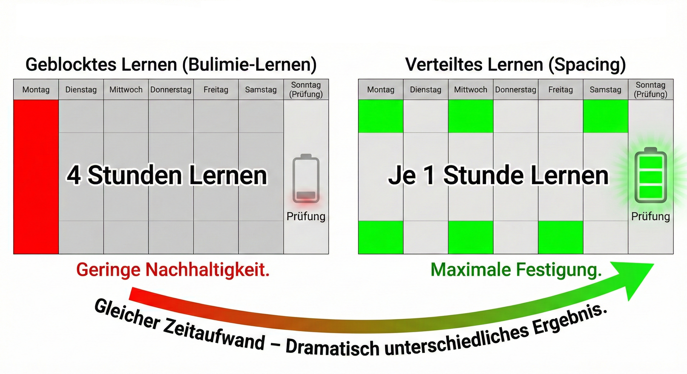
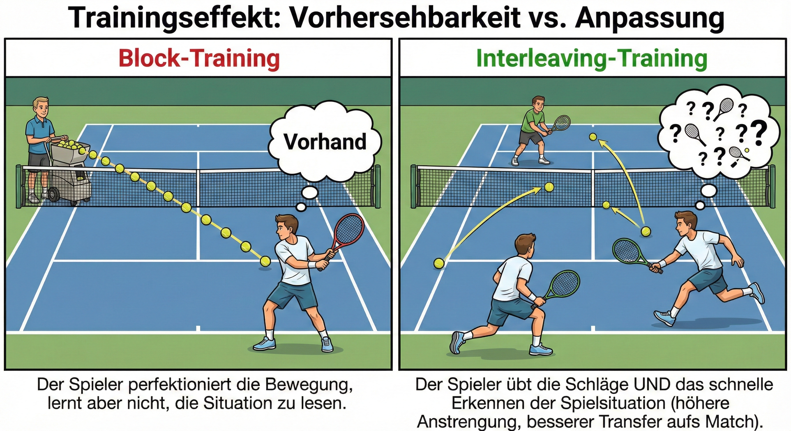
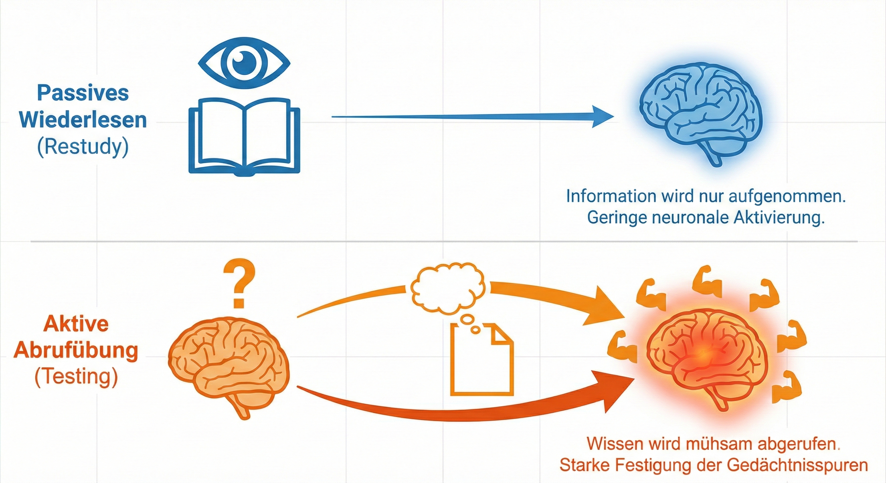

# Didaktische Ziele und Mechanismen {#sec-didaktik}

::: {.callout-note title="Lernziele"}
Nach diesem Kapitel können Sie …

- erklären, warum wirksame Lehrmethoden bekannt, aber selten umgesetzt sind, und wo generative KI den Aufwand senken kann;
- begründen, warum Chatbots ohne didaktische Bremsen dem Lernen eher schaden, mit Bezug auf erwünschte Schwierigkeiten und kognitive Belastung;
- je Wissensstufe und je gut belegter Lerntechnik einen passenden KI-Einsatz wählen und ihn mit der ICAP-Rangfolge bewerten;
- den Stand der Evidenz seit 2025 wiedergeben: wann KI-Tutoren Lernen fördern und wann ungebremste Nutzung es senkt.
:::

::: {.callout-note .mc-block title="Probleme aus der Lehre"}
*Zu jedem dieser Probleme bietet das Kapitel Lösungsansätze. Wählen Sie eine Antwort, bevor Sie weiterlesen: Wer vorher rät, behält die Auflösung besser. Die Kernaussagen am Kapitelende greifen die Probleme in derselben Reihenfolge auf.*

::: mc-frage
Sie wissen, dass aktives Üben mehr bewirkt als eine Vorlesung, und halten trotzdem vor allem Vorlesungen. Was nennen Lehrende in Befragungen als häufigsten Grund?

- Zweifel an der Forschung zum aktiven Lernen.
- Widerstand der Studierenden gegen Gruppenarbeit.
- [Zeitmangel und Hürden wie Gruppengröße und Räume.]{.richtig}

::: mc-rueckmeldung
Das Problem der Hochschullehre ist nicht fehlendes Wissen über gute Lehre, sondern fehlende Zeit, sie umzusetzen. Genau hier kann generative KI ansetzen (@sec-ziele-genai).
:::
:::

::: mc-frage
Ein Chatbot beantwortet jede Übungsfrage Ihrer Studierenden sofort mit der vollständigen Lösung. Was ist daran für das Lernen problematisch?

- [Er nimmt die Anstrengung ab, die Behalten und Verstehen erst erzeugt.]{.richtig}
- Nichts, solange die Lösungen fachlich richtig sind.
- Seine Lösungen sind in der Regel fehlerhaft.

::: mc-rueckmeldung
Chatbots sind darauf gebaut, hilfreich zu sein, nicht darauf, Lernen zu fördern. Ohne Bremsen nehmen sie die erwünschten Schwierigkeiten ab und überladen mit Wissens-Dumps (@sec-ziele-genai).
:::
:::

::: mc-frage
Ihre Studierenden sollen den Stoff bis zur Klausur behalten, doch für wöchentlich neue Übungsfragen fehlt Ihnen die Zeit. Welche Kombination ist am besten belegt?

- Zusammenfassungen markieren; die KI schreibt die Zusammenfassungen.
- [Verteilt üben und oft abfragen; die KI erzeugt Fragen und Varianten.]{.richtig}
- Vor der Klausur im Block wiederholen; die KI plant den Block.

::: mc-rueckmeldung
Verteiltes Üben, häufige Abruftests und Warum-Fragen sind die am besten belegten Lerntechniken; Markieren und Zusammenfassen schneiden schwach ab. Ihr Haken ist der Aufwand, und den senken Sprachmodelle (@sec-lerntechniken).
:::
:::

::: mc-frage
Ihre Hochschule stellt allen Studierenden einen KI-Tutor bereit. Am Semesterende sind die Prüfungsleistungen nicht besser. Was hat vermutlich gefehlt?

- Ein leistungsfähigeres Sprachmodell hinter dem Tutor.
- [Leitplanken in Aufgabe und Rückmeldung und eine verbindliche Einbettung in den Kurs.]{.richtig}
- Ein freundlicherer, motivierenderer Tonfall des Tutors.

::: mc-rueckmeldung
Ein Tutor, der nur bereitgestellt wird, wird kaum genutzt und dann als Antwortmaschine. Ungebremster Zugang hebt die Übungsleistung und senkt die Prüfungsleistung; Leitplanken und angeleitete Einbettung kehren das Vorzeichen um (@sec-evidenz).
:::
:::
:::

## Was für Ziele verfolgen wir mit dem Einsatz von GenAI in der Lehre? {#sec-ziele-genai}

Bevor wir uns der konkreten Umsetzung zuwenden, müssen wir uns zunächst fragen, was wir überhaupt bezwecken: Was sind typische Probleme und was sind unsere Ziele für die konkrete Umsetzung in Lehrsituationen?

Schauen wir uns zunächst ein zentrales Problem der Lernsituation an Hochschulen an [@freeman2014, @roediger2012]: **Wir wissen, was effektive Formen der Lehre sind, diese werden jedoch häufig nicht angewendet.** Studien deuten darauf hin, dass dies eher an situativen Hindernissen der Lernumgebung liegt als am Willen der Lehrenden [@henderson2007].

Ein Beispiel ist die **Vorlesung**. Es ist gut belegt, dass diese Form des passiven Konsums eine sehr schwache Form der Wissensvermittlung ist. **Man lernt nicht nichts, aber anders würde man mehr lernen.** Empirisch und theoretisch ist sehr gut belegt, dass Studierende Wissen besser behalten, wenn sie dieselbe Zeit für aktives Üben, Frage-Antwort Interaktionen oder Diskussion in Kleingruppen verwenden [@freeman2014; @hake1998].

Praktisch wird oft mit dem positiven Effekt der reinen Anwesenheit argumentiert (besser als wenn die Studierenden zu Hause Netflix schauen; wer zur Vorlesung kommt hat bessere Noten), aber **diese spezielle Form der Präsenzlehre hat durch mangelnde Interaktion klare Nachteile.** Der Harvard Physiker @kestin2025 fasst drei zentrale Probleme von Vorlesungen zusammen: Mangelnde Anpassung, mangelndes individuelles Feedback und mangelnde Aktivierung der Lernenden. Genauer [@kestin2025, S.2-3]: "1. They move too quickly for some students and too slowly for others because the teacher controls the pace of instruction; 2. Students do not receive personalized feedback to their questions as they arise; and 3. They fail to maintain consistent student engagement."

**Warum werden trotzdem Vorlesungen sehr häufig und aktivere Lehrformen relativ selten eingesetzt** [@stains2018]? Studien deuten an, dass es oft nicht am Willen der Lehrenden liegt, sondern dass **situative Hindernisse** eine große Rolle spielen, vor allem Zeitmangel wird sehr häufig in Umfragen genannt [@shadle2017], außerdem bremsen Faktoren wie Gruppengröße oder ein ungünstiger Setup der Räume [@henderson2007]. Auch erfolgt die **Umsetzung oft zu optimistisch und ohne Berücksichtigung von Widerständen und Hindernissen** (z.B. Anreize für Studierende, zu Gruppenübungen auch zu kommen, oder nicht lieber ihr Wochenende in Kleingruppen zu besprechen als die Übungsaufgabe), so dass z.B. mangels notwendiger Anreizsetzung die erhoffte Lernwirkung ausbleibt und schnell Frust bei der Umsetzung entsteht [@henderson2007].

Wir argumentieren hier, dass GenAI **helfen kann, solche situativen Barrieren zu verringern,** speziell das häufig genannte **Zeitproblem** bei der Umsetzung effektiver Lehrmethoden [@shadle2017]. Bei sorgfältiger Umsetzung könnte GenAI so als "Kraftverstärker" für Lehrkräfte dienen [@mollick2023b], indem es die Implementierung evidenzbasierter Lehransätze erleichtert, die sonst aufgrund von Zeit- und Arbeitsaufwand oft schwer umzusetzen sind.

Auch hier gibt es allerdings nichts umsonst: Die **neuen Tools haben ihre eigenen Risiken und Nebenwirkungen** und **der Aufwand für Anpassung und Umsetzung** darf nicht unterschätzt werden. Einfach Sprachmodelle ohne Anpassung und didaktische 'Bremsen' einzusetzen ist oft nicht sinnvoll. Wie wir in der weiteren Diskussion sehen werden, nehmen sonst die KI-Chatbots den Studierenden erwünschte Schwierigkeiten ab (*desirable difficulties*), ermuntern sie nicht dazu, selbst Informationen abzuwägen, das eigene Verständnis zu vertiefen und so den eigenen Fähigkeitsstand aktiv zu verbessern (*growth mindset*) oder überfordern die kognitive Aufnahmefähigkeit der Lernenden durch Wissens-Dumps (*cognitive load*). Werden die Sprachmodelle nicht dazu angehalten, klar zu sagen, wenn sie zu etwas keine Informationen haben, so können sie die Lernenden durch überzeugend vorgetragene Halluzinationen oder Fehlschlüsse in die Irre führen. Um effektiv zu sein, müssen GenAI Lernhilfen insofern didaktisch gebremst, themenspezifisch angepasst und systematisch erprobt werden [@kestin2025]:

```         
"AI chatbots are generally designed to be helpful, not to promote learning. They are not trained to follow pedagogical best practices (e.g., facilitating active learning, managing cognitive load and promoting
a growth mindset) (...) . Another well-known flaw of AI tutors is their uncanny confidence when giving an incorrect answer or when marking a correct reply as incorrect [@kestin2025]."
```

Die nächsten Abschnitte geben eine theoriegestützte Orientierung, wie solche Anpassungen erfolgen könnten und welche Mechanismen die Lernforschung als besonders effektiv herausstellt. Zunächst führen wir zur genaueren Zielbestimmung Kategorien von Wissen und Lernmethoden ein. Dann können wir im Detail diskutieren, für welche Ziele und Methodenwahl welche Art der Unterstützung geeignet ist.

## Wissenstypen {#sec-wissenstypen}

@hattie2023 [S. 358, 340ff.] unterscheidet drei Stufen des Lernens (s. @tbl-wissenstypen).

Zunächst geht es um **„knowing that“**, also das reine **Fakten- und Begriffswissen**, das erworben und dann gefestigt werden muss: Hier soll eine belastbare Wissensbasis entstehen, weshalb Lehrkräfte häufig Vorwissensaktivierung oder Drill-and-Practice einsetzen und durch unmittelbares Feedback die korrekte Erinnerung verankern.

Darauf baut **„knowing how“** auf, das **prozedurale und strategische Können**. Auch hier müssen Abläufe zunächst erworben und dann gefestigt werden. Lernende erwerben Prozesswissen, indem sie modellierte Beispiele studieren, in gelenkten Übungen selbst anwenden und mithilfe von „worked examples“ sowie Fehleranalysen Schritt für Schritt ihre Vorgehensweisen optimieren. Festigen können Lernende dieses Prozesswissen besonders gut durch Interaktion oder Wettbewerb mit anderen Lernenden, da diese Auseinandersetzung ihnen dabei hilft, verschiedene Nutzungskontexte zu vergleichen [@chi2018].

Die höchste Stufe nennt Hattie **„knowing with“**: Wissen wird flexibel **auf neue Situationen übertragen**. Problembasiertes Lernen, authentische Fallstudien, bewusste Reflexionsphasen und kooperativ angelegte Projekte helfen dabei, Konzepte in unbekannten Kontexten sicher anzuwenden und weiterzuentwickeln.

Wo können wir neue technische Hilfsmittel wie LLMs zur Unterstützung dieser Methoden besonders effektiv einsetzen?

| Kategorie | Phase | Typische Methoden |
|:-----------------------|:-----------------------|:-----------------------|
| **Wissen, dass** („Knowing that“) | **Erwerben** | Notizen zusammenführen; Zusammenfassen; Heft-/Notizbuch-Durchsicht; Bildhafte Notizen |
| **Wissen, dass** („Knowing that“) | **Festigen** | Argumente prüfen; Fehler identifizieren; Einschränkungen formulieren; Formale Argumentstrukturen darstellen; Belege liefern; Durchgearbeitete Beispiele |
| **Wissen, wie** („Knowing how“) | **Erwerben** | Aufgabenüberarbeitung; Häufiges Üben; Übungseinheit vor Tests; Zweispaltige Notizen; Problemorientiertes Lernen |
| **Wissen, wie** („Knowing how“) | **Festigen** | Peer-Feedback / Peer-Response-Gruppen; Peer-Tutoring; Studierenden-Turniere; Think-Pair-Share; Kumulative Wiederholung |
| **Wissen anwenden** („Knowing with“) | **Transfer** | Sortieren, Zuordnen, Kategorisieren; Dichotome Schlüssel; Von Studierenden erstellte Klassifikationsmuster; Klassifikationsdiagramme |

: Methoden nach Wissenstyp: Fakten, Prozess und Transfer. Quelle: Basierend auf @hattie2023, S. 358, 340ff. {#tbl-wissenstypen}

## Anwendungsbeispiele nach Wissenskategorien {#sec-anwendungsbeispiele}

Zur Unterstützung des **Aufbaus von Faktenwissen („knowing that“)** können starke LLMs gut grundlegende Konzepte erklären [@korinek2024, S. 48] und zum Selbststudium komplette Abruf-Übungen erzeugen: Sie formulieren Multiple-Choice- und Kurzantwortfragen, bewerten die Eingaben sofort und erklären fehlerhafte Distraktoren – ein Verfahren, das in einer STEM-Untersuchung zur automatischen Item-Generierung überzeugende Validitätswerte zeigte [@sauberli2024].

Ebenso lassen sich sehr schnell Definitionen, Paraphrasen oder Mini-Zusammenfassungen erzeugen, was personalisierte Glossare ermöglicht [@chen2024]. @wang2024 sprechen von KI als „Confusion Helper“. Um Halluzinationen zu vermeiden, wird das Modell häufig per Retrieval-Augmentation an externe Wissensbasen gekoppelt (also z. B. durch Beigabe von Skripten oder Fachartikeln als PDF. Siehe auch das Harvard-Tutor-Bot Beispiel in Abschnitt 4.3, wo Musterlösungen beigegeben werden.).

Zur **Festigung von Prozessen und Strategien („knowing how“)** dient das LLM als dialogischer Coach: Feingranulierte Prompts („Erkläre den Beschaffungsprozess in 5 Schritten und stelle nach jeder Stufe eine Kontrollfrage“) steigern die Lösungswahrscheinlichkeit in Tutorendialogen [@scarlatos2025]. Sprachmodelle können Lehrenden dabei helfen, komplette „worked examples“ mitsamt Zwischenschritten zu generieren [@hassany2024].

Angepasste Sprachmodelle können Lernende zur Selbstkorrektur anleiten. Umso besser geht das, wenn das Sprachmodell **fachspezifische Lerntheorien** kennen (z.B.: typische Englischfehler von Deutschen oder typische Verhaltensfehler bei Verhandlungen oder beim Feedback-Gespräch im sozialen Bereich) und **die individuelle Lernhistorie** - sie also wissen, in welche Fallen ich als Lernender gerne tappe. @zhang2025 demonstrieren dies am Beispiel eines selbst entwickelten multimodalen **Mathematik-Tutor-Bots** (MathCCS, Mathematical Classification and Constructive Suggestions).

Der **Teachable-Agent-Ansatz** nutzt umgekehrt das Lernen-durch-Lehren-Prinzip: Studierende bringen dem LLM eine Methode bei und reflektieren dabei ihre eigene Strategie. Dies basiert auf der Annahme, dass Interaktionen besonders effektiv zum Lernen beitragen [@chi2018; @hayashi2025]. Wie auch in der persönlichen Interaktion scheint hierbei wichtig zu sein, welche „Persönlichkeit“ der KI-Bot hat, dem Studierende etwas beibringen sollen [@lyu2025] und mehr Anstrengung in der Interaktion (etwa durch ausführlicheres Formulieren beim Erklären) führt zu mehr Lernerfolg [@love2025].

Sprachmodelle können genutzt werden, um komplexe (mathematische) Anwendungsprobleme mit einem simulierten User **„durchzuspielen“,** so dass **logische Fehler im Lösungsprozess sichtbar werden,** wie der Prototyp „MathChat“ von @wu2023a zeigt. Meta-Analysen zeigen starke positive Lerneffekte, deuten aber auch auf mögliche Einschränkungen hin. So gibt es Anzeichen dafür, dass die Effekte höher für Studierende sind als für Schüler und möglicherweise schwinden Motivationsschübe durch **abnehmende 'novelty effects'** einfacher Chat-Interfaces über die Zeit der Nutzung. Die Autoren der Metastudie empfehlen, hier mit stärkerer **Gamifizierung und Personalisierung** der Chatbots gegenzusteuern [@wu2024a], was sich mit praktischen Ansätzen etwa von Duolingo deckt [@kazu2025] (z. B. Gamifizierung durch Streaks und Leaderboards, Challenges, Video-Chats mit dem Emo-Teen Lili usw.). Solche aufwändigen Setups sind im Hochschulkontext natürlich schwieriger abzudecken, ließen sich aber vielleicht graduell als Studierendenprojekt entwickeln?

Für **Transfer und Anwendung („knowing with“)** entwirft das LLM realitätsnahe Szenarien – etwa Rollenspiele zu Lieferantenausfällen – und übernimmt Stakeholder-Rollen, wobei Analysen des Brookings-Instituts das Potenzial für kollaboratives Reasoning hervorheben [@korinek2024]. Cross-Domain-Prompts fördern Analogiebildung („Welche Parallelen bestehen zwischen agilem Projektmanagement und Lean-Procurement?“) [@mollick2023b].

In Gruppenarbeiten funktioniert das Modell als Co-Autor: KI-unterstützte Schreibprozesse können die Menge und Vielfalt der Ideen steigern [@meincke2024; @shaer2024]. Auch hier ist jedoch die sorgfältige Gestaltung des Lernprozesses wichtig, so dass nicht erwünschte Schwierigkeiten an die KI delegiert und so kritische Denkprozesse nicht eingeübt werden [@lee2025].

## Effektive Lerntechniken und Unterstützung mit KI {#sec-lerntechniken}

### Wie lernen wir besonders effektiv?

In diesem Abschnitt verdeutlichen wir kurz die angestrebten Wirkmechanismen mit Fokus auf drei Lehrtechniken, die die Kognitionswissenschaft als besonders effektiv heraushebt (siehe @morth2021 für eine gute deutschsprachige Übersicht).

Die moderne Lernforschung der Kognitionspsychologie stellt drei Gruppen von Techniken als besonders gute Kombination zwischen Effektivität und einfacher Anwendung heraus: **Verteiltes und gemischtes Lernen**, **testgestütztes Lernen** und **fragebasierte Ausarbeitung** [@dunlosky2013; @morth2021; @roediger2012]. Diese Wirkung gibt es allerdings nicht umsonst: Den positiven Effekten der Techniken steht oft ein deutlich höherer Vorbereitungsaufwand gegenüber. Wie im Folgenden kurz skizziert wird, lassen sich KI-Tools nutzen, um den Aufwand dieser drei Mechanismen zu verringern, was die Lernwirkung im Vergleich zu traditionellen Ansätzen deutlich erhöhen kann.

**Zeitliche Verteilung und inhaltliche Mischung von Lerninhalten (Spacing & interleaving)**: Diese Technik basiert auf dem Prinzip, dass Informationen besser behalten werden, wenn das Lernen über die Zeit verteilt und in verschiedenen Kontexten stattfindet, anstatt in einer einzigen, intensiven Sitzung [@brown2014; @murre2015; @roediger2012].

**Abstände** zwischen Lerneinheiten und die wiederholte Aktivierung von Wissensstrukturen stärken die Verbindung zwischen Hinweisreizen und Gedächtnis und geben dem Gehirn Zeit, Erinnerungen effektiv zu speichern. Dies fördert die Langzeiterinnerung, denn der wiederholte Abruf verstärkt die gespeicherten Muster und vertieft sie so.

{#fig-spacing fig-align="center"}

*Quelle: Erstellt mit Gemini 3 Pro, basierend auf @roediger2012.*

Weiterhin hilft es, zu „mischen“: **inhaltlich gemischtes Üben** (*interleaving*) ist effektiver als die isolierte Behandlung von Themenblöcken, die linear im Semesterverlauf abgehandelt werden [@morth2021]. Das liegt daran, dass das gemischte Üben die Unterscheidung zwischen verschiedenen Aufgabentypen fördert, was entscheidend für die spätere Anwendungskompetenz ist. Nur durch den geübten Vergleich verschiedener Kombinationen von Anwendungskontexten und Lösungsansätzen kann ein Gefühl dafür ausgebildet werden, welches Werkzeug zu welchem Problem passt. Fallstudien und Simulationen bieten sich hier an, wenn diese ausreichend komplex sind, um bekannte Analysen in neuen Kontexten anzuwenden und neue einzuführen.

{#fig-interleaving fig-align="center"}

**Testgestütztes Lernen (Test-enhanced learning)**: Das Abrufen von Informationen durch Tests fördert das Langzeitgedächtnis deutlich stärker als das erneute Lesen des Stoffes. Für Studierende ist das anstrengender, es bringt aber deutlich mehr [@brown2014]. Ein ‚Test‘ kann dabei auch die Bearbeitung von Lerninhalten im Rahmen einer Fallstudie, die kritische Bewertung potenziell falscher Aussagen eines LLMs oder die Beantwortung von Verständnisfragen im Dialog mit einem Tutor-Bot sein.

{#fig-testing-effect fig-align="center"}

*Quelle: Erstellt mit Gemini 3 Pro, basierend auf @roediger2012.*

Häufige Aktivierung von Lerninhalten durch Fragen verbessert den Lernerfolg durch mehrere Mechanismen [@roediger2006]. Erstens fördert solches Testen das **transfergerechte Verarbeiten**, da die mentalen Prozesse beim Testen und beim späteren Abrufen ähnlich sind, was die Erinnerungsfähigkeit verbessert. Zweitens stärkt die Wiederholung durch Tests einerseits den erinnerten **Inhalt** und fügt andererseits **neue ‚Haken‘** hinzu, mit denen wir den Inhalt aus dem Gedächtnis ziehen: die Beziehungen zwischen Hinweisreizen (*cues*) und dem Inhalt im Gedächtnis, indem zusätzliche Abrufwege zu gespeicherten Wissensmustern geschaffen werden, was den Abruf verbessert. Praktisch kann man diesen tollen Effekt auch recht einfach durch regelmäßige kurze Fragerunden nutzen: Wie die Lernforscher herausstellen: „frequent low-stakes quizzes (last only 5 or 10 min) can produce a large boost in performance“ [@roediger2012, S. 246].

**Fragebasierte Ausarbeitung (Explanatory questioning)**: Bei dieser Technik wird das tiefergehende Verständnis von Material durch das Stellen und Beantworten von „Warum“-Fragen gefördert. In **Rollenspielen und Simulationen** können Teilnehmer durch bewusste Praxis aktiv Szenarien durchspielen, während sie gleichzeitig durch gezielte Fragen angeleitet werden, die zum tieferen Nachdenken und zur Reflexion anregen. Diese Fragen können dazu dienen, die Teilnehmer dazu zu bringen, ihre Entscheidungen und Handlungen im Kontext des Rollenspiels zu erklären, wodurch das Verständnis für die Anwendung von Konzepten in realen oder simulierten Situationen vertieft wird.

Indem Lernende über die Gründe hinter den Fakten nachdenken, werden Verbindungen zu bereits bekanntem Wissen hergestellt, was zu einem tieferen Verständnis und besserer Erinnerung führt. Dies deckt sich mit dem Postulat der ICAP-Theorie des kognitiven Engagements [@chi2018]: Interaktion (I) ist effektiver als individuelle Konstruktion, was wiederum effektiver ist als aktive (aber nicht konstruktive) Beteiligung, was wiederum die passive Lernteilnahme schlägt (I \> C \> A \> P).

### Wie können LLMs genutzt werden, um diese Lerntechniken zu unterstützen?

Wir skizzieren das hier kurz an einem Seminar zum interkulturellen Management. Um **zeitliche Verteilung und Mischung** zu fördern, kann mit LLMs eine Serie von kurzen, thematisch variierenden Aufgaben und Fallstudien über das Semester verteilt erstellt werden. Diese könnten reale Szenarien abbilden, in denen Studierende ihre Fähigkeiten im interkulturellen Management anwenden müssen. Beispielsweise könnte das Sprachmodell Aufgaben generieren, bei denen Studierende Strategien für die Überwindung kultureller Barrieren in internationalen Teams entwickeln.

Was sind Beispiele für **testgestütztes Lernen**? Regelmäßige, durch LLMs generierte Quizze bringen Studierende dazu, ihr Wissen häufiger aktiv abzurufen. Durch LLMs können Multiple-Choice-Fragen, Fallstudienanalysen und Szenariobeschreibungen zu interkulturellen Missverständnissen erzeugt werden, welche die Studierenden lösen müssen.

Zur Unterstützung von **fragebasierter Ausarbeitung** können LLMs die Erstellung von Fallstudien, Simulationen und Rollenspielen unterstützen, damit Studierende über interkulturelle Dynamiken und Managementstrategien nachdenken. Diese könnten als Ausgangspunkt für Diskussionen im Kurs oder als Teil von Hausaufgaben dienen, wobei die Studierenden angehalten werden, über die Verbindungen zwischen dem Kursmaterial und den simulierten interkulturellen Interaktionen zu reflektieren. Ein rechnendes Beispiel aus der Logistik ist das Bullwhip-Widget in @sec-widget-bullwhip: Warum die Fabrik viel stärker schwankt als die Kundschaft, erklären Studierende erst, wenn sie Lieferzeit und Informationsfluss einzeln verändert und die Folgen gesehen haben. Viele weitere Beispiele hierfür besprechen wir im folgenden Kapitel, wo wir Anwendungsfälle von KI in der Lehre nach der didaktischen Rolle des Werkzeugs darstellen: Hilfskraft, Copilot, Tutor oder Simulator.

:::: {.callout-note title="Anwendungsbeispiel: KI-Feedback zum Schreiben kommt sofort, ist aber nicht immer richtig"}
**Problem ohne KI.** In Sprachkursen ist individuelles Feedback zu Texten knapp, weil jede Rückmeldung Zeit der Lehrkraft kostet.

**Problem mit KI.** Ein Sprachmodell kommentiert jeden Entwurf sofort, aber nicht immer richtig; wer die Fremdsprache erst lernt, erkennt falsche Vorschläge schwer.

**Der Lösungsansatz.** Das Sprachlernzentrum der Universität Bonn (Projekt Digital Literacy, Géraldine Stich-Desmarchelier, Torsten Kirchner, Elisabeth Schmitt) erprobt seit dem Wintersemester 2024/25 Englischmodule auf den Niveaus B2+ und C1.1 mit KI. In E-Learning-Einheiten bauen die Studierenden einen Essay Schritt für Schritt auf: Argumente sammeln und von der KI bewerten lassen, die Struktur eines Musteressays erkennen, Einleitung und Fazit mit KI-Feedback schreiben, schließlich den ganzen Essay selbstständig verfassen. Jede KI-Rückmeldung prüfen sie an verlässlichen Quellen, die die Lehrkraft bereitstellt. Ins E-Portfolio laden sie die Chats, den eigenständig verfassten Text, die KI-gestützt überarbeitete Fassung und eine angeleitete Reflexion; die Lehrkraft ergänzt das KI-Feedback um eigenes.

**Was das für wirksames Lernen heißt.** *Erfahrungsbericht.* Das Prüfen der KI-Rückmeldung ist selbst ein Abrufanlass im Sinne des testgestützten Lernens, das ausdrücklich die kritische Bewertung möglicherweise falscher Aussagen eines Sprachmodells einschließt. Dass der eigene Text vor der KI-Überarbeitung feststeht, folgt einer Leitplanke, die sich in den Experimenten seit 2025 bewährt: erst die eigene Antwort, dann die Antwort der KI [@xu2026] (@sec-evidenz).

Quelle: @tobor2026usecases, S. 32–33.

::: {.content-visible unless-format="html"}
{width="18%"}
:::
::::

## Was die Forschung seit 2025 zeigt: Lernwirkung und kognitive Auslagerung {#sec-evidenz}

Die Mechanismen der vorigen Abschnitte sind seit Jahrzehnten belegt; ob sie mit Sprachmodellen tragen, war 2024 noch eine Vermutung. Seit 2025 gibt es Messungen mit den zwei stärksten verfügbaren Methoden, randomisierten Feldexperimenten und Paneldaten aus echten Kursen, und seit Sommer 2026 liegen die ersten großen Feldversuche vor, bei denen ein Tutor nicht als Laborprototyp, sondern als Teil eines laufenden Kurses getestet wurde. Vier Gestaltungsfragen ordnen die Befunde; je Frage stehen hier die belastbarsten oder neuesten Studien, weitere im Kasten am Ende des Abschnitts, in Anhang C und D und auf der Online-Seite „Forschungsstand“.

**Lernen Studierende mit KI-Tutoren mehr?** Die Antwort lautete 2025 noch „im Mittel ja“, seit 2026 lautet sie „nur unter Bedingungen“. Die Einzelstudie mit dem saubersten Design bleibt das Harvard-Experiment von @kestin2025, dessen Tutor mit Musterlösungen, Portionierung und Wachstumsdenken gebaut war (@sec-ziele-genai): Studierende lernten mit ihm in weniger Zeit mehr als in der aktiven Präsenzübung. Das bislang größte Hochschulexperiment zeigt das Gegenteil für den Normalfall: An der University of Maryland erhielten per Los 2.379 Studierende in den Kursen von 30 Lehrenden Zugang zu einem Tutor, der mit den Kursmaterialien aus dem Lernmanagementsystem arbeitete; ihre Abschlussnote lag 0,37 Standardabweichungen *unter* der Kontrollgruppe, ihre Beteiligung im Kurs 0,90 Standardabweichungen darunter, und bei Erstakademikerinnen und Erstakademikern war der Verlust doppelt so groß. Nur 15 Prozent der Berechtigten nutzten den Tutor überhaupt, und drei Viertel ihrer Anfragen verlangten eine direkte Antwort, weniger als ein Prozent Rückmeldung auf eigene Arbeit [@liu2026courseintegrated]. Dazwischen liegt das präregistrierte Schulexperiment von @oreopoulos2026productive mit 6.997 Lernenden und einem verzögerten Test: Weder ein Tutor allein noch ein Übungsablauf, der erst nach gezeigter Beherrschung weiterführt, verbesserten das Behalten; nur die Kombination tat es, und nach einem Fehler stieg mit Tutor die Trefferquote im nächsten Versuch um 8,5 Prozentpunkte. Die Meta-Analysen, die 2025 große positive Effekte berichteten, sind inzwischen methodisch geprüft: Die meisten ihrer Vergleiche setzen ChatGPT gegen Kontrollgruppen, die zugleich andere Methoden, weniger Übungszeit oder kürzere Interventionen hatten, so dass der Werkzeugeffekt nicht vom Methodeneffekt zu trennen ist [@lawson2026]; der Wissenschaftsrat nennt die Studienlage „(noch) nicht belastbar“ [@wissenschaftsrat2026]. Ein deutscher Hochschulbeleg mit sauberem Design existiert: 334 Studierende, die sich auf eine Prüfung mit Anreiz vorbereiteten, erreichten mit freiem Zugang zu einem Tutor 0,23 Standardabweichungen mehr als mit dem Lehrbuch allein, ohne weniger zu lesen [@fischer2025].

**Was passiert ohne didaktische Bremse?** Hier ist die Evidenz eindeutig und sie kam zuerst. In einem Feldexperiment mit knapp tausend Oberstufenschülern verbesserte ein Tutor im Stil des normalen ChatGPT die Übungsleistung um 48 Prozent; als der Zugang in der Prüfung fehlte, lagen dieselben Schüler 17 Prozent *unter* der Kontrollgruppe, die nie Zugang hatte. Ein zweiter Tutor mit Leitplanken, der Hinweise statt Lösungen gab, hob die Übungsleistung um 127 Prozent und ließ in der Prüfung keinen Schaden zurück [@bastani2025]. Die Paneldaten einer Mathematik-Lernplattform zeigen denselben Mechanismus im Großen: Über 3,2 Millionen Lerninteraktionen sank nach dem Start von ChatGPT die Lernzeit auf Aufgaben, deren Text sich in einen Chatbot kopieren lässt, kumuliert um 27 Prozent bei Studierenden und 31 Prozent in der Oberstufe, und mit ihr der daraus gebaute Wissenszuwachs; unter Aufsicht verschwindet der Effekt vollständig [@rismanchian2026]. Die Dissoziation von Leistung und Behalten ist inzwischen im Labor repliziert: 59 Informatikstudierende lösten Programmieraufgaben mit ChatGPT zu 89 statt 69 Prozent, behielten den Stoff nach 48 Stunden aber nur zu 39 statt 52 Prozent und schrieben sich die Lösung seltener selbst zu [@bergh2026cognition]. Die Theorie dazu liefert @nakamura2026: Auslagerung an die KI augmentiert, wenn sie Nebenoperationen abnimmt, und erodiert, wenn sie genau die Operationen umgeht, die das Lernziel ausmachen.

**Welche Gestaltungsmerkmale schützen vor Auslagerung?** Drei präregistrierte Experimente aus dem Jahr 2026 benennen die Stellschrauben, und eines davon zeigt, welche Stellschraube nicht wirkt. Eine metakognitive Rückmeldung, die Lernenden sichtbar macht, was das Abschreiben einer KI-Lösung für ihr eigenes Können bedeutet, halbierte in einem Online-Experiment mit 704 Teilnehmenden die Auslagerung und verbesserte den anschließenden Test ohne KI; eine Belohnung für eigenständiges Arbeiten blieb wirkungslos [@maier2026deskilling]. In einem Cluster-Experiment mit 1.176 Erstsemestern in 48 Übungsgruppen an vier Hochschulen gewann direktes KI-Feedback kurzfristig, aber beim verzögerten Transfer ohne KI lagen die Gruppen vorn, deren Feedback zuerst zur Reflexion aufforderte und die Kritik erst danach lieferte [@ates2026]. Was nicht reicht, ist der Prompt allein: An der ETH Zürich durchliefen 1.059 Programmieranfänger im Crossover-Design Tutoren mit System-Prompts für selbstreguliertes Lernen und für kognitive Aktivierung nach ICAP, und auf keinem der vier konfirmatorischen Maße unterschieden sich die Varianten [@barth2026steering]. Die Leitplanke muss also in die Aufgabe, in die Rückmeldung und in den Ablauf gebaut werden, nicht nur in die Anweisung an das Modell; wie das konkret aussieht, zeigt @sec-d-tutoren. Das ist die Übersetzung der erwünschten Schwierigkeiten (@sec-ziele-genai) in Werkzeugdesign: eine eigene Antwort festhalten, bevor die KI antwortet, Hinweise vor Lösungen, und eine Begründungspflicht, wo eine Lösung übernommen wird [@xu2026; @tao2026justification].

**Trägt die Einbettung oder das Werkzeug?** Die Einbettung, und der Engpass ist fast immer die Nutzung. In einer randomisierten Studie in 83 indischen Internatsschulen erhielten alle Zugang zur selben Lernplattform; große Lerngewinne entstanden nur dort, wo betreute Lernzeiten mit Aufsichtspersonen eingeplant waren [@oreopoulos2026]. Zwei Jahre Khanmigo an 18 Schulen brachten 0,06 bis 0,08 Standardabweichungen pro Jahr, nicht mehr als Khan Academy ohne KI, weil das mittlere Kind den Tutor an einem Drittel der Übungstage und in nur 17 Prozent der Sitzungen mit Fehler ansprach [@oreopoulos2026khanmigo]; der Anbieter hat den Nullbefund öffentlich eingeräumt und den Tutor umgebaut, in die Aufgabe hinein, ohne Antwort vor dem ersten Versuch (@sec-tutor). Für die Hochschule zeigt ein deutsches Wirtschaftsinformatik-Semester mit drei Bedingungen dasselbe von der anderen Seite: Alle 87 Studierenden lernten, der Tutor brachte keinen Zusatzgewinn, aber auch keine Erosion; was zählte, war die Rahmung der Nutzung, nicht der Zugang [@melanou2026]. Und wo die Nutzung angeleitet statt nur ermutigt wird, kehrt der Effekt zurück: Ermutigung zum Tutor änderte in einem Ökonometrie-Kurs nichts, eine Anleitung zur tutoriellen Nutzung hob die Prüfungsleistung um 0,21 Standardabweichungen und die Bestehensquote um zwölf Prozentpunkte [@gallegos2026]. Für die Gestaltung heißt das zusammengenommen: Ein KI-Tutor braucht Leitplanken in Aufgabe und Rückmeldung, die Hinweise vor Lösungen setzen, eine Einbettung in den Kurs, die seine Nutzung verbindlich und angeleitet macht, und einen Test vor dem Einsatz, ob er zu viel hilft (@sec-d-tutoren, @sec-pruefen).

:::: {.callout-note title="Anwendungsbeispiel: Studierende übernehmen KI-Texte, statt sich mit ihnen auseinanderzusetzen"}
**Problem ohne KI.** Eine begründete eigene Position zu einem literarischen Thema entsteht durch wiederholtes Nachfragen, für das im Seminar wenig Zeit bleibt.

**Problem mit KI.** Der Chatbot liefert Quellen, Zusammenfassungen und Formulierungen sofort; die Studierenden übernehmen sie, statt sich mit ihnen auseinanderzusetzen.

**Der Lösungsansatz.** Nina Yuen beschreibt eine Aufgabe in sieben Schritten, am Beispiel eines Kurses über Darstellungen von „Race“ in der amerikanischen Literatur des 20. Jahrhunderts. Die Studierenden schreiben zuerst ohne KI einen kurzen Essay. Dann recherchieren sie mit dem Chatbot, entwickeln mit ihm eine Bewertungsrubrik und beurteilen ihre Arbeit danach ohne KI neu. Es folgt ein sokratischer Dialog mit dem Chatbot über drei bis fünf Ebenen von Nachfragen. Am Ende vergleichen sie eine KI-gestützte mit einer eigenen Überarbeitung und schärfen in der letzten Fassung ihre eigene Stimme.

**Was das für wirksames Lernen heißt.** *Unterrichtsentwurf, keine Ergebnisse berichtet.* Der erste, KI-freie Entwurf ist die eigene Antwort, die feststeht, bevor die KI antwortet. Die Reihenfolge entspricht dem Befund, dass Rückmeldung, die zuerst zur Reflexion auffordert und die Kritik danach liefert, beim späteren Transfer ohne KI besser abschneidet als direkte KI-Kritik [@ates2026].

Ablauf und Prompt: @sec-prompt-sokratischer-dialog. Quelle: @yuen2025 (AI Pedagogy Project, metaLAB at Harvard).

::: {.content-visible unless-format="html"}
{width="18%"}
:::
::::

::: {.callout-note title="Stand der Forschung bei Drucklegung, November 2026"}
Die vier Gestaltungsfragen dieses Abschnitts und die Studien, die bei Drucklegung die Antwort trugen; weitere Belege, die aus Platzgründen nicht im Fließtext stehen, in je einer Zeile. Die Online-Seite „Forschungsstand“ führt alle vollständig und wird halbjährlich fortgeschrieben.

| Gestaltungsfrage | Tragende Studien (Fließtext) | Weitere Belege |
|:---------|:---------------|:----------------|
| Lernen Studierende mit KI-Tutoren mehr? | @kestin2025; @liu2026courseintegrated; @oreopoulos2026productive; Vorbehalt @lawson2026 | Meta-Analysen mit großen, aber konfundierten Effekten: @deng2025, @wu2024a, @ren2026 (47 RCTs, g = 0,68, Plateau bei etwa 23 Stunden), @jing2026 (Hochschule, g = 0,46), @wuouyang2026 (Programmieren, KI-gestützte und unbegleitete Leistung getrennt); Feldbefunde @fischer2025, @learnlm2025, @yang2026speak (Sprache = Text bei 2,8-fachen Kosten), @harrison2026medly, @northcutt2026studentbench (Industrieautoren), @chakraborty2026, @kuo2026 |
| Was passiert ohne didaktische Bremse? | @bastani2025; @rismanchian2026; @bergh2026cognition; Theorie @nakamura2026 | @mittal2026 (Recherche per Chatbot senkt kritisches Denken), @kosmyna2025 (EEG, 54 Teilnehmende, Preprint), @contractor2026learning (+0,27 SD, nach einer Woche nur bei augmentierender Nutzung erhalten), @autor2026expertise (Patentanwälte: unbegleitete Fähigkeit nach 90 Tagen nur bei Erfahrenen erhalten), @sungu2026harmteaching (KI-Tool für Lehrende senkt deren Motivation) |
| Welche Gestaltungsmerkmale schützen? | @maier2026deskilling; @ates2026; @barth2026steering | @hou2026 (Prompting-Gerüst), @yang2026visar (Planungsschritte erhalten), @ross2026 (Fehlvorstellungen nur mit korrigierender Rolle), @akgun2026 (Abruf-Übung schlägt freies KI-Lernen nach sieben Wochen), @chen2026transfer (Transfer nur mit Peer-Schicht um das KI-Feedback), @brender2026reflective, @guan2026 |
| Trägt die Einbettung oder das Werkzeug? | @oreopoulos2026; @oreopoulos2026khanmigo; @melanou2026; @gallegos2026 | @robinson2026 (menschliche Begleitung hebt Nutzung, nicht Leistung), @stumpf2026 (OneTutor, 84 Lehrveranstaltungen, kein Unterschied im wahrgenommenen Lernerfolg), @tobler2026, @turano2026monolith (40–47 Prozent nutzen einen reinen KI-Tutor nie), @openai2026studymode (Herstellerangabe), @ghahramani2026sierraleone (Herstellerangabe) |

: Tragende und weitere Belege zu den Gestaltungsfragen in Kapitel 3, Stand November 2026. {#tbl-stand-kap3}

::: {.content-visible when-format="html"}
Zur lebenden Seite [Forschungsstand](forschungsstand.qmd).
:::
::: {.content-visible unless-format="html"}
Die lebende Fassung finden Sie online unter <https://th-koln-bartnik.github.io/genai4teaching/forschungsstand.html>.
:::
:::

::: {.callout-tip title="Kernaussagen"}
1. Das Problem der Hochschullehre ist nicht fehlendes Wissen über gute Lehre, sondern fehlende Zeit, sie umzusetzen. Genau hier kann generative KI ansetzen.
2. Chatbots sind darauf gebaut, hilfreich zu sein, nicht darauf, Lernen zu fördern. Ohne Anpassung nehmen sie Lernenden die Schwierigkeiten ab, die das Lernen ausmachen.
3. Welcher KI-Einsatz sinnvoll ist, hängt vom Wissenstyp ab: Abrufübungen und Erklärungen für Faktenwissen, dialogisches Coaching und durchgearbeitete Beispiele für Prozesswissen, Szenarien und Rollenspiele für Transfer.
4. Verteiltes Üben, häufige Abruftests und Warum-Fragen sind die am besten belegten Lerntechniken. Ihr Haken ist der Aufwand, und den können Sprachmodelle drastisch senken.
5. Interaktion schlägt Konstruktion schlägt aktive Beteiligung schlägt passives Zuhören. Eine KI-Lernaktivität ist umso wirksamer, je weiter oben sie auf dieser Leiter steht.
6. Ungebremster KI-Zugang verbessert die Übungsleistung und senkt die Prüfungsleistung; ein Tutor, der nur bereitgestellt wird, wird kaum und dann als Antwortmaschine genutzt. Leitplanken in Aufgabe und Rückmeldung (nicht nur im Prompt) und eine verbindliche, angeleitete Einbettung in den Kurs kehren das Vorzeichen um.
:::

::: {.callout-note title="Lernfragen"}
**Wiederholen**

1. Nennen Sie die drei Wissensstufen nach Hattie und je einen passenden KI-Einsatz.
2. Bringen Sie die vier Stufen der ICAP-Rangfolge in die richtige Reihenfolge.
3. Erklären Sie ohne Nachschlagen, warum ein Chatbot, der sofort die richtige Antwort gibt, dem Testeffekt entgegenwirkt. Wie müsste der Bot stattdessen reagieren?

**Anwenden**

4. Ordnen Sie drei Lernziele Ihrer Veranstaltung den Stufen knowing that, knowing how und knowing with zu. Welche Stufe kommt bei Ihnen zu kurz, und welche KI-gestützte Methode aus diesem Kapitel würde sie stärken?
5. Wo in Ihrem Semesterplan könnten Sie mit geringem Aufwand verteiltes und gemischtes Üben einbauen, wenn ein Sprachmodell die Aufgabenvarianten liefert?

**Beurteilen**

6. Ein Kollege berichtet, seine Studierenden hätten mit einem KI-Tutor in den Übungen deutlich besser abgeschnitten. Welche eine Frage stellen Sie ihm, bevor Sie den Tutor übernehmen, und warum?
7. Ein Anbieter wirbt mit einem Tutor, dessen System-Prompt sokratisches Fragen und kognitive Aktivierung vorschreibt. Reicht das als Leitplanke? Begründen Sie mit den Befunden des Kapitels.

Lösungshinweise: @sec-loesungshinweise.
:::
