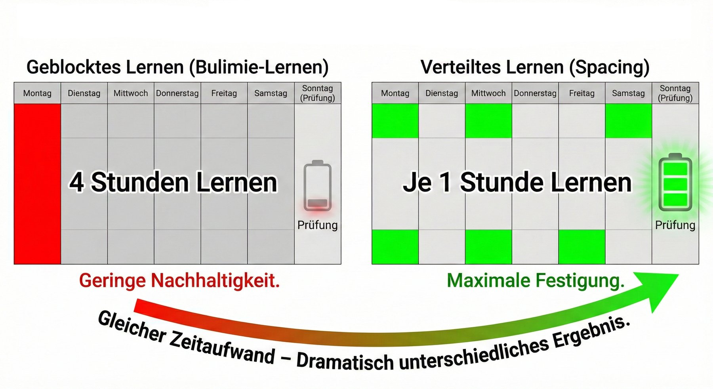
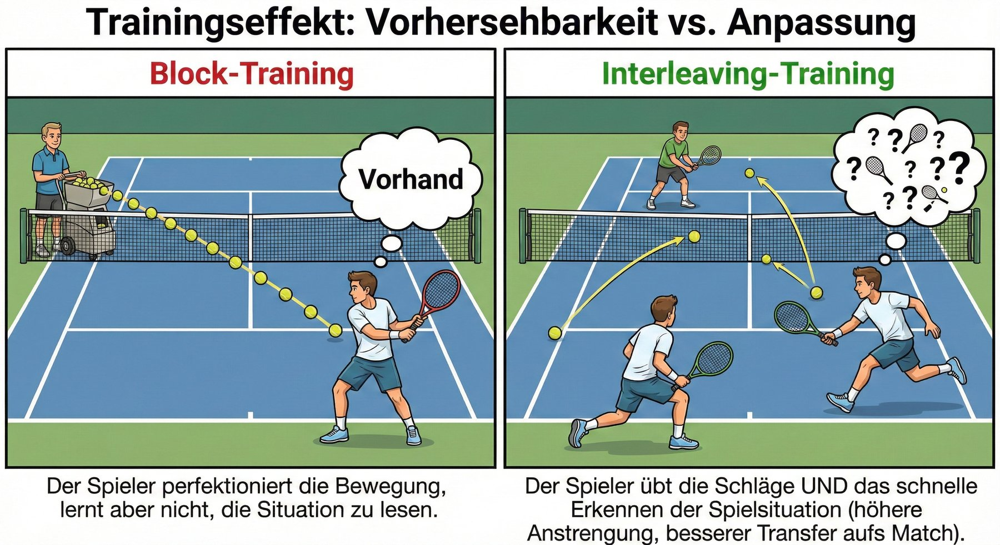
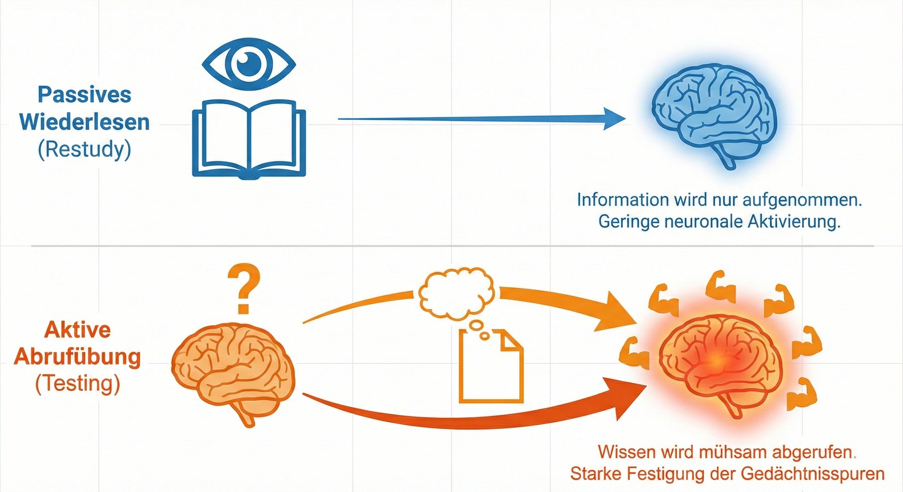

# Lern- und Wirkmechanismen {#sec-didaktik}

::: kapitel-gliederung
:::

Thomas Brandt unterrichtet als Lehrkraft für besondere Aufgaben Kostenrechnung für 250 Erstsemester. Er weiß, dass Übungen mehr bringen als Vortrag, doch bei 18 Semesterwochenstunden und einem Hörsaal mit festen Bänken trägt er vor. Vor der Klausur lesen seine Studierenden das Skript zum dritten Mal. Seit dem Sommer lösen sie die Übungsblätter mit dem Chatbot, fehlerfrei und in Minuten. Brandt will einen eigenen Tutor einrichten, dessen Anweisung fertige Lösungen verbietet und sokratisches Nachfragen verlangt. Ein Kollege winkt ab: Seine Studierenden hätten den Tutor gebeten, die Anweisung zu vergessen, und die Lösungen trotzdem bekommen. Brandt fragt sich, ob er an der Technik feilen muss oder an seiner Lehre.

*Die Szene ist aus Gesprächen in Workshops und aus der eigenen Lehre zusammengesetzt.*



::: {.callout-note .ez-block title="Bevor Sie weiterlesen: Wie sehen Sie das?"}
*Wie sehr stimmen Sie den vier Aussagen zu? Jede Aussage wird an der Stelle im Kapitel aufgelöst, die sie beantwortet. Wer sich vorher festlegt, liest gezielter.*

::: {.einschaetzung #ez-k3-1}
Dass wirksame Lehrmethoden selten eingesetzt werden, liegt vor allem daran, dass Lehrende die Forschung dazu nicht kennen oder ihr nicht trauen.

[Auflösung in @sec-ziele-genai]{.ez-verweis}
:::

::: {.einschaetzung #ez-k3-2}
Solange seine Lösungen fachlich richtig sind, schadet ein Chatbot, der jede Übungsfrage sofort vollständig löst, dem Lernen nicht.

[Auflösung in @sec-ziele-genai]{.ez-verweis}
:::

::: {.einschaetzung #ez-k3-3}
Häufige kleine Abfragen, über das Semester verteilt, lassen den Stoff besser behalten als dieselbe Zeit für gründliches Wiederlesen.

[Auflösung in @sec-lerntechniken]{.ez-verweis}
:::

::: {.einschaetzung #ez-k3-4}
Eine gut formulierte Anweisung an das Modell genügt, damit ein KI-Tutor zum Lernen anleitet, statt Lösungen zu liefern.

[Auflösung in @sec-evidenz]{.ez-verweis}
:::
:::

::: {.callout-note .lernziele title="Lernziele: Nach diesem Kapitel können Sie …"}
1. erklären, warum wirksame Lehrmethoden bekannt, aber selten umgesetzt sind, und wo generative KI den Aufwand senken kann;
2. begründen, warum Chatbots ohne didaktische Bremsen dem Lernen eher schaden, mit Bezug auf erwünschte Schwierigkeiten und kognitive Belastung;
3. je Lernstufe (Erinnern, Verstehen, Anwenden) und je gut belegter Lerntechnik einen passenden KI-Einsatz wählen und ihn mit der ICAP-Rangfolge (interaktiv vor konstruktiv, aktiv und passiv) bewerten;
4. den Stand der Evidenz seit 2025 wiedergeben: wann KI-Tutoren Lernen fördern und wann ungebremste Nutzung es senkt.

*Die Kernaussagen am Kapitelende sind nach diesen vier Zielen geordnet.*
:::

## Was für Ziele verfolgen wir mit dem Einsatz von GenAI in der Lehre? {#sec-ziele-genai}

**Wir wissen, was wirksame Lehre ist, und setzen es selten um** [@freeman2014; @roediger2012]. Die Vorlesung ist das bekannteste Beispiel. Man lernt in ihr nicht nichts, aber mit derselben Zeit für aktives Üben (*active learning*), Frage-Antwort-Runden oder Diskussion in Kleingruppen lernt man mehr [@freeman2014; @hake1998]. @kestin2025 [S. 2–3] nennt drei Schwächen: Das Tempo passt nur einem Teil des Saals, Fragen bekommen keine persönliche Rückmeldung, und die Aufmerksamkeit lässt nach. Dass Vorlesungen trotzdem vorherrschen [@stains2018], liegt selten am Willen der Lehrenden. In Befragungen nennen sie vor allem Zeitmangel [@shadle2017], dazu Gruppengröße und Räume; zudem wird die Umstellung oft zu optimistisch geplant, ohne Anreize für die Studierenden mitzudenken [@henderson2007].

::: {.callout-tip .ez-pruefen title="Ihre Einschätzung prüfen"}
*„Dass wirksame Lehrmethoden selten eingesetzt werden, liegt vor allem daran, dass Lehrende die Forschung dazu nicht kennen oder ihr nicht trauen.“* []{.ez-ihre data-ez="ez-k3-1"}

**Auflösung: eher nicht.** Die Befragungen deuten auf situative Hindernisse: Am häufigsten nennen Lehrende Zeitmangel, dazu bremsen Gruppengröße und Räume, und die Umsetzung wird oft zu optimistisch geplant. Genau beim Zeitproblem kann generative KI ansetzen.
:::

**Generative KI kann genau beim Zeitproblem ansetzen.** Sorgfältig eingesetzt, wirkt sie als Kraftverstärker (*force multiplier*) für Lehrende [@mollick2023b], weil sie Übungsaufgaben, Rückmeldungen und Szenarien liefert, deren Vorbereitung bisher zu teuer war. Umsonst ist das nicht. Ein Chatbot ohne didaktische Bremsen nimmt Lernenden die erwünschten Schwierigkeiten (*desirable difficulties*) ab, überfordert mit Wissens-Dumps ihre kognitive Belastung (*cognitive load*)[]{#sb-k3-kognitive-belastung} und führt mit selbstsicher vorgetragenen Fehlern in die Irre. Chatbots sind darauf gebaut, hilfreich zu sein, nicht darauf, Lernen zu fördern; KI-Lernhilfen müssen deshalb didaktisch gebremst, an das Fach angepasst und erprobt werden [@kestin2025].

::: {.callout-tip .ez-pruefen title="Ihre Einschätzung prüfen"}
*„Solange seine Lösungen fachlich richtig sind, schadet ein Chatbot, der jede Übungsfrage sofort vollständig löst, dem Lernen nicht.“* []{.ez-ihre data-ez="ez-k3-2"}

**Auflösung: nein.** Auch eine richtige Lösung nimmt die Anstrengung ab, die Behalten und Verstehen erst erzeugt, die erwünschten Schwierigkeiten. Wie groß der Schaden ist, zeigt @sec-evidenz: Mit einem Tutor im Stil des normalen ChatGPT stieg die Übungsleistung, und in der Prüfung ohne KI lagen dieselben Schüler 17 Prozent unter der Kontrollgruppe.
:::

Die nächsten Abschnitte zeigen, welche Lerntechniken die Forschung als besonders wirksam ausweist und wo KI ihren Aufwand senkt.

## Effektive Lerntechniken und Unterstützung mit KI {#sec-lerntechniken}

**Welcher KI-Einsatz passt, hängt davon ab, was gelernt werden soll.** Dieses Buch ordnet Lernziele nach drei Stufen der überarbeiteten Lernzieltaxonomie [@anderson2001]: Zum **Erinnern** von Begriffen und Fakten passen Abrufübungen und kurze Erklärungen, zum **Verstehen** Warum-Fragen, dialogisches Coaching und durchgearbeitete Beispiele (*worked examples*), zum **Anwenden** in neuen Lagen Szenarien, Fallstudien und Rollenspiele. @sec-fallbeispiele ordnet seine Beispiele nach denselben Stufen.

### Wie lernen wir besonders effektiv?

In diesem Abschnitt verdeutlichen wir kurz die angestrebten Wirkmechanismen mit Fokus auf drei Lehrtechniken, die die Kognitionswissenschaft als besonders effektiv heraushebt (siehe @morth2021 für eine gute deutschsprachige Übersicht).

Die moderne Lernforschung der Kognitionspsychologie stellt drei Gruppen von Techniken als besonders gute Kombination zwischen Effektivität und einfacher Anwendung heraus: **Verteiltes und gemischtes Lernen**, **testgestütztes Lernen** und **fragebasierte Ausarbeitung** [@dunlosky2013; @morth2021; @roediger2012]. Diese Wirkung gibt es allerdings nicht umsonst: Den positiven Effekten der Techniken steht oft ein deutlich höherer Vorbereitungsaufwand gegenüber. Wie im Folgenden kurz skizziert wird, lassen sich KI-Tools nutzen, um den Aufwand dieser drei Mechanismen zu verringern, was die Lernwirkung im Vergleich zu traditionellen Ansätzen deutlich erhöhen kann.

**Zeitliche Verteilung und inhaltliche Mischung von Lerninhalten (*spacing & interleaving*)**: Diese Technik basiert auf dem Prinzip, dass Informationen besser behalten werden, wenn das Lernen über die Zeit verteilt und in verschiedenen Kontexten stattfindet, anstatt in einer einzigen, intensiven Sitzung [@brown2014; @murre2015; @roediger2012].

[]{#sb-k3-verteiltes-ueben}**Abstände** zwischen Lerneinheiten und die wiederholte Aktivierung von Wissensstrukturen stärken die Verbindung zwischen Hinweisreizen (*cues*) und Gedächtnis und geben dem Gehirn Zeit, Erinnerungen effektiv zu speichern. Dies fördert die Langzeiterinnerung, denn der wiederholte Abruf verstärkt die gespeicherten Muster und vertieft sie so.

{#fig-spacing fig-align="center"}

*Quelle: Erstellt mit Gemini 3 Pro, basierend auf @roediger2012.*

Weiterhin hilft es, zu „mischen“: **inhaltlich gemischtes Üben** (*interleaving*)[]{#sb-k3-gemischtes-ueben} ist effektiver als die isolierte Behandlung von Themenblöcken, die linear im Semesterverlauf abgehandelt werden [@morth2021]. Das liegt daran, dass das gemischte Üben die Unterscheidung zwischen verschiedenen Aufgabentypen fördert, was entscheidend für die spätere Anwendungskompetenz ist. Nur durch den geübten Vergleich verschiedener Kombinationen von Anwendungskontexten und Lösungsansätzen kann ein Gefühl dafür ausgebildet werden, welches Werkzeug zu welchem Problem passt. Fallstudien und Simulationen bieten sich hier an, wenn diese ausreichend komplex sind, um bekannte Analysen in neuen Kontexten anzuwenden und neue einzuführen.

{#fig-interleaving fig-align="center"}

*Quelle: Erstellt mit Gemini 3 Pro, basierend auf @morth2021.*

[]{#sb-k3-testgestuetzt}**Testgestütztes Lernen (*test-enhanced learning*)**: Das Abrufen von Informationen durch Tests fördert das Langzeitgedächtnis deutlich stärker als das erneute Lesen des Stoffes (Testeffekt, *testing effect*). Für Studierende ist das anstrengender, es bringt aber deutlich mehr [@brown2014]. Ein ‚Test‘ kann dabei auch die Bearbeitung von Lerninhalten im Rahmen einer Fallstudie, die kritische Bewertung potenziell falscher Aussagen eines LLMs oder die Beantwortung von Verständnisfragen im Dialog mit einem Tutor-Bot sein.

{#fig-testing-effect fig-align="center"}

*Quelle: Erstellt mit Gemini 3 Pro, basierend auf @roediger2012.*

Häufige Aktivierung von Lerninhalten durch Fragen verbessert den Lernerfolg durch mehrere Mechanismen [@roediger2006]. Erstens fördert solches Testen das **transfergerechte Verarbeiten** (*transfer-appropriate processing*)[]{#sb-k3-transfergerecht}, da die mentalen Prozesse beim Testen und beim späteren Abrufen ähnlich sind, was die Erinnerungsfähigkeit verbessert. Zweitens stärkt die Wiederholung durch Tests einerseits den erinnerten **Inhalt** und fügt andererseits **neue ‚Haken‘** hinzu, mit denen wir den Inhalt aus dem Gedächtnis ziehen: die Beziehungen zwischen Hinweisreizen (*cues*) und dem Inhalt im Gedächtnis, indem zusätzliche Abrufwege (*retrieval routes*) zu gespeicherten Wissensmustern geschaffen werden, was den Abruf verbessert. Praktisch kann man diesen tollen Effekt auch recht einfach durch regelmäßige kurze Fragerunden nutzen: Wie die Lernforscher herausstellen: „frequent low-stakes quizzes (last only 5 or 10 min) can produce a large boost in performance“ [@roediger2012, S. 246].

::: {.callout-tip .ez-pruefen title="Ihre Einschätzung prüfen"}
*„Häufige kleine Abfragen, über das Semester verteilt, lassen den Stoff besser behalten als dieselbe Zeit für gründliches Wiederlesen.“* []{.ez-ihre data-ez="ez-k3-3"}

**Auflösung: ja.** Das Abrufen durch Tests stärkt das Langzeitgedächtnis deutlich mehr als erneutes Lesen, und verteilte Wiederholung wirkt besser als eine einzige intensive Sitzung. Für Studierende ist das anstrengender, für Lehrende aufwendiger, weil laufend neue Fragen nötig sind; diesen Aufwand können Sprachmodelle senken (nächster Abschnitt).
:::

[]{#sb-k3-ausarbeitung}**Fragebasierte Ausarbeitung (*explanatory questioning*)**: Bei dieser Technik wird das tiefergehende Verständnis von Material durch das Stellen und Beantworten von „Warum“-Fragen gefördert. In **Rollenspielen und Simulationen** können Teilnehmer durch bewusste Praxis aktiv Szenarien durchspielen, während sie gleichzeitig durch gezielte Fragen angeleitet werden, die zum tieferen Nachdenken und zur Reflexion anregen. Diese Fragen können dazu dienen, die Teilnehmer dazu zu bringen, ihre Entscheidungen und Handlungen im Kontext des Rollenspiels zu erklären, wodurch das Verständnis für die Anwendung von Konzepten in realen oder simulierten Situationen vertieft wird.

Indem Lernende über die Gründe hinter den Fakten nachdenken, werden Verbindungen zu bereits bekanntem Wissen hergestellt, was zu einem tieferen Verständnis und besserer Erinnerung führt. Dies deckt sich mit dem Postulat der ICAP-Theorie[]{#sb-k3-icap} des kognitiven Engagements [@chi2018]: Interaktion (I) ist effektiver als individuelle Konstruktion, was wiederum effektiver ist als aktive (aber nicht konstruktive) Beteiligung, was wiederum die passive Lernteilnahme schlägt (I \> C \> A \> P; *interactive, constructive, active, passive*).

### Wie können LLMs genutzt werden, um diese Lerntechniken zu unterstützen?

Wir skizzieren das hier kurz an einem Seminar zum interkulturellen Management. Um **zeitliche Verteilung und Mischung** zu fördern, kann mit LLMs eine Serie von kurzen, thematisch variierenden Aufgaben und Fallstudien über das Semester verteilt erstellt werden. Diese könnten reale Szenarien abbilden, in denen Studierende ihre Fähigkeiten im interkulturellen Management anwenden müssen. Beispielsweise könnte das Sprachmodell Aufgaben generieren, bei denen Studierende Strategien für die Überwindung kultureller Barrieren in internationalen Teams entwickeln.

Was sind Beispiele für **testgestütztes Lernen**? Regelmäßige, durch LLMs generierte Quizze bringen Studierende dazu, ihr Wissen häufiger aktiv abzurufen. Durch LLMs können Multiple-Choice-Fragen, Fallstudienanalysen und Szenariobeschreibungen zu interkulturellen Missverständnissen erzeugt werden, welche die Studierenden lösen müssen.

Zur Unterstützung von **fragebasierter Ausarbeitung** können LLMs die Erstellung von Fallstudien, Simulationen und Rollenspielen unterstützen, damit Studierende über interkulturelle Dynamiken und Managementstrategien nachdenken. Diese könnten als Ausgangspunkt für Diskussionen im Kurs oder als Teil von Hausaufgaben dienen, wobei die Studierenden angehalten werden, über die Verbindungen zwischen dem Kursmaterial und den simulierten interkulturellen Interaktionen zu reflektieren. Ein rechnendes Beispiel aus der Logistik ist das Bullwhip-Widget in @sec-widget-bullwhip: Warum die Fabrik viel stärker schwankt als die Kundschaft, erklären Studierende erst, wenn sie Lieferzeit und Informationsfluss einzeln verändert und die Folgen gesehen haben. Viele weitere Beispiele hierfür besprechen wir im folgenden Kapitel, wo wir Anwendungsfälle von KI in der Lehre nach der didaktischen Rolle des Werkzeugs darstellen: Hilfskraft, Copilot, Tutor oder Simulator.

:::: {.callout-note title="Anwendungsbeispiel: KI-Feedback zum Schreiben kommt sofort, ist aber nicht immer richtig"}
**Problem ohne KI.** In Sprachkursen ist individuelles Feedback zu Texten knapp, weil jede Rückmeldung Zeit der Lehrkraft kostet.

**Problem mit KI.** Ein Sprachmodell kommentiert jeden Entwurf sofort, aber nicht immer richtig; wer die Fremdsprache erst lernt, erkennt falsche Vorschläge schwer.

**Der Lösungsansatz.** Das Sprachlernzentrum der Universität Bonn (Projekt Digital Literacy, Géraldine Stich-Desmarchelier, Torsten Kirchner, Elisabeth Schmitt) erprobt seit dem Wintersemester 2024/25 Englischmodule auf den fortgeschrittenen Sprachniveaus B2+ und C1.1 des Europäischen Referenzrahmens mit KI. In E-Learning-Einheiten bauen die Studierenden einen Essay Schritt für Schritt auf: Argumente sammeln und von der KI bewerten lassen, die Struktur eines Musteressays erkennen, Einleitung und Fazit mit KI-Feedback schreiben, schließlich den ganzen Essay selbstständig verfassen. Jede KI-Rückmeldung prüfen sie an verlässlichen Quellen, die die Lehrkraft bereitstellt. Ins E-Portfolio laden sie die Chats, den eigenständig verfassten Text, die KI-gestützt überarbeitete Fassung und eine angeleitete Reflexion; die Lehrkraft ergänzt das KI-Feedback um eigenes.

**Was das für wirksames Lernen heißt.** *Erfahrungsbericht.* Das Prüfen der KI-Rückmeldung ist selbst ein Abrufanlass im Sinne des testgestützten Lernens, das ausdrücklich die kritische Bewertung möglicherweise falscher Aussagen eines Sprachmodells einschließt. Dass der eigene Text vor der KI-Überarbeitung feststeht, folgt einer Leitplanke (*guardrail*), die sich in den Experimenten seit 2025 bewährt: erst die eigene Antwort, dann die Antwort der KI [@xu2026] (@sec-evidenz).

Quelle: @tobor2026usecases, S. 32–33.

::: {.content-visible unless-format="html"}
{width="18%"}
:::
::::

## Was die Forschung seit 2025 zeigt: Lernwirkung und kognitive Auslagerung {#sec-evidenz}

Die Mechanismen der vorigen Abschnitte sind seit Jahrzehnten belegt; ob sie mit Sprachmodellen tragen, war 2024 noch eine Vermutung. Seit 2025 gibt es Messungen mit den zwei stärksten verfügbaren Methoden, randomisierten Feldexperimenten und Paneldaten aus echten Kursen, und seit Sommer 2026 liegen die ersten großen Feldversuche vor, bei denen ein Tutor nicht als Laborprototyp, sondern als Teil eines laufenden Kurses getestet wurde. Vier Gestaltungsfragen ordnen die Befunde; je Frage stehen hier die belastbarsten oder neuesten Studien, weitere im Kasten am Ende des Abschnitts und auf der Online-Seite „Forschungsstand“.

**Lernen Studierende mit KI-Tutoren mehr?** Die Antwort lautete 2025 noch „im Mittel ja“, seit 2026 lautet sie „nur unter Bedingungen“. Die Einzelstudie mit dem saubersten Design bleibt das Harvard-Experiment von @kestin2025, dessen Tutor mit Musterlösungen, Portionierung und Wachstumsdenken gebaut war: Studierende lernten mit ihm in weniger Zeit mehr als in der aktiven Präsenzübung. Das bislang größte Hochschulexperiment zeigt das Gegenteil für den Normalfall: An der University of Maryland erhielten per Los 2.379 Studierende in den Kursen von 30 Lehrenden Zugang zu einem Tutor, der mit den Kursmaterialien aus dem Lernmanagementsystem arbeitete; ihre Abschlussnote lag 0,37 Standardabweichungen *unter* der Kontrollgruppe, ihre Beteiligung im Kurs 0,90 Standardabweichungen darunter, und bei Erstakademikerinnen und Erstakademikern war der Verlust doppelt so groß. Nur 15 Prozent der Berechtigten nutzten den Tutor überhaupt, und drei Viertel ihrer Anfragen verlangten eine direkte Antwort, weniger als ein Prozent Rückmeldung auf eigene Arbeit [@liu2026courseintegrated]. Dazwischen liegt das präregistrierte Schulexperiment von @oreopoulos2026productive mit 6.997 Lernenden und einem verzögerten Test: Weder ein Tutor allein noch ein Übungsablauf, der erst nach gezeigter Beherrschung weiterführt (*mastery-based practice*), verbesserten das Behalten; nur die Kombination tat es, und nach einem Fehler stieg mit Tutor die Trefferquote im nächsten Versuch um 8,5 Prozentpunkte. Die Meta-Analysen, die 2025 große positive Effekte berichteten, sind inzwischen methodisch geprüft: Die meisten ihrer Vergleiche setzen ChatGPT gegen Kontrollgruppen, die zugleich andere Methoden, weniger Übungszeit oder kürzere Interventionen hatten, so dass der Werkzeugeffekt nicht vom Methodeneffekt zu trennen ist [@lawson2026]; der Wissenschaftsrat nennt die Studienlage „(noch) nicht belastbar“ [@wissenschaftsrat2026]. Ein deutscher Hochschulbeleg mit sauberem Design existiert: 334 Studierende, die sich auf eine Prüfung mit Anreiz vorbereiteten, erreichten mit freiem Zugang zu einem Tutor 0,23 Standardabweichungen mehr als mit dem Lehrbuch allein, ohne weniger zu lesen [@fischer2025].

**Was passiert ohne didaktische Bremse?** Hier ist die Evidenz eindeutig und sie kam zuerst. In einem Feldexperiment mit knapp tausend Oberstufenschülern verbesserte ein Tutor im Stil des normalen ChatGPT die Übungsleistung um 48 Prozent; als der Zugang in der Prüfung fehlte, lagen dieselben Schüler 17 Prozent *unter* der Kontrollgruppe, die nie Zugang hatte. Ein zweiter Tutor mit Leitplanken, der Hinweise statt Lösungen gab, hob die Übungsleistung um 127 Prozent und ließ in der Prüfung keinen Schaden zurück [@bastani2025]. Die Paneldaten einer Mathematik-Lernplattform zeigen denselben Mechanismus im Großen: Über 3,2 Millionen Lerninteraktionen sank nach dem Start von ChatGPT die Lernzeit auf Aufgaben, deren Text sich in einen Chatbot kopieren lässt, kumuliert um 27 Prozent bei Studierenden und 31 Prozent in der Oberstufe, und mit ihr der daraus gebaute Wissenszuwachs; unter Aufsicht verschwindet der Effekt vollständig [@rismanchian2026]. Die Dissoziation von Leistung und Behalten ist inzwischen im Labor repliziert: 59 Informatikstudierende lösten Programmieraufgaben mit ChatGPT zu 89 statt 69 Prozent, behielten den Stoff nach 48 Stunden aber nur zu 39 statt 52 Prozent und schrieben sich die Lösung seltener selbst zu [@bergh2026cognition]. Die Theorie dazu liefert @nakamura2026: Auslagerung an die KI (*cognitive offloading*) augmentiert, wenn sie Nebenoperationen abnimmt, und erodiert, wenn sie genau die Operationen umgeht, die das Lernziel ausmachen.

**Welche Gestaltungsmerkmale schützen vor Auslagerung?** Drei präregistrierte Experimente aus dem Jahr 2026 benennen die Stellschrauben, und eines davon zeigt, welche Stellschraube nicht wirkt. Eine metakognitive Rückmeldung, die Lernenden sichtbar macht, was das Abschreiben einer KI-Lösung für ihr eigenes Können bedeutet, halbierte in einem Online-Experiment mit 704 Teilnehmenden die Auslagerung und verbesserte den anschließenden Test ohne KI; eine Belohnung für eigenständiges Arbeiten blieb wirkungslos [@maier2026deskilling]. In einem Cluster-Experiment mit 1.176 Erstsemestern in 48 Übungsgruppen an vier Hochschulen gewann direktes KI-Feedback kurzfristig, aber beim verzögerten Transfer ohne KI lagen die Gruppen vorn, deren Feedback zuerst zur Reflexion aufforderte und die Kritik erst danach lieferte [@ates2026]. Was nicht reicht, ist der Prompt allein: An der Technischen Hochschule ETH Zürich durchliefen 1.059 Programmieranfänger im Crossover-Design, also nacheinander, Tutoren mit System-Prompts für selbstreguliertes Lernen (*self-regulated learning*) und für kognitive Aktivierung nach ICAP, und auf keinem der vier konfirmatorischen Maße unterschieden sich die Varianten [@barth2026steering]. Die Leitplanke muss also in die Aufgabe, in die Rückmeldung und in den Ablauf gebaut werden, nicht nur in die Anweisung an das Modell. Das ist die Übersetzung der erwünschten Schwierigkeiten (@sec-ziele-genai) in Werkzeugdesign: eine eigene Antwort festhalten, bevor die KI antwortet, Hinweise vor Lösungen, und eine Begründungspflicht, wo eine Lösung übernommen wird [@xu2026; @tao2026justification].

::: {.callout-tip .ez-pruefen title="Ihre Einschätzung prüfen"}
*„Eine gut formulierte Anweisung an das Modell genügt, damit ein KI-Tutor zum Lernen anleitet, statt Lösungen zu liefern.“* []{.ez-ihre data-ez="ez-k3-4"}

**Auflösung: nein.** An der ETH Zürich unterschieden sich Tutoren mit System-Prompts für selbstreguliertes Lernen und für kognitive Aktivierung auf keinem der vier konfirmatorischen Maße. Die Leitplanke gehört in Aufgabe, Rückmeldung und Ablauf: eine eigene Antwort vor der KI-Antwort, Hinweise vor Lösungen, eine Begründungspflicht, wo eine Lösung übernommen wird.
:::

**Trägt die Einbettung oder das Werkzeug?** Die Einbettung, und der Engpass ist fast immer die Nutzung. In einer randomisierten Studie in 83 indischen Internatsschulen erhielten alle Zugang zur selben Lernplattform; große Lerngewinne entstanden nur dort, wo betreute Lernzeiten mit Aufsichtspersonen eingeplant waren [@oreopoulos2026]. Zwei Jahre Khanmigo an 18 Schulen brachten 0,06 bis 0,08 Standardabweichungen pro Jahr, nicht mehr als Khan Academy ohne KI, weil das mittlere Kind den Tutor an einem Drittel der Übungstage und in nur 17 Prozent der Sitzungen mit Fehler ansprach [@oreopoulos2026khanmigo]; der Anbieter hat den Nullbefund öffentlich eingeräumt und den Tutor umgebaut, in die Aufgabe hinein, ohne Antwort vor dem ersten Versuch (@sec-tutor). Für die Hochschule zeigt ein deutsches Wirtschaftsinformatik-Semester mit drei Bedingungen dasselbe von der anderen Seite: Alle 87 Studierenden lernten, der Tutor brachte keinen Zusatzgewinn, aber auch keine Erosion; was zählte, war die Rahmung der Nutzung, nicht der Zugang [@melanou2026]. Und wo die Nutzung angeleitet statt nur ermutigt wird, kehrt der Effekt zurück: Ermutigung zum Tutor änderte in einem Ökonometrie-Kurs nichts, eine Anleitung zur tutoriellen Nutzung hob die Prüfungsleistung um 0,21 Standardabweichungen und die Bestehensquote um zwölf Prozentpunkte [@gallegos2026]. Für die Gestaltung heißt das zusammengenommen: Ein KI-Tutor braucht Leitplanken in Aufgabe und Rückmeldung, die Hinweise vor Lösungen setzen, eine Einbettung in den Kurs, die seine Nutzung verbindlich und angeleitet macht, und einen Test vor dem Einsatz, ob er zu viel hilft (@sec-pruefen).

**Ein Semester durchspielen.** Wie sich diese Befunde über ein Semester summieren könnten, zeigt der Semester-Simulator. Sie übernehmen den Kurs von Professorin Albers aus der Eingangsszene von @sec-einleitung, 120 Studierende in Technischer Mechanik, und wählen zwölf Wochen lang je einen Zug: Chatbot freigeben, Tutor mit Leitplanken, Abrufübung, Übung unter Aufsicht oder nichts ändern. Schätzen Sie vorher den Klausurschnitt. Der Simulator ist ein Lehrmodell und misst nichts. Die Effektgrößen stammen aus @bastani2025, @adesope2017 und @cepeda2006; dass sie sich Woche für Woche aufsummieren und vom Test nach der Übung auf eine Semesterklausur übertragen lassen, ist Annahme, ebenso Albers' Zeitkonto und die Regel, nach der Studierende aussteigen. Online steht jede Annahme in einer Tafel, jede Zahl mit Regler.

::: {.content-visible when-format="html"}
<iframe loading="lazy" id="semester-simulator" src="interactions/semester-simulator.html" width="100%" height="2350px" frameborder="0" title="Semester-Simulator: Sie sind Professorin Albers – zwölf Wochen, 120 Studierende, je Woche eine Entscheidung"></iframe>

| Stellgröße des Modells | Wert | Herkunft |
|:-----------------------------|:-------------|:--------------------|
| Test ohne Hilfsmittel nach Üben mit freiem Chatbot, gegenüber Klassen ohne KI | −17 % | @bastani2025 |
| Derselbe Test nach Üben mit Tutor mit Leitplanken | kein belegter Unterschied | @bastani2025 |
| Übungsleistung mit Chatbot und mit Tutor, gegenüber Klassen ohne KI | +48 % und +127 % | @bastani2025 |
| Abrufübung statt Wiederlesen | *g* = 0,51 | @adesope2017 |
| Abruf nach geballter statt verteilter Wiederholung | 36,7 % statt 47,3 % | @cepeda2006 |
| Abrufübung direkt nach einer Abrufübung zählt nur anteilig | Faktor 0,78 | Annahme |
| Je Abrufübung ein Zwölftel von *g* = 0,51; Effekte summieren sich | | Annahme |
| Übertragung vom Test nach der Übungssitzung auf die Semesterklausur | | Annahme |
| Klausurschnitt und Streuung, wenn niemand abkürzt; Bestehensgrenze | 60 und 15 Punkte; 50 Punkte | Annahme |
| Hausübungsschnitt ohne KI | 30 % | Annahme |
| Anteil, der abkürzt: mit freiem Chatbot und ohnehin privat | 50 % und 20 % | Annahme |
| Ausstieg ab Woche 3 | unter 50 % des Stoffstands, je Woche 30 % | Annahme |
| Unter Aufsicht und mit Tutor kürzt niemand ab; den Verlust tragen die Abkürzenden | | Annahme |
| Zeitkonto; Kosten für Tutor, Abrufübung, Aufsicht | 18 h; 3 h, 3 h, 1 h | Annahme |

: Was der Semester-Simulator annimmt. {#tbl-semester-simulator}
:::

::: {.content-visible unless-format="html"}
{#fig-semester-simulator width="100%" fig-pos="htbp"}
:::

:::: {.callout-note title="Anwendungsbeispiel: Studierende übernehmen KI-Texte, statt sich mit ihnen auseinanderzusetzen"}
**Problem ohne KI.** Eine begründete eigene Position zu einem literarischen Thema entsteht durch wiederholtes Nachfragen, für das im Seminar wenig Zeit bleibt.

**Problem mit KI.** Der Chatbot liefert Quellen, Zusammenfassungen und Formulierungen sofort; die Studierenden übernehmen sie, statt sich mit ihnen auseinanderzusetzen.

**Der Lösungsansatz.** Nina Yuen beschreibt eine Aufgabe in sieben Schritten, am Beispiel eines Kurses über Darstellungen von „Race“ in der amerikanischen Literatur des 20. Jahrhunderts. Die Studierenden schreiben zuerst ohne KI einen kurzen Essay. Dann recherchieren sie mit dem Chatbot, entwickeln mit ihm eine Bewertungsrubrik und beurteilen ihre Arbeit danach ohne KI neu. Es folgt ein sokratischer Dialog mit dem Chatbot über drei bis fünf Ebenen von Nachfragen. Am Ende vergleichen sie eine KI-gestützte mit einer eigenen Überarbeitung und schärfen in der letzten Fassung ihre eigene Stimme.

**Was das für wirksames Lernen heißt.** *Unterrichtsentwurf, keine Ergebnisse berichtet.* Der erste, KI-freie Entwurf ist die eigene Antwort, die feststeht, bevor die KI antwortet. Die Reihenfolge entspricht dem Befund, dass Rückmeldung, die zuerst zur Reflexion auffordert und die Kritik danach liefert, beim späteren Transfer ohne KI besser abschneidet als direkte KI-Kritik [@ates2026].

Ablauf und Prompt: @sec-prompt-sokratischer-dialog. Quelle: @yuen2025 (AI Pedagogy Project, metaLAB at Harvard).

::: {.content-visible unless-format="html"}
{width="18%"}
:::
::::

::: {.callout-note title="Stand der Forschung bei Drucklegung, November 2026"}
::: {.content-visible when-format="html"}
Die vier Gestaltungsfragen dieses Abschnitts, die Kernaussagen, die bei Drucklegung die Antwort trugen, und die weiteren Belege, nach Aussagen geordnet. Die Punkte geben an, wie belastbar eine Wirkungsaussage ist: ●●● hoch, ●●○ mittel, ●○○ begrenzt. Sie folgen den Designstufen der CAT-Leitlinie (*Critically Appraised Topic*, eine kurze, strukturierte Bewertung der Studienlage zu einer Frage) des Center for Evidence-Based Management [@cebma2017cat]. Ausgangspunkt ist das stärkste Design unter den Studien einer Aussage: Meta-Analyse randomisierter Studien oder randomisierte Studie (RCT, *randomized controlled trial*) drei Punkte, kontrollierte Studie ohne Zufallszuteilung oder Paneldaten zwei, Befragung, Fallbericht oder Synthese einen. Einen Punkt weniger gibt es, wenn keine der Studien begutachtet ist, wenn die Daten vom Anbieter stammen oder wenn die Vergleiche nachweislich konfundiert sind. Erklärungen und Methodenkritik tragen keine Punkte, weil die Stufen nur Wirkungsaussagen bewerten. Ob ein Befund aus der Schule auf die Hochschule übertragbar ist, steht in der Studienangabe, nicht in den Punkten. Abkürzungen in der Tabelle: Standardabweichung (SD), standardisierte Effektstärke (g), ganze Gruppen statt Einzelner zugelost (Cluster-RCT), Messung der Hirnströme (EEG), Managementstudium (MBA). Die Online-Seite „Forschungsstand“ führt alle Studien vollständig und wird halbjährlich fortgeschrieben.

+----------------------+----------------------------------------------------------------------+----------------------------------------------------------------------+
| Gestaltungsfrage     | Kernaussagen und tragende Studien (Fließtext)                        | Weitere Belege, nach Kernaussage                                     |
+:=====================+:=====================================================================+:=====================================================================+
| Lernen Studierende   | **Ein Tutor kann mehr Lernen bewirken als aktive Präsenzübung oder   | - **Meta-Analysen finden mittlere bis große Durchschnittseffekte;    |
| mit KI-Tutoren mehr? | Lehrbuch allein.** [●●●]{title="hoch"}                               |   nach etwa 23 Stunden steigt der Effekt nicht weiter.**             |
|                      |                                                                      |   [●●○]{title="mittel"} Der Vorbehalt links gilt für sie: @ren2026   |
|                      | - @kestin2025: RCT, Physik, Harvard; mehr gelernt in weniger Zeit    |   (47 RCTs, g = 0,68), @jing2026 (Hochschule, g = 0,46), @deng2025,  |
|                      | - @fischer2025: RCT, 334 Studierende, Deutschland; +0,23 SD in einer |   @wu2024a; @wuouyang2026 trennt KI-gestützte von unbegleiteter      |
|                      |   Prüfung mit Anreiz                                                 |   Programmierleistung.                                               |
|                      |                                                                      | - **Weitere Feldversuche mit eigens gebauten Tutoren zeigen Gewinne, |
|                      | **Ein Tutor, der nur bereitgestellt wird, hebt die Leistung nicht    |   oft mit Beteiligung der Anbieter.** [●●○]{title="mittel"}          |
|                      | und kann sie senken.** [●●○]{title="mittel"}                         |   @learnlm2025 (Herstellerangabe), @harrison2026medly                |
|                      |                                                                      |   (Sekundarstufe, g = 0,33), @northcutt2026studentbench (KI          |
|                      | - @liu2026courseintegrated: RCT, 2.379 Studierende, Maryland; −0,37  |   gleichauf mit menschlichem Tutoring, Industrieautoren), @kuo2026   |
|                      |   SD Abschlussnote, 15 % Nutzung                                     |   (Tutor- plus Tutee-Bot schlägt Antwort-Bot).                       |
|                      | - @oreopoulos2026productive: präregistrierter RCT, 6.997 Schüler;    | - **Gesprochene Antworten lehren nicht besser als geschriebene,      |
|                      |   Tutor allein ohne Wirkung auf das Behalten, wirksam nur im         |   kosten aber das 2,8-Fache.** [●●○]{title="mittel"} @yang2026speak  |
|                      |   Mastery-Ablauf                                                     |   (präregistriert, 86 Online-MBA-Studierende).                       |
|                      |                                                                      | - **Die Rolle der KI bestimmt, was steigt: als Tutor die Motivation, |
|                      | **Vorbehalt: Die großen Effekte der Meta-Analysen messen nicht das   |   nicht die Klausur; als Löser die Aufgabe, nicht der Transfer.**    |
|                      | Werkzeug allein.**                                                   |   [●●○]{title="mittel"} @chakraborty2026 (vier Experimente in einem  |
|                      |                                                                      |   Programmierkurs).                                                  |
|                      | - @lawson2026: Kontrollgruppen unterscheiden sich zugleich in        |                                                                      |
|                      |   Methode, Übungszeit und Dauer                                      |                                                                      |
|                      | - @wissenschaftsrat2026: Studienlage „(noch) nicht belastbar“        |                                                                      |
+----------------------+----------------------------------------------------------------------+----------------------------------------------------------------------+
| Was passiert ohne    | **Ungebremster Zugang hebt die Leistung mit KI und senkt, was ohne   | - **Wer per Chatbot recherchiert oder schreibt, lernt weniger und    |
| didaktische Bremse?  | KI bleibt.** [●●●]{title="hoch"}                                     |   denkt weniger selbst.** [●●○]{title="mittel"} @mittal2026 (RCT,    |
|                      |                                                                      |   acht Tage, kritisches Denken am stärksten betroffen), @kosmyna2025 |
|                      | - @bastani2025: RCT, knapp 1.000 Oberstufenschüler; +48 % Übung, −17 |   (EEG, 54 Teilnehmende, Preprint).                                  |
|                      |   % Prüfung                                                          | - **Was mit KI gelingt, bleibt ohne KI nur erhalten, wo die KI       |
|                      | - @rismanchian2026: Paneldaten, 3,2 Mio. Interaktionen; −27 %        |   ergänzt statt ersetzt oder schon Expertise da ist.**               |
|                      |   Lernzeit bei kopierbaren Aufgaben                                  |   [●●○]{title="mittel"} @contractor2026learning (+0,27 SD, nach      |
|                      | - @bergh2026cognition: Laborexperiment, 59 Studierende; Behalten     |   einer Woche nur bei ergänzender Nutzung), @autor2026expertise (133 |
|                      |   nach 48 Stunden 39 statt 52 %                                      |   Patentanwälte, Fähigkeit ohne KI nach 90 Tagen nur bei             |
|                      | - @stromberg2026penalty: Paneldaten, 26.811 Schülerinnen und         |   Erfahrenen).                                                       |
|                      |   Schüler, 30 Monate; +18 % Hausaufgaben, −20 % Monatsklausuren      | - **Auch Lehrende lagern aus: Ein KI-Werkzeug für die                |
|                      |                                                                      |   Unterrichtsvorbereitung senkt die Lernmotivation ihrer             |
|                      | **Erklärung: Auslagerung schadet, wenn sie die Operationen umgeht,   |   Schülerinnen und Schüler.** [●●○]{title="mittel"}                  |
|                      | die das Lernziel ausmachen.**                                        |   @sungu2026harmteaching (randomisiertes Feldexperiment, 193         |
|                      |                                                                      |   Lehrkräfte, −0,11 SD).                                             |
|                      | - @nakamura2026: Theorie                                             |                                                                      |
+----------------------+----------------------------------------------------------------------+----------------------------------------------------------------------+
| Welche               | **Rückmeldung, die zuerst zum eigenen Denken auffordert, schützt das | - **Gerüste wirken, wenn Planen, Abrufen und Korrigieren bei den     |
| Gestaltungsmerkmale  | Können ohne KI.** [●●●]{title="hoch"}                                |   Lernenden bleiben.** [●●○]{title="mittel"} @hou2026                |
| schützen?            |                                                                      |   (Prompting-Gerüst bei offenen Aufgaben), @yang2026visar            |
|                      | - @maier2026deskilling: präregistriert, 704 Teilnehmende;            |   (Planungsschritte bleiben erhalten), @ross2026 (Fehlvorstellungen  |
|                      |   metakognitive Rückmeldung halbiert die Auslagerung                 |   weichen nur mit korrigierender Rolle), @akgun2026 (Abruf-Übung     |
|                      | - @ates2026: Cluster-RCT, 1.176 Erstsemester, vier Hochschulen;      |   schlägt freies KI-Lernen nach sieben Wochen).                      |
|                      |   Reflexion vor Kritik gewinnt beim verzögerten Transfer             | - **Gemeinsam verarbeitetes KI-Feedback fördert den Transfer stärker |
|                      |                                                                      |   als allein verarbeitetes.** [●●●]{title="hoch"} @chen2026transfer  |
|                      | **Ein System-Prompt allein ändert das Lernen nicht.**                |   (Cluster-RCT, 16 Wochen, 108 Studierende, China).                  |
|                      | [●●●]{title="hoch"}                                                  | - **Sokratische Führung wirkt nach, wenn die Leitplanken fallen.**   |
|                      |                                                                      |   [●●●]{title="hoch"} @brender2026reflective (randomisiert, 66       |
|                      | - @barth2026steering: präregistriertes Crossover, 1.059              |   Master-Studierende, danach freie KI-Nutzung im Projekt).           |
|                      |   Programmieranfänger, ETH; kein Effekt auf vier Maße                |                                                                      |
+----------------------+----------------------------------------------------------------------+----------------------------------------------------------------------+
| Trägt die Einbettung | **Gewinne entstehen, wo die Nutzung eingeplant und angeleitet ist,   | - **Menschliche Begleitung hebt die Nutzung, nicht automatisch die   |
| oder das Werkzeug?   | nicht durch den Zugang.** [●●○]{title="mittel"}                      |   Leistung.** [●●○]{title="mittel"} @robinson2026 (zwei RCTs,        |
|                      |                                                                      |   Grundschule, Beteiligung +71–80 %, Lesen unverändert).             |
|                      | - @oreopoulos2026: RCT, 83 indische Internatsschulen; Gewinne nur    | - **Wo Tutoren an deutschsprachigen Hochschulen laufen, fehlen       |
|                      |   mit betreuten Lernzeiten                                           |   Lernmaße; Befragungen zeigen keinen Unterschied im wahrgenommenen  |
|                      | - @gallegos2026: zwei RCTs, Ökonometrie, Chile; Anleitung +0,21 SD,  |   Lernerfolg.** [●○○]{title="begrenzt"} @stumpf2026 (OneTutor, 84    |
|                      |   Ermutigung wirkungslos                                             |   Lehrveranstaltungen), @tobler2026 (ETH, 407 Studierende).          |
|                      | - @melanou2026: Quasi-Experiment, 87 Studierende, Deutschland; die   | - **Reine KI-Tutoren erreichen viele nie: 40–47 Prozent nutzen sie   |
|                      |   Rahmung zählt                                                      |   nicht.** [●○○]{title="begrenzt"} @turano2026monolith (Synthese).   |
|                      |                                                                      | - **Anbieterstudien berichten Gewinne, sind aber nicht unabhängig    |
|                      | **Bereitgestellte Tutoren werden zu selten genutzt, um zu wirken.**  |   geprüft.** [●○○]{title="begrenzt"} @openai2026studymode,           |
|                      | [●●○]{title="mittel"}                                                |   @ghahramani2026sierraleone (Herstellerangaben).                    |
|                      |                                                                      |                                                                      |
|                      | - @oreopoulos2026khanmigo: Cluster-RCT, 18 Schulen, zwei Jahre;      |                                                                      |
|                      |   Nutzung an einem Drittel der Übungstage                            |                                                                      |
+----------------------+----------------------------------------------------------------------+----------------------------------------------------------------------+

: Kernaussagen und Belege zu den Gestaltungsfragen in Kapitel 4, Stand November 2026. {#tbl-stand-kap3}

Zur lebenden Seite [Forschungsstand](forschungsstand.qmd).
:::

::: {.content-visible unless-format="html"}
Die vier Gestaltungsfragen dieses Abschnitts mit allen weiteren Belegen, nach Kernaussagen geordnet und nach Belastbarkeit gewichtet (Designstufen der CAT-Leitlinie des Center for Evidence-Based Management [@cebma2017cat]), führt die Online-Seite „Forschungsstand“; sie wird halbjährlich fortgeschrieben. QR-Code scannen oder <https://th-koln-bartnik.github.io/genai4teaching/forschungsstand.html> aufrufen.

{width="18%"}
:::
:::

::: {.callout-tip title="Kernaussagen"}
**Zu Lernziel 1: Zeit als Engpass**

1. Das Problem der Hochschullehre ist nicht fehlendes Wissen über gute Lehre, sondern fehlende Zeit, sie umzusetzen. Genau hier kann generative KI ansetzen.

**Zu Lernziel 2: Didaktische Bremsen**

2. Chatbots sind darauf gebaut, hilfreich zu sein, nicht darauf, Lernen zu fördern. Ohne Anpassung nehmen sie Lernenden die Schwierigkeiten ab, die das Lernen ausmachen.

**Zu Lernziel 3: Lernstufen, Lerntechniken und ICAP**

3. Welcher KI-Einsatz sinnvoll ist, hängt von der Lernstufe ab: Abrufübungen und kurze Erklärungen zum Erinnern, Warum-Fragen, dialogisches Coaching und durchgearbeitete Beispiele zum Verstehen, Szenarien, Fallstudien und Rollenspiele zum Anwenden.
4. Verteiltes Üben, häufige Abruftests und Warum-Fragen sind die am besten belegten Lerntechniken. Ihr Haken ist der Aufwand, und den können Sprachmodelle drastisch senken.
5. Interaktion schlägt Konstruktion schlägt aktive Beteiligung schlägt passives Zuhören. Eine KI-Lernaktivität ist umso wirksamer, je weiter oben sie auf dieser Leiter steht.

**Zu Lernziel 4: Evidenz seit 2025**

6. Ungebremster KI-Zugang verbessert die Übungsleistung und senkt die Prüfungsleistung; ein Tutor, der nur bereitgestellt wird, wird kaum und dann als Antwortmaschine genutzt. Leitplanken in Aufgabe und Rückmeldung (nicht nur im Prompt) und eine verbindliche, angeleitete Einbettung in den Kurs kehren das Vorzeichen um.
:::

::: {.callout-note .schluesselbegriffe title="Schlüsselbegriffe"}
::: sb-begriffe
::: {.sb-begriff begriff="k3-kognitive-belastung"}
Kognitive Belastung (*cognitive load*)

*Beispiel:* Die Folie zeigt die Formel erst, wenn die Dozentin sie erklärt, nicht schon zusammen mit Grafik und Fließtext; so bleibt die kognitive Belastung niedrig.
:::

::: {.sb-begriff begriff="k3-verteiltes-ueben"}
Verteiltes Üben (*spacing*)

*Beispiel:* Die Fachbegriffe der ersten Woche tauchen nach zwei Tagen, nach einer Woche und nach einem Monat wieder im Quiz auf; das ist verteiltes Üben.
:::

::: {.sb-begriff begriff="k3-gemischtes-ueben"}
Gemischtes Üben (*interleaving*)

*Beispiel:* Die Statistikübung mischt t-Test, Chi-Quadrat-Test und Regression, so dass zuerst das passende Verfahren zu wählen ist; das ist gemischtes Üben.
:::

::: {.sb-begriff begriff="k3-testgestuetzt"}
Testgestütztes Lernen (*test-enhanced learning*)

*Beispiel:* Zu Beginn jeder Sitzung schreiben alle drei Minuten lang auf, was sie von der letzten Woche noch wissen; das ist testgestütztes Lernen.
:::

::: {.sb-begriff begriff="k3-transfergerecht"}
Transfergerechte Verarbeitung (*transfer-appropriate processing*)

*Beispiel:* Wer in der Klausur Rechenwege begründen muss, übt am besten das Begründen, nicht nur das Ankreuzen von Ergebnissen; dahinter steht transfergerechte Verarbeitung.
:::

::: {.sb-begriff begriff="k3-ausarbeitung"}
Fragebasierte Ausarbeitung (*explanatory questioning*)

*Beispiel:* Nach der richtigen Antwort fragt der Tutor-Bot weiter: Warum sinkt die Nachfrage, wenn der Preis steigt, und wann nicht? Das ist fragebasierte Ausarbeitung.
:::

::: {.sb-begriff begriff="k3-icap"}
ICAP

*Beispiel:* Eine Vorlesung anhören ist passiv, mitschreiben aktiv, eine eigene Zusammenfassung schreiben konstruktiv; nach ICAP wirkt jede Stufe stärker als die vorige.
:::
:::

::: {.sb-spiel modus="fall" kapitel="3"}
::: {.sb-aufgabe loesung="k3-testgestuetzt" ablenker="k3-kognitive-belastung k3-icap k3-transfergerecht"}
Statt am Ende der Vorlesung die Folien zusammenzufassen, lässt eine Dozentin einen Bot fünf Kurzfragen zum Stoff der Stunde erzeugen, die alle zuerst ohne Unterlagen beantworten.

::: sb-herkunft
Herkunft: konstruiert nach @sec-lerntechniken.
:::

::: sb-begruendung
Die Studierenden rufen ab, statt wiederzulesen; das festigt den Stoff stärker. Der Bot nimmt der Dozentin nur die Arbeit ab, die Fragen zu schreiben.
:::
:::

::: {.sb-aufgabe loesung="k3-gemischtes-ueben" ablenker="k3-verteiltes-ueben k3-ausarbeitung k3-kognitive-belastung"}
Auf dem Übungsblatt vor der Klausur in Kostenrechnung stehen Aufgaben zu Zuschlagskalkulation, Deckungsbeitrag und Break-even nicht mehr in Blöcken, sondern durcheinander; zuerst muss man erkennen, welches Verfahren passt.

::: sb-herkunft
Herkunft: konstruiert nach @sec-lerntechniken und der Eingangsszene dieses Kapitels.
:::

::: sb-begruendung
Weil die Aufgabentypen wechseln, üben die Studierenden die Unterscheidung mit, die ihnen in der Klausur niemand abnimmt. In Blöcken stünde das Verfahren schon über der Aufgabe.
:::
:::

::: {.sb-aufgabe loesung="k3-verteiltes-ueben" ablenker="k3-gemischtes-ueben k3-icap k3-transfergerecht"}
Ein Dozent streicht die lange Wiederholungssitzung vor der Klausur; dafür kehrt jedes Thema in drei kurzen Blöcken im Abstand mehrerer Wochen zurück.

::: sb-herkunft
Herkunft: konstruiert nach @sec-lerntechniken.
:::

::: sb-begruendung
Dieselbe Übungszeit, über das Semester verteilt statt gebündelt, stärkt die Langzeiterinnerung. Die Themen werden dabei nicht gemischt, sie kehren mit Abstand wieder.
:::
:::

::: {.sb-aufgabe loesung="k3-ausarbeitung" ablenker="k3-kognitive-belastung k3-icap k3-verteiltes-ueben"}
Nach jeder Antwort im Lieferkettenkurs fragt ein Bot nach: Warum steigen die Bestellungen weiter oben in der Kette stärker, und was würde sich ändern, wenn alle Stufen dieselben Verkaufsdaten sähen?

::: sb-herkunft
Herkunft: konstruiert nach @sec-lerntechniken und dem Bullwhip-Widget (@sec-widget-bullwhip).
:::

::: sb-begruendung
Warum- und Was-wäre-wenn-Fragen zwingen dazu, den Stoff mit vorhandenem Wissen zu verknüpfen. Es geht nicht um das Abrufen eines Fakts, sondern um die Begründung dahinter.
:::
:::

::: {.sb-aufgabe loesung="k3-kognitive-belastung" ablenker="k3-ausarbeitung k3-gemischtes-ueben k3-transfergerecht"}
Ein Erstsemester fragt den Kurs-Bot nach dem Unterschied zwischen fixen und variablen Kosten und bekommt eine Antwort über anderthalb Seiten mit acht Unterpunkten und drei Exkursen.

::: sb-herkunft
Herkunft: konstruiert nach @sec-ziele-genai.
:::

::: sb-begruendung
Die Antwort überfordert das Arbeitsgedächtnis, das für das Wesentliche frei bleiben sollte. Ein didaktisch angepasster Bot würde kurz antworten und eine Frage zurückgeben.
:::
:::

::: {.sb-aufgabe loesung="k3-icap" ablenker="k3-ausarbeitung k3-testgestuetzt k3-kognitive-belastung"}
Statt die Musterlösung zu lesen, erklären sich zwei Studierende gegenseitig ihren Lösungsweg und widersprechen, wo sie anders gerechnet haben; ein Bot markiert nur die Stellen, an denen ihre Wege auseinanderlaufen.

::: sb-herkunft
Herkunft: konstruiert nach @sec-lerntechniken.
:::

::: sb-begruendung
Wer einer anderen Person erklärt und auf ihre Einwände antwortet, arbeitet interaktiv, auf der obersten Stufe der Rangfolge. Der Bot liefert nur den Anlass, nicht die Erklärung.
:::
:::
:::

::: {.sb-wiederkehr quellen="kapitel01-einleitung.html kapitel02-grundlagen.html" druck="k1-erwuenschte-schwierigkeiten k2-halluzination k2-rag"}
:::
:::

::: {.callout-note title="Lernfragen"}
**Wiederholen**

1. Nennen Sie die drei Lernstufen, nach denen dieses Buch ordnet, und je einen passenden KI-Einsatz.
2. Bringen Sie die vier Stufen der ICAP-Rangfolge in die richtige Reihenfolge.
3. Erklären Sie ohne Nachschlagen, warum ein Chatbot, der sofort die richtige Antwort gibt, dem Testeffekt entgegenwirkt. Wie müsste der Bot stattdessen reagieren?

**Anwenden**

4. Ordnen Sie drei Lernziele Ihrer Veranstaltung den Stufen Erinnern, Verstehen und Anwenden zu. Welche Stufe kommt bei Ihnen zu kurz, und welche KI-gestützte Methode aus diesem Kapitel würde sie stärken?
5. Wo in Ihrem Semesterplan könnten Sie mit geringem Aufwand verteiltes und gemischtes Üben einbauen, wenn ein Sprachmodell die Aufgabenvarianten liefert?

**Beurteilen**

6. Ein Kollege berichtet, seine Studierenden hätten mit einem KI-Tutor in den Übungen deutlich besser abgeschnitten. Welche eine Frage stellen Sie ihm, bevor Sie den Tutor übernehmen, und warum?
7. Ein Anbieter wirbt mit einem Tutor, dessen System-Prompt sokratisches Fragen und kognitive Aktivierung vorschreibt. Reicht das als Leitplanke? Begründen Sie mit den Befunden des Kapitels.

Lösungshinweise: @sec-loesungshinweise.
:::
