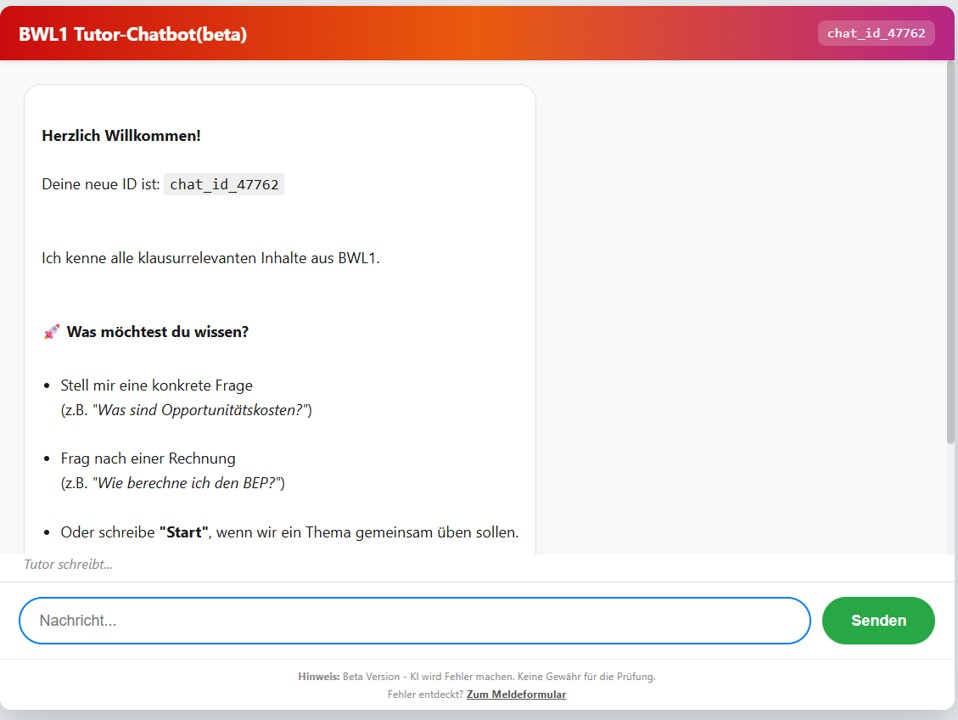
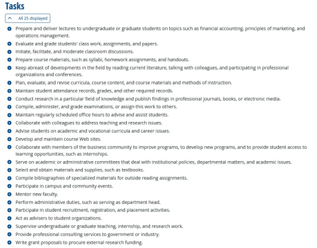
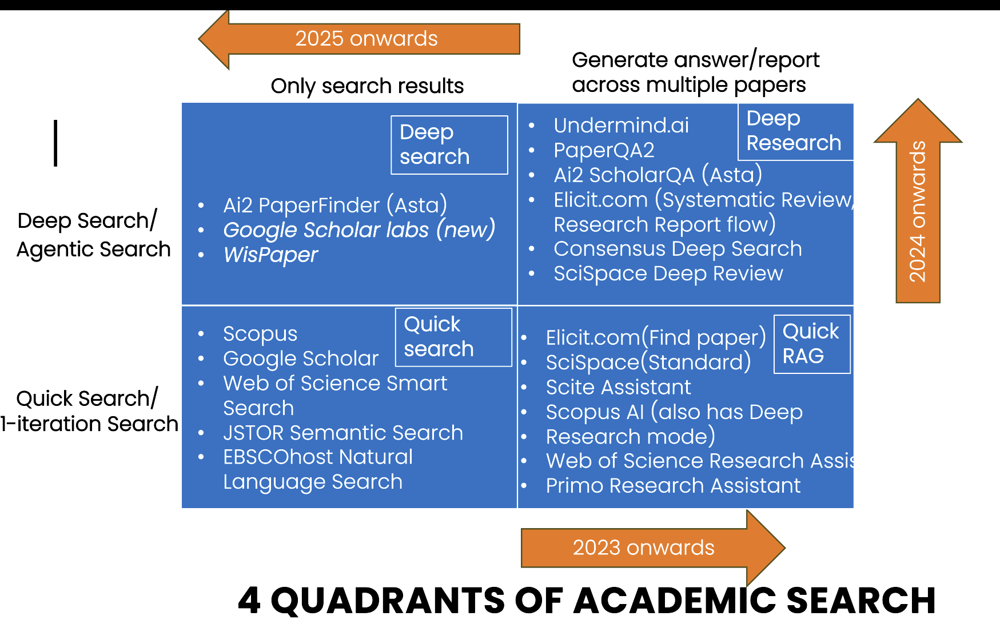
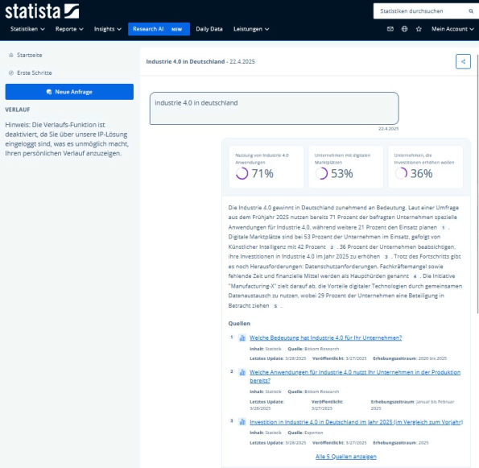
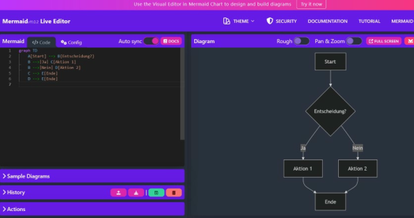
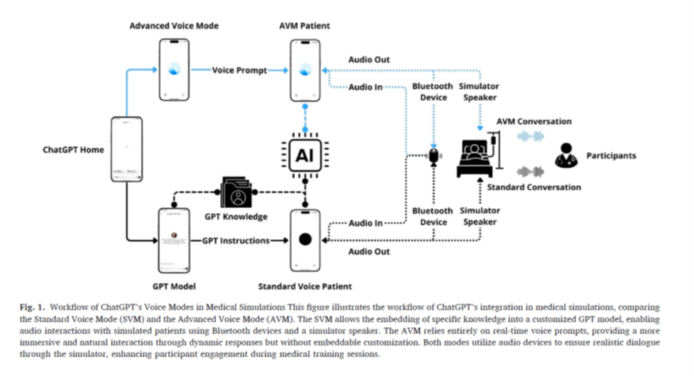

# Vier Szenarien der Nutzung von GenAI: Hiwi, Copilot, Tutor, Simulator {#sec-szenarien}

Wie nutzen Lehrende generative KI?
Wir sortieren die sehr vielfältigen Hilfestellungen der neuen Tools in vier Kategorien von Anwendungen: Hiwi, Copilot, Tutor, Simulator [@mollick2023a; @mollick2024a].

Hier ein Beispiel für einen Tutor-Bot, den wir seit dem Wintersemester 2025/26 <!-- TODO Roman: Zeitraum prüfen --> als Hilfestellung für das Modul "Grundlagen der BWL" erproben; neue Themen werden laufend ergänzt.

{#fig-tutor-bot-bwl}

::: {.content-visible when-format="html"}
**Hier können Sie die Live-Version testen:** https://dev.d1czie2npcfbfs.amplifyapp.com <!-- TODO Roman: Testinstanz leitet laut Review 17.10. nur noch weiter; stabile Adresse (oder Hinweis „Testbetrieb beendet“) eintragen -->
:::

::: {.content-visible when-format="pdf"}
Eine Testversion und der aktuelle Stand des Projekts sind über die Online-Fassung dieses Buches erreichbar; Aufbau, Betrieb und Erfahrungen beschreibt @sec-fallbeispiele. <!-- TODO: Label existiert erst mit Kapitel 6 -->
:::

<!-- Entwurf (Claude, 17.10.2026) nach notes/schablone-lernziele-kernaussagen.md; Freigabe und Anpassung durch Roman -->
::: {.callout-note title="Lernziele"}
Nach diesem Kapitel können Sie …

- die vier Rollen Hiwi, Copilot, Tutor und Simulator unterscheiden und eigene Anwendungsideen einer Rolle zuordnen;
- mit dem Dreiklang Verdrängung, Produktivität und Wiedereinsetzung einschätzen, welche Aufgaben Lehrender durch KI wegfallen, schneller werden oder neu entstehen;
- Recherchewerkzeuge nach den zwei Fragen „einmalig oder iterativ“ und „Liste oder Analyse“ einordnen und ein passendes Werkzeug für eine Literaturaufgabe wählen;
- Grade der KI-Nutzung beim Schreiben unterscheiden und erklären, warum auch Nicht-Informatiker mit Sprachmodellen Lernwerkzeuge programmieren können, und eine KI-gebaute Simulation daraufhin prüfen, ob sie rechnet oder nur abspielt;
- die vier Vorteile eines KI-Tutors nennen und beschreiben, wie Musterlösungen als Input Halluzinationen eindämmen;
- Role Play und Goal Play unterscheiden und begründen, warum Simulationen Rahmung und Nachbesprechung durch Lehrende brauchen.
:::

<!-- Entwurf (Claude, 19.10.2026) nach notes/schablone-leitfragen-lernfragen.md; Freigabe durch Roman -->
::: {.callout-note title="Leitfragen"}
*Versuchen Sie eine Antwort, bevor Sie weiterlesen; die Kernaussagen am Kapitelende greifen die Fragen in derselben Reihenfolge auf.*

1. In welchen Rollen kann generative KI in der Lehre auftreten?
2. Spart KI Lehrenden am Ende Zeit, oder verschiebt sie die Arbeit nur?
3. Wonach wählt man ein Recherchewerkzeug, wenn nicht nach dem Markennamen?
4. Was braucht ein KI-Tutor, damit er keine überzeugend klingenden Fehler produziert?
5. Warum reicht es nicht, Studierende allein mit einer KI-Simulation üben zu lassen?
:::

## KI als Hiwi {#sec-hiwi}
### Was sind unsere Aufgaben?

Beschäftigte in Forschung und Lehre erfüllen eine Vielzahl sehr heterogener Aufgaben, mit einem wachsenden Teil an „Verwaltung“.
Wer lehrt, merkt schnell, dass die Präsenzveranstaltung nur die Spitze eines ganzen Eisbergs an Aufgaben darstellt.
Eine Umfrage unter Lehrenden in Österreich zeigt, dass sie etwa ein Drittel ihrer Zeit mit Lehraktivitäten verbringen (32 %) und etwa ein Fünftel mit Verwaltungstätigkeiten in der Hochschule (20 %) sowie ein weiteres Fünftel mit externen Verpflichtungen wie Gutachten oder Tätigkeiten in wissenschaftlichen Gesellschaften (9 %, 10 %) [@oesterreichischeruniversitaetsprofessor/innenverband2018].
Wie Unkraut im Garten wächst der Anteil, den Lehrende mit „sonstigem“ verbringen: Vor allem der Zeitaufwand für Verwaltung stieg an [@schomburg2012].

Woraus besteht das im Detail und wo könnten LLMs helfen?
Vor- und Nachbereitung, Evaluation, Beratung, Planung und vieles mehr lassen die Stunden eines Tages schnell vergehen.
@fig-onet-tasks zeigt die 25 Hauptaufgaben, die Lehrende nach Umfragen des US-Arbeitsministeriums verrichten (https://www.onetonline.org/link/summary/25-1011.00).
Welche Auswirkungen können wir von LLM auf diese konkreten Aufgaben erwarten?

{#fig-onet-tasks}

Historische Studien zeigen, dass Technologie typischerweise **Tätigkeiten** (tasks) beeinflusst und eher selten ganze Jobs ersetzt.
Führend sind dazu Untersuchungen von David Autor und dem Nobelpreisträger Daron Acemoglu [@acemoglu2019; @autor2015].
Eine nützliche Kategorisierung unterscheidet **drei Effekte** neuer Technologien auf den Faktor Arbeit: Technologische Veränderungen können menschliche Arbeit ersetzen (**Verdrängungseffekt** / displacement effect), spezifische Arbeitskräfte produktiver machen (**Produktivitätseffekt** / productivity effect / augmentation), oder neue Aufgaben (und Jobs) schaffen (**Wiedereinsetzungseffekt** / reinstatement effect) [@acemoglu2019].

| Effekt | Beschreibung | Aufgaben in der Lehre (Beispiele) |
|:--------|:---------|:-----------------------|
| **Verdrängung** | Technologie übernimmt Aufgaben | • Erstellung, Durchführung und Bewertung von Prüfungen (x)<br>• Verwaltung von Noten und Anwesenheit (x)<br>• Vorbereitung standardisierter Lehrmaterialien (x)<br>• Zusammenstellung von Bibliographien (x) |
| **Produktivität** | Technologie macht Arbeit effizienter | • Vorbereitung und Durchführung von Vorlesungen (x)<br>• Durchführung von Seminaren und Diskussionen (x)<br>• Akademische und berufliche Beratung (?/x)<br>• Forschung und Publikation (x)<br>• Pflege von Webseiten und digitalen Ressourcen (?/x) |
| **Wiedereinsetzung** | Technologie schafft neue Aufgaben | • Entwicklung KI-gestützter Lehrkonzepte (x)<br>• Qualitätskontrolle von KI-Materialien (x)<br>• Gestaltung individueller Lernpfade (x)<br>• Ethische und rechtliche Begleitung (x)<br>• Weiterbildung des Personals (x) |

: Für welche Aufgaben in der Lehre erwarten wir Verdrängung und Erhöhung der Produktivität und welche Aufgaben kommen hinzu? Legende: x = klarer Effekt, ? = gemischter Effekt. Quelle: Theorierahmen nach @acemoglu2019 {#tbl-acemoglu}

In @tbl-acemoglu übertragen wir die genannten drei Effekte auf konkrete Aufgaben in der Hochschullehre.

Der **Verdrängungseffekt** betrifft hauptsächlich administrative und stark standardisierte Tätigkeiten.
Aufgaben wie das Erstellen, Durchführen und Bewerten von Prüfungen, die Verwaltung von Noten und Anwesenheiten sowie die Vorbereitung standardisierter Lehrmaterialien oder Literaturzusammenstellungen werden voraussichtlich vollständig oder überwiegend von KI übernommen.
Anwendungsstudien und Umfragen der letzten zwei Jahre geben hierzu deutliche Hinweise [@morgan2024; @naddaf2025; @ogunleye2024; @ou2024; @tutton2025].
<!-- Einschub 2026-07-02 (Gegenlesen-Ordner, Baustein 4.1-A), eingesetzt 2026-10-17 -->
Wie weit die Verdrängung bei der Bewertung tatsächlich reicht, lässt sich inzwischen präzise sagen. Sehfähige Sprachmodelle bewerten fotografierte handschriftliche Mathematik-Abgaben entlang der Rubriken der Lehrenden insgesamt zuverlässig, aber 87 % der verbleibenden Fehler des besten Modells sind **Transkriptionsfehler** (Handschrift lesen, äquivalente Umformungen erkennen, Bildqualität), nicht falsch angewandte Bewertungskriterien [@levine2026]. Verdrängt wird also die Rubrik-Anwendung; die menschliche Arbeit verlagert sich auf Erfassungsqualität und stichprobenartige Kontrolle, ein konkretes Beispiel für die neue Aufgabe „Qualitätskontrolle von KI-Materialien“ im Wiedereinsetzungs-Feld derselben Tabelle (zu den Grenzen KI-gestützten Benotens vgl. @sec-pruefen).

Der **Produktivitätseffekt** bezieht sich auf zentrale Lehr-, Forschungs- und Betreuungstätigkeiten, die durch KI effizienter werden.
Dazu zählen die Vorbereitung und Durchführung von Vorlesungen, Seminaren und Diskussionen, akademische und berufliche Beratung der Studierenden sowie Forschung und Publikationen.
KI unterstützt hier durch automatische Literaturauswertungen, personalisierte Lerninhalte oder Pflege digitaler Ressourcen, sodass Lehrende ihre Kernaufgaben besser und effektiver erfüllen können [@gottweis2025; @meincke2024; @mollick2024a; @mollick2023b; @schwarcz2025].

**Gemischte Effekte** treten bei einigen Aufgaben wie der Entwicklung und Pflege von Kurswebseiten, dem digitalen Aufzeichnen von Vorträgen und der Auswahl von Lehrmaterialien auf, bei denen KI sowohl Teile der Aufgaben ersetzt als auch deren Durchführung produktiver macht.

Der **Wiedereinsetzungseffekt** zeigt, dass durch den Einsatz von generativer KI gänzlich neue Aufgaben entstehen.
Dazu gehören beispielsweise die Entwicklung neuer KI-gestützter Lehrkonzepte und -methoden, Qualitätskontrollen von KI-generierten Lehrmaterialien, Gestaltung individueller Lernpfade, ethische und rechtliche Begleitung des KI-Einsatzes sowie die Weiterbildung des Lehrpersonals im Umgang mit KI-Technologien [@dihan2025; @mollick2024; @mollick2024a].

Durch diese differenziertere Analyse der drei Effekte wird klar, dass die Einführung von KI in die Lehre zwar mit hoher Sicherheit **deutliche Änderungen im Aufgaben-Mix** und der Zeitanteile bedeutet, die wir mit verschiedenen Aufgaben verbringen.
Das ist nicht neu: Wer bestellt noch regelmäßig per Fernleihe, schickt Briefe oder kopiert in großem Umfang?
Wir sehen, dass generative KI wahrscheinlich mittelfristig einen Teil der bisherigen Tätigkeiten verdrängen, zentrale Kernaufgaben produktiver gestalten und zugleich neue, spezialisierte Aufgaben in der Lehre schaffen wird.

Ob das **insgesamt zu einer Zeitersparnis führt, ist keineswegs sicher**, denn die neuen Aufgaben um die Einrichtung und Betreuung der KI-Unterstützung können sehr zeitintensiv sein, als Beispiel sei hier etwa die Einrichtung eines Physik-Tutor-Bots [@kestin2025] oder einer Startup-Simulation, in der KI in verschiedenen Rollen beim Aufsetzen und Verbessern von Geschäftsplänen hilft [@mollick2024].
Beide Konzepte führen sichtlich zu einer Verbesserung der Lehre, aber die gibt es auch hier nicht umsonst.


### Fachartikel finden und auswerten: Welches Werkzeug passt zu welcher Aufgabe? {#sec-recherche}

<!-- Gekürzt (Claude, 17.10.2026) nach der Redaktionsregel: eine Gestaltungsfrage, drei Praxisquellen (Tay); die ausführliche Tabelle zu den Formen der Zusammenfassung steht nur noch online. Freigabe Roman. -->

Was leisten die KI-Helfer bei der Literaturrecherche, und wie prüft man, was sie liefern?
Die besten Antworten darauf gibt der Bibliothekar Aaron Tay von der Singapore Management University, der die Werkzeuge seit Jahren systematisch testet (<https://aarontay.substack.com/>) [@tay2025agentic].
Zwei Unterscheidungen ordnen das Feld: Wird einmalig gesucht oder in mehreren Schleifen (einmalige Suche gegenüber agentischem Suchprozess)? Und bekommt man eine Trefferliste oder eine aus den Treffern erzeugte Zusammenfassung (Ergebnisliste gegenüber RAG-basierter Analyse)? Daraus ergeben sich vier Typen (@tbl-suchtypen und @fig-paper-discovery-types); die Produktnamen in der Abbildung sind ein datierter Schnappschuss, die Typen bleiben.

| Suche | Ausgabe | Typ nach Tay | Was man praktisch bekommt |
|:---------|:------------------|:--------------|:----------------------------------------|
| einmalig | Liste | Quick Search | Klassische Trefferliste mit Ranking (etwa der Bibliothekskatalog oder Google Scholar), ohne erzeugten Antworttext |
| einmalig | Zusammenfassung | Quick RAG | Kurze „Antwort mit Zitaten“ aus den obersten Treffern; meist wenige Absätze |
| iterativ | Liste | Deep Search | Mehrere Suchschleifen über Minuten mit Abfragevarianten und Zitationsverfolgung; ein Sprachmodell bewertet die Relevanz; das Ergebnis bleibt eine Liste, meist eine bessere |
| iterativ | Bericht | Deep Research | Deep Search plus Berichterstellung: eine längere Synthese auf Basis des iterativ gefundenen Korpus |

: Vier Typen von KI-Suchhelfern nach zwei Unterscheidungen. Quelle: @tay2025agentic {#tbl-suchtypen}

{#fig-paper-discovery-types}

Hinter dem Wort „iterativ“ verbirgt sich die wichtigere Frage, *wie* ein Werkzeug iteriert: als fest verdrahteter Ablauf mit ein paar KI-Entscheidungspunkten oder als Agent, der eine Aufgabe flexibel zerlegen kann.
Tay beschreibt ein Agency-Spektrum und ordnet die meisten akademischen Deep-Research-Tools am verdrahteten Ende ein: beeindruckend innerhalb ihrer Schablonen, spröde außerhalb [@tay2025agentic].
Sein Stresstest macht das sichtbar: „Finde Arbeiten, die Paper X hätte zitieren sollen, aber nicht zitiert hat.“ Eine menschliche Hilfskraft zerlegt das in drei Schritte (ähnliche Arbeiten finden, deren Referenzen extrahieren, die Überlappung abziehen); allgemeine Sprachmodelle mit Werkzeugen führen diese Logik eher aus, während spezialisierte Tools scheitern, weil die Aufgabe nicht in ihren eingebauten Ablauf passt.
Für die Lehre folgt daraus die Regel aus @sec-agenten-praxis: Je freier das Werkzeug arbeitet, desto klarer müssen die Kontrollpunkte sein, an denen wir das Ergebnis prüfen.

Beim Auswerten gefundener Artikel gilt eine ähnliche Staffelung [@tay2024classifying].
Die Zusammenfassung eines einzelnen Dokuments ist am wenigsten riskant und eignet sich für die schnelle Relevanzprüfung; die sequenzielle Auswertung vieler Dokumente nach denselben Fragen (Design, Stichprobe, Befund) ergibt eine Codier-Tabelle, deren Zellen man stichprobenartig gegen das PDF prüft; die Synthese über mehrere Dokumente zu einer Frage trägt das höchste Fehlerrisiko, weil sich Suchfehler, untreue Zusammenfassung und schwache Gewichtung der Evidenz addieren.
Die Kurzform „Antwort mit Zitaten“ ist für wissenschaftliche Arbeit deshalb meist nur ein Teaser: Man braucht den Originaltext für Kontext, Operationalisierung und Geltungsgrenzen, und erzeugter Text kann Quellen etwas zuschreiben, das sie so nicht sagen (fehlende *source faithfulness*) [@tay2025agentic].
Ein praktisches Problem der spezialisierten Suchwerkzeuge kommt hinzu: Sie kommen nicht hinter die Bezahlschranken der Verlage und arbeiten deshalb mit Abstracts oder Open-Access-Korpora.
Akademische Konnektoren zu den großen Sprachmodellen verschieben die Arbeit hier von abstract-basiertem Raten zu passagenbasiertem Prüfen, weil das Modell über eine institutionelle Anmeldung lizenzierte Volltexte durchsuchen und Behauptungen an Fundstellen binden kann, begrenzt auf den Bestand des jeweiligen Anbieters [@tay2024mcp].
Wie eine Agentenrecherche mit festen Kontrollpunkten in der Praxis abläuft, zeigt @sec-d-agenten.

::: {.content-visible when-format="html"}
::: {.callout-note collapse="true" title="Nur online: Ausführliche Übersicht der Formen von KI-Zusammenfassungen nach Tay (2024)"}
| Form der LLM-Zusammenfassung (Tay) | Was passiert technisch/funktional? | Typische UI-Form | Beispiele (Anbieter/Produktnamen) | Nutzen in sozialwissenschaftlicher Forschung | Typische Risiken und worauf man testet |
|---|---|---|---|---|---|
| **1. Single-Document Summarisation** (ein Dokument) | Ein einzelner Text wird zusammengefasst; Tay unterscheidet innerhalb dieser Kategorie drei Varianten je nach Prompt-Freiheit: (1a) fester Button, (1b) feste, aber query-abhängige Antwort, (1c) freies Q&A/Chat über ein Dokument. Viele Implementierungen nutzen intern RAG-Muster und zeigen „Snippets“ als Beleg. | Button/Sidebar/Chat neben einem Treffer | **1a**: EBSCO „AI Insights“; **1a**: Ex Libris „Document Insights“ (Primo/ProQuest-Kontext); **1b**: ProQuest „Research Assistant“ (z. B. „Relationship to your search terms“); **1c**: JSTOR Research Tool (beta) „Chat“. | Sehr gut fürs schnelle Triage-Lesen: „Ist das Paper relevant?“; hilfreich bei überlappenden Begriffen zwischen Soziologie/Politikwissenschaft/Erziehungswissenschaft. Query-abhängige Varianten (1b) machen sichtbar, wenn ein Treffer nur semantisch „ähnlich“ ist, aber nicht zur Fragestellung passt. | Bei festen Buttons geringeres Risiko, aber oft nur „aufgebohrte Abstract-Paraphrase“; bei Chat-mit-PDF höheres Risiko durch unvorhersehbare Fragen. Tests: Stabilität (gleicher Text → ähnliche Ausgabe), Grounding-Spotchecks (Behauptungen im PDF prüfen), Negativkontrolle („steht das überhaupt drin?“), Scope-Klarheit (Abstract vs. Volltext). |
| **2. Sequential Single-Document Summarisation** (mehrere Dokumente, aber jeweils einzeln) | Mehrere Treffer werden nacheinander dokumentweise verarbeitet; typisch sind „Synthesis tables“/Matrizen. Extraktion klar definierter Variablen ist meist zuverlässiger als freie Zusammenfassung. Query-abhängige Ein-Zeilen-Zusammenfassungen dienen nebenbei als Relevanz-Signal. | Tabelle/Matrix über Top-K Treffer | **Elicit**: automatische Summary-Spalte plus frei definierbare Extraktions-Spalten (Design, Sample, Outcome etc.). | „Codier-Werkbank“: Konstrukte, Kontext, Designlogik und Findings als Spalten definieren, Paper für Paper füllen lassen; macht Muster, Cluster und Ausreißer sichtbar (wie ein standardisiertes Codebuch mit beschleunigter Erstbefüllung). | Stille Inkonsistenzen: driftende Begriffe/Einheiten, „Missingness“ wird mit Vermutungen gefüllt. Tests: Stichproben-Audit gegen PDF, Konsistenzchecks, „Missingness-Ehrlichkeit“, Provenance je Zelle (Textstelle muss rückverfolgbar sein). |
| **3. Query-based Multi-Document Summarisation** (Synthese über mehrere Dokumente) | Synthese über mehrere Dokumente zur Beantwortung einer Frage; häufig RAG. Varianten: nur Suchtreffer, nur Uploads oder Hybrid. Manche Systeme fixieren zuerst ein Korpus (z. B. Top-25) und erlauben danach Folgefragen über dieses Set. | „Answer with citations“ / Report über mehrere Papers | **Ex Libris/Primo Research Assistant**; **Google NotebookLM** (Upload-Korpus); **Elicit Systematic Review** (Hybrid); **JSTOR Research Tool (beta)** (fixes Top-K-Set); **Undermind.ai** („Ask Expert“) nach iterativer Phase. | „Narrativ-Maschine“: gut für Landschaftsskizzen (Themencluster, Mechanismen, Kontroversen). Kann beim Strukturieren eines Review-Kapitels helfen (Abschnitte nach Mechanismen, Kontexten, Messansätzen). | Höchstes Fehlerrisiko durch Kombination aus Retrieval-Fehlern, kontextuntreuer Paper-Zusammenfassung und schwacher Evidenzgewichtung. In Sozialwissenschaften heikel wegen heterogener Designs. Tests: Claim-zu-Quelle-Mapping, Coverage („Must-cite“-Set), Widerspruchstest, „Not in sources“-Test, Retraktions-/Korrekturtest. |

: Paper mit KI analysieren: Einfach oder sequenziell, ein Artikel oder Synthese mehrerer Artikel? Quelle: @tay2024classifying {#tbl-paper-analysis-types}
:::
:::

## KI als Copilot {#sec-copilot}

In dieser Kategorie hilft das Sprachmodell uns dabei, etwas zu tun, was wir sonst nicht könnten.
@mollick2024a beschreiben mehrere solcher Ansätze: Bei der **"Case Co-Creation"** [@mollick2024a, S. 25–28] arbeiten Studierende mit der KI zusammen, um ein Fallbeispiel für Kommilitonen zu erstellen.
Dies fördert die Artikulation von Ideen und die kritische Auseinandersetzung mit dem KI-Output, da die initialen Entwürfe oft oberflächlich sind und durch studentische Expertise verbessert werden müssen.
Die Übung **"Critique the AI"** lässt die KI ein Szenario zu einem Konzept (z. B. Groupthink) erstellen, das die Studierenden dann kritisch bewerten und ggf.
verbessern müssen.
Dies schult das Erkennen von Konzeptmerkmalen und die Fähigkeit, Wissen durch Korrektur zu artikulieren.
Eine Herausforderung ist, dass die KI Konzepte manchmal unvollständig oder fehlerhaft illustriert, was aber Teil des Lerneffekts sein kann [@mollick2024a].


<!-- Anwendungsbeispiel (Claude-Entwurf, 20.10.2026) nach notes/schablone-leitfragen-lernfragen.md und notes/lehrpraxis-kandidaten-2026-10-20.md; Freigabe durch Roman -->
:::: {.callout-note title="Anwendungsbeispiel: Wer nicht selbst rechnen kann, erkennt die Fehler des Copiloten nicht"}
**Problem ohne KI.** Eine Kennzahlenanalyse am echten Geschäftsbericht ist mühsam: Zahlen aus Bilanz und Gewinn- und Verlustrechnung heraussuchen, die Komponenten der Eigenkapitalrendite berechnen, das Ergebnis deuten.

**Problem mit KI.** Ein Copilot liefert die DuPont-Analyse in Sekunden und erklärt sie Schritt für Schritt. Ob sie stimmt, erkennt nur, wer den Rechenweg selbst beherrscht.

**Das Dilemma.** David Pedersen lässt Studierende die DuPont-Analyse der Eigenkapitalrendite von Coca-Cola für 2022 zuerst selbst aus dem Jahresbericht (10-K) bei der US-Börsenaufsicht berechnen und kurz deuten. Erst dann führen sie dieselbe Analyse mit Microsoft Copilot durch, stellen mindestens eine Nachfrage, reichen das Protokoll ein und reflektieren in 300 Wörtern, wie viel Führung die KI für ein richtiges Ergebnis brauchte. Die Zeitersparnis des Copiloten gibt es erst nach der eigenen Rechnung.

**Was das für wirksames Lernen heißt.** *Unterrichtsentwurf, keine Ergebnisse berichtet.* Die Reihenfolge schützt vor der Trennung von Leistung und Behalten, die im Labor gemessen ist: Mit ChatGPT lösten Informatikstudierende mehr Aufgaben, behielten den Stoff aber schlechter [@bergh2026cognition]. Und sie macht die zerklüftete Grenze der Modelle erfahrbar [@dellacqua2023]: Ob der Copilot bei dieser Rechnung zuverlässig ist, zeigt erst der Vergleich mit dem eigenen Ergebnis.

[Ablauf und Prompt: @sec-prompt-dupont-analyse.]{.content-visible when-format="html"}[Ablauf und Prompt: Online-Fassung von Anhang B.]{.content-visible unless-format="html"} Quelle: @pedersen2025 (AI Pedagogy Project, metaLAB at Harvard).

::: {.content-visible unless-format="html"}
{width="18%"}
:::
::::

### Besser schreiben – als Cyborg {#sec-cyborg-writing}

Wer akademisch schreibt, lässt sich zunehmend von einer Vielzahl an unterstützenden KI-Systemen über die Schultern schauen – oder die Hand führen –, die Vorschläge zur besseren Sprachverwendung machen, wie DeepL, Grammarly, oder ChatGPT [@ou2024].
@ou2024 sprechen von AI-assisted language tools (AILT), die Studierenden dabei helfen, ihre Sprachfähigkeiten etwa von einer in die andere Sprache zu übertragen und das Sprachniveau ihrer Schreibprodukte generell zu verbessern.
In ihrer Studie analysieren sie die Kommentare von 1703 schwedischen Studierenden und stellen komplexe Muster der Nutzung fest: „…students align their own languages, writing skills and thinking with the algorithm-based language processes (e.g., lexical, grammatical, and textual corrections, word choice suggestions, language translation) within AI chatbots, writing assistance, and machine language translation to optimise the outcomes of their academic writing.
… students have become ‘spatially extended cyborg\[s\]’”.

Studierende schreiben durch die zunehmend mächtigere technische Unterstützung ihre Haus- und Abschlussarbeiten deutlich anders.
Bedeutet dies das Ende der Hausarbeit?
Wohl eher einen starken Wandel, denn es wird weiter wichtig sein, die saubere Argumentation zu üben [@friedrich2023; @klein2023].

::: {.callout-tip title="Probieren Sie mal"}
Hier haben wir einen kleinen **Schreib-Trainer-Bot für Studierende** erstellt, der ihnen dabei helfen soll, eine **Einleitung für die Abschlussarbeit** zu schreiben.
Dabei werden zunächst Beispiele gezeigt die nach richtig/falsch sortiert werden müssen, dann kommen nach und nach komplexere Fragen: [Link zum Einleitungstrainer](https://chatgpt.com/g/g-68767cb33afc8191b1cfb9da1ed5c15a-bot-1-einleitungstrainer)

Hier eine zweite Übung (erstellt von Julia Schmid), zum die strukturiertes **Schreiben mit Einleitungssätzen (Topic-Sentences)** beibringen soll: [Link zum Topic-Sentence-Bot](https://chatgpt.com/g/g-68768c3031c08191b752ef66df258979-topic-sentence-bot).
:::

Die Studienberatung der Universität Frankfurt hat eine Übersicht nach Phasen des Prozesses erstellt [@lehrevirtuell-universitaetfrankfurt2023], s.
@tbl-writing-process:

| Phase im Schreibprozess | Unterstützung durch KI | Eigenanteil |
|:-----------------------|:-----------------------|:-----------------------|
| **Themenfindung und Literaturrecherche** | Brainstorming<br>Grober Themenüberblick | Schwerpunktsetzung<br>Wissenschaftliche Quellen finden |
| **Lesen und Exzerpieren** | Zusammenfassung/Gliederung für ersten Überblick<br>Textpassagen vereinfachen | Gründliches Lesen<br>KI-generierte Texte überarbeiten |
| **Rohfassung** | Ausformulieren von Stichpunkten<br>Kooperatives Freewriting | Stichpunkte festhalten<br>"Schreiben, um eigene Gedanken zu klären"<br>KI-generierte Texte überarbeiten |
| **Überarbeiten** | Verschiedene Textversionen generieren<br>Stil/Perspektive anpassen | Passende Textversion aussuchen und anpassen<br>Menschliches Feedback einholen |
| **Sprachliche Korrektur** | Spezialisierte Tools wie DeepL, Write und Duden Mentor | Prüfen, ob Bedeutung verändert wurde |

: Integration von KI in den Schreibprozess. Quelle: Studienberatung der Universität Frankfurt [@lehrevirtuell-universitaetfrankfurt2023], Stand 10.3.2024 {#tbl-writing-process}

Mit einer einfachen Skala lässt sich auch die Intensität der LLM-Nutzung grob beschreiben.
(s. @tbl-llm-scale): Je nach Phase im Arbeitsprozess kann LLM zur Ideenfindung, zur Ausarbeitung möglicher Fragestellungen oder Inhalte dienen.
Je nach Intensität sollte dann die Nutzung stärker begründet und durch Prüfschritte abgesichert werden [@baresel2024a; @rowland2023].

| Grad der KI-Nutzung | Charakterisierung | Beispiele |
|:-----------------------|:-----------------------|:-----------------------|
| **1** | **Zur Inspiration** | Sie haben sich Vorschläge für Themen unterbreiten lassen; Tools eingesetzt, um sich aus eigenen Notizen heraus Themenschwerpunkte zu bilden; sich Formulierungen vorschlagen lassen; die Rechtschreibung-/Grammatikprüfung genutzt. |
| **2** | **Ergänzend** | Sie haben sich mögliche Fragestellungen vorschlagen lassen, einzelne Begriffe der Aufgabenstellung oder Stellen in der Literatur erklären lassen, Gliederungen der eigenen Notizen vorschlagen oder eigene Texte zusammenfassen lassen, Reverse Outline zum eigenen Text (eine basierend auf dem Geschriebenen erzeugte Gliederung) generieren lassen. |
| **3** | **Unterstützend** | Sie haben sich Anforderungen der Aufgabe (z. B. Aufbau einer HA) erklären, Literatur zusammenfassen, mögliche Gliederungen zum Thema vorschlagen lassen; <br>Sie haben die Fragestellung dialogisch verfeinert bzw. Textteile dialogisch verfasst und dabei LLM-Output iterativ ergänzt; <br>Sie haben sich Überarbeitungsvorschläge bzgl. Leserlichkeit und Stil generieren lassen. |
| **4** | **Inhaltsgestaltend** | Sie haben sich Hintergrundwissen zur Aufgabe bzw. Antworten auf Fragestellung generieren, Gliederung zum Thema vorgeben, Kürzungen und Ergänzungen vornehmen lassen oder KI-generierten Text direkt übernommen. |

: Erläuterungen zum Grad der LLM-Nutzung. Quelle: @baresel2024a, basierend auf @rowland2023 {#tbl-llm-scale}

Wie können wir konstruktiv mit den neuen technischen Möglichkeiten umgehen?
Die folgende Tabelle fasst konkrete Beispiele für Hausarbeiten unter Einbindung von KI zusammen, die Ethan und Lilach Mollick in verschiedenen Beiträgen ausgeführt haben [@mollick2023b; @mollick2023a].
Der übergeordnete Gedanke ist, KI nicht nur zur Automatisierung einzusetzen, sondern neue, interaktivere und individuellere Lernerfahrungen zu ermöglichen – mit mehr Reflexion, verschiedenen Perspektiven, Kreativität und Kollaboration.
Die Rolle der Lehrenden wandelt sich hin zur Begleitung und Moderation dieser KI-gestützten Prozesse.

| Ansatz | Beschreibung |
|:-----------------------------------|:-----------------------------------|
| **Copilot: Kollaboratives Schreiben mit KI** | Gruppen von Studierenden schreiben gemeinsam einen Text und nutzen KI als zusätzliches "Teammitglied". Sie dokumentieren die Interaktion mit KI und reflektieren Vor- und Nachteile. |
| **Copilot: Multimediale Anreicherung mit KI** | Studierende nutzen KI, um ihre Arbeiten mit Visualisierungen, Animationen oder Audio anzureichern und reflektieren, wie dies Verständnis und Attraktivität erhöht. |
| **Copilot: KI als Coach und Reflexionspartner** | KI stellt Fragen bezogen auf die Teamarbeit, um Studierende zur Reflexion ihrer Lernerfahrungen, Herausforderungen und Lehren anzuregen. |
| **Tutor: KI-generierte Beispiele zur Erklärung von Konzepten** | KI erstellt schnell viele Beispiele, die ein abstraktes Konzept in unterschiedlichen realen Kontexten illustrieren. Dies hilft Studierenden, die Idee zu erfassen und breiter anzuwenden. |
| **Tutor: KI-Tutor, den Studierende kritisieren** | KI erstellt einen Essay zu einem Thema, den Studierende dann kollaborativ verbessern, indem sie Informationen ergänzen, Punkte klären, Belege liefern etc. Fördert kritische Analyse. |
| **Tutor: Simulation von Anwendungsszenarien mit KI** | Besonders in praxisorientierten Fächern erstellen Studierende mit KI Simulationen, in denen sie ihre Erkenntnisse anwenden, z. B. Unterrichtsszenarien in der Lehramtsausbildung. |

: Neue Ansätze für Hausarbeiten mit KI. Quelle: @mollick2023b sowie die verlinkten Blogeinträge {#tbl-mollick-assignments}

Prompts für ausgewählte Anwendungen finden Sie im Appendix.

Letztlich ist die Anpassung der didaktischen Ansätze und technischen Möglichkeiten auf die konkrete Kombination von Lerninhalt und Studierendengruppe entscheidend. Es besteht die **Hoffnung**, dass die neuen Möglichkeiten der **administrativen Entlastung, höheren Niveaus bei Arbeitsaufgaben und schnellerer Individualisierung der Lernunterstützung** in der Summe zu einem höheren Niveau des Lehrens und Lernens führt.

**Voraussetzung** dafür ist sicherlich eine **Anpassung der Lehrstrategie** und die nüchterne und proaktive Beschäftigung mit den unvermeidlichen Risiken und Nebenwirkungen von neuen technischen Möglichkeiten.
Wie kann kritisches Denken in diesen neuen Recherche- und Schreibprozessen erfolgen [@lee2025]?
In diesem Fall darf man vermuten, dass die negativen Effekte noch höher wären, wenn wir die Lehre nicht anpassen.

Wie der nächste Abschnitt zeigt, findet eine ähnlich intensive Diskussion im Bereich der Informatik statt, wo speziell Programmieraufgaben ganz neu gedacht werden müssen.

### Jeder kann jetzt programmieren {#sec-coding}

Mit KI als Copilot können wir **viel umfangreicher und schneller mit Code arbeiten**. Ein Beispiel ist Programmieren: Professionelle Programmierer werden mit KI-Copiloten deutlich schneller [@peng2023; zunehmend beaufsichtigen sie KI-Agenten, siehe etwa @willison2025; @steinberger2025] und Lehrbücher haben zunehmend Namen wie „Learn AI-assisted Python Programming“ [@porter2024].

Studierende können so zum Beispiel viel schneller ein funktionierendes Spiel oder eine Simulation erstellen, was die Motivation erhöht. Der **Raum der kreativen Möglichkeiten weitet sich deutlich aus**.
Mit KI-Unterstützung können Schüler/innen mit Sonic Pi Musikstücke programmieren [@gieselmann2024] oder mit Tools wie Violentmonkey kleine Skripte für die individuelle Anzeige von Lieblings-Websites erstellen [@eikenberg2025].

Wie helfen solche Copiloten beim Coden? Aktuelle Studien untersuchen etwa, wie man mit KI-Copiloten auch Nicht-Informatiker an fortgeschrittene statistische Auswertungen heranführen kann [@bien2025].
In einer Einführungsvorlesung für **MBA-Studierende** wurde GitHub Copilot genutzt, wobei die Studierenden natürliche Spracheingaben verwendeten, um **R-Code automatisch** generieren zu lassen.
Das Ziel war, komplexe Syntax zu vermeiden und die Studierenden direkt mit Datenanalyse vertraut zu machen.
Im Ergebnis ermöglichte die Nutzung von GitHub Copilot es Studierenden ohne Programmierkenntnisse, statistische Methoden effektiv und eigenständig anzuwenden.
Studierende bewerteten die Nutzung der KI-Tools überwiegend positiv, da diese die Lernerfahrung verbesserten und den Zugang zur Programmierung erleichterten.
Die empirische Untersuchung zeigte, dass ein Großteil der universitären Programmieraufgaben teilweise oder vollständig durch die KI-Tools gelöst werden konnte.

Eine weitere Studie sammelt qualitative Erfahrungen in einem **Einführungskurs in Informatik**, wie sich die Nutzung von Copilot auf das Lernen auswirkte [@puryear2022].
Studierende profitierten deutlich von Copilot, insbesondere bei der Entwicklung von Programmierfähigkeiten und beim Lösen konkreter Programmierprobleme.
Allerdings zeigte sich, dass die Studierenden weiterhin ein fundiertes Verständnis der Programmiersprache benötigen, um KI-generierte Lösungen richtig beurteilen und gegebenenfalls korrigieren zu können.
Die KI unterstützte den Lernprozess effektiv, konnte aber die grundlegenden Konzepte nicht vollständig ersetzen.

Mehrere Studien testen, **wie gut ein KI-Assistent typische Programmieraufgaben** aus einer Einführungsveranstaltung löst – zunächst allein durch KI und dann mit Anpassung der Eingaben durch Studierende (GitHub Copilot) [@denny2023].
Eine öffentliche Datenbank mit 166 typischen CS1-Problemen wurde genutzt, um Copilot zu testen.
Wenn Copilot anfangs scheiterte, versuchten Studierende, die Beschreibung der Aufgaben in natürlicher Sprache anzupassen („Prompt Engineering“), um das Ergebnis zu verbessern.
Copilot löste etwa die Hälfte der Programmieraufgaben auf Anhieb korrekt.
Durch gezieltes Prompt Engineering konnten weitere 60 % der anfänglich nicht gelösten Aufgaben erfolgreich bearbeitet werden.
Dies deutet darauf hin, dass die bewusste Formulierung von Aufgabenstellungen ein wichtiger Bestandteil der Lernaktivitäten wird und das Erlernen von Programmierkompetenzen verändert.

Eine weitere Studie an der niederländischen Universität Twente zeigt basierend auf Interviews und Umfragen mit Studierenden, dass ein Großteil der universitären Programmieraufgaben teilweise oder vollständig durch die KI-Tools gelöst werden konnte.
Dies erfordert, dass Lehrende ihre Unterrichtsstrategien anpassen, um sicherzustellen, dass Kernkompetenzen dennoch vermittelt werden [@nizamudeen2024].

Wofür nutzen professionelle Programmierer\*innen die Copiloten?
Eine Studie untersucht dies mit einer Umfrage unter 410 Entwicklern [@liang2024].
Die wichtigsten Gründe der Nutzung waren Autovervollständigung, schnelleres Abschließen von Programmieraufgaben sowie Unterstützung beim Erinnern von Syntax.
Als besonders erfolgreich erwiesen sich die Tools bei repetitiven und einfachen Programmieraufgaben.
Häufige Probleme waren jedoch, dass generierter Code oft nicht die gewünschten funktionalen oder nicht-funktionalen Anforderungen erfüllte, wodurch Entwickler diesen oft modifizieren mussten oder ganz darauf verzichteten.

Alle fünf Studien zeigen, dass KI-Programmierassistenten, insbesondere GitHub Copilot, effektiv dabei helfen, **Einstiegshürden beim Programmieren zu reduzieren**, indem sie Entwicklern helfen, repetitive und einfache Programmieraufgaben effizienter zu erledigen [@bien2025; @liang2024; @nizamudeen2024; @puryear2022].
Ein wesentliches Potenzial dieser Tools liegt in der **Steigerung der Motivation und der Verkürzung der Lernkurve** bei Programmieranfängern.

Besonders wichtige neue Kompetenzbereiche sind „Prompt Engineering“, die gezielte Steuerung der KI-Ausgaben [@denny2023], sowie das Verständnis dafür, wie Input den generierten Output beeinflusst [@liang2024].
Jedoch treten auch **Herausforderungen** auf: Häufig erfüllen KI-generierte Lösungen nicht alle funktionalen oder nicht-funktionalen Anforderungen, weshalb Entwickler oft erhebliche Anpassungen vornehmen müssen oder den KI-generierten Code ganz verwerfen [@liang2024].
Dies unterstreicht, dass trotz erheblicher Erleichterungen durch KI grundlegende Programmierkenntnisse weiterhin notwendig sind, um Lösungen kritisch zu bewerten und effektiv anzupassen [@puryear2022].

**Praktisch alles, was Code ist, lässt sich mit Sprachmodellen erstellen und anpassen**.
Wir brauchen also nur Code-Schnittstellen.
Das klingt kompliziert, ist aber überall schon vorhanden.
Im Schreibprozess importieren wir Zitationen über das Bibtex-Format (.bib).
Kalendertermine werden im Kalenderstandard (.ics) geführt.
Für Flussdiagramme gibt es z.
B.
den Mermaid-Standard.
Wir können insofern mit Sprachmodellen:

-   Zitationen von einem Foto aus importieren („Scanne das Foto und gib mir die Quellen als Bibtex Code aus. Erkläre mir dann, wie ich ihn importiere“)
-   Kalendereinträge aus einer Liste in unser Terminprogramm überführen („Erstelle mir aus dieser Liste Einträge im ICS Standard. Erkläre mir dann, wie ich den Code in Google Calendar importiere.“)
-   Ablaufdiagramme in Mermaid visualisieren und als Grafik speichern („Erstelle mir einen typischen Kaufprozess in Mermaid. Erkläre mir dann, wie ich ihn visualisieren und als Grafik exportieren kann.“)
-   Interaktive Simulationen mit den Claude Artifacts erstellen (s. o.; selbst gebaute Beispiele stehen in @sec-widget-littles-law und @sec-widget-bullwhip)
-   Dialogbasiert Grafiken und statistische Analysen in Google Colab erstellen (s. u.)
-   (Für viele weitere Ideen für solche Hilfsmittel können wir einfach das Sprachmodell fragen.)

{#fig-mermaid}

Wichtig für Hochschulen: Mit verschiedenen browserbasierten Tools wie **Google Colab oder Cursor** steht eine sehr mächtige Programmierhilfe mit integriertem Sprachmodell zur kostenlosen Verfügung.
Visualisierungen und statistische Analysen können hier komplett dialogbasiert begonnen werden.
Auch ohne Grundkenntnisse in der Programmiersprache Python sind Studierende hier gleich handlungsfähig und können durch häufige Nutzung Wissen aufbauen.
Dadurch wird es etwa möglich, von Studierenden durchgängig die Nutzung von Programmiertools zur Erstellung von Visualisierungen zu verlangen.
Die Hilfestellung durch die KI-Assistenz lässt dies deutlich leichter werden, als das händische Gefrickel in den Grafiken von Excel oder gar PowerPoint.
Zur Illustration hier ein Beispiel-Notebook.
Rechts können die Prompts eingegeben werden: [Beispiel-Notebook](https://colab.research.google.com/drive/1mFJWvghahGor87gwkNZAqPYoejD3KDwK?usp=sharing)

**Beispiel-Prompts:** \* Erstelle mir eine einfache Visualisierung von vertikalen und horizontalen **Balkendiagrammen** in Python.
\* **Passe die Balken so an**, dass die Prozentwerte auf den Balken sichtbar sind.
\* Füge Beispiele für **Violin Charts** mit einem etwas komplexeren **Beispieldatensatz** hinzu.
\* Erstelle jetzt einen Beispieldatensatz und führe eine einfache **Explorative Datenanalyse** (EDA) mit Visualisierungen durch.

{#fig-colab}

Anmerkung: Rechts schreibt man den Prompt, links entsteht der Code und die Grafik.
Besondere Stärken sind die Nachvollziehbarkeit (da alles im Code steht) und die einfachen Anpassungsmöglichkeiten (da die KI sich um die Syntax kümmert).
Code ist hier einsehbar: [Link zum Code](https://colab.research.google.com/drive/1mFJWvghahGor87gwkNZAqPYoejD3KDwK?usp=sharing).

Solche **Hilfestellungen sind Alltag** geworden: Alle großen Anbieter von Code-Editoren wie **Pycharm, VS Code (Microsoft/GitHub) und neuere Anbieter wie Cursor** und (noch extremer, als Agent) **Devin** (https://preview.devin.ai/) bieten Programmierung mit KI-Unterstützung an.
Für Hochschulen stellt sich die Frage, wie diese Fähigkeit am Besten trainiert werden kann.
Ein extremes Anwendungsbeispiel ist dieser Youtuber, der in Trainingsvideos mit einer Vielzahl verschiedener KI-Tools programmiert, auch selbst beschrieben eher in der Rolle eines Supervisors, der die verschiedenen KI-Helfer überwacht und koordiniert: [Build Anything with Cursor, David Ondrej, 2024-09-1](https://www.youtube.com/watch?v=C59LC1WJIbE).

<!-- Schritt 1 des Konzepts „Simulationen mit Observable JS und Quarto Live“ (2026-10-29).
     Modell: interactions/models/littles-law.js · Tests: tests/models.test.mjs · Widget: _ojs/littles-law.qmd
     Druckzwilling: scripts/druck-abbildungen.mjs -> images/druck/littles-law-szenarien.svg -->

#### Beispiel: Little's Law selbst nachrechnen {#sec-widget-littles-law}

Simulationen, an denen Studierende selbst drehen, haben in der Lehre zu Produktion und Logistik eine lange Tradition. @dobson2006web stellten drei Browser-Simulationen vor, eine Warteschlange, Little's Law in einem einstufigen Prozess und ein Bestellpunktsystem, alle über Schieberegler gesteuert, und erprobten sie in einer Web-Übung mit 74 Studierenden. Das R-Paket `bullwhipgame` simuliert den Bullwhip-Effekt in einer vierstufigen Lieferkette, setzt aber eine eigene R-Installation voraus [@marchena2018bullwhipgame]. Solche Werkzeuge zu bauen, war lange Sache von Spezialisten. Mit einem Sprachmodell als Copilot können Lehrende sie selbst programmieren, und das folgende Widget ist auf diesem Weg entstanden.

Little's Law sagt: Bestand = Durchsatz × Durchlaufzeit, kurz L = λW [@little1961]. Wer jeden Monat zehn Flaschen Wein kauft und jede ein Jahr liegen lässt, hat im Mittel 120 Flaschen im Keller, ohne je eine einzelne Flasche zu verfolgen. Das Gesetz ist eine Bilanz, und Bilanzen stimmen nur über den ganzen Zeitraum. Wer den Keller einen Nachmittag lang beobachtet, sieht vielleicht keine einzige Flasche kommen oder gehen.

::: {.content-visible when-format="html"}
Die Animation zeigt zuerst, wie man den Bestand L zählt: Aufträge kommen an, warten, werden bearbeitet und verlassen das System.

<iframe src="interactions/littles-law-animation.html" width="100%" height="420px" frameborder="0" title="Animation: Little's Law zählen (Ankunft, Warteschlange, Bearbeitung, Abgang)"></iframe>

Das Widget darunter rechnet dieselbe Station über ein frei wählbares Beobachtungsfenster durch. Es vergleicht den gezählten mittleren Bestand $\bar L$ mit dem, was die Gleichung aus beobachteter Ankunftsrate $\hat\lambda$ und mittlerer Verweilzeit $\hat W$ ergibt. Geben Sie zuerst Ihre Vorhersage ab, spielen Sie dann die drei Szenarien durch und würfeln Sie neu.


:::

::: {.content-visible unless-format="html"}
{#fig-littles-law width="100%" fig-pos="H"}

{width="18%"}
:::

::: {.callout-note title="Warum die Gleichung im kurzen Fenster danebenliegt"}
Aufträge, die bei Fensterende noch im System sind, zählen im Bestand $\bar L$ mit, haben aber noch keine abgeschlossene Verweilzeit und fehlen deshalb in $\hat W$. Ist das System an beiden Fensterrändern leer, gilt $\bar L = \hat\lambda \cdot \hat W$ exakt; sonst entsteht die Abweichung am Rand. Je höher die Auslastung, desto länger die Verweilzeiten, desto breiter der Rand und desto langsamer nähert sich die Rechnung dem gezählten Bestand. Im kurzen Fenster entscheidet deshalb der Zufall, ob die Gleichung passt.
:::

::: {.callout-tip title="Probieren Sie mal" collapse="true"}
Ein Studienbüro erhält im Mittel 40 Anträge pro Woche, im Stapel liegen 120. Wie lange wartet ein Antrag im Mittel, ohne dass jemand Zeiten misst?

*Lösung:* W = L / λ = 120 / 40 = 3 Wochen. Die Rechnung gilt, wenn das Büro über die Zeit so viele Anträge abarbeitet, wie eingehen.
:::

<!-- Schritt 2 des Konzepts „Simulationen mit Observable JS und Quarto Live“ (2026-10-29).
     Modell: interactions/models/bullwhip.js · Tests: tests/models.test.mjs · Widget: _ojs/bullwhip.qmd
     Druckzwilling: scripts/druck-abbildungen.mjs -> images/druck/bullwhip-szenarien.svg -->

#### Beispiel: Den Bullwhip-Effekt zerlegen {#sec-widget-bullwhip}

Eine kleine Bewegung am Griff einer Peitsche wird an der Spitze zum großen Ausschlag. In einer Lieferkette geschieht dasselbe mit den Bestellungen: Sie schwanken umso stärker, je weiter eine Stufe vom Endkunden entfernt ist, obwohl die Kundennachfrage kaum schwankt. @lee1997information nannten das den Bullwhip-Effekt und führten ihn auf vier Ursachen zurück: die laufende Aktualisierung der Prognosen, das Bündeln von Bestellungen, Preisaktionen und das Horten bei Knappheit. Das zweite selbst gebaute Widget greift die erste Ursache heraus und verbindet sie mit zwei Stellgrößen, die jede Disponentin kennt, der Lieferzeit und der Frage, wer welche Daten sieht.

Das Modell hat vier Stufen: Händler, Großhandel, Verteilzentrum und Fabrik. Jede Stufe prognostiziert ihre Nachfrage als gleitenden Mittelwert über die letzten $p$ Perioden und bestellt so viel, dass Bestand und offene Bestellungen die Prognose über die Lieferzeit $L$ decken. Für genau diese Kette haben @chen2000quantifying gezeigt, dass die Bestellungen des Händlers mindestens um den Faktor

$$\frac{\operatorname{Var}(q)}{\operatorname{Var}(D)} \geq 1 + \frac{2L}{p} + \frac{2L^2}{p^2}$$

stärker streuen als die Kundennachfrage $D$. Bei zwei Wochen Lieferzeit und einem Mittelwert über fünf Wochen ist das gut das Doppelte. Die Lieferzeit zählt dabei wie bei @chen1999bullwhip die Bestellperiode mit: Eine Bestellung vom Ende der Woche $t$ ist zu Beginn der Woche $t + L$ da. Ohne geteilte Information multiplizieren sich die Faktoren von Stufe zu Stufe; teilen alle Stufen die Kassendaten des Händlers, addieren sich nur noch die Lieferzeiten. Der Effekt wird dann kleiner, verschwindet aber nicht. Das Widget leitet sein Modell aus diesen Arbeiten ab und übernimmt keinen Code aus dem Paket `bullwhipgame`, das unter der GPL-3 steht.

::: {.content-visible when-format="html"}
Geben Sie zuerst Ihre Vorhersage ab. Spielen Sie dann das Grundszenario durch, verdoppeln Sie die Lieferzeit und schalten Sie schließlich auf geteilte Kassendaten. Die oberen Diagramme zeigen ein Jahr Bestellungen auf gleicher Skala, das untere das Varianzverhältnis jeder Stufe mit dem Wert nach Chen et al. als Strich.


:::

::: {.content-visible unless-format="html"}
![Bullwhip-Effekt in drei Szenarien mit derselben Kundennachfrage. Oben die Bestellungen eines Jahres auf gleicher Skala, unten das Varianzverhältnis jeder Stufe über 2000 Perioden (logarithmisch), der Strich markiert den Wert nach Chen et al. Verdoppelt sich die Lieferzeit, steigt die Varianz der Fabrikbestellungen vom 41- auf das 692-Fache der Kundennachfrage; geteilte Kassendaten senken sie auf das 9,7-Fache. Dieses interaktive Element gibt es nur in der Online-Version: QR-Code scannen oder <https://th-koln-bartnik.github.io/genai4teaching/kapitel04.html#sec-widget-bullwhip> aufrufen.](images/druck/bullwhip-szenarien.svg){#fig-bullwhip width="100%" fig-pos="H"}

{width="18%"}
:::

::: {.callout-note title="Warum die Peitsche knallt"}
Jede Bestellung besteht aus zwei Teilen: dem, was gerade verkauft wurde, und der Änderung der Bestellgrenze. Steigt die Prognose um ein Stück pro Woche, muss die Bestellgrenze um $L$ Stück steigen, weil sie $L$ Wochen abdeckt. Die Prognoseänderung kommt also mit der Lieferzeit vervielfacht in der Bestellung an. Die nächste Stufe hält diese schon verstärkte Bestellung für Nachfrage und verstärkt sie erneut. Geteilte Kassendaten unterbrechen die zweite Verstärkung, die erste bleibt.
:::

Das Modell zeigt die operativen Ursachen, nicht die menschlichen. In den Experimenten von @croson2006behavioral entstand der Bullwhip-Effekt auch dann, als Prognose, Bündelung und Preisaktionen ausgeschaltet waren, weil die Teilnehmenden die bereits bestellte, noch unterwegs befindliche Ware zu wenig berücksichtigten. @sterman1989modeling hatte dieses Verhalten im Beer Game als Verankern und Anpassen beschrieben. Wer das Widget allein zeigt, legt deshalb eine Fehlvorstellung nahe: dass bessere Prognoseverfahren das Problem lösten. In der Lehre passt es besser in die Nachbesprechung eines Beer Game, in der Studierende ihre eigenen Bestellkurven neben die Kurven des Modells legen. Simulationsspiele wirken als Ergänzung anderer Lehrformen stärker denn als alleinige Unterweisung [@sitzmann2011metaanalytic].

::: {.callout-tip title="Probieren Sie mal" collapse="true"}
Ein Händler bestellt bei drei Wochen Lieferzeit und prognostiziert mit dem Mittelwert der letzten sechs Wochen. Um welchen Faktor streuen seine Bestellungen mindestens stärker als die Nachfrage? Und wie viele Wochen muss er bei vier Wochen Lieferzeit mitteln, damit der Faktor unter 1,5 fällt?

*Lösung:* 1 + 2·3/6 + 2·9/36 = 2,5; die Standardabweichung ist damit gut das 1,6-Fache. Bei L = 4 fällt der Faktor erst ab p = 20 Wochen unter 1,5 (1,48). Ein so langes Fenster reagiert aber träge auf echte Trendwechsel; die Dämpfung hat ihren Preis.
:::

<!-- Schritt 3 des Konzepts „Simulationen mit Observable JS und Quarto Live“ (2026-10-29).
     Anwendungsbeispiel, Prüfliste und „Ausprobiert“ nach notes/schablone-leitfragen-lernfragen.md;
     Claude-Entwurf, Freigabe durch Roman. Fakten zu scm-visuals: PROTOTYPE_REVIEW_v1 vom 2026-09-13. -->

#### Prüfen, ob eine KI-gebaute Simulation rechnet {#sec-widget-pruefen}

Beide Widgets hat ein Sprachmodell nach meinen Vorgaben programmiert. Verlässlich macht sie die Reihenfolge, in der sie entstanden sind: zuerst das Rechenmodell als eigene Datei ohne Oberfläche, dazu Tests gegen Handrechnungen und veröffentlichte Formeln, erst danach Regler und Diagramme. Wer die Reihenfolge umkehrt, bekommt in kurzer Zeit etwas, das gut aussieht.

:::: {.callout-note title="Anwendungsbeispiel: Die KI baut überzeugende Animationen, die nichts rechnen"}
**Problem ohne KI.** Eine Prozessanimation, in der sich vor dem Engpass sichtbar eine Schlange bildet, erklärt Durchlaufzeiten besser als jede Folie. Sie zu programmieren, kostet Lehrende ohne Programmiererfahrung Wochen; deshalb bleibt es meist bei Kästchen und Pfeilen.

**Problem mit KI.** Ein Sprachmodell liefert eine solche Animation in einer Stunde. Ob dahinter ein Modell rechnet oder ein Film mit festem Drehbuch abläuft, sieht man dem Ergebnis nicht an.

**Der Lösungsansatz.** Für die Animationsbibliothek *scm-visuals* ließ ich im September 2026 sechs Prozessanimationen zu Produktion und Beschaffung von einem Sprachmodell entwerfen: einfacher Fluss, Los- gegen Einzelstückfertigung, Engpass und Warteschlange, Push gegen Pull und zwei Bestellabläufe vom Bedarf bis zur Zahlung. Eine Prüfung mit Standbildfolgen und Zustandsprotokollen, also mit Listen, die für jeden Zeitpunkt festhalten, wo jedes Stück steht, ergab: Nur zwei der sechs rechneten ein Modell, Engpass und Push gegen Pull. Die übrigen vier spielten feste Zeitleisten ab, und die Animation zur Losfertigung ließ im Einzelstückmodus die Kapazität der Stationen außer Acht. Alle sechs sahen überzeugend aus. Seitdem entsteht zuerst das Modell mit seinen Tests und dann die Oberfläche; die beiden Widgets in @sec-widget-littles-law und @sec-widget-bullwhip sind so gebaut.

**Was das für wirksames Lernen heißt.** *Erfahrungsbericht aus der eigenen Entwicklung, keine Lernwirkung gemessen.* Eine Simulation lehrt Ursache und Wirkung nur, wenn die Wirkung aus der Ursache folgt. Spielt sie ein festes Drehbuch ab, zeigt sie nach jeder Änderung dasselbe, und wer seine Vorhersage prüft, prüft sie gegen einen Film. Studierende können das nicht erkennen, Lehrende nur am Modell, nicht am Bild. Ein Sprachmodell baut eine glaubwürdige Oberfläche schneller als ein korrektes Modell; die Grenze seiner Leistung verläuft hier mitten durch eine einzige Aufgabe [@dellacqua2023].
::::

::: {.callout-note title="Prüfliste: Rechnet die Simulation, oder spielt sie ab?"}
Die fünf Prüfungen brauchen keine Programmierkenntnisse, nur die Regler und einen Taschenrechner. Beide Widgets dieses Abschnitts bestehen sie, und ihre Tests im Repositorium prüfen dieselben Punkte bei jeder Änderung automatisch.

1. **Andere Eingabe, anderer Verlauf.** Wer einen Parameter ändert, muss eine andere Kurve sehen, nicht nur andere Zahlen an derselben Kurve. Im Bullwhip-Widget ändert die doppelte Lieferzeit die Form der Fabrikbestellungen, nicht nur ihre Höhe.
2. **Grenzfälle.** Kommen fast keine Aufträge an, bleibt das System leer. Liegt die Auslastung bei 100 % oder darüber, warnt das Little's-Law-Widget, statt ein Gleichgewicht vorzutäuschen. Schwankt die Kundennachfrage nicht, bestellt im Bullwhip-Widget jede Stufe genau 100 Stück.
3. **Eine Handrechnung.** Mindestens ein Fall muss sich auf Papier nachrechnen lassen. Im Little's-Law-Modell sind es zwei Aufträge, im Bullwhip-Modell ein Nachfragesprung von 100 auf 120 Stück: Bei zwei Perioden Lieferzeit und einem Mittel über vier Perioden bestellt der Händler 130 Stück, der Großhandel 145. Wo es eine veröffentlichte Formel gibt, muss das Modell sie treffen, hier die von @chen2000quantifying.
4. **Gleicher Startwert, gleiches Ergebnis.** Ein Szenario mit demselben Startwert läuft zweimal identisch ab. Neu gewürfelt ändert sich der Verlauf, das Muster bleibt.
5. **Genannte Annahmen.** Das Widget sagt, was es vereinfacht. Bei beiden Widgets stehen die Annahmen in einem aufklappbaren Kasten unter den Diagrammen.
:::

::: {.callout-tip title="Ausprobiert: Eine Simulation bauen lassen, die rechnet · 4D: Description, Discernment · für Lehrende"}
**Ziel.** Das Sprachmodell baut ein Widget zu Little's Law und liefert die Mittel, es zu prüfen, gleich mit.

**Prompt.**

```
Baue ein interaktives Widget zu Little's Law
(L = λW) für Studierende im ersten Semester.
Gehe in zwei Schritten vor.
Schritt 1: Schreibe das Modell als reine
Funktion ohne Oberfläche.
Eingaben: λ, mittlere Bearbeitungszeit,
Fensterlänge, Startwert für den
Zufallsgenerator.
Ausgaben: mittlerer Bestand L̄, beobachtete
Ankunftsrate λ̂, mittlere Verweilzeit Ŵ. Nenne
alle Annahmen. Schreibe drei Tests:
(1) Ist das System zu Beginn und am Ende leer,
gilt L̄ = λ̂·Ŵ exakt.
(2) Bei Auslastung 0,6 und langem Fenster liegt
die Abweichung unter 2 %.
(3) Derselbe Startwert liefert dasselbe
Ergebnis.
Schritt 2: Erst wenn alle Tests bestehen, baue
Regler und Diagramm.
Erkläre mir danach in drei Sätzen, wie ich ohne
Programmierkenntnisse prüfe, dass das Widget
rechnet und nicht nur abspielt.
```

**Worauf achten.** Hält das Modell die Reihenfolge ein, oder liefert es sofort Regler? Rechnen die Tests das Modell durch, oder vergleichen sie fest eingetragene Zahlen miteinander? Lässt sich die Erklärung am Ende mit der Prüfliste oben abgleichen?

**Variante mit Studierenden (4D: Discernment).** Lassen Sie das Sprachmodell eine zweite Fassung bauen, die nur eine feste Zeitleiste abspielt, und geben Sie beide Fassungen ohne Kennzeichnung aus. Die Studierenden finden mit der Prüfliste heraus, welche rechnet, und begründen es.
:::

## KI als Tutor {#sec-tutor}

Diese Kategorie umfasst KI-Systeme, die Studierende direkt beim Lernen anleiten, beraten oder ihnen Feedback geben. Sogenannte Intelligent Tutor Systems (ITS) werden in der Didaktik schon länger diskutiert, sie wurden klassischerweise regelbasiert als Entscheidungsbäume aufgebaut, ähnlich einem Fortsetzungs-Kinderbuch (A la: "Wenn Du die Tür öffnen willst, lies weiter auf S.145" ). Durch generative KI entstehen breitere Möglichkeiten der Interaktion, jedoch führt das "generative" Element auch etwas Unsicherheit in die Dialogsteuerung ein [@latif2026systematic].

Aus didaktischer Sicht entfaltet der GenAI Tutor seinen Mehrwert vor allem in vier Punkten [@kestin2025]: \* **Individuelle Anpassung**: Das System erkennt unterschiedliche Lernstände (etwa durch Analyse typischer Fehler oder wiederkehrender Wissenslücken) und kann dadurch passgenauere Folgefragen stellen.
\* **Unmittelbares Feedback**: Während in großen Lehrveranstaltungen Lehrende nur sehr eingeschränkt auf einzelne Fragen von Studierenden eingehen können, liefert das KI-Tool praktisch sofort Rückmeldungen.
\* **Motivation und aktive Teilhabe**: Studierende werden durch die permanenten Interaktionsmöglichkeiten stärker einbezogen, was sich positiv auf die Lernergebnisse auswirkt.
\* **Zeitersparnis für Lehrende**: Ein Teil der individuellen Betreuung kann – bei inhaltlich gut vorbereitetem KI-System – durch den Tutor übernommen werden.
Allerdings behält die Lehrkraft jederzeit die Oberaufsicht, indem sie zum Beispiel relevante KI-Antworten stichprobenartig überprüft oder spezielle Fälle selbst übernimmt (z. B. wenn die KI Auskünfte gibt, die nicht zur jeweiligen Kursstruktur passen).

<!-- Einschub 2026-07-02 (Baustein 4.3-A), eingesetzt 2026-10-17; Details zu Chang et al. stehen in Anhang C (@sec-update-2026-07-rs), hier nur die Pointe -->
Der erste Punkt, die individuelle Anpassung, war bisher konzeptionell begründet; ein Feldexperiment zeigt, dass ein Tutor die Anpassung **selbst lernen** kann. Ein Prompt-Router, der aus vierzehn pädagogischen Merkmalen des Gesprächsverlaufs die Tutoring-Strategie wählt (eher analytisch oder eher gerüstbauend), schlug im A/B-Test mit 359 Oberstufenschülern statische Prompts bei gehaltener pädagogischer Qualität; die Variante, die zwischen Strategien streut, statt stur die beste zu wählen, hob die Quote begonnener Übungen von 19,6 auf 28,1 % [@chang2026]. Zusammen mit dem Musterlösungs-Ansatz von @kestin2025 ergeben sich damit zwei komplementäre Stellschrauben: Musterlösungen kontrollieren den **Inhalt**, adaptives Prompt-Routing die **Strategie**.

Generell ist bei KI-Tutoren die **Gefahr von Fehlinformationen und Halluzinationen** zu beachten.
Hierfür gibt es jedoch gute Gegenmaßnahmen, vor allem durch Kontrolle des Inputs und systematische Qualitätstests der LLM-Tools.
Eine interessante Möglichkeit, die beim Physik-Tutor der Harvard Studie besprochen wird [@kestin2025], ist die **Bereitstellung von Musterlösungen als Input** (nicht nur der Fragen), was die Gefahr von Ungenauigkeiten, Halluzinationen und Inkonsistenzen in den Antworten des Sprachmodells deutlich reduziert.
Der Aufwand für die Erstaufsetzung steigt hier zwar, aber im Gegenzug verspricht dieser Ansatz die Vorteile der individuellen Anleitung ohne die Nachteile der Qualitätsunsicherheit.
Insgesamt ist eine solche Durchsicht und intensive Qualitätskontrolle klar zu empfehlen (dieser Aspekt der intensiven Qualitätstests wird bei der Kurzvorstellung einiger deutscher Fallstudien in @wannemacher2025 vernachlässigt).

### Beispiele für einfache Tutoren {#sec-simple-tutors}

@mollick2024a beschreiben eine Reihe allgemeiner Tutorenkonzepte: Der **"Integration Agent"** [@mollick2024a, S. 31–33] fordert Studierende durch offene Fragen heraus, Verbindungen zwischen verschiedenen Kurskonzepten herzustellen, was vernetztes Denken fördert.
Der **"Reflection Coach"** [@mollick2024a, S. 30] regt zur Reflexion über Erfahrungen an, um das Gelernte zu konsolidieren.
Der **"AI Tutor Blueprint"** [@mollick2024a, S. 38–40] ermöglicht es Lehrenden, eigene, auf ihre spezifischen Themen zugeschnittene Tutoren-Prompts zu erstellen.

An deutschen Hochschulen gibt es ebenfalls vielfältige Tutor-Anwendungen: Der Lern- und Informationsassistent **"LISA"** an der Hochschule Hof unterstützt Studierende bei der **Prüfungsvorbereitung** durch personalisierte Lernpläne, Übungsaufgaben und Feedback basierend auf hochgeladenen Materialien [@wannemacher2025, Case 208].
Herausforderungen sind hier die Bekanntmachung des Tools und die potenziell geringere Ergebnisqualität im Vergleich zu großen kommerziellen Modellen.
An der FernUniversität in Hagen bietet **"COFFEE"** skalierbares, kriterienbasiertes **Feedback zu Freitextaufgaben**, während **"MIND"** Feedback zu Lernaktivitäten liefert, um die **Selbstreflexion** zu fördern [@wannemacher2025, Case 61].
Hier sind der hohe initiale Implementierungsaufwand, Datenschutzanforderungen und die Notwendigkeit interdisziplinärer Expertise einschränkende Faktoren [@wannemacher2025].

Für all diese allgemeinen Tutoren gilt: Ihre Effektivität hängt von der Qualität des Prompts und der Fähigkeit der KI ab, die Tutor-Rolle konsistent und pädagogisch sinnvoll auszufüllen, was nicht immer gegeben ist und von Modell zu Modell variieren kann [@mollick2024a, S. 36].
Die KI kann oberflächlich bleiben oder halluzinieren [@mollick2024a, S. 36].

<!-- Einschub 2026-07-16 (Gegenlesen-Ordner, Einschub 2), eingesetzt und nach Redaktionsregel gekürzt 2026-10-17; Perczel-Zahlen stehen vollständig in Anhang D (@sec-d-tutoren), Banh-Prinzipien in Anhang C (@sec-update-2026-07-rs) -->
Über solche einzeln erdachten Prompts hinaus gibt es inzwischen systematisches Gestaltungswissen. @banh2026 leiten aus Interviews, Literatur und einem erprobten Prototyp drei übergeordnete Anforderungen an GenAI-Lernagenten ab, Selbststeuerung, Kollaboration und Assessment (von lateinisch *assidēre*, „sich danebensetzen“), sowie neun Design-Prinzipien; die beiden Feedback-Prinzipien geben den Fällen COFFEE und MIND nachträglich eine theoretische Grundlage: Antworten weisen ihre Quelle im Lernmaterial aus, und Feedback benennt Stärken und macht Wissenslücken sichtbar, um die Selbstbewertung der Lernenden zu stützen. Die Wirksamkeit hat allerdings eine Grenze, die im Modell selbst liegt. @perczel2025 messen die dialogische Qualität heutiger Sprachmodelle an echten Eins-zu-eins-Tutorien und finden sie systematisch schwächer als die menschlicher Tutorinnen und Tutoren: Die Modelle lassen Lernenden nur 5 bis 15 Prozent der Redezeit statt rund 30, stellen drei bis vier Fragen auf einmal und drängen früh zur Lösung. Die Ursache ist strukturell: Standard-Modelle sind darauf optimiert, als hilfreiche Assistenten Reibung zu minimieren, während gutes Unterrichten Reibung gezielt erzeugt. Prompt Engineering, das Feinschleifen der Anweisungen an das Modell, bleibt deshalb ein Notbehelf; erst das Nachtrainieren auf 100.000 Stunden echter Tutorien verdoppelte in der Studie die Redezeit der Lernenden. Für die Praxis schärft das den Vorbehalt dieses Abschnitts: Die Qualität eines GenAI-Tutors hängt am Prompt *und* am Modell, und die zuverlässigsten Gegenmaßnahmen liegen jenseits des Prompts, von Musterlösungen als Input bis zu systematischen Testläufen vor dem Einsatz (Testplan in @sec-d-tutoren).

<!-- Einschub 2026-10-17 (Evidenz-Screening KI-Tutoren, Abschnitt 4.3): Khan-Umbau, Ahtisham, Hou/CoMeT; Belege gegen arXiv/URL geprüft -->
Die Regel „Hinweise vor Lösungen“ hat inzwischen selbst eine Grenze bekommen. Der größte Anbieter eines Schul-Tutors hat nach einem zweijährigen Feldexperiment ohne messbaren Zusatzeffekt (@sec-evidenz) öffentlich eingeräumt, dass ein Tutor, der neben der Aufgabe wartet, kaum angesprochen wird, und ihn umgebaut: in die Aufgabe hinein, keine Antwort vor dem ersten eigenen Versuch, aktives Eingreifen nach dem Fehler [@khan2026firstchapter, Herstellerangabe]. Was nach dem Fehler geschehen soll, zeigt eine Auswertung von 20.462 Tutor-Beiträgen in Sackgassen-Situationen: Bei festgefahrenen Lernenden hilft jede weitere Rückfrage weniger, das Benennen des Fehlers mehr [@ahtisham2026impasses]. Ein Tutor, der sein Gerüst kontingent eskaliert und abbaut, also mehr hilft, wenn die Person stockt, und weniger, sobald sie trägt, schlägt im Vergleich beide starren Varianten, den Lösungsgeber wie den Dauerfrager [@hou2026comet]. Die Gestaltungsregel für @sec-d-tutoren lautet deshalb: Hinweise vor Lösungen, aber mit Eskalation bei Sackgassen, und ohne die Erwartung, dass der Prompt sie allein durchsetzt (@sec-evidenz).

**Sprachen lernen und schwierige Situationen simulieren** kann man sehr einfach und auf hohem Niveau über den Sprachmodus der großen Chat-Interfaces [@jurran2025].
Vorreiter war der „Voice Mode“ von OpenAI, den man als App auf dem Handy ausprobieren kann (gut in der kostenfreien, sehr gut in der kostenpflichtigen Version); die anderen großen Anbieter bieten seither ähnliche Funktionen an.
Die KI spricht auf Wunsch über ein beliebiges Thema in einer beliebigen Sprache.
Im fortgeschrittenen Modus („**Advanced Voice Mode**“, für Abonnenten) ist die Stimme noch realistischer und man kann unter anderem die Geschwindigkeit und andere Stimmparameter anpassen.
Im Standardmodus kann man Dokumente hinzufügen, auf die sich die Unterhaltung beziehen soll (s. das zweite Beispiel für Anwendungen).
Damit lassen sich zum Beispiel im Hochschulunterricht interaktive und unmittelbare Anwendungen realisieren: Studierende könnten ihre Fragen in Seminar- oder Vorlesungsphasen mündlich stellen, wobei die KI entsprechende Antworten gibt, visuelle Inhalte erklärt oder sogar aktuelle Daten aus dem Internet integriert.
Besonders gut eignet es sich auch zum Lernen von Sprachen: Man kann die englische Präsentation ausprobieren und sich Feedback geben lassen.
Solche Interaktionen kommen dem Ideal eines persönlichen Tutors schon sehr nahe, ermöglicht eine enge, interaktive und sehr auf die eigenen Bedürfnisse und Lernziele zugeschnittene Zusammenarbeit und kann so Lernprozesse dynamischer gestalten.

**Wie passt man die Lehre an?** Ein Artikel von 2025 bespricht, wie sich diese neuen Möglichkeiten auf die Rolle des Sprachunterrichts an Hochschulen auswirken [@tutton2025]: Es werden eine breite Reihe an Tools besprochen und konkrete Empfehlungen zur Umsetzung angeboten: Lehrende sollen mit Studierenden die Stärken und Schwächen der Tools erproben und sie so an die Nutzung heranführen.
Unterrichtskonzepte sollten so angepasst werden, dass sich die Stärken der KI-Tools und des Präsenz-Unterrichts ergänzen.

::: {.callout-note title="Stand bei Drucklegung, November 2026: Tutor-Angebote der Anbieter"}
<!-- Neu 2026-10-17 (Evidenz-Screening, Anbieter-Kasten). Alle Angaben sind Herstellerangaben; URLs am 17.10.2026 geprüft. -->
Welche Tutor-Funktionen die großen Anbieter bei Drucklegung in ihren Bildungsprodukten boten, als historischer Schnappschuss; alle Angaben stammen von den Anbietern selbst. Die Online-Seite „Forschungsstand“ führt die Liste fort.

- **OpenAI:** quellengebundener Tutor für Studierende als Erweiterung in ChatGPT Edu, der aus den freigegebenen Kursmaterialien antwortet [@openai2026plugins]; ein „Learning Lab“ für Studien mit Hochschulen, das die Evidenzlage zu den eigenen Produkten verbessern soll [@devani2026learninglab]; die eigene Studie zum Lernmodus fand einen Gewinn in Mikroökonomie und keinen in Neurowissenschaft [@openai2026studymode].
- **Google:** Gemini im Google Classroom für alle Altersstufen mit kursbezogenen Startprompts [@google2026classroom]; die bisher für Tutoren genutzten „Gems“ werden im Bildungsbereich frühestens zum 1. Juni 2027 abgeschaltet und durch Skills und Guided Learning ersetzt [@google2026skills], ein Beispiel dafür, warum Tutoren nicht an ein einzelnes Produktmerkmal gebunden sein sollten (@sec-d-arbeitsumgebung).
- **Anthropic:** ein Lernmodus, der Hinweise vor Lösungen setzt, und seit Juli 2026 ein Angebot für Lehrende mit Vorlagen für Rückmeldung und Kursmaterial [@anthropic2026teachers].
- **Khan Academy:** Umbau von Khanmigo nach dem zweijährigen Feldexperiment ohne messbaren Zusatzeffekt: Tutor in der Aufgabe, keine Antwort vor dem ersten Versuch, Eingreifen nach dem Fehler [@khan2026firstchapter; @oreopoulos2026khanmigo].
:::

### Komplexer Physik Tutor mit Musterlösungen {#sec-complex-tutors}

Als **Beispiel für einen ausführlich getesteten Tutor-Bot** wollen wir hier exemplarisch einen **Physik-Tutor der Harvard Universität** etwas ausführlicher darstellen [@kestin2025].
Der Physik-Tutor "PS2 Pal" betreut Studierende in Physik-Einsteigerkursen interaktiv und mit adaptiven Fragestellungen, was in der Evaluation zu einem deutlich verbesserten Lernerfolg führte.
Im Verbund mit kürzeren Input-Phasen erhalten die Studierenden Aufgaben und Fragestellungen, die sie direkt in Interaktion mit dem KI-Tutor bearbeiten können.
Der Tutor stellt Fragen, gibt bei Bedarf Hinweise und passt den Schwierigkeitsgrad an den Fortschritt der bzw.
des Lernenden an.

Studierenden loggen sich über eine Weboberfläche – oder in manchen Fällen eine in den Kurs integrierte Lernplattform – ein und erhalten dann Aufgabenpakete zu Teilthemen (z. B. Kinematik, Kräfte oder Energieerhaltung).
Die KI analysiert die eingegebenen Antworten und entscheidet anhand vorab definierter Parameter und eines Maschinenlern-Modells, ob und wie viel zusätzliche Hilfestellung nötig ist.
Bei korrekten oder fast korrekten Lösungen wird ein vertiefender Schritt vorgeschlagen (etwa eine weiterführende Frage), während bei fehlerhaften Lösungsschritten gezielt ein Tipp oder ein Hinweis auf das entsprechende Lehrmaterial gegeben wird.
Dadurch werden die Lernenden kontinuierlich im Lernprozess unterstützt, ohne gleich eine komplette Lösung zu sehen.

### Vom Prototyp zum Betrieb: Tutoren mit eigenen Quellen {#sec-tutor-betrieb}

<!-- Neu 2026-10-17 (Claude-Entwurf) aus Tutor-Bots-AWS-TH-Koeln (März 2026); modellneutral, Anbieter nur als datierter Beleg. TODO Roman: Architektur des BWL-Tutors bestätigen (Hosting AWS Amplify ist aus der URL ersichtlich; Backend?). -->
Die bisher gezeigten Tutoren sind Prompts in einem Chat-Interface. Ein Tutor, der einen ganzen Kurs über ein Semester begleiten soll, braucht mehr: eine **Wissensbasis** aus den eigenen Kursmaterialien, damit er aus dem Skript antwortet statt aus dem Netz (das Verfahren dahinter, Retrieval-Augmented Generation, erklärt @sec-d-quellen); eine **Dialogschicht**, die Fragen entgegennimmt und die Antwort an die Studierenden zurückgibt; **Leitplanken**, die bei offensichtlichen Prüfungsfragen auf Lernmaterial verweisen statt zu lösen; und ein **Gedächtnis** über Sitzungen hinweg, damit der Tutor weiß, was eine Person zuletzt geübt hat und Wiederholungsfragen zum passenden Zeitpunkt stellen kann (verteiltes Üben, @sec-lerntechniken). Alle großen Cloud-Anbieter stellen diese vier Bausteine inzwischen als konfigurierbare Dienste bereit, so dass ein erster Tutor mit den eigenen Skripten an einem Nachmittag steht; Referenzarchitekturen für Hochschulen beschreibt zum Beispiel AWS für seine Dienste Bedrock, Lex und AgentCore [@aws2025agentcore; @aws2025companion]. Der BWL-Tutor aus der Kapiteleinleitung läuft als Web-Anwendung in einer solchen Cloud-Umgebung. Die Kosten eines Pilotbetriebs mit einem Kurs liegen bei kleinen Modellen im niedrigen zweistelligen Eurobereich pro Monat; die eigentliche Investition ist organisatorisch: digital vorliegende Materialien, ein didaktisch durchdachter System-Prompt, ein Datenschutzkonzept für studierendenbezogene Daten und ein Testplan, bevor Studierende den Tutor sehen (@sec-d-tutoren). Wie das in konkreten Modulen gelaufen ist, zeigen die Fallbeispiele in @sec-fallbeispiele.

<!-- Einschub 2026-10-17 (Evidenz-Screening KI-Tutoren, Abschnitt 4.3.3 Betrieb): Liu, Gerber, Tani -->
Drei Betriebserfahrungen aus dem Jahr 2026 zeigen, woran ein solcher Tutor im Semester scheitert oder gelingt, und keine davon liegt in der Technik. An der University of Maryland lief genau diese Architektur, ein Tutor über die Kursmaterialien im Lernmanagementsystem, in den Kursen von 30 Lehrenden; nur 15 Prozent der berechtigten Studierenden nutzten ihn, drei Viertel ihrer Anfragen verlangten eine fertige Antwort, und die Noten der Berechtigten sanken (@sec-evidenz). Der Grund war der Standardmodus: Die Lehrenden hatten den Tutor überwiegend als Antwortmaschine konfiguriert, und wer ihn nutzte, ersetzte damit das eigene Arbeiten am Material [@liu2026courseintegrated]. Das deutsche Gegenstück ist ein sokratisch gebauter Tutor mit eigenen Quellen auf einem lokal betriebenen offenen Modell an der Hochschule Rhein-Waal: Nach einem Semester mit 62 Studierenden war die Bereitschaft, Fragen zu stellen, gestiegen, die Neugier auf das Warum gesunken; die Studierenden nutzten auch den sokratisch gebauten Tutor als Antwortmaschine, sobald er es zuließ [@gerber2026]. Dass es anders geht, zeigt ein Assistent mit eigenen Quellen in einem Planspiel zum Operations Management: 61 Prozent der Teams nutzten ihn, seine Antworten waren zu 90 bis 95 Prozent korrekt, und ein Zusammenhang zwischen Nutzung und Note fehlte, weil die Nutzung über Teamvertreter lief und der Assistent die Regeln des Spiels erklärte statt die Entscheidungen zu treffen [@tani2026]. Die drei Fälle messen am selben Maßstab: Entscheidend ist nicht, ob der Tutor aus den eigenen Quellen antwortet, sondern was die Lehrenden als Standardverhalten eingestellt haben und welche Operationen er den Lernenden abnimmt (@sec-d-tutoren).

<!-- Anwendungsbeispiel (Claude-Entwurf, 20.10.2026) nach notes/schablone-leitfragen-lernfragen.md und notes/lehrpraxis-kandidaten-2026-10-20.md; Freigabe durch Roman -->
:::: {.callout-note title="Anwendungsbeispiel: Ein Tutor-Bot liefert Lösungen, statt das Lernen zu begleiten"}
**Problem ohne KI.** In einer großen Grundlagenvorlesung erreichen Lehrende die Fragen der einzelnen Studierenden kaum.

**Problem mit KI.** Ein Chatbot, der als Experte auftritt, liefert fertige Lösungen und nimmt den Studierenden das Lernen ab.

**Der Lösungsansatz.** An der Universität Kiel hat Jan Steinkühler die Entwicklung des Tutors selbst zur Lernaufgabe gemacht. Masterstudierende betreiben ihn lokal mit OpenWebUI, schreiben den Systemprompt, binden die Lernmaterialien per RAG ein und vergleichen verschiedene Modelle darauf, welche Antworten tatsächlich tutoriell helfen. Der Tutor soll schrittweise begleiten, Reflexion und Transfer anregen und keine Lösungen liefern; eingesetzt wird er in der Bachelorvorlesung Grundlagen der Elektrotechnik I. Aus den anonym protokollierten Chats lassen sich die häufigsten Fragen ablesen und in der nächsten Vorlesung aufgreifen.

**Was das für wirksames Lernen heißt.** *Erfahrungsbericht; eine systematische Evaluation ist angekündigt.* Die Gestaltung setzt dort an, wo der Tutor in Maryland scheiterte: am Standardmodus als Antwortmaschine [@liu2026courseintegrated]. Ob die Leitplanken halten, sollen künftig die Studierenden mitbewerten: Was hilft wirklich weiter, wo bleibt der Tutor zu allgemein? Einen verwandten Ansatz aus der eigenen Lehre beschreibt @sec-fall-studierende-bauen.

Quelle: @tobor2026usecases, S. 34–35.

::: {.content-visible unless-format="html"}
{width="18%"}
:::
::::

<!-- Einschub 2026-07-02 (Baustein 4.3-B), eingesetzt 2026-10-17 -->
Offen bleibt bei alledem, wer den Tutor im Hörsaal steuert. Eine Design-Studie aus dem Labor von Vincent Aleven zu ko-orchestrierter Lehre, in der die KI vorschlägt, wann Lernende zwischen Einzel- und Partnerarbeit wechseln, zeigt, dass Lehrendenkontrolle und studentische Agency **kein einzelner Schieberegler** sind, sondern phasenweise variieren: Lehrende wollen ein Echtzeit-Vetorecht beim Wechsel selbst, akzeptieren aber Systemvorschläge für dessen Timing; Studierende wollen Mitsprache bei der Partnerwahl, erwarten die finale Autorität aber bei den Lehrenden [@yang2026orchestration]. Orchestrierungswerkzeuge, die einen einzigen Autonomiewert festlegen, werden deshalb beiden Seiten nicht gerecht; wie sich Kontrollpunkte für KI-Werkzeuge in der Lehre allgemein setzen lassen, behandelt @sec-d-modus.


## KI als Simulator {#sec-simulator}

Hier erstellt die KI interaktive Umgebungen für praxisnahes Training.
In einfachen Rollenspielen simuliert das Sprachmodell ein Gegenüber, um z.
B.
Analyse- oder Verhaltensmuster einzuüben.
@mollick2024a unterscheiden dabei **Role Play** (Rollenspiele) und **Goal Play** (zielgerichtete Spiele).

### Role Play {#sec-role-play}

**Rollenspiel-Simulationen** z.
B.
für Verhandlungen lassen Studierende eine neue Rolle einnehmen und dadurch risikofrei zu Üben, etwa von Verhandlungssituationen.
In Deutschland wird an der TH Brandenburg das Format "Talk2Transform" eingesetzt, das **Mitarbeitergespräche in Transformationsprozessen** simuliert, wobei KI die Mitarbeiterrollen spielt [@wannemacher2025, Case 132].
Der Mehrwert liegt im praxisnahen Training von Kommunikations- und Führungskompetenz.
Herausforderungen sind der hohe Konfigurationsaufwand, die technische Stabilität und die Tatsache, dass KI menschliche Interaktion nicht vollständig ersetzen kann und Rollen nicht immer fehlerfrei spielt [@wannemacher2025].
In der HAW Hamburg werden **Gesprächssimulationen zur deeskalierenden Kommunikation** genutzt [@wannemacher2025, Case 177].
An der Hochschule Kempten kommen **KI-Avatare** zur Simulation von **Führungsgesprächen** zum Einsatz [@wannemacher2025, Case 95].
An der Deutschen Hochschule der Polizei dient eine Simulation der **Sensibilisierung für LLM-Missbrauchspotenziale**, indem Studierende explorativ deren missbräuchliche Nutzung erproben [@wannemacher2025, Case 031].

**Direkt mit der KI zu sprechen** kann die Situation dabei noch realistischer machen: @barra2024 beschreiben den Einsatz von **ChatGPT's Advanced Voice Mode (AVM) in medizinischen Simulationen**, speziell für das CPR-Training (s. @fig-voice-mode).
AVM ermöglicht der Simulationspuppe, mit einer natürlichen, emotional reagierenden Stimme zu "sprechen", was den Realismus steigert.
Der Mehrwert liegt in der verbesserten Immersion, Zugänglichkeit und Entlastung der Trainer.
Herausforderungen sind die Sicherstellung der Konsistenz, die Abhängigkeit von den Prompting-Fähigkeiten des Trainers und technische Limitierungen des AVM bezüglich vorab eingebetteten Wissens.

**Auch Juristen simulieren**: Einen ähnlichen Ansatz verfolgt die simulierte Zeugenbefragung von Heetkamp, der es so etwa Rechtsreferendaren ermöglicht, diese Kompetenz im Rollenspiel mit VR-Brillen einzuüben [@heetkamp2023].

{#fig-voice-mode}

Eine umfangreiche Simulation beschreiben @mollick2024: **"Pitch Quest"** an der **Wharton School** ist ein Simulator für **Venture-Capital-Pitches**, der mehrere KI-Agenten (Mentor, Investor, Bewerter) nutzt, um personalisierte Übung und Feedback zu ermöglichen [@mollick2024, S. 5–10].
Der Mehrwert liegt in der skalierbaren Bereitstellung von Übungsmöglichkeiten für komplexe Skills.
Herausforderungen sind die Aufrechterhaltung der Konsistenz, die Vermeidung von Bias und Halluzinationen sowie der hohe Entwicklungsaufwand für solche Multi-Agenten-Systeme [@mollick2024, S. 2–3].

<!-- Anwendungsbeispiel (Claude-Entwurf, 20.10.2026) nach notes/schablone-leitfragen-lernfragen.md und notes/lehrpraxis-kandidaten-2026-10-20.md; Freigabe durch Roman -->
:::: {.callout-note title="Anwendungsbeispiel: Im Rollenspiel üben wenige Studierende, der Rest schaut zu"}
**Problem ohne KI.** Im klassischen Rollenspiel üben nur zwei bis vier Studierende aktiv, die anderen beobachten. Beobachtung und Bewertung erzeugen Rollenstress und dämpfen die Lust am Ausprobieren, und manche Rollen liegen weit von der Lebenswelt der Studierenden entfernt.

**Problem mit KI.** Eine KI-Persona kann jedes Gegenüber spielen, verfällt aber in Argumentationsschleifen und überzeichnet Skepsis und Eskalation.

**Der Lösungsansatz.** Michael Barton (Universität Leipzig) macht in einer Übung zur Personal- und Organisationsökonomik im BWL-Master die Prinzipal-Agent-Theorie erfahrbar. Die Studierenden spielen die Führungskraft, die einen erfahrenen Mitarbeiter über 50 von einer Schulung zur Digitalisierung überzeugen soll; die KI spielt den skeptischen Mitarbeiter, samt Hinweisen auf Mimik und Gestik. Ein rund zweiseitiger Systemprompt regelt Rolle, Gesprächsphasen, Schwierigkeit und das Feedback am Ende, eine Info-Karte gibt den Studierenden den Rahmen. Ein Durchlauf dauert fünf bis zehn Minuten und lässt sich wiederholen; danach reflektieren die Studierenden das Gespräch in einem Fragebogen.

**Was das für wirksames Lernen heißt.** *Erfahrungsbericht mit offener Befragung (Wintersemester 2024/25: 17, 2025/26: 9 Studierende).* Alle Studierenden rücken von der passiven Beobachtung in die interaktive Übung, die nach ICAP am stärksten wirkt [@chi2018]. Die Befragten lobten Realitätsnähe und überwiegend hilfreiches Feedback; die genannten Grenzen zeigen, dass der Prompt laufend überarbeitet werden muss und eine abschließende Reflexion der Methode dazugehört [@barton2026poster].

[Prompt zum Nachnutzen: [Systemprompt und Anleitung (PDF)](https://hochschulforumdigitalisierung.de/wp-content/uploads/2025/01/2285-Tag-der-Lehre-Rollenspiel-Prompt-Barton.pdf).]{.content-visible when-format="html"}[Prompt zum Nachnutzen über den QR-Code.]{.content-visible unless-format="html"} Quelle: @barton2026poster; @tobor2026usecases, S. 40–42.

::: {.content-visible unless-format="html"}
{width="18%"}
:::
::::

### Goal Play – zielgerichtete Spiele {#sec-goal-play}

In **zielgerichteten Spielen** ("Goal Play", @mollick2024a) bleiben Studierende in ihrer normalen Rolle und wenden in einer Situation bestimmtes Wissen oder theoretische Konzepte an (z. B. Zielsetzung, Selbst-Distanzierung oder Analyseraster wie Transaktionskostenanalyse), indem sie einen KI-Charakter anleiten.
Wichtig dabei: Die Studierenden wissen etwas, das das KI-Gegenüber im Spiel nicht weiß.

So nehmen etwa bei dem einfachen Rollenspiel **"Teach the AI"** [@mollick2024a, S. 21–23] Studierende die Rolle des Lehrenden ein und erklären der KI (die einen unwissenden Studenten spielt) ein Konzept.
Der Mehrwert liegt im vertieften Lernen durch Lehren (Protégé-Effekt) und dem Aufdecken eigener Wissenslücken.
Als Herausforderung kann die KI manchmal vom Thema abweichen oder Fragen stellen, die die Studierenden an ihre Grenzen bringen; zudem ist die Simulation eines "Novizen" durch die KI nur begrenzt realistisch [@mollick2024a, S. 24].

Für beide Typen gilt: Die KI kann von der Rolle abweichen oder inkonsistent agieren, und die Qualität der Erfahrung kann variieren.
Eine **sorgfältige Einbettung und Reflexion** durch Lehrende ist entscheidend [@mollick2024a].
Bei allen Simulatoren ist die Notwendigkeit einer klaren didaktischen Rahmung und eines Debriefings durch Lehrende ("Human in the Loop") zentral, um den Lernerfolg zu sichern und die Grenzen sowie potenzielle Fehler der KI zu reflektieren [@mollick2024a, S. 16].

Der Simulator dieses Abschnitts ist ein Sprachmodell, das eine Rolle spielt, und deshalb nie ganz vorhersagbar. Für Zusammenhänge, die sich berechnen lassen, etwa Warteschlangen oder den Bullwhip-Effekt in einer Lieferkette, ist ein rechnendes Widget das verlässlichere Übungsfeld; zwei Beispiele und eine Prüfliste stehen am Ende von @sec-coding. Auch dort entscheidet die Nachbesprechung, was gelernt wird.

<!-- Entwurf (Claude, 17.10.2026) nach notes/schablone-lernziele-kernaussagen.md; Freigabe und Anpassung durch Roman -->
::: {.callout-tip title="Kernaussagen"}
1. Vier Rollen ordnen die Praxis: Als Hiwi nimmt die KI Arbeit ab, als Copilot ermöglicht sie, was wir allein nicht könnten, als Tutor begleitet sie Lernende, als Simulator stellt sie Übungssituationen bereit.
2. Technik ersetzt Tätigkeiten, nicht Berufe. In der Lehre verdrängt KI vor allem Standardisiertes, macht Kernaufgaben produktiver und schafft neue Aufgaben wie Qualitätskontrolle und Kursdesign. Ob am Ende Zeit gespart wird, ist offen.
3. Bei der Literaturrecherche entscheidet nicht der Markenname, sondern das Muster: einmalige Suche oder iterativer Prozess, Trefferliste oder zusammenfassende Analyse.
4. Schreiben und Programmieren mit KI sind Cyborg-Tätigkeiten. Der Lernwert hängt davon ab, wie viel die Studierenden selbst verstehen und verantworten müssen. Wer eine Simulation von KI bauen lässt, prüft das Modell, nicht das Bild.
5. Ein guter KI-Tutor passt sich an, gibt sofort Rückmeldung, hält Lernende aktiv und entlastet Lehrende. Er braucht Musterlösungen als Input und systematische Qualitätstests, sonst produziert er überzeugende Fehler.
6. Simulationen wirken, wenn Lehrende sie rahmen und nachbesprechen. Die KI kann aus der Rolle fallen; der Mensch bleibt in der Schleife.
:::

<!-- Entwurf (Claude, 19.10.2026) nach notes/schablone-leitfragen-lernfragen.md; Freigabe durch Roman -->
::: {.callout-note title="Lernfragen"}
**Wiederholen**

1. Nennen Sie die vier Rollen und je eine typische Anwendung.
2. Was bezeichnen Verdrängung, Produktivität und Wiedereinsetzung? Nennen Sie je ein Beispiel aus der Lehre.
3. Nach welchen zwei Fragen ordnet das Kapitel Recherchewerkzeuge, und welche vier Typen ergeben sich daraus?
4. Was unterscheidet Role Play von Goal Play?

**Anwenden**

5. Nehmen Sie Ihre eigene Aufgabenliste einer typischen Semesterwoche und sortieren Sie jede Aufgabe nach Verdrängung, Produktivität oder Wiedereinsetzung. Welche neue Aufgabe kommt bei Ihnen dazu, die Sie heute noch nicht einplanen?
6. Entwerfen Sie aus dem Gedächtnis einen Tutor-Prompt für ein Konzept Ihres Fachs. Welche drei didaktischen Bremsen bauen Sie ein, und woher bekommt der Tutor seine Musterlösungen?
7. Welche Berufssituation Ihrer Absolventinnen und Absolventen eignet sich für ein Role Play, welche für ein Goal Play? Was muss im Debriefing unbedingt zur Sprache kommen?

**Beurteilen**

8. Ob KI Lehrenden am Ende Zeit spart, bleibt nach diesem Kapitel offen. Welche neuen Aufgaben machen Sie skeptisch, und unter welcher Bedingung würden Sie trotzdem netto Zeit gewinnen?

Lösungshinweise: @sec-loesungshinweise.
:::
