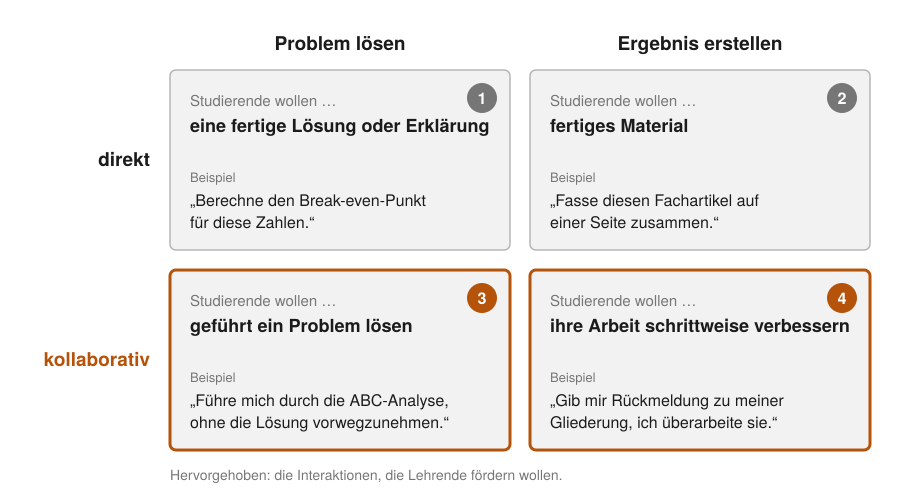
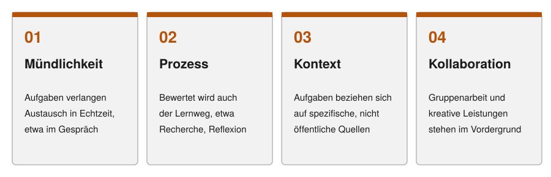

# Phasen der Arbeit mit generativer KI (4D) {#sec-umsetzung}

::: kapitel-gliederung
:::

Prof. Dr. Henrik Sauer ist Studiendekan und lehrt Marketing für 180 Studierende der Betriebswirtschaft. Im Sommer hat er seine Hausarbeitsthemen einmal in einen Chatbot getippt; die Antworten waren dünn, also ließ er die Themen, wie sie waren. Die Arbeiten, die jetzt auf seinem Tisch liegen, sind glatt formuliert, und ob sie eigene Leistung zeigen, kann er nicht sagen. Ein Kollege will alle Abgaben durch einen KI-Detektor schicken. Die Fakultät erwartet bis Semesterbeginn eine Regel zur Dokumentation, und der Entwurf aus der Verwaltung verlangt das vollständige Protokoll jeder Eingabe. Für das neue Semester plant Sauer eine 90-minütige KI-Einführung in der ersten Woche. Er fragt sich, ob er damit das Richtige aufbaut oder nur das Falsche absichert.

*Die Szene ist aus Gesprächen in Workshops und Gremien zusammengesetzt.*



::: {.callout-note .ez-block title="Bevor Sie weiterlesen: Wie sehen Sie das?"}
*Wie sehr stimmen Sie den vier Aussagen zu? Jede Aussage wird an der Stelle im Kapitel aufgelöst, die sie beantwortet. Wer sich vorher festlegt, liest gezielter.*

::: {.einschaetzung #ez-k5-1}
Liefert ein Sprachmodell auf eine Kursaufgabe beim ersten Versuch eine schwache Antwort, können Studierende die Aufgabe kaum mit KI lösen.

[Auflösung in @sec-durchspielen]{.ez-verweis}
:::

::: {.einschaetzung #ez-k5-2}
Studierende lernen den Umgang mit KI besser, wenn sie gleich damit üben und die Erklärungen an konkreten Problemen folgen, als durch eine gründliche Einführung vorab.

[Auflösung in @sec-einfuehrung-studierende]{.ez-verweis}
:::

::: {.einschaetzung #ez-k5-3}
Prüfende können eine mit KI geschriebene Hausarbeit in der Regel nicht von einer rein menschlichen unterscheiden, auch wenn die Aufgabe authentisch und praxisnah gestellt ist.

[Auflösung in @sec-pruefen]{.ez-verweis}
:::

::: {.einschaetzung #ez-k5-4}
Damit die KI-Nutzung nachvollziehbar wird, sollten Studierende jede Interaktion mit allen Prompts protokollieren.

[Auflösung in @sec-dokumentation]{.ez-verweis}
:::
:::

::: {.callout-note .lernziele title="Lernziele: Nach diesem Kapitel können Sie …"}
1. eigene Aufgaben mit einem Sprachmodell durchspielen und daraus Anpassungen für Ihren Kurs ableiten;
2. eine praktische, über das Semester verteilte Einführung der Studierenden planen und einen Kurs in drei Phasen mit wechselnden Rollen der KI ergänzen;
3. eine Prüfungsleistung nach den vier Säulen Mündlichkeit, Prozessorientierung, Kontextualisierung und Kollaboration umbauen und die Grenzen von KI-Detektoren begründen;
4. Studierenden eine praktikable Dokumentation ihrer KI-Nutzung vorgeben, die zu den Richtlinien Ihrer Hochschule passt.

*Die Kernaussagen am Kapitelende sind nach diesen vier Zielen geordnet.*
:::

## Mit KI arbeiten: vier Kompetenzen {#sec-schemas}

Wer mit künstlicher Intelligenz (KI) arbeitet, trifft vier Arten von Entscheidungen.
Vor dem Prompt, der Eingabe an die KI, steht die Frage, was überhaupt an die KI geht, dann die Beschreibung der Aufgabe, nach der Antwort die Prüfung des Ergebnisses und über allem die Verantwortung dafür.
Ein Schema, das diese Schritte ordnet, macht aus einer Sammlung von Tipps eine Arbeitsweise, und weil es keine Werkzeuge nennt, übersteht es den nächsten Modellwechsel.
Dieses Kapitel folgt dem Schema: Nach den Grundbegriffen in @sec-definitionen beantwortet jeder Abschnitt eine der vier Fragen, und die Technik im Inneren der Modelle steht am Ende als Vertiefung.

### Das 4D-Modell {#sec-4d}

AI Fluency (etwa: Gewandtheit im Umgang mit KI) ist die Fähigkeit, effektiv, effizient, ethisch und sicher mit KI zu arbeiten [@dakan2025].
Das Modell zerlegt sie in vier Kompetenzen, die *4 D*, mit je drei Unterkompetenzen (@tbl-4d).

::: {.tabelle-scroll}
| Kompetenz | Leitfrage | Unterkompetenzen | Herkunft des Wortes |
|---|---|---|---|
| []{#sb-k2-delegation}**Delegation** | Was übernimmt der Mensch, was die KI? | Ziel- und Aufgabenbewusstsein (*goal and task awareness*), Kenntnis der Werkzeuge (*platform awareness*), Aufgabenverteilung (*task delegation*) | lat. *delegare*, übertragen |
| []{#sb-k2-description}**Description** | Wie sage ich der KI klar, was ich will? | Ergebnis beschreiben (*product description*), Zusammenarbeit beschreiben (*process description*), Verhalten festlegen (*performance description*) | lat. *describere*, umreißen, aufzeichnen |
| []{#sb-k2-discernment}**Discernment** | Wie beurteile ich, was die KI liefert? | Ergebnis beurteilen (*product discernment*), Zusammenarbeit beurteilen (*process discernment*), Verhalten beurteilen (*performance discernment*) | lat. *discernere*, unterscheiden, trennen |
| []{#sb-k2-diligence}**Diligence** | Wie setze ich KI verantwortlich und offen ein? | Sorgfalt beim Erzeugen (*creation diligence*), Offenlegung (*transparency diligence*), Prüfung vor der Freigabe (*deployment diligence*) | lat. *diligentia*, Sorgfalt, von *diligere*, hochachten, sorgsam auswählen |

: Die vier Kompetenzen des AI-Fluency-Modells mit ihren Unterkompetenzen. Übersetzung nach @dakan2025, CC BY-SA 4.0 {#tbl-4d tbl-colwidths="[16,24,40,20]"}
:::

Dakan und Feller nennen die vier D ausdrücklich vernetzte Kompetenzen, keine Reihenfolge [@dakan2025].
In ihrem Kurs für Lehrende verbinden sie die vier aber zu zwei Schleifen [@dakan2025teaching], und daraus baut dieses Buch einen Kreislauf[ (@fig-4d-kreislauf)]{.content-visible unless-format="html"}[, den die Abbildung unten zum Anklicken zeigt]{.content-visible when-format="html"}.
Die äußere Schleife zwischen **Delegation und Diligence** ist strategisch und läuft einmal je Vorhaben: Was soll die KI übernehmen, und welche Pflichten folgen daraus?
Sie läuft in beide Richtungen, denn eine Pflicht zur Offenlegung oder zur Prüfung verändert, was man sinnvoll abgibt.
Die innere Schleife zwischen **Description und Discernment** dreht sich in jedem Arbeitsgang viele Male: beschreiben, erzeugen lassen, prüfen, nachbessern.
Das Buch liest die vier D damit als Stufen eines Arbeitsablaufs; es folgt der Lehrpraxis der Autoren, nicht dem Wortlaut ihrer Definition.

::: {.content-visible when-format="html"}
<iframe loading="lazy" src="interactions/4d-kreislauf.html" width="100%" height="760px" frameborder="0" title="Der 4D-Kreislauf: zwei Schleifen, vier Kompetenzen, Engpass je Rolle"></iframe>
:::

::: {.content-visible unless-format="html"}
![Der 4D-Kreislauf. Die äußere Schleife (Delegation und Diligence) entscheidet einmal je Vorhaben, was die KI übernimmt und welche Pflichten daraus folgen; die innere (Description und Discernment) dreht sich in jedem Arbeitsgang mehrmals. Eigene Darstellung nach @dakan2025 und den beiden Schleifen aus @dakan2025teaching. Die Fassung zum Anklicken mit Unterkompetenzen und dem Engpass je Rolle: QR-Code scannen oder <https://th-koln-bartnik.github.io/genai4teaching/interactions/4d-kreislauf.html> aufrufen.](images/druck/4d-kreislauf.svg){#fig-4d-kreislauf width="100%" fig-pos="htbp"}
:::

Das Schema beantwortet nicht, wie viel KI eine Aufgabe verträgt.
Zu viel Einsatz kostet Kompetenz und Qualität, zu wenig kostet Übung mit Werkzeugen, die die Studierenden im Beruf vorfinden; die Mitte zwischen beiden muss man für jede Aufgabe neu suchen, und der Kreislauf zeigt, an welcher Stelle die Entscheidung fällt.
Was die Forschung über die Kosten des Auslagerns weiß, zeigt @sec-evidenz.

### Wie dieses Kapitel und das Buch das Schema nutzen {#sec-4d-nutzung}

Im übrigen Buch endet jede der vier Rollen in @sec-szenarien mit einem Absatz, der den Kreislauf für diese Rolle durchläuft und die Stufe benennt, an der er am ehesten reißt; die Prompt-Sammlung in @sec-prompts liefert Material für die Stufe Description.

```{=html}
<span id="sec-schemas-rahmen"></span>
```

::::: {.callout-note title="Warum AI Fluency?"}
Artikel 4 der KI-Verordnung verpflichtet Hochschulen, die KI-Systeme bereitstellen, zu Maßnahmen für die KI-Kompetenz (*AI literacy*) ihres Personals, sagt aber nicht, worin diese Kompetenz besteht; der Digital-Omnibus vom Juli 2026 hat die Pflicht entschärft und die Definition nicht nachgeliefert [@eu2024aiact; @eu2026omnibus] (@sec-ki-vo).
Die Lücke füllen Kompetenzrahmen; einen Überblick über die Forschung zu *AI Literacy* gibt @pinski2024literacy.
Von fünf neueren Rahmen für die Hochschullehre[ (@tbl-kompetenzrahmen)]{.content-visible when-format="html"}[, die die Online-Fassung vergleicht,]{.content-visible unless-format="html"} arbeitet dieses Buch mit *AI Fluency* von Rick Dakan und Joseph Feller: Es ordnet nach dem Arbeitsprozess, nennt keine Werkzeuge und führt als einziger die Verantwortung gegenüber Dritten als eigene Kompetenz.
Alle fünf verlangen, dass Lernende KI-Ergebnisse kritisch beurteilen, kaum einer sagt, wie; die Prüfmethoden liefert dieses Buch dort nach, wo sie gebraucht werden (@sec-hallucinations).
Die deutschen Definitionen sind eigene Übersetzungen der Fassung, die die irische Hochschulbehörde HEA (*Higher Education Authority*) herausgegeben hat; sie steht wie dieses Buch unter der Lizenz CC BY-SA 4.0.

:::: {.content-visible when-format="html"}

::: {.tabelle-scroll}
| Rahmen | Zielgruppe | Ordnungsprinzip | Entstehung |
|---|---|---|---|
| AI Fluency [@dakan2025] | Hochschule | vier Kompetenzen entlang des Arbeitsprozesses, drei Formen der Zusammenarbeit | Lehrerfahrung zweier Hochschulen |
| KI-Kompetenzrahmen Hochschule [@feil2026dlhn] | Hochschule einschließlich Verwaltung | vier Bereiche: Technologie sowie Recht und Ethik als Basis, darauf Anwendung und Reflexion; drei Niveaustufen | Recherche und Kriterienkatalog im Verbundprojekt Digitale Lehre Hub Niedersachsen (DLHN) |
| AI Literacy Heptagon [@hackl2026heptagon] | Hochschule, fachbezogen anpassbar | sieben Dimensionen, vier Niveaustufen nach Bloom | Literaturreview nach PRISMA (Standard für systematische Übersichtsarbeiten) mit 27 Studien |
| AILit Framework [@oecd2026ailit] | Schule | vier Domänen (mit KI umgehen, gestalten, steuern, die KI-Entwicklung mitprägen), je Wissen, Fähigkeiten und Haltungen | EU und die Industriestaaten-Organisation OECD mit Fachleuten und öffentlicher Konsultation |
| Kompetenzen nach @gimpel2024competencies | Hochschule, Schwerpunkt Wirtschaftswissenschaften | Basiskompetenzen (AI Literacy, AI Reflection) und vier Felder vertiefter Kompetenzen | Konsortium von vier Hochschulen, Analyse von Curricula, Stellenmarkt und Literatur |

: Fünf Kompetenzrahmen für den Umgang mit KI im Vergleich. Eigene Zusammenstellung nach den genannten Quellen {#tbl-kompetenzrahmen tbl-colwidths="[20,20,32,28]"}
:::

::::

:::: {.content-visible unless-format="html"}
{#fig-qr-kompetenzrahmen width="32%" fig-align="center"}
::::
:::::

::::: {.content-visible when-format="html"}

## AI Fluency am Berufsprofil: eine Übung in vier Phasen {#sec-ai-fluency-uebung}

Die Übung führt durch die vier Kompetenzen des 4D-Modells aus @sec-schemas, jeweils am selben Berufsprofil, so dass Lehrende sie auf ihr Fach übertragen können. Sie eignet sich für eine Fortbildung von Lehrenden ebenso wie für eine Sitzung mit Studierenden höherer Semester.

::: {.callout-note title="Didaktische Ziele der heutigen Übung"}
- **Kennenlernen** – GenAI-Literacy-Frameworks (Modelle der KI-Kompetenz) als Analyserahmen für den Kompetenzaufbau.
- **Verstehen** – Aufbau speziell des AI Fluency Frameworks (etwa: Gewandtheit im Umgang mit KI).
- **Anwenden** – Modellverständnis praktisch erfahren.
- **Verstehen** – weitere Ressourcen für Übungen in den vier Teilbereichen kennenlernen (US-Berufsdatenbank O\*NET, Prompt-Arten, systematische Evaluation …).
:::

### Worum es geht

AI Fluency ist die Fähigkeit, mit KI-Systemen wirksam, effizient, ethisch und sicher zu arbeiten [@dakan2025]. Sie entsteht durch Übung. Das Modell gliedert sie in vier Kompetenzen, die *4 D* (@sec-4d); in dieser Übung werden sie als vier Phasen durchlaufen:

| Phase (4D) | Leitfrage |
|---|---|
| **Delegation** | Was übernimmt der Mensch, was die KI? |
| **Description** | Wie sage ich der KI klar, was ich will? |
| **Discernment** | Wie beurteile ich kritisch, was die KI liefert? |
| **Diligence** | Wie setze ich KI verantwortlich und transparent ein? |

: Die vier Kompetenzen des AI Fluency Frameworks {tbl-colwidths="[28,72]"}

::: {.callout-tip title="Drei Formen im Aufgabenmodell [@acemoglu2025tasks]"}
**Automatisierung (*automation*).** Eine Aufgabe wandert vom Menschen zur KI.

**Augmentierung (*labor-augmenting technology*).** Die Aufgabe bleibt beim Menschen, die KI macht seine Arbeit schneller oder besser.

**Neue Aufgaben (*new tasks*).** Durch die KI entstehen Tätigkeiten, die es vorher nicht gab, etwa die Prüfung von KI-Ergebnissen.

Beispiele aus der Lehre zeigt @tbl-acemoglu.
:::

**So nutzen Sie diese Übung.** Die folgenden Aufgaben sind so formuliert, dass Sie sie auf jedes Fach übertragen können. Der rote Faden ist ein **Berufsprofil aus der O\*NET-Datenbank** – einer frei zugänglichen Sammlung standardisierter Tätigkeitsbeschreibungen. Wählen Sie ein für Ihren Studiengang typisches Profil und ersetzen Sie damit die Platzhalter `[STUDIENBEREICH]`, `[BERUF]` und `[O*NET-LINK]`. Die Übungen zu Description, Discernment und Diligence bauen aufeinander auf: Sie entwickeln eine GenAI-Unterstützung, testen ihre Qualität und prüfen die Verantwortung – alles am selben Anwendungsfall.

Beispiele: Delegation am Profil **Social Worker** ([O\*NET 21-1021.00](https://www.onetonline.org/link/summary/21-1021.00){target="_blank"}); die übrigen Übungen am Profil **Project Management Specialist** ([O\*NET 13-1082.00](https://www.onetonline.org/link/summary/13-1082.00){target="_blank"}).

::: {.callout-note appearance="simple"}
**Hintergrund in der Wissensbasis.** Die Detail-Definitionen des Frameworks, der Prompt-Pattern-Katalog und die Optionen der systematischen Qualitätsprüfung sind ausführlich in der Wissensbasis hinterlegt:
[AI Fluency Framework](https://th-koln-bartnik.github.io/workshop-ai-4-taac/appendix/wissensbasis.html#sec-4d-framework){target="_blank"} ·
[Prompt-Pattern-Katalog (White et al., 2023)](https://th-koln-bartnik.github.io/workshop-ai-4-taac/appendix/wissensbasis.html#sec-prompt-patterns){target="_blank"} ·
[Optionen der Qualitätsprüfung](https://th-koln-bartnik.github.io/workshop-ai-4-taac/appendix/wissensbasis.html#sec-primer-qualitaetspruefung){target="_blank"}
:::

::: {.callout-note appearance="simple" title="Stand der Modellnamen: Oktober 2026"}
Die Übung nennt die Modelle, die im Oktober 2026 in der Academic Cloud der Gesellschaft für wissenschaftliche Datenverarbeitung in Göttingen (GWDG) und auf der Vergleichsplattform arena.ai verfügbar waren. Ersetzen Sie sie durch ein kleines, ein mittleres und das stärkste Modell Ihres aktuellen Hochschulzugangs; die Aufgabe bleibt dieselbe.
:::

### Phase 1 – Delegation {#sec-af-uebung-delegation}

*Modellstärke erfahren und die Wirkung von GenAI auf Berufsaufgaben einschätzen.*

#### Übung 1 – Karriereberatung im Modellvergleich

**Kompetenzfokus:** Platform Awareness, Task Delegation.

**Aufgabe (5 Min).** Geben Sie denselben Prompt 3× nacheinander in der GWDG Academic Cloud ein – zuerst mit **Teuken 7B**, dann **Qwen 3 30B**, dann **OpenAI GPT 5.5**. Notieren Sie je drei Stichworte zur Qualität (Tiefe, Konkretheit, Belege).

- Alle drei Modelle laufen in der [GWDG Academic Cloud](https://academiccloud.de){target="_blank"} – so bleibt das Setup (die „Harness“, der Werkzeugkasten um das Modell) gleich, und die Unterschiede zeigen die reine Modellstärke.
- Faktenbasis: ein O\*NET-Profil Ihres Fachs. Beispiel zum Einstieg: Social Worker, [21-1021.00](https://www.onetonline.org/link/summary/21-1021.00){target="_blank"}.

```text
Berate mich: Ich studiere [STUDIENBEREICH]. Wie sollte ich mich auf die
Auswirkungen generativer KI auf den Arbeitsmarkt für [BERUF] vorbereiten?
Bezug: O*NET-Profil [O*NET-LINK].
```

**Auswertung (Think-Pair-Share).** Welche Unterschiede ergeben sich allein aus der Modellstärke (Teuken 7B → Qwen 3 30B → GPT 5.5)? Wo wird ein schwächeres Modell erkennbar ungenau oder halluziniert? Den Einfluss der Werkzeuge (Harness) untersuchen Sie in Idee 1.

**Abgabe.** Drei Outputs, je drei Qualitäts-Stichworte und ein Satz Empfehlung: Welches Modell wofür?

**5 Ideen zur Weiterentwicklung**

1. **KPMG-Überblick mit Suchwerkzeugen.** Auf [arena.ai](https://arena.ai){target="_blank"} Side-by-Side öffnen – links Llama 3.1 8B, rechts über die Globus-Schaltfläche zwei such-fähige Modelle (`grok-4.20-multi-agent` und `gpt-5.2-search`). Dieselbe Frage an alle drei. Notieren: Was geht auf das Modell zurück, was auf die Harness? Wo halluziniert Llama erkennbar?

   ```text
   Geben Sie mir einen Überblick zu aktuellen Entwicklungen im Geschäft von
   KPMG Deutschland, mit besonderem Fokus auf die Nutzung generativer KI und
   die wirtschaftliche Lage.
   ```

2. **Deep-Research-Lauf.** Zuerst das starke Modell einen Deep-Research-Prompt mit Ziel, Wozu, Material und Abnahme erzeugen lassen, dann in den Deep-Research-Modus (mehrstufige, selbstständige Webrecherche der KI) geben (GPT mit Deep Research, Gemini Advanced oder Perplexity Pro im Trial).

   ```text
   Erstellen Sie mir einen Prompt mit Ziel, Wozu, Material und Abnahme für eine
   Deep-Research-Analyse von Praxisbeispielen aus hochwertiger grauer Literatur
   (vor allem Think Tanks, Reports der großen Unternehmensberatungen und Big
   Four, Case Studies von Anbietern wie Salesforce oder IBM) zur Aufgabenstellung:
   „Process Automation und Cognitive Automation im Berufsfeld [BERUF] —
   Erfolgsfaktoren, Barrieren, Best Practices.“ Fragen Sie mich anfangs nach
   weiteren Details, wenn nötig. Abnahmekriterium: Jede Aussage hat eine
   prüfbare Quelle mit Link.
   ```

3. **Sprachvergleich.** Dieselbe Frage auf Deutsch und auf Englisch stellen – ändert sich die Qualität je Modell?
4. **Quellenpflicht.** Dieselbe Frage einmal frei, einmal mit „belege jede Aussage mit einer Quelle“ stellen und die Belegbarkeit vergleichen.
5. **Kreuzkritik.** Das stärkste Modell die Antwort eines schwächeren bewerten lassen – und umgekehrt. Wer erkennt die Schwächen des anderen?

*Vorbild: [Übung 2 – Karriereentwicklung im Modellvergleich (Workshop 1)](https://th-koln-bartnik.github.io/workshop-ai-4-taac/parts/02-uebungen-w1.html#sec-uebung-2){target="_blank"}.*

#### Übung 2 – GenAI-Wirkung auf Berufsaufgaben (drei Formen)

**Kompetenzfokus:** Goal and Task Awareness, Task Delegation.

**Aufgabe.** Kopieren Sie die Aufgabenliste aus dem Reiter „Tasks“ des O\*NET-Profils in den Prompt. Lassen Sie die KI die Aufgaben nach den drei Formen clustern und konkrete Workflow-Veränderungen ableiten.

```text
Hier ist eine Liste von Aufgaben, die im Beruf [BERUF, z.B. Social Worker]
vorkommen. Clustere und diskutiere die Auswirkung von GenAI auf diese Aufgaben,
je nachdem, ob die Aufgabe zur KI wandert (automation), ob die KI den Menschen
bei der Aufgabe unterstützt (labor-augmenting technology) oder ob neue Aufgaben
entstehen (new tasks). Gib mir 3 konkrete Beispiele, wie sich Workflows jetzt
verändern könnten. Bezug: O*NET-Profil [O*NET-LINK, z.B.
https://www.onetonline.org/link/summary/21-1021.00 ].
```

**Abgabe.** Cluster-Übersicht (Automatisierung / Augmentierung / neue Aufgaben) und drei konkrete Workflow-Beispiele.

**5 Ideen zur Weiterentwicklung**

1. **Berufe-Vergleich.** Zwei verwandte O\*NET-Profile gegenüberstellen – welche Aufgaben sind je eher automatisiert, augmentiert oder um neue Aufgaben ergänzt?
2. **Eigene Einschätzung zuerst.** Die Aufgaben selbst clustern, dann mit der KI vergleichen – wo weicht die KI ab und warum?
3. **Workflow-Redesign.** Für ein Beispiel aus dem Augmentierungs-Cluster einen konkreten neuen Arbeitsablauf Schritt für Schritt ausarbeiten lassen.
4. **Gegenprüfung mit Literatur.** Die KI-Einschätzung mit einer Studie oder einem Branchenreport abgleichen – hält sie stand?
5. **Zeithorizont.** Dieselbe Analyse für „heute“ und „in fünf Jahren“ erstellen lassen – was verschiebt sich zwischen den Clustern?

### Phase 2 – Description {#sec-af-uebung-description}

*Eine GenAI-Unterstützung gemeinsam entwerfen – als Prompt mit Ziel, Wozu, Material und Abnahme.*

::: {.callout-note appearance="simple"}
**Flipped Interaction** [@white2023]: „Stell mir Fragen, bis du genug Informationen hast, um Ziel X zu erreichen. Frage mich eine Frage auf einmal.“ Das Modell führt die Befragung – Sie antworten.

**Vier Rollen für die KI** (Hilfskraft, Tutor, Co-Pilot, Simulator): die **Hilfskraft** erledigt Zuarbeiten auf Anweisung; der **Tutor** erklärt, fragt ab und gibt Feedback; der **Co-Pilot** denkt als Partner mit und schlägt vor; der **Simulator** spielt Szenarien und Rollen zum Üben durch.

**Zwei Muster für Prompts** (Vorbemerkung zu @sec-prompts): **Arbeitsauftrag** = Ziel · Wozu · Material · Abnahme (das Modell liefert ein Werkstück, etwa als Hilfskraft oder Co-Pilot). **Verhaltensbeschreibung** = Zweck · Ablauf · Regeln · Grenzfälle · Ende (Tutor oder Simulator; das Gespräch ist das Produkt).
:::

#### Übung – GenAI-Unterstützung entwerfen (Flipped Interaction)

**Kompetenzfokus:** Product Description, Process Description.

**Aufgabe.** Lassen Sie sich per Flipped Interaction eine GenAI-Unterstützung für ein O\*NET-Profil entwerfen. Die KI geht mit Ihnen die vier Rollen durch und liefert am Ende einen angepassten Prompt mit Ziel, Wozu, Material und Abnahme. Beispiel: Project Management Specialist ([13-1082.00](https://www.onetonline.org/link/summary/13-1082.00){target="_blank"}).

```text
Ich will eine GenAI-Unterstützung für Studierende/Arbeitnehmer im Bereich
[BERUF] (O*NET [O*NET-LINK]) erstellen. Hilf mir, dafür einen Prompt zu
erstellen, indem du mit mir Optionen durchgehst für: KI als Hilfskraft, KI als
Tutor, KI als Co-Pilot, KI als Simulator. Stell mir dazu Fragen, eine nach der
anderen, mit Antwortoptionen. Als Ergebnis will ich einen angepassten Prompt
mit Ziel, Wozu, Material und Abnahme.
```

**Abgabe.** Der angepasste Prompt plus eine Notiz, welche Rolle Sie gewählt haben und warum.

*Vorlagen für die vier Rollen: die Prompts dieses Anhangs (@sec-prompts).*

**5 Ideen zur Weiterentwicklung**

1. **Alle vier Rollen testen.** Für dasselbe Profil je einen Prompt als Hilfskraft, Tutor, Co-Pilot und Simulator bauen – welche Rolle passt zu welcher Aufgabe?
2. **Rollen kombinieren.** Zwei Rollen mischen (z. B. Tutor + Simulator) und prüfen, ob das ein komplexes Lernziel besser trifft.
3. **Persona schärfen.** Die KI eine passende Persona erfinden lassen (Berufserfahrung, Ton) und prüfen, ob der Output dadurch fachnäher wird.
4. **Die Hälfte streichen.** Streichen Sie die Hälfte Ihres Prompts. Was fehlt im Ergebnis?
5. **Prompt-Muster nach White et al. (2023).** Den erzeugten Prompt um Bauformen aus dem Prompt-Pattern-Katalog erweitern (z. B. Persona + Template + Fact Check List) und die Wirkung vergleichen [@white2023].

### Phase 3 – Discernment {#sec-af-uebung-discernment}

*Die Output-Qualität der eigenen GenAI-Unterstützung systematisch testen.*

#### Übung – Output-Qualität systematisch testen

**Kompetenzfokus:** Product Discernment, Process Discernment.

**Aufgabe.** Lassen Sie sich per Flipped Interaction ein Testverfahren für die in Phase 2 erstellte GenAI-Unterstützung entwickeln – in vier Bausteinen, die nach dem Prinzip *Defense in Depth* (gestaffelte Sicherung) aufeinander aufbauen (keiner allein genügt).

- **Baustein 1 – Bewertungsschemata:** Optionen mit Vor- und Nachteilen.
- **Baustein 2 – Manuelle Testfälle:** erste Fälle zur manuellen menschlichen Bewertung.
- **Baustein 3 – Automatische Bewertung:** GenAI bewertet GenAI, z. B. mit RAGAS. RAGAS (Retrieval-Augmented Generation Assessment, Prüfung von KI mit Dokumentenabruf) ist ein Open-Source-Werkzeug, das ein zweites Sprachmodell als Prüfer einsetzt und die Antwortqualität automatisch in Kennzahlen misst – vor allem Faithfulness (Treue zur Quelle), Answer Relevancy (Antwortrelevanz), Context Precision und Context Recall (Güte des Abrufs) [@es2024].
- **Baustein 4 – Gold-Standard:** ein Pool fachlich abgesicherter Testfälle für die regelmäßige Bewertung – die einzige Stelle, an der menschliche Fachexpertise eintritt.

```text
Ich habe eine GenAI-Unterstützung erstellt: [Beschreibung aus Phase 2 einfügen].
Hilf mir, dafür systematisch die Output-Qualität zu testen. Entwickle mit mir
nacheinander: (1) Optionen für Bewertungsschemata, mit Vor- und Nachteilen;
(2) erste Testfälle zur manuellen systematischen Bewertung; (3) ein Setup zur
automatischen Bewertung von GenAI durch GenAI (z. B. RAGAS); (4) einen Pool von
Testfällen für die spätere regelmäßige Bewertung (Gold-Standard). Stell mir
Fragen, eine nach der anderen.
```

**Abgabe.** Bewertungsschema, 3–5 manuelle Testfälle, ein Konzept für die automatische Bewertung und ein Gold-Standard-Startset.

**5 Ideen zur Weiterentwicklung**

1. **Schichten benennen.** Den vier Bausteinen je eine typische Fehlerklasse zuordnen, die sie abfangen (Defense in Depth).
2. **Adversarial testen.** Testfälle bewusst so bauen, dass sie das System zu Halluzination verleiten (Fang- und Grenzfälle).
3. **RAGAS interpretieren.** Eine schlechte Antwort kausal zerlegen – schlechte Faithfulness bei guter Context Precision zeigt ein Generator-Problem, schlechte Context Recall ein Retrieval-Problem.
4. **Inter-Rater-Reliabilität.** Zwei Personen denselben Output unabhängig bewerten und die Übereinstimmung prüfen (z. B. Cohens Kappa).
5. **Regressionstest.** Nach jeder Prompt-Änderung den Gold-Standard erneut laufen lassen – wird das System besser oder schlechter?

*Vertiefung: [Primer – Optionen der Qualitätsprüfung](https://th-koln-bartnik.github.io/workshop-ai-4-taac/appendix/wissensbasis.html#sec-primer-qualitaetspruefung){target="_blank"}.*

### Phase 4 – Diligence {#sec-af-uebung-diligence}

*Verantwortung, Transparenz und Freigabe mit der KI durchdenken.*

#### Übung – Diligence-Check im Dialog

**Kompetenzfokus:** Creation Diligence, Transparency Diligence, Deployment Diligence.

**Aufgabe.** Lassen Sie sich von der KI mit Fragen durch die drei Diligence-Unterkategorien führen und sich zu jedem Punkt Optionen geben – für denselben Anwendungsfall wie in Phase 2 und 3.

```text
Führe mich für den folgenden Anwendungsfall mit Fragen durch die Hauptpunkte von
Creation Diligence, Transparency Diligence und Deployment Diligence des
AI-Fluency-Schemas. Gib mir zu jedem Punkt Optionen, um die wichtigsten Aspekte
zu berücksichtigen. Anwendungsfall: [Beschreibung aus Phase 2/3 einfügen]. Stell
mir Fragen, eine nach der anderen.
```

**Worauf die drei Kategorien zielen.** Creation Diligence (verantwortlicher Umgang, Bias, Datenschutz), Transparency Diligence (Offenlegung des KI-Anteils gegenüber Stakeholdern) und Deployment Diligence (Verifikation und Verantwortung vor der Freigabe).

**Abgabe.** Je Unterkategorie eine festgehaltene Leitlinie und eine offene Frage, die Sie selbst klären müssen.

**5 Ideen zur Weiterentwicklung**

1. **Datenschutz konkret.** Prüfen, welche Eingaben Ihres Anwendungsfalls niemals in ein KI-System dürfen (DSGVO-Bezug).
2. **Transparenzhinweis formulieren.** Einen konkreten, vorzeigbaren Hinweis für Ihren Anwendungsfall schreiben (Vorbild: der [Transparenzhinweis](transparenz.qmd) dieses Buchs).
3. **Freigabe-Checkliste.** Die Prüfschritte vor der Veröffentlichung als Checkliste festhalten (Faktencheck, Test, Validierung).
4. **Stakeholder-Map.** Wer ist betroffen, wem gegenüber besteht welche Offenlegungspflicht?
5. **Bias-Probe.** Den eigenen Anwendungsfall gezielt auf Verzerrungen testen (z. B. unterschiedliche Personengruppen in den Testfällen).

:::::

## Delegation: Was übernimmt die KI? {#sec-delegation}

Delegation fragt, was der Mensch übernimmt und was die KI (@tbl-4d).
Die Antwort hat drei Teile, die den Unterkompetenzen des Modells entsprechen: wissen, was die Modelle können (@sec-capabilities), Setup und Modell kennen (@sec-patterns-usage, @sec-model-choice) und die Arbeit zwischen Mensch und KI verteilen (@sec-arbeitsweisen).
Den größten Teil des Harness liefert dabei der Hersteller; den Teil, den die Nutzenden selbst bauen, nennt @bockeler2026harness den äußeren Harness (*outer harness*): Anleitungsdateien, Skills (bei Bedarf geladene Gebrauchsanweisungen), eigene Wissensbasen und Prüfregeln.
An diesem äußeren Harness gestalten Lehrende und Studierende; ein Übungstutor (@sec-fall-tutor-bwl), ein Karriereberater (@sec-fall-job-buddy) und eine Quellenanbindung mit Praxispartnern (@sec-fall-unternehmen) laufen auf denselben großen Modellen und unterscheiden sich in Anleitung, Quellen und Grenzen.
Unsere Rolle verschiebt sich dabei: Wir setzen das Ziel, legen fest, wo der Agent anhält, und prüfen, was zurückkommt; OpenAI fasst das in den Leitsatz „Humans steer. Agents execute.“ [@lopopolo2026harness].

### Was die Modelle können und was nicht {#sec-capabilities}

Was Sprachmodelle können, ist sehr uneinheitlich und **verändert sich schnell**.
Mollick und Kollegen sprechen von einer „**Jagged Technological Frontier**“[]{#sb-k2-zerklueftete-grenze}, einer zerklüfteten Technik-Grenze: Zwei Aufgaben von ähnlicher Schwierigkeit für Menschen können auf verschiedenen Seiten der Grenze liegen; die eine löst die KI auf menschlichem Niveau oder besser, an der anderen scheitert sie [@dellacqua2023].
In ihrem Experiment mit Consultants brachte KI bei den meisten von 18 Beratungsaufgaben große Vorteile; bei einer gezielt außerhalb der Grenze gewählten Aufgabe lagen die Consultants mit KI dagegen 19 Prozentpunkte seltener richtig als ohne [@dellacqua2023].

::: {.callout-tip .ez-pruefen title="Ihre Einschätzung prüfen"}
*„Wenn ein Modell die schwierigen Aufgaben Ihres Fachs löst, können Sie sich bei den leichteren erst recht auf es verlassen.“* []{.ez-ihre data-ez="ez-k2-3"}

**Auflösung: nein.** Die Fähigkeiten der Modelle folgen nicht unserer Vorstellung von schwer und leicht. Zwei für Menschen ähnlich schwierige Aufgaben können auf verschiedenen Seiten der zerklüfteten Grenze liegen, und bei der Aufgabe jenseits der Grenze lagen die Consultants mit KI 19 Prozentpunkte seltener richtig als ohne. Wo die Grenze im eigenen Fach verläuft, zeigt nur der Test an den eigenen Aufgaben.
:::

Zugleich wächst, was sich an die Modelle delegieren lässt.
Ein anschauliches Maß dafür ist der **Zeithorizont**: die Dauer, die Fachleute für eine Aufgabe brauchen, die ein Modell in der Hälfte der Fälle löst [@kwa2025].
Er stieg von rund 4 Minuten bei GPT-4 (März 2023) auf rund 17 Stunden bei einer frühen Fassung von Claude Mythos Preview (April 2026) und verdoppelte sich seit 2023 etwa alle 129 Tage, also gut alle vier Monate [@metr2026].
Den letzten Wert ordnet METR selbst als unsicher ein, weil die Testaufgaben über 16 Stunden nicht mehr für eine verlässliche Messung reichen.

::: {.content-visible when-format="html"}
<iframe loading="lazy" src="interactions/ki-entwicklung.html?zeige=zeithorizont" width="100%" height="1000px" frameborder="0" title="Diagramm: Zeithorizont der KI-Modelle 2019 bis 2026 nach METR"></iframe>
:::

::: {.content-visible unless-format="html"}

{#fig-performance width="100%" fig-pos="htbp"}

:::

Warum die Grenze so schnell wandert, beschreiben zwei **Skalierungsgesetze** (*scaling laws*) [@kaplan2020; @hoffmann2022; @openai2024; anschaulich bei @grootendorst2025].
Erstens werden Modelle verlässlich besser, je mehr Daten, Rechenleistung und Parameter ins Training fließen: Jede Verzehnfachung des Rechenaufwands senkt den Vorhersagefehler um etwa denselben Anteil [@kaplan2020], sofern Daten und Modellgröße im Gleichschritt wachsen [@hoffmann2022].
Zweitens liefert ein fertig trainiertes Modell bessere Lösungen, wenn es vor der Antwort mehr „**Denkzeit**“ (*test-time compute*) für zusätzliche Rechenschritte erhält [@openai2024; @snell2024]; auf diesem zweiten Gesetz beruhen die Reasoning-Modelle [@gottweis2025; @schwarcz2025].
Wie bei einer Prüfung ist die Lernzeit einmal bezahlt, die Bearbeitungszeit fällt bei jeder Prüfung neu an; deshalb kosten Reasoning-Modelle je Antwort mehr.
Trotzdem bleiben die **Grenzkosten der Nutzung sehr niedrig**, und personalisierte Lernangebote lassen sich kostengünstig skalieren [@mollick2025].

::: {.content-visible when-format="html"}
<iframe loading="lazy" src="interactions/scaling-laws.html" width="100%" height="1460px" frameborder="0" title="Animation: Zwei Skalierungsgesetze – Training und Denkzeit beim Antworten"></iframe>
:::

::: {.content-visible unless-format="html"}

![Zwei Skalierungsgesetze: Links sinkt der Vorhersagefehler mit dem Rechenaufwand im Training auf einer Geraden (beide Achsen logarithmisch); bei gleichem Budget schneidet das kleinere, mit mehr Daten trainierte Chinchilla besser ab als Gopher. Rechts steigt die Trefferquote mit der Denkzeit beim Antworten; bei mittelschweren Aufgaben schlägt ein kleines Modell mit Denkzeit ein 14-mal größeres. Lehrmodell, schematisch; Zahlen nach @kaplan2020, @hoffmann2022, @openai2024 und @snell2024. Interaktive Fassung: QR-Code scannen oder <https://th-koln-bartnik.github.io/genai4teaching/interactions/scaling-laws.html> aufrufen.](images/druck/scaling-laws-qr.png){#fig-scaling-laws width="100%" fig-pos="htbp"}

:::

Wie schnell die Preise fallen, zeigt eine Auswertung von Epoch AI.
Der GPQA Diamond (*Graduate-Level Google-Proof Q&A*, Fragen, die sich nicht ergoogeln lassen) ist eine Sammlung von 198 naturwissenschaftlichen Multiple-Choice-Fragen auf Promotionsniveau.
Die niedrigsten Kosten, mit denen ein Modell 75 % davon richtig beantwortet, sanken von 29,9 US-Cent je Frage im Januar 2025 auf 0,04 Cent im Juli 2026, um den Faktor 725 oder 99,9 % in 17 Monaten [@emberson2026].
Als mögliche Gründe nennt Epoch AI, ohne sie einzeln nachzuweisen, kleinere und je Token (Textbaustein) billigere Basismodelle unter den Reasoning-Modellen, weniger Denk-Token je Frage und den Wettbewerb, der den Aufpreis des ersten Modells auf einem Leistungsniveau rasch abschmelzen lässt [@emberson2026].

::: {.content-visible when-format="html"}
Im interaktiven Diagramm steht ein Kästchen für eine Frage zum o3-Preis vom Januar 2025. Zuerst ist eine eigene Schätzung gefragt, wie viele Fragen dieselben 30 Cent im Juli 2026 kaufen. Danach deckt jeder Klick auf „Weiter“ die nächste Preisstufe auf: Der Zeitstrahl rückt vor, und das Raster füllt sich, bis auf der letzten Stufe die Schätzung aufgelöst wird. Der Umschalter „Treppe“ zeigt dieselben Stufen auf logarithmischer Achse.

<iframe loading="lazy" src="interactions/ki-entwicklung.html?zeige=kosten" width="100%" height="1100px" frameborder="0" title="Diagramm: Kosten je GPQA-Frage bei 75 % Genauigkeit 2025 bis 2026 nach Epoch AI"></iframe>
:::

::: {.content-visible unless-format="html"}

![Expertenwissen wird 725-mal billiger: niedrigste Kosten je Frage, mit denen ein Modell 75 % des GPQA Diamond richtig beantwortet, Januar 2025 bis Juli 2026 (logarithmische Achse). Darunter als Raster: Ein Kästchen ist eine Frage zum o3-Preis vom Januar 2025, gefüllt ist, was 30 Cent zum jeweiligen Zeitpunkt kaufen; der letzte Sprung (−66 %) bringt mit 479 Kästchen mehr als alle früheren zusammen. Rasterdarstellung nach einer Idee von @mollick2026charts. Daten: Emberson & Roodman (2026), Epoch AI. Interaktive Fassung: QR-Code scannen oder <https://th-koln-bartnik.github.io/genai4teaching/interactions/ki-entwicklung.html?zeige=kosten> aufrufen.](images/druck/ki-kosten-qr.png){#fig-ki-kosten width="100%" fig-pos="htbp"}

:::

Was das für die Lehre bedeutet, zeigt ein Tutor-Bot, dem 150 Studierende an den 98 Tagen eines Semesters je zwei Fragen pro Tag stellen, zusammen 29.400 Fragen.
Auf der Rechengrundlage von Epoch AI kostete dieses Semester anfangs rund 8.800 US-Dollar und im Juli 2026 rund 12 US-Dollar, je Person also 59 US-Dollar und 8 Cent.
Das ist nur eine Größenordnung, denn ein Tutorgespräch ist länger als eine Testfrage, aber sie verschiebt die Frage von „Können wir uns das leisten?“ zu „Wer prüft, was der Tutor sagt?“.

::: {.content-visible when-format="html"}
Im Rechner lassen sich die eigenen Kurszahlen eintragen. „Abspielen“ oder „Weiter“ zeigt die Semesterkosten Stufe für Stufe, in denselben Farben wie im Raster; der Umschalter „log“ macht auch die kleinen Beträge der letzten Stufen sichtbar.

<iframe loading="lazy" src="interactions/tutor-kosten.html" width="100%" height="950px" frameborder="0" title="Rechner: Semesterkosten eines Tutor-Bots nach Preisstufen 2025 bis 2026"></iframe>
:::

::: {.content-visible unless-format="html"}
{#fig-tutor-kosten width="100%" fig-pos="htbp"}
:::

Zum Standardumfang der großen Chat-Interfaces gehören inzwischen vier **Funktionsklassen**, die den Einsatz in der Lehre erweitern: **Bildgenerierung** für Visualisierungen, **Audio-Modelle** mit steuerbarem Tonfall für Rollenspiele und barrierefreie Inhalte, **Research-Harnesses** („Deep Research“, Recherche-Agenten) für Literatursichtung und Projektarbeiten sowie günstige **Mini-Varianten der Reasoning-Modelle** (s. die Beispiele in @sec-einleitung).

### Einführung der Studierenden planen: Besser praktisch, häufig und niedrigschwellig {#sec-einfuehrung-studierende}

Den Einsatz von KI lernen die Studierenden, wenn sie häufig und über das Semester zeitversetzt damit experimentieren dürfen und müssen. Auch hier führen wieder die Empfehlungen des **Spacing & Interleaving** zu höherer Effektivität. Unterstützend können **externe Lernvideos** von seriösen Plattformen wie dem KI-Campus genutzt werden (z. B. https://ki-campus.org/videos/generativeki) oder selbst erstellte hochschulweite Angebote wie die Lehrpfade der TH Köln (https://lehrpfade.th-koeln.de/kategorie/ki/).

Um ein gemeinsames Verständnis über Grundlagen herzustellen, ist es hilfreich, **Zeit in einer der ersten Präsenzveranstaltungen einzuräumen**, um das gemeinsam zu üben. Der Sprung ins kalte Wasser ist dabei meist besser als eine lange Theorieeinführung: **Gleich anfangen**, dann problembasiert erläutern. Aspekte von **testgestütztem Lernen** und **fragebasierte Ausarbeitung** lassen sich gut über Anwendungsaufgaben in der Präsenzveranstaltung einbauen.

::: {.callout-tip .ez-pruefen title="Ihre Einschätzung prüfen"}
*„Studierende lernen den Umgang mit KI besser, wenn sie gleich damit üben und die Erklärungen an konkreten Problemen folgen, als durch eine gründliche Einführung vorab.“* []{.ez-ihre data-ez="ez-k5-2"}

**Auflösung: eher ja.** Den Umgang mit KI lernen Studierende, wenn sie häufig und über das Semester verteilt damit arbeiten; das folgt den gut belegten Befunden zu verteiltem Üben. Die Empfehlung, gleich anzufangen und dann problembasiert zu erläutern, stützt sich auf diese Befunde und auf Erfahrung aus der Lehre, nicht auf einen direkten Vergleich der beiden Einstiege.
:::

#### Beispiel: KI-Übung in Präsenzveranstaltung am Ende eines Theorieblock zu Nachhaltigkeit in Lieferketten

**Aufgabe:** Nicht lange schnacken, gleich anpacken! Mit der KI einen Projektplan für erste konkrete Schritte einer Nachhaltigkeitsstrategie erstellen (Edge Browser, Bing Copilot = GPT-4). Prompts zum Einstieg werden den Studierenden vorgegeben. Anfang mit:

* *Prompt #1*: „KI als Tutor“ oder ähnlich (siehe @sec-prompts, Allgemeiner Tutor. Prompts im Folgenden immer *kursiv*.)
* *Prompt #2*: *Ich will eine Cradle-to-cradle Nachhaltigkeitsstrategie für ein Unternehmen entwerfen. Helfen Sie mir, konkrete erste Schritte nach der Cradle-to-cradle Zertifizierung zu planen.*

Studierende sollen ein Unternehmen auswählen, bei dem sie schon einmal gearbeitet haben, oder das sie gut kennen. Hier ein Beispiel.

* *Prompt #3*: *Ich denke über Voss Automotive nach, die folgende Produkte herstellen: innovative Leitungs-und Verbindungssysteme, die überall auf der Welt in Pkw und Nutzfahrzeugen sowie Land- und Baumaschinen eingesetzt werden. Unser Produktportfolio umfasst dabei einbaufertige Leitungsmodule mit Rohren, Schläuchen, Verbindungselementen, Ventilen und Sensoren. Zur Verbindungstechnik gehören Stecksysteme, Verschraubungen, Mehrfachkupplungen und Verteiler.*
* *Prompt #4*: *Erstelle einen Zeitplan als Tabelle mit Aufwandsschätzungen für 3 Personen in 4 Wochen.*
* *Prompt #5*: *Mehr Details bitte: Erstelle Unteraufgaben für die jeweiligen Aufgabenpakete, jeweils auch wieder mit Aufwandsschätzungen.*

Die Studierenden sollen den Projektplan dann weiter verbessern und diskutieren. Erweiternd können sie auch z. B. Projektrisiken, Indikatoren und Gegenmaßnahmen und Szenarien erheben und diskutieren.

## Discernment: Wie beurteile ich, was die KI liefert? {#sec-hallucinations}

Discernment fragt, wie wir beurteilen, was die KI liefert (@tbl-4d).
Die Grundlage ist ein nüchterner Befund: Ein Sprachmodell prüft keine Wahrheit, und über sein eigenes Vorgehen gibt es nicht verlässlich Auskunft.

**Können wir das Modell fragen, wie es zu einem Ergebnis gekommen ist?** Eher nicht.
Eine Studie des KI-Labors Anthropic, die mit neuen Methoden in ein Modell hineinschaut, fand bei einfachen Rechnungen wie der Quadratwurzel von 0,64 klare interne Rechenschritte; bei schwierigeren, etwa dem Kosinus einer großen Zahl, gab das Modell Rechnungen an, für die keine internen Prozesse erkennbar waren [@lindsey2025].
Es erfindet dann eine plausible Rechnung, ohne gerechnet zu haben; die Autoren nennen das mit dem Philosophen Harry Frankfurt *bullshitting*.
Bekommt es einen Hinweis auf das gewünschte Ergebnis, rechnet es rückwärts darauf hin, ein Verhalten, das sie als „motiviertes Denken“ (*motivated reasoning*) bezeichnen.
Weitere Befunde dieser Studie stellt die Vertiefung vor (@sec-blick-ins-modell).

**Was kann zu Halluzinationen führen?** Die erfundene Literaturangabe aus dem Kapitelauftakt hat einen erkennbaren Mechanismus.
Im Modell ist standardmäßig ein Schaltkreis (*circuit*) aktiv, der die Antwort verweigert, wenn Informationen fehlen; erkennt das Modell einen bekannten Namen, hemmt ein konkurrierender Mechanismus diese Verweigerung und gibt die Antwort frei.
Kennt das Modell den Namen, aber nicht die gesuchte Tatsache, entsteht eine Halluzination[]{#sb-k2-halluzination}: Nach einem Fachartikel des bekannten Forschers Karpathy gefragt, nennt es einen erfundenen Titel, bei weniger bekannten Namen sagt es, die Antwort nicht zu kennen [@lindsey2025].

Wie man Ergebnisse prüft, zeigt dieses Buch dort, wo es gebraucht wird: in der Prüfregel der Modellwahl (@sec-model-choice), beim Tutor (@sec-tutor-betrieb) und bei KI-gebauten Simulationen (@sec-widget-pruefen).

::: {.callout-tip .ez-pruefen title="Ihre Einschätzung prüfen"}
*„Dass ein Chatbot Quellen erfindet, ist ein Programmfehler, den die nächsten Modellversionen abstellen.“* []{.ez-ihre data-ez="ez-k2-2"}

**Auflösung: nein.** Erfundene Quellen folgen aus der Funktionsweise: Ein Sprachmodell erzeugt das wahrscheinlichste nächste Wort und prüft dabei keine Wahrheit, und erkennt es einen Namen, unterdrückt das die Antwort „weiß ich nicht“, auch wenn ihm das Wissen fehlt. Abstellen lässt sich das nicht, eindämmen schon: mit eigenem Material als Grundlage (@sec-patterns-usage), Musterlösungen als Vorgabe und systematischer Prüfung der Ergebnisse (@sec-4d).
:::

## Diligence: Verantwortung, Offenlegung, Ressourcen {#sec-diligence}

Diligence fragt, wie wir KI verantwortlich und offen einsetzen (@tbl-4d): mit Sorgfalt beim Erzeugen, mit Offenlegung gegenüber anderen und mit Prüfung, bevor ein Ergebnis oder ein System freigegeben wird.

Die Technik verschiebt die Verantwortung, sie nimmt sie nicht ab.
Das zeigt das Gedächtnis eines Agenten (@sec-agenten-gedaechtnis): Ein Fehler, der einmal dort steht, wirkt in allen folgenden Sitzungen fort, die menschliche Prüfung vorgeschlagener Änderungen wird leicht zum Abnicken, und eine Versionsgeschichte zeigt, *wer* etwas geändert hat, nicht, *ob* es stimmt [@bridgwater2026dream].
Wer mehr Änderungen erzeugen lässt, als er lesen kann, hat kein geprüftes Gedächtnis, sondern ein ungeprüftes mit Freigabestempel.

Offenlegung heißt, zu sagen, wo KI mitgearbeitet hat: gegenüber Studierenden, wenn Material oder Feedback mit KI entsteht, und gegenüber allen, die mit KI erzeugte Texte, Bilder oder Stimmen lesen, sehen oder hören.
Welche Pflichten die KI-Verordnung dafür vorsieht, steht in @sec-ki-vo.

### Richtlinien zur KI-Nutzung - welche Handreichungen geben Hochschulen und was wird empfohlen?

#### Übersicht: Was regeln die Richtlinien der Hochschulen?

@an2025 werten die Richtlinien der 50 führenden US-Hochschulen zur Nutzung von LLM aus. Die Haltung ist insgesamt positiv, unterscheidet sich aber nach Zielgruppe. Lehrende erhalten in 94 % der Richtlinien didaktische Hinweise zu Kursdesign, Aufgaben und Prüfungsformaten, etwa gestufte Erlaubnisformen in der Kursbeschreibung (Syllabus): verboten, erlaubt mit Dokumentation, ausdrücklich gewünscht. Für Studierende überwiegen Integritätsregeln: Nicht genehmigte Nutzung gilt als Täuschungsversuch, die Klärung, ob KI zulässig ist, liegt bei ihnen, und Anleitungen zur kompetenten Nutzung bieten nur wenige Richtlinien. Die Autor:innen empfehlen zielgruppenspezifische, laufend weiterentwickelte Richtlinien.

Für Deutschland hat das Hochschulforum Digitalisierung die Leitlinien von 27 Hochschulen ausgewertet [@tobor2024], ein Update vom Februar 2025 ergänzt neuere Entwicklungen [@tobor2025]. Tobor hebt vier bewährte Praktiken hervor:

* []{#sb-k5-eigenstaendigkeitserklaerung}**Angepasste Eigenständigkeitserklärung:** Studierende erklären bei schriftlichen Prüfungen ohne Aufsicht, ob und wie sie KI-Werkzeuge genutzt haben (Vorlage etwa der Hochschule RheinMain).
* **Verdachtsfälle im Gespräch klären:** Detektoren wie GPTZero gelten als unzuverlässig. Empfohlen wird ein multifaktorielles Vorgehen mit Indikatoren wie nicht existierenden Quellen oder auffälligen Formulierungen; erhärtet sich der Verdacht, prüft ein Klärungsgespräch, ob die Studierenden ihre Arbeit verstehen (Leitfaden der Universität Vechta).
* **Keine automatisierte Bewertung:** Prüfungsordnungen verlangen eine begründete Bewertung durch eine prüfende Person; studentische Arbeiten in KI-Systeme hochzuladen gilt zudem als urheberrechtlich bedenklich.
* **Prüfungsformate didaktisch weiterentwickeln:** reflexionsorientierte Aufgaben, Zwischenfeedback und ergänzende mündliche Prüfungen (@sec-pruefen); auch der Umgang mit KI selbst wird Prüfungsgegenstand.

Im Update kritisiert Tobor die **thematische Zersplitterung** der Handreichungen, die regulatorische, didaktische und Risikofragen für viele Gruppen zugleich abdecken; zentrale Einstiegsseiten wie der KI-Hub der Universität Vechta (<https://www.uni-vechta.de/ki-hub>) bündeln sie. Wirksam werden Leitlinien erst, wenn sie **bekannt gemacht, diskutiert und weiterentwickelt** werden, am besten gemeinsam mit Studierenden, im Hochschulverbund und mit Formaten wie Prompt-Battles (Wettbewerben im Prompten) [@tobor2025].

#### Was die KI-Verordnung von Hochschulen verlangt {#sec-ki-vo}

Richtlinien sind seit 2025 nicht mehr nur Hausordnung, sondern Teil einer Rechtspflicht. Die europäische KI-Verordnung (KI-VO, *AI Act*; *regulation* von lateinisch *regula*, „Richtschnur“) verlangt in Artikel 4 seit Februar 2025 von jeder Organisation, die KI-Systeme betreibt, Maßnahmen für die KI-Kompetenz (*AI literacy*) ihres Personals; der Wissenschaftsrat stellt klar, dass Hochschulen, die Studierenden und Lehrenden Chat-Zugänge oder eigene Tutoren bereitstellen, in diesem Sinn Betreiber (*deployer*)[]{#sb-k5-betreiber} sind, und empfiehlt, KI-Kompetenz als Teil der Hochschulbildung selbst zu verankern statt als Zusatzschulung [@wissenschaftsrat2026]. Die Vereinfachungsverordnung vom Juli 2026, der sogenannte Digital-Omnibus, hat Artikel 4 nicht gestrichen, sondern entschärft: Organisationen müssen weiterhin Maßnahmen ergreifen, aber kein bestimmtes Kompetenzniveau jeder einzelnen Person mehr garantieren [@eu2026omnibus; @kicampus2026omnibus]. Für die Praxis der Lehre ist die Handreichung des Hochschulforums Digitalisierung der verlässlichste Wegweiser, weil sie die Rechtsfragen an Szenarien durchspielt: Wer einen eigenen Tutor mit den Kursmaterialien betreibt, bewegt sich im Szenario eines angepassten, nicht eines selbst entwickelten KI-Systems, solange die Anpassung über System-Prompt (hinterlegte Grundanweisung) und angebundene Quellen erfolgt; erst das Nachtrainieren (*fine-tuning*) eines Modells macht die Hochschule zur Anbieterin (*provider*) mit den entsprechenden Pflichten. Für die Materialien gilt das Urheberrecht unverändert, einschließlich der Grenze von 15 Prozent eines Werks für die Nutzung in der Lehre [@baresel2026]. Für die Ausgaben der KI gilt dagegen: Urheberrechtlich geschützt ist nach § 2 Abs. 2 Urheberrechtsgesetz (UrhG) nur, was freie kreative Entscheidungen eines Menschen ausdrückt; das Amtsgericht München versagte deshalb 2026 drei mit KI erzeugten Logos den Schutz, weil weder ausführliche Prompts noch die Auswahl unter mehreren Vorschlägen die Gestaltung prägten [@agmuenchen2026ki]. Ob Studierende solche Texte verwenden dürfen, regelt darum nicht das Urheberrecht, sondern das Prüfungsrecht, also die Prüfungsordnung und die Eigenständigkeitserklärung mit ihrer Pflicht, Hilfsmittel anzugeben [@salden2023]. Zum Vergleich außerhalb Europas: Das Massachusetts Institute of Technology (MIT) hat 2026 acht Prinzipien für die Lehre mit KI beschlossen, darunter mündliche Prüfungskomponenten, der Verzicht auf KI-Detektoren und eine modellunabhängige Campus-Plattform, und begründet damit dieselbe Linie wie Tobor: anleiten statt verbieten, und die Infrastruktur so bauen, dass die Wahl des Modells nicht die Lehre diktiert [@mit2026aicommittee].

::: {.callout-note title="Stand bei Drucklegung, November 2026: Hochschulen in Deutschland"}
Wo die deutschen Hochschulen beim Einsatz von KI-Tutoren und bei der Kompetenzpflicht standen, als dieses Buch in den Druck ging; die Online-Seite „Forschungsstand“ führt die Quellen fort.

- **Nutzung durch Studierende:** 81 Prozent von 28.584 Befragten an 202 Hochschulen nutzen KI-Werkzeuge mindestens wöchentlich, die Hälfte „als Tutor bzw. Lernpartner“; dieser Anteil reicht von 72 Prozent in der Wirtschaftsinformatik bis 19 Prozent in Jura [@horstmann2026check].
- **Angebote der Hochschulen:** 53 Prozent der befragten Hochschulleitungen haben KI-Lernassistenten in Umsetzung, an Hochschulen für angewandte Wissenschaften 63 Prozent; 13 Hochschulen melden Regelbetrieb, adaptives Lernen bieten 14 Prozent [@budde2026].
- **Lehrmaterial für eigene Tutoren:** Zwei Drittel der befragten Lehrenden würden ihre Materialien für einen Hochschul-Tutor freigeben, ein Drittel nicht; Bedingungen sind Urheberrecht und der Ausschluss des Trainings [@brandenburger2026].
- **Evaluierte Einsätze:** OneTutor in 84 Lehrveranstaltungen bayerischer Hochschulen im Sommersemester 2025, ohne Unterschied im wahrgenommenen Lernerfolg zwischen Nutzenden und Nichtnutzenden [@stumpf2026]; Sokratest an der Hochschule Rhein-Waal (@sec-tutor-betrieb) [@gerber2026]; ein Tutor für Physik, der die Antworten vollständig gab, wurde von den Studierenden entsprechend genutzt [@glomski2026]. Das bayerische Programm „KI-Tutorien“ meint dagegen menschliche Tutorinnen und Tutoren, die KI-Kompetenz vermitteln [@zhlbayreuth2026kitutorien].
- **Rechtsrahmen:** Artikel 4 KI-VO seit Februar 2025 in Kraft, durch den Digital-Omnibus vom Juli 2026 entschärft [@eu2026omnibus]; Rechtsszenarien für die Lehre in @baresel2026; Empfehlungen des Wissenschaftsrats vom Juli 2026 [@wissenschaftsrat2026].
:::

**Wie sehen solche Richtlinien aus?** Konkrete Formulierungen mit Links zu den Originaltexten stellt die Analyse des Hochschulforums Digitalisierung zusammen [@tobor2025].

### Wie können Studierende die Nutzung von LLM dokumentieren? Stichworte, nach Arbeitsphase, nach Werkzeug oder als Reflexionstagebuch {#sec-dokumentation}

**Frühe Handreichungen** zur Dokumentation von LLM in Studierendenarbeiten waren noch sehr allgemein formuliert und bestanden etwa darauf, dass **jegliche Nutzung im Schreibprozess** genau protokolliert würde. Bei täglicher und stark integrierter Nutzung ist das etwa so sinnvoll, wie die Forderung, jegliche Internetnutzung in einem Tagebuch zu erfassen. Sinnlose Forderungen führen schnell dazu, dass die dahinter stehende Forderung nach prinzipieller Nachvollziehbarkeit des Forschungsvorgehens entwertet und Umgehungshandlungen normalisiert werden.

**Neuere Empfehlungen** der Hochschulen sind hier deutlich realistischer: So bietet etwa eine Handreichung von niedersächsischen Hochschulen eine gute **Reihe von Optionen**, die von einer einfachen Stichpunktliste („elicit.com zur Literaturrecherche, perplexity.ai zur Internetrecherche, gamma.app zur Präsentationserstellung, stablediffusionweb.com zur Bildgeneration“) bis zu detaillierten Tagebüchern mit Reflexionshilfen reicht [@baresel2024a].

::: {.callout-tip .ez-pruefen title="Ihre Einschätzung prüfen"}
*„Damit die KI-Nutzung nachvollziehbar wird, sollten Studierende jede Interaktion mit allen Prompts protokollieren.“* []{.ez-ihre data-ez="ez-k5-4"}

**Auflösung: nein.** Bei täglicher Nutzung ist ein vollständiges Protokoll so wenig praktikabel wie ein Tagebuch jeder Internetsuche, und unerfüllbare Pflichten machen Umgehung zur Normalität. Neuere Handreichungen bieten abgestufte Formen: eine Stichwortliste, eine Übersicht nach Arbeitsphase oder Werkzeug, ein Reflexionstagebuch.
:::

Dieselbe Handreichung beschreibt drei weitere Formen: die Dokumentation nach Arbeitsphasen, nach Werkzeugen und als Reflexionstagebuch [@baresel2024a].

Die Dokumentation nach **Arbeitsphasen** (s. @tbl-doc-phases) zielt auf eine strukturierte Erfassung des KI-Einsatzes entlang typischer wissenschaftlicher Arbeitsphasen (z. B. Themenfindung, Recherche, Schreiben). Studierende bewerten selbst den Grad der KI-Nutzung auf einer vierstufigen Skala von „zur Inspiration“ bis „inhaltsgestaltend“ (@tbl-llm-scale) und dokumentieren Tool, Einsatzkontext und Wirkung. Je höher die Stufe, desto stärker muss die Nutzung begründet und durch Prüfschritte abgesichert werden [@baresel2024a; @rowland2023]. Ziel ist Transparenz über den konkreten Einfluss auf das Ergebnis.

Bei der **werkzeugorientierten** Dokumentation[ (s. @tbl-doc-tools)]{.content-visible when-format="html"} werden in tabellarischer Form die verwendeten Tools (z. B. ChatGPT, DeepL Write) samt Quelle, Zweck, Funktion und Einsatzbereich gelistet. Diese Variante erleichtert die Nachvollziehbarkeit, gibt aber wenig Einblick in den Kontext oder den Einfluss der Tools auf den Arbeitsprozess.

Beim **Reflexionstagebuch**[]{#sb-k5-reflexionstagebuch}[ (s. @tbl-doc-reflection)]{.content-visible when-format="html"} steht die kontinuierliche, persönliche Auseinandersetzung mit dem eigenen KI-Einsatz im Vordergrund. Studierende führen während des Arbeitsprozesses ein Tagebuch, das später in eine prüfungsrelevante Dokumentation überführt wird. Diese Methode fördert den Aufbau von **KI-Kompetenz** und metakognitiver Kompetenz, ist jedoch zeitaufwändig und betreuungsintensiv.

| Phase im Arbeitsprozess | Dokumentation: Eingesetzte Tools, Verwendungszweck, Funktionsweise, Ergebnis | Grad der KI-Nutzung |
| :--- | :--- | :--- |
| **Ideenfindung/Strukturierung** | **Tools**: ChatGPT, Perplexity<br>**Zweck**: Brainstorming zu Forschungsfragen, Gliederungsideen<br>**Ergebnis**: 5 Themenvorschläge, davon 1 weiterverfolgt | 1 |
| **Recherche** | **Tools**: Elicit, Semantic Scholar<br>**Zweck**: Suche nach passender Literatur<br>**Ergebnis**: Liste mit 15 Quellen, 8 davon verwendet | 2 |
| **Schreiben/Formulieren** | **Tools**: DeepL Write<br>**Zweck**: Verbesserung des sprachlichen Ausdrucks<br>**Ergebnis**: Überarbeitete Einleitung | 3 |
| **Überarbeitung/Korrektur** | **Tools**: Grammarly<br>**Zweck**: Prüfung auf Grammatik- und Rechtschreibfehler<br>**Ergebnis**: Fehlerfreier Text | 2 |

: Beispiel arbeitsphasenorientierte Dokumentation der LLM Nutzung. Quelle: (@baresel2024a, S. 11) {#tbl-doc-phases}

| Grad der KI-Nutzung | Charakterisierung | Beispiele |
|:-----------------------|:-----------------------|:-----------------------|
| **1** | **Zur Inspiration** | Sie haben sich Vorschläge für Themen unterbreiten lassen; Tools eingesetzt, um sich aus eigenen Notizen heraus Themenschwerpunkte zu bilden; sich Formulierungen vorschlagen lassen; die Rechtschreibung-/Grammatikprüfung genutzt. |
| **2** | **Ergänzend** | Sie haben sich mögliche Fragestellungen vorschlagen lassen, einzelne Begriffe der Aufgabenstellung oder Stellen in der Literatur erklären lassen, Gliederungen der eigenen Notizen vorschlagen oder eigene Texte zusammenfassen lassen, Reverse Outline zum eigenen Text (eine basierend auf dem Geschriebenen erzeugte Gliederung) generieren lassen. |
| **3** | **Unterstützend** | Sie haben sich Anforderungen der Aufgabe (z. B. Aufbau einer Hausarbeit) erklären, Literatur zusammenfassen, mögliche Gliederungen zum Thema vorschlagen lassen; <br>Sie haben die Fragestellung dialogisch verfeinert bzw. Textteile dialogisch verfasst und dabei LLM-Output iterativ ergänzt; <br>Sie haben sich Überarbeitungsvorschläge bzgl. Leserlichkeit und Stil generieren lassen. |
| **4** | **Inhaltsgestaltend** | Sie haben sich Hintergrundwissen zur Aufgabe bzw. Antworten auf Fragestellung generieren, Gliederung zum Thema vorgeben, Kürzungen und Ergänzungen vornehmen lassen oder KI-generierten Text direkt übernommen. |

: Erläuterungen zum Grad der LLM-Nutzung. Quelle: @baresel2024a, basierend auf @rowland2023 {#tbl-llm-scale}

::: {.content-visible unless-format="html"}
Beispiele für die werkzeugorientierte Dokumentation und das Reflexionstagebuch (Stand 2024) stehen in der Online-Fassung dieses Kapitels.
:::

::: {.content-visible when-format="html"}
::: {.callout-note collapse="true" title="Werkzeugliste und Reflexionstagebuch: zwei Beispiele (Stand 2024, nur online)"}
| Software / KI-Anwendung | Link / Quelle | Zweck | Genutzte Funktion | Nutzungsbeschreibung, Anwendungsbereich |
| :------ | :----- | :----- | :----- | :------- |
| **appypie** | <https://www.appypie.com/design/de/infografik/ersteller> | Info­grafiken zur Erläuterung | Entspricht Verwendungszweck | Infografik für einen Überblick in der Einleitung, S. 3 |
| **Claude** | <https://claude.ai/new> | Assistenz zur Program­mierung, Vorschläge für Gliederung | Chat und Code-Ausgabe | Program­mierung des Auswertungsprogramms, siehe S.13 Erstaufschlag der Gliederung, wurde überarbeitet |
| **DeepL Write** | <https://www.deepl.com/de/write> | Überarbeiten der Texte | Entspricht Verwendungszweck | Gesamter Text |
| **DeepL Übersetzer** | <https://www.deepl.com/de/translator> | Übersetzung von französischsprachigen Papers | Übersetzung Französisch–Deutsch | Die Paper Lacroix, 2007 & Macron, 2020 wurden übersetzt. |
| **KiCad²** | <https://www.kicad.org/> | Layout der Testplatine | PCB Layout | Layout der Platine, siehe Abb. 15 S. 20 |
| **MATLab** | Hochschul­lizenz | Simulation der Empfängerschaltung | Simulink | Schaltung xyz auf S. 14 simuliert und optimiert |
| **MaxQDA** | Hochschul­lizenz | Auswertung Interviews | MaxQDA und AI Assist | Kategorienbildung, siehe Kap 4.2 |
| **Open­knowledge­map** | <https://openknowledgemaps.org/> | Recherche des Forschungsfelds | Entspricht Verwendungszweck | Für die Einarbeitung wurde mit diesem Tool der Zugang zum Forschungsfeld erschlossen. |
| **SPSS** | Hochschul­lizenz | Auswertung Daten zur Gesundheitsversorgung | Hypothesen­test mittels xy | Daten­auswertung siehe S. 15 und Anhang S. 77 |
| **Visual Studio C++** | Hochschul­lizenz | Program­mierung einer Navigationslösung | Entspricht Verwendungszweck | Program­mierung des zentralen Programms der Arbeit, siehe Kap. 4 |
| **Whisper (openAI)** | <https://openai.com/index/whisper/> | Trans­kribieren von Interviews | Trans­kribieren ohne Übersetzung | Trans­kribieren der Interviews, wurden korrigierend überarbeitet. |

: Beispiel werkzeugorientierte Dokumentation der LLM Nutzung. Quelle: (@baresel2024a, S. 8) {#tbl-doc-tools}

| Datum | Woran habe ich gearbeitet? (Stichpunkte) | Welche digitalen Tools habe ich verwendet? | Notizen zum Einsatz digitaler Tools | Reflexion | Beleg/Beispiel | Grad der Nutzung |
| :--- | :--- | :--- | :--- | :--- | :--- | :--- |
| 1.9.24 | Themenfindung | ChatGPT 3.5 über Academic Cloud | Versuch, einige Begriffe zu schärfen<br>Fragestellungen vorschlagen lassen | Hilfreich, um Fachbegriffe zu identifizieren<br>Aus den Begriffen mal Fragestellungen machen lassen. Das traf es aber nicht wirklich. Ich muss noch weitermachen. | | 1<br>2 |
| 2.9.24 | Texte lesen | ChatPDF | 2 Texte hochgeladen, geprüft, ob relevant | Toll, dass ich deutsch fragen kann, auch wenn der Text englisch/italienisch ist. Entlastet! Macht das Lesen gezielter. Merke aber auch, dass ich dann den Text nicht mehr ganz lese. | | 2 |
| 5.9.24 | Bild generieren | bing.com/create | Illustration für die Präsentation zum Projekt | Macht Spaß! Ist aber auch aufwändig, genau das zu prompten, was man haben will. Zeitfresser. | Denken findet in der Auseinandersetzung von Mensch mit Maschine statt; Künstliche Intelligenz ist ein Partner des Menschen beim Denken. Helle, motivierende Farben = 07_Denken-externalisiert_Utopie_01.jpeg | 4 |
| 10.9.24 | Text bearbeiten | ChatGPT 4.0 über Academic Cloud | Formulierungsalternativen gesucht | Unentschieden. Manches klingt gut, aber irgendwie auch nicht. Weiß nicht so recht, was ich davon halten soll. | 24-09-10_Chat-Verlauf.docx | 3 |

: Beispiel Reflexionstagebuch zur LLM Nutzung. Quelle: (@baresel2024a, S. 16) {#tbl-doc-reflection}
:::
:::

**Eine Fakultätsregel auf einer Seite.** Für die Studiengänge Wirtschaftsingenieurwesen der TH Köln haben Christoph Haag und ich die Dokumentation nach Arbeitsphasen auf eine Seite gebracht [@bartnik2025handreichung]; die Vorlage ist eine gekürzte Fassung der arbeitsphasenorientierten Dokumentation, die die Leuphana Universität Lüneburg nach @baresel2024a bereitstellt [@leuphanakikennzeichnung]. Drei Grundsätze tragen die Regel: KI unterstützt die Denkleistung und ersetzt sie nicht; Studierende müssen ihre Arbeit jederzeit mündlich erläutern können; wer zentrale Teile nicht selbst erstellt hat, besteht nicht. Eine Tabelle nennt je Phase die empfohlene Nutzung und die typischen Fehler. Für die Literaturrecherche lauten sie: nur KI-Suche, keine eigene Suchstrategie, keine Originalartikel gelesen. Das ist Tays Argument aus @sec-recherche in Regelform. Prüfbar wird die Regel durch das Gespräch, ein konkreter Fall der Säule Mündlichkeit (@tbl-vier-saeulen): Wer mehr als zweimal eine Quelle oder Methode nicht schlüssig erklären kann, hat die Prüfung in der Regel nicht bestanden.

## Wie prüfen wir jetzt? Jenseits der Homework Apocalypse {#sec-pruefen}

Jenseits der vielen produktiven Anwendungen besteht die Gefahr, dass Studierende wichtige Teile des Denkprozesses an Sprachmodelle delegieren [@lee2025]. Klassische „Hausaufgaben“ wie **Seminararbeiten, Gruppenprojekte und Abschlussarbeiten drohen entwertet zu werden**. Ohne Anpassung der Aufgabenstellung werden die Aufgaben potenziell sinnlos, da Studierende etwa Aufsätze oder Reflexionsaufgaben einfach von ChatGPT schreiben und einreichen. Interviews mit Studierenden und Nutzungsstudien zeigen, dass diese Gefahr akut ist. Wie wir in der umfassenden empirischen Nutzungsstudie von @handa2025 sehen, nutzen Studierende Sprachmodelle speziell zur Schreibunterstützung intensiv und häufig. Das New York Magazine betitelt eine Recherche von 2025 mit „**Everyone Is Cheating Their Way Through College**“, auf der Grundlage einer Vielzahl von Interviews mit desillusionierten Studierenden und Lehrenden [@walsh2025]. Ein Artikel der Fachzeitschrift Nature skizziert ebenfalls basierend auf Interviews ein breites Spektrum an aktiver Nutzung im höheren Bildungsbereich [@heidt2025].

Schon 2023 kündigte der Wharton Professor Mollick die „Homework Apocalypse“ (das Ende der klassischen Hausaufgabe)[]{#sb-k5-homework-apocalypse} an [@mollick2023]. Dabei geht es Mollick weniger um das Tricksen mit den neuen technischen Möglichkeiten („Cheating was already common in schools“), sondern mehr um die **empfundene Sinnlosigkeit von klassischen Hausaufgaben**. „Students will want to understand why they are doing assignments that seem obsolete thanks to AI.“. Wer gibt noch reine Rechenübungen auf, wenn alle Taschenrechner haben? Wie kann Eigen- und Fremdleistung unter diesen neuen technischen Bedingungen getrennt werden? Wie können unter diesen Bedingungen Anreize für Studierende gesetzt werden, Texte selbst zu lesen und Sätze selbst zu formulieren?

{#fig-interaction-types}

Eine Unterscheidung der empirischen Anthropic-Studie von Studierenden-Interaktionen mit Sprachmodellen ist dabei hilfreich, um das Problem einzuordnen [@handa2025]: Hier werden vier Arten der Nutzung großer Sprachmodelle (LLM) unterschieden, je nachdem, ob ein **Problem** gelöst oder ein **Ergebnis generiert** werden soll und je nachdem, ob dies **direkt oder interaktiv** erfolgt. Kollaborative Nutzungsformen (Typ 3 und 4) sind dabei für den Lernerfolg eher hilfreich, während das direkte Bereitstellen von Problemlösungen oder Texten aufgrund mangelnder Beschäftigung der Studierenden mit den Problemen und Materialien für Hausarbeiten eher hinderlich sein könnte (anders als für die Vorbereitung von kontrollierten Tests wie Klausuren). Studierende werden so eher in eine passive Rolle gedrängt und es fehlen die erwünschten Schwierigkeiten (*desirable difficulties*, [@roediger2006]), das fragebasierte Durchkauen und Hin- und Herüberlegen, das die Lernforschung als wichtig für langfristiges Behalten ansieht [@roediger2012].

Grob gesagt wollen wir also **kollaborative Interaktion und Hilfestellung fördern und einfaches Übernehmen bereitgestellter Lösungen verhindern**. Wie können wir dafür die Hausarbeiten anpassen? Im Folgenden werden einige Empfehlungen zusammengefasst. Der Vier-Säulen-Ansatz nach Gmeiner bietet Orientierung. Er unterscheidet vier Gegenmaßnahmen für das Prüfen unter KI-Bedingungen: Mündlichkeit, Prozessorientierung, Kontextualisierung sowie Kollaboration [@gmeiner2025].

{#fig-gmeiner-pillars}

Die empirische Forschung der Jahre 2025 und 2026 stützt diesen Umbau in fünf Punkten.

Erstens verlieren klassische, asynchron geschriebene Aufgaben unter generativer KI ihre Aussagekraft, weil sie den Kompetenzerwerb eher verhindern als ihn nachzuweisen. @rismanchian2026 zeigen das an 3,2 Millionen Lerninteraktionen der Mathematikplattform ALEKS über zehn Jahre: Nach der Veröffentlichung von ChatGPT sinkt die Bearbeitungszeit für Aufgaben, deren Text sich in einen Chatbot kopieren lässt, um 2,8 % pro Quartal und kumuliert 26,9 % über elf Quartale bei Studierenden, und der dauerhafte Wissensgewinn aus diesen Aufgaben bleibt aus. Unter Aufsicht verschwindet der Effekt vollständig; die Zeitersparnis stammt also aus der KI-Nutzung, nicht aus schneller gewordenen Lernenden. @delikoura2025 ordnen diesen Befund in einen Rahmen ein: Ihre Synthese von 70 empirischen Studien beschreibt, wie technische Modellrisiken über die Interaktion zu Überabhängigkeit (*over-reliance*)[]{#sb-k5-ueberabhaengigkeit}, nachlassender eigenständiger Lernfähigkeit und einem Verlust an Lernenden-Agency (Selbststeuerung der Lernenden) werden, und benennt ausdrücklich die Bedrohung der Prüfungsvalidität. Der Umbau der Prüfung ist damit kein Vorsorgeargument, sondern die Antwort auf einen gemessenen Verlust.

:::: {.callout-note title="Anwendungsbeispiel: Mit KI steigen die Hausaufgabennoten, und die Klausurnoten fallen"}
**Problem ohne KI.** Hausaufgaben sind Übung und Signal zugleich: Ihre Noten zeigen Lehrenden, wer den Stoff beherrscht, und das Korrigieren kostet Zeit.

**Problem mit KI.** Lernende können die Hausaufgabe an die KI abgeben, und Korrekturgeräte versprechen, die Arbeiten einer Klasse in Minuten zu bewerten. Beides beschleunigt den Ablauf, ohne zu sichern, dass die Note noch Können misst.

**Das Dilemma.** Strömberg, Lei und Wu begleiten 26.811 chinesische Schülerinnen und Schüler über 30 Monate. Mit KI steigen die Hausaufgabennoten um 18 %, die Bearbeitungszeit sinkt um 30 %. Die Monatsklausuren ohne Hilfsmittel fallen dagegen binnen sechs Monaten um 20 %, die Aufnahmeprüfungen um 18 bis 24 %; die volle Einbuße zeigt sich nach etwa zwei Jahren. Rund 80 % der Nutzenden lagern die Hausaufgabe erkennbar aus [@stromberg2026penalty]. Zur selben Zeit wirbt iFlytek mit einem Gerät, das die handschriftlichen Arbeiten einer Klasse in fünf Minuten korrigieren soll; unabhängige Genauigkeitswerte fehlen [@smith2026sparkm50].

**Was das für wirksames Lernen heißt.** *Beobachtungsstudie über 30 Monate, kein Experiment; Herstellerangabe ohne unabhängige Prüfung.* Der Befund fügt sich zu den Experimenten: Was mit KI gelingt, bleibt ohne KI nur erhalten, wo die KI ergänzt statt ersetzt [@contractor2026learning] (@sec-evidenz). Schneller benotet heißt nicht besser gemessen.

Quellen: @stromberg2026penalty; @smith2026sparkm50.

::::

Zweitens hängt der diagnostische Wert einer Aufgabe an ihrem Format: Offene Begründung bleibt aussagekräftig, Reproduktion und Wiedererkennung nicht. @hou2026 trennen in einem Drei-Arm-Experiment der Bauingenieur-Ausbildung folienbasiertes Lernen, ungeführte KI-Unterstützung und eine KI-Unterstützung, die durch ein fünfschrittiges Prompting-Gerüst strukturiert ist. Der Lernvorteil zeigt sich allein bei offenen Aufgaben, die Erklärung und Begründung verlangen, und verschwindet bei Multiple-Choice-Items; die ungeführte Bedingung schlägt die passiven Folien nicht. Formate, die auf Reproduktion setzen, messen unter KI-Bedingungen wenig; der Ertrag liegt in Aufgaben, die Schlussfolgern und Begründen sichtbar machen, also in denselben prozess- und mündlichkeitsnahen Formaten, die die vier Säulen vorschlagen.

Drittens sichern Detektion und „authentische“ Aufgaben (*authentic assessments*) allein die Integrität nicht; der Nachweis muss von der Ausgabe zum synchronen, prozessnahen Handeln wandern. @kofinas2025 prüfen das experimentell an zwei britischen Universitäten und finden zweierlei: Prüfende können KI-gestützte Arbeiten nicht von rein menschlichen unterscheiden, und der Grad der Authentizität einer Aufgabe ändert daran nichts. Ihre Schlussfolgerung deckt sich mit der dieses Kapitels: Der Schwerpunkt muss von ausgabebasierten, asynchron geschriebenen Prüfungen zu synchronen, interpersonalen und performativen Formaten wandern. @devito2025 zeigen die soziale Kehrseite unzuverlässiger Detektion: In 1.199 Reddit-Diskussionen mit knapp 14.000 Kommentaren berichten Studierende Belastung durch falsche Betrugsvorwürfe der KI-Detektoren, während Lehrende sich um Integrität und Adoptionsdruck sorgen. Der Verzicht auf Detektionswerkzeuge, den auch @an2025 empfehlen, gründet damit nicht nur auf deren Fehleranfälligkeit, sondern auf dem Schaden, den Falsch-Positive im Vertrauensverhältnis anrichten.

::: {.callout-tip .ez-pruefen title="Ihre Einschätzung prüfen"}
*„Prüfende können eine mit KI geschriebene Hausarbeit in der Regel nicht von einer rein menschlichen unterscheiden, auch wenn die Aufgabe authentisch und praxisnah gestellt ist.“* []{.ez-ihre data-ez="ez-k5-3"}

**Auflösung: ja.** Im Experiment an zwei britischen Universitäten konnten Prüfende KI-gestützte Arbeiten nicht von rein menschlichen unterscheiden, und eine authentischere Aufgabe änderte daran nichts. Detektoren[]{#sb-k5-ki-detektor} helfen auch nicht weiter, weil ihre Fehlalarme Studierende zu Unrecht beschuldigen. Aussagekraft gewinnt eine Prüfung erst, wenn der Nachweis ins Gespräch und in den Arbeitsprozess wandert.
:::

Viertens lassen sich mündliche und performative Formate mit KI zugänglicher und stressärmer gestalten. @yusuf2026 begegnen der Schwäche, die solchen Formaten am häufigsten vorgehalten wird, dem situativen Prüfungsstress. Ihr Werkzeug AIvaluate, ein LLM-gestützter Gesprächsagent (*conversational agent*) für mündliche Präsentationen und Viva-voce-Prüfungen (mündliche Verteidigung der eigenen Arbeit), senkt in einem Within-Subjects-Vergleich (dieselben Personen in beiden Bedingungen) mit 35 Lernenden vor Studienbeginn die Prüfungsangst gegenüber der klassischen Präsenzprüfung. Damit erweitert sich die Säule der Mündlichkeit von der Aufwands- auf die Zugänglichkeitsseite: Der interaktive Nachweis von Autorschaft und Transfer bleibt erhalten, die Hürde für ängstliche Lernende sinkt. Dass ein solcher Umbau überfällig ist, formuliert @avigad2026, Mathematiker an der Carnegie Mellon University, für die quantitativen Fächer zugespitzt: Die üblichen Hausaufgaben erledige KI längst, und Präsenzklausuren, die das verhindern sollen, nähmen den Studierenden künstlich Werkzeuge, die sie im Beruf selbstverständlich nutzen.

Fünftens unterstützt KI das Bewerten, ersetzt das menschliche Urteil aber noch nicht; die Skalierung der neuen Formate bleibt an Menschen gebunden. @sapkota2026 lassen sechs LLM-Konfigurationen eine Klausur in diskreter Mathematik gegen menschliche Bewertende korrigieren. Großzügige Teilpunkt-Vorgaben senken den Fehler über alle Modellfamilien, doch Kalibrierung und Rangerhaltung (*point calibration, rank preservation*) fallen auseinander: Die beste mittlere Abweichung und die beste Korrelation entstehen unter verschiedenen Konfigurationen, und keine ist reif für unbeaufsichtigtes Benoten. @levine2026 untersuchen die Bewertung handschriftlicher Mathematik durch sehfähige Modelle (*vision-capable LLMs*): Die Gesamtgenauigkeit ist hoch, doch 87 % der Fehler des besten Modells stammen aus der Transkription der Handschrift, nicht aus falsch angewandten Rubriken (Bewertungsrastern). Der Engpass sitzt in der Erfassung, nicht im Urteil; automatisierbar ist die Rubrik-Anwendung, die Wahrnehmung des studentischen Artefakts bleibt vorerst menschliche Aufgabe (zur Verschiebung der Bewertungsarbeit vgl. @sec-hiwi).

### Selbsttest: Erkennen Sie KI-Texte besser als ein Detektor? {#sec-detektor-duell}

Henrik Sauers Kollege will alle Abgaben durch einen KI-Detektor schicken. Bevor Sie ihm antworten, prüfen Sie zuerst sich selbst und dann einen Detektor. In etwa sieben Minuten ordnen Sie acht Auszüge aus Schüleraufsätzen und KI-Texten zu, setzen auf jedes Urteil eine Sicherheit und treten gegen einen kleinen, offen gebauten Detektor an, dessen Rechnung Sie nach jedem Auszug sehen. Eine zweite Runde zeigt, wen ein Detektor zu Unrecht verdächtigt. Dass Prüfende KI-gestützte Arbeiten nicht erkennen, haben @kofinas2025 im Experiment gezeigt; hier erleben Sie es am eigenen Urteil.







::: {.callout-note title="So entstand dieses Spiel" collapse="true"}
Bauauftrag an einen KI-Agenten (Claude Opus 5.5): „Lies die Auftragsdatei zum Detektor-Duell und führe den Auftrag aus.“ Werkzeuge: zwei offene Datensätze, PERSUADE 2.0 [@crossley2024persuade] und die Daten von @liang2023detectors, acht frische Teilagenten für 40 KI-Essays, die Programmbibliothek scikit-learn für den Detektor; Bauzeit rund eine Stunde. Schwäche: Unter den „KI-Wörtern“, die der Detektor selbst aus seinen Trainingstexten ableitete, stehen Themenwörter wie *June* und *August*. Er lernt, was in seinen Daten zufällig zusammenfällt, und erkannte deshalb nur 5 von 8 aktuellen KI-Texten.
:::

### Formate nach den vier Säulen

Die Ratgeber der Jahre 2023 bis 2025 übersetzen die vier Säulen in konkrete Formate (@tbl-vier-saeulen). []{#sb-k5-muendlichkeit}**Mündlichkeit** macht Verständnis, Transfer und Autorschaft im Gespräch sichtbar; eigene Entscheidungen müssen erläutert und verteidigt werden, und die schriftliche Arbeit wird vom Leistungsnachweis getrennt [@gmeiner2025]. []{#sb-k5-prozessorientierung}**Prozessorientierung** verlagert das Gewicht vom Produkt auf den Weg dorthin und beteiligt die Prüfenden am Entstehungsprozess; die Sichtbarkeit individueller und kollaborativer Arbeitsschritte macht unreflektierte KI-Nutzung unattraktiv [@mulder2023; @hanoverresearch2024; @monashuniversity2025]. []{#sb-k5-kontextualisierung}**Kontextualisierung** bindet die Leistung an reale, lokale oder persönliche Daten, Orte und Rollen; solche Aufgaben sind „un-promptbar“, weil sie nicht-öffentliche Informationen, eigene Beobachtung und Gegenwartsbezug verlangen [@mulder2023; @gmeiner2025]. []{#sb-k5-kollaboration}**Kollaboration und Kreation** prüfen über Gruppenaufgaben in der Veranstaltung, Peer- und Selbstbeurteilung und gestufte Projekte die soziale, evaluative und kreative Seite des Lernens [@mulder2023; @hanoverresearch2024]. In allen Formaten legen Studierende ihre KI-Nutzung offen; KI darf strukturieren und sprachlich glätten, nicht aber Evidenz, Theoriebildung oder Ergebnisse ersetzen.

| Säule | Format | Artefakte | Skalierung |
|:----------|:--------------------------|:----------------------|:----------------------|
| **Mündlichkeit** | Kurzkolloquium (Viva voce): rund zehn Minuten zu zwei Kernentscheidungen der eingereichten Arbeit, dazu eine Transferfrage („Was würden Sie ändern, wenn …?“) | Schriftliche Arbeit (mit KI-Unterstützung erlaubt), Aufzeichnung des Gesprächs | Standardisierte Leitfragen, Doppelprüfung im Stichprobenprinzip, Aufzeichnung für Zweitbewertung |
| | Interaktive mündliche Prüfung (*interactive oral assessment*)[]{#sb-k5-interaktiv-muendlich}: praxisnahes Szenario oder Fall im offenen Gespräch mit Prüfenden oder anderen Studierenden [@ward2024] | Gespräch, bewertet nach Rubrik (auch gemeinsam mit Studierenden entwickelt [@nibheolain2020]) | Erstsemesterkurse mit rund 200 bis 800 Studierenden und 4 bis 10 Prüfenden |
| | Posterpräsentation mit strukturierter Fragerunde zu Methode, Evidenz und Limitationen | Poster, einseitiges Handout, Frageprotokoll | Parallele Poster-Sessions mit festen Zeitslots |
| **Prozessorientierung** | Prozessjournal mit Audit-Trail (lückenloser Prüfpfad): Suche, Auswahl, Analyse, Entscheidungen und Revisionen fortlaufend dokumentiert | Journal mit Versionsverlauf (Overleaf, Git), Query-Protokolle, Daten- und Code-Paket, Endprodukt | Der dokumentierte Prozess ersetzt Detektoren als Beurteilungsgrundlage |
| | Gestaffelte Hausarbeit mit Feedback nach jeder Stufe, Prozess- und Produktpunkte getrennt | Gliederung, annotierte Bibliografie, Methoden-Memo, Rohanalyse, Entwurf, Endfassung | Peer-Review nach Rubrik, stichprobenhafte Checks durch Lehrende |
| **Kontextualisierung** | Eigene Empirie: Fall auswählen, Primärdaten erheben (Interviews, Prozessanalysen, Prototyp), Entscheidungsvorlage erstellen | Datensatz, Methodenprotokoll, Analyse-Notebook, Kurzempfehlung | – |
| | Replikation einer veröffentlichten Analyse mit Robustheitsprüfung | Repro-Paket, Abweichungsprotokoll, Kurzbericht | Automatisierte Checks, präzise Rubriken |
| **Kollaboration und Kreation** | Peer-reviewtes Multimedia-Projekt (Podcast, Video, Infografik) für ein definiertes Publikum; auch Rollen- oder Planspiele [@gmeiner2025] | Produkt, Quellenliste, Peer-Feedback-Protokolle, individuelle Reflexion | Kurze Nachgespräche sichern die Autorschaft |
| | Team-Capstone (Abschlussprojekt im Team) mit getrennter Team- und Individualnote | Teamartefakt (Prototyp, Konzeptstudie, Policy-Brief als kurzes Entscheidungspapier), individueller Methoden-Anhang, Reflexion zum eigenen Beitrag und zur KI-Nutzung | Milestone-Boards, strukturierte Peer-Assessments, stichprobenhafte mündliche Abfrage pro Team |

: Prüfungsformate nach den vier Säulen. Quellen: @gmeiner2025; @mulder2023; @hanoverresearch2024; @monashuniversity2025; @ward2024 {#tbl-vier-saeulen}

Mündliche Formate verlangen vorab Bewertungsraster und bringen eigene Herausforderungen mit: situativen **Stress**, **Validität** (Form oder Inhalt, einfache oder schwere Fragen, mündliche oder schriftliche Ausdrucksfähigkeit), **Reliabilität** über verschiedene Nachfragen, Bewertende und Szenarien hinweg und **Fairness** gegenüber Sprachfähigkeit und Vorwissen. Ihr Vorteil ist die Reaktivität: Vertiefende Nachfragen legen Hintergrundwissen und Begründungen offen [@akimov2020, S. 31; @kearney2019]. Einsätze interaktiver mündlicher Prüfungen in großen Kohorten an verschiedenen Universitäten sind unter <https://sway.cloud.microsoft/yQ2s0Bm3ILkWtGll> zusammengestellt; Leitfäden mit Beispielaufnahmen und Bewertungsrubriken stellt etwa die Dublin City University bereit (<https://www.dcu.ie/sites/default/files/inline-files/interactive-oral-io-user-guide_0.pdf>, Ressourcenübersicht auf S. 11).

Für **Abschlussarbeiten** lassen sich zwei Säulen direkt in die Prüfungsordnung übertragen. Ein Entwurf an der TH Köln (Stand 2025) gewichtet die Mündlichkeit höher und verteilt sie auf zwei Termine: ein erstes Kolloquium etwa einen Monat nach Beginn zu Forschungsstand und Forschungsfragen (3 Leistungspunkte nach dem European Credit Transfer System, ECTS), die schriftliche Arbeit (8 ECTS) und ein zweites Kolloquium zum Ergebnis (4 ECTS); bisher waren es 12 ECTS für die schriftliche Arbeit und 3 ECTS für das Kolloquium. Die Kontextualisierung lässt sich verankern, indem reine Literatur- oder Theoriearbeiten ohne empirischen Bezug vom Prüfungsausschuss genehmigt werden müssen.

:::: {.callout-note title="Anwendungsbeispiel: Gesprächsführung zu prüfen ist aufwändig und kaum wiederholbar"}
**Problem ohne KI.** Beratungsgespräche gehören in der Sozialen Arbeit zum Kern des Berufs, ihre Prüfung aber bindet viel Personal und feste Termine. An der CBS University of Applied Sciences liefen solche Performanzprüfungen bisher mit Schauspielerinnen und Schauspielern.

**Problem mit KI.** Ein Bot kann die Klientin oder den Klienten spielen, reagiert aber in jedem Gespräch anders.

**Das Dilemma.** Im Modul Kommunikation und Gesprächsführung des Bachelors Soziale Arbeit führen die Studierenden innerhalb von zwei Wochen ein Beratungsgespräch im Chat mit einem Prüfungsbot, etwa mit einer Person, die sich wegen Überschuldung an das Sozialamt wendet, und reichen den Dialog mit einer theoriebezogenen Reflexion ein. Zum Üben gibt es Tutor-, Mentor- und Szenario-Bots; in der Prüfung ist diese Unterstützung abgeschaltet. Die Varianz macht die Prüfung schwer auswendig zu lernen und, so die Verantwortlichen, besser nachvollziehbar als die frühere Prüfung mit Schauspielern. Sie verunsichert aber: Eine Studentin schrieb, der Bot habe in der Prüfung „komplett anders“ geschrieben als in ihren Übungen, ihre Notizen hätten sich „sehr überflüssig“ angefühlt [@puchert2026pruefsim].

**Was das für wirksames Lernen heißt.** *Erfahrungsbericht mit Rückmeldungen von Lehrenden und Studierenden.* Die Lehrenden beurteilen die Reflexionen als deutlich besser als in früheren Formaten ohne vorbereitende Szenarien. Das Format verlagert den Nachweis, wie @kofinas2025 es fordern, von der Ausgabe zum performativen Handeln und dessen Analyse. Damit die Varianz nicht in Verunsicherung kippt, brauchen die Übungsfälle dieselbe Struktur und Schwierigkeit wie die Prüfung.

Quelle: @puchert2026pruefsim; @tobor2026usecases, S. 46–48.

::: {.content-visible unless-format="html"}
{width="18%"}
:::
::::

:::: {.callout-note title="Anwendungsbeispiel: Im Beruf programmieren Ingenieure mit KI, in der Prüfung nicht"}
**Problem ohne KI.** Eine Prüfung ohne Hilfsmittel misst nicht, wie Ingenieurinnen und Ingenieure heute arbeiten: Sie erzeugen und prüfen Code zunehmend mit KI.

**Problem mit KI.** KI-Code wirkt plausibel, setzt aber mitunter Randbedingungen falsch um, und identische Prompts liefern unterschiedliche Lösungswege. Auf die Ankündigung, KI in der Prüfung zuzulassen, reagierten die Studierenden zunächst verunsichert.

**Der Lösungsansatz.** Klaus Webers (Hochschule München) prüft im Master Mechatronik, Modul Simulation mechatronischer Systeme, in einer digitalen Präsenzprüfung im PC-Pool. Über die Hochschuloberfläche HAWKI ist ein Sprachmodell als Hilfsmittel zugelassen; die Studierenden erzeugen damit Code für Simulationen und führen ihn in MATLAB aus. Bewertet wird, ob sie die Aufgabe so durchdringen, dass die KI Brauchbares erzeugt, und ob sie das Ergebnis auf Plausibilität prüfen und verantworten können. Ein Prüfungsteil ohne KI sichert das Grundlagenwissen. Den Umgang mit KI-Code üben die Studierenden schon im Semester, begleitet vom Lehrenden.

**Was das für wirksames Lernen heißt.** *Erfahrungsbericht.* Die Prüfung nimmt auf, was @avigad2026 für die quantitativen Fächer einwendet: Wer KI aus der Prüfung verbannt, nimmt den Studierenden Werkzeuge, die sie im Beruf nutzen werden. Der Nachweis liegt nicht in der Ausgabe, sondern im Prüfen und Begründen, und damit in dem Teil, der unter KI-Bedingungen aussagekräftig bleibt [@hou2026].

Quelle: @tobor2026usecases, S. 43–45.

::: {.content-visible unless-format="html"}
{width="18%"}
:::
::::

Kombiniert ergeben die vier Säulen ein konsistentes Prüfungsdesign: Mündliche Elemente sichern Autorschaft und Transfer, prozessorientierte Formate liefern nachvollziehbare Evidenz, kontextgebundene Aufgaben prüfen Verständnis unter realen Bedingungen, und kollaborative Produkte stärken Urteilskraft und Feedbackkultur. KI-Detektoren werden überflüssig, weil der Nachweis im Prozess liegt und Prüfende interaktiv nachfragen können. Der Aufbau kostet anfangs viel Zeit, und die neuen Formate müssen evaluiert werden, damit die bekannten Probleme des Prüfens im Gespräch (Validität, Reliabilität, Fairness) beherrschbar bleiben [@akimov2020]. Auf viele Vorlagen lässt sich dabei aufbauen, und Studierende lernen nebenbei, KI verantwortlich, nachvollziehbar und wirksam einzusetzen.

## Kurs-Integration: Drei Phasen eines Semesters {#sec-kurs-integration}

Wer KI nicht in eine einzelne Sitzung, sondern in einen ganzen Kurs einbaut, sieht die Rolle der KI mit dem Semester wandern. Zu Beginn arbeitet sie vor allem für die Lehrenden, als Hiwi, der Aufgaben und Fälle in Varianten erzeugt. In der Mitte arbeiten die Studierenden mit ihr an Anwendungsaufgaben, als Copilot oder als Simulator im Rollenspiel. Vor der Prüfung fragt sie ab und gibt Rückmeldung, als Tutor. @tbl-kurs-phasen ordnet jeder Phase das Lernprinzip zu, dem sie dient. Werkzeuge stehen bewusst nicht in der Tabelle: Sie wechseln im Halbjahrestakt, die Prinzipien seit Jahrzehnten kaum.

| Semesterphase | Rolle der KI | Was entsteht | Tragendes Lernprinzip |
|---|---|---|---|
| Woche 1–4: Vorbereitung | Hiwi | Aufgaben in mehreren Schwierigkeitsstufen, Fallstudien, Einstiegsmaterial | Vorrat für verteiltes und gemischtes Üben über das ganze Semester [@dunlosky2013] |
| Woche 5–8: Anwendung | Copilot, Simulator | Anwendungsaufgaben, deren Lösung Studierende anderen erklären; Rollenspiele mit Nachbesprechung | Ausarbeiten durch Erklären [@dunlosky2013]; Erfahrung plus Debriefing (Nachbesprechung) |
| Woche 9–12: Festigung | Tutor | Übungsfragen, Quiz, simulierte mündliche Prüfung | Testgestütztes Lernen: Abrufen statt Wiederlesen [@roediger2006; @dunlosky2013] |

: Drei Phasen der KI-Integration in einen Kurs; die Rollen entsprechen @sec-szenarien. Eigene Darstellung. {#tbl-kurs-phasen}

Zwei Regeln überdauern jedes Werkzeug. Erstens gibt eine verantwortliche Person frei, was die KI für Studierende erzeugt, bevor es den Kurs erreicht; bei Fallstudien aus anderen Kulturen oder Branchen gehört der Blick auf Stereotype dazu. Diese Prüfung zahlt sich aus: In einem Zwei-Kohorten-Vergleich in der Volkswirtschaftslehre senkten geprüfte, quellengebundene Lernhilfen vor allem den Anteil schwacher Prüfungsergebnisse [@dang2026verified, Preprint, also noch nicht begutachtet]. Zweitens muss der Kurs auch ohne das Werkzeug weiterlaufen. Skripte und Aufgaben liegen unabhängig vom Anbieter vor, damit ein Ausfall, eine Lizenzänderung oder eine Datenschutzentscheidung der Hochschule keine Sitzung kostet.

Wie solche Kurse in der eigenen Lehre aussehen und was sie bewirkt haben, zeigt Kapitel 7 (@sec-fallbeispiele). Die Beispiele sind dort nach der Art des Wissens geordnet, das Studierende erwerben sollen, nicht nach Semesterwochen.

::: {.content-visible when-format="html"}
::: {.callout-note collapse="true" title="Zwei ausführliche Beispielkurse (Stand 2025, nur online)"}
Die beiden Kursentwürfe stammen aus der ersten Fassung dieses Skripts. Sie beschreiben nur die KI-Ergänzung; Lehrbücher und Fachartikel bleiben selbstverständlich Grundlage. Die genannten Werkzeuge entsprechen dem Stand 2025.

**Beispielkurs Programmierung**

**Zeitliche Struktur und Inhalte (Fokus auf den Einsatz von KI-Tools)**

**Woche 1–4: Vorbereitung und KI-gestützte Materialerstellung (KI als „Hiwi“)**
* **Kursvorbereitung mit LLM**: Erstellung und Anpassung vielfältiger Programmieraufgaben an unterschiedliche Lernniveaus mithilfe von Large Language Models.
* **Deep Research** (KI-Agent für ausführliche Webrecherche): Unterstützung bei der Recherche neuer Trends in der Programmierdidaktik und relevanter Beispiele, um realitätsnahe Aufgabenstellungen zu entwickeln.
* **NotebookLM für Podcast-Episoden**: Aus den erstellten Materialien werden mithilfe von NotebookLM kurze Podcast-Folgen generiert, die Studierende zur Einführung in die Kursstruktur, grundlegende Programmierkonzepte und organisatorische Aspekte anhören können. Dies dient als motivierende, niederschwellige Form der Wissensvermittlung.

**Woche 5–8: Vertiefung und individuelle Lernwege (KI als „Copilot“)**
* **Individuelle Programmieraufgaben**: Die Studierenden nutzen Google Colab oder ein ähnliches Tool, das KI-unterstützte Programmierung erlaubt (z. B. DeepNote). Sie lösen damit gleich am Anfang Anwendungsaufgaben und müssen die Code-Bestandteile in der Präsenzzeit anderen Gruppen erklären. Die Übungsaufgaben werden fortlaufend angepasst, indem die Lehrenden zusammen mit einem LLM bestehende Aufgaben je nach Lernfortschritt der Studierenden variieren (z. B. mehr Code-Komplexität oder zusätzliche Anwendungsfälle).
* **Voice Mode für Simulationen** (Sprachmodus): Interaktive Rollenspiele bzw. Simulationen (z. B. „Debugging-Dialog“) mit einem KI-Avatar in Voice Mode. Die Studierenden können live Fragen stellen, sich Lösungswege erklären lassen oder sich ein Code-Review im Gesprächsformat geben lassen.
* **DeepResearch**: Zur Vertiefung konkreter Themen (z. B. Algorithmendesign, Datenstrukturen) recherchieren die Studierenden mithilfe von DeepResearch in Fachartikeln, Blogposts und Dokumentationen. Sie lernen, verschiedene Quellen kritisch zu bewerten und für ihr Projekt nutzbar zu machen.

**Woche 9–12: Konsolidierung und Prüfungsvorbereitung (KI als „Lernhilfe“)**
* **NotebookLM zur Zusammenfassung**: Aus den im Kurs genutzten Lernmaterialien (Skripte, Forumsdiskussionen, Beispielcode) generiert NotebookLM automatisiert Zusammenfassungen und kurze Podcasts zu Schlüsselkonzepten. Studierende können diese unterwegs anhören oder gezielt zur Prüfungsvorbereitung nutzen.
* **LLM für Übungsfragen**: Auf Grundlage der bisherigen Lernfortschritte generiert das LLM individuelle Übungsfragen sowie Quizformate zur Selbstüberprüfung.
* **Voice Mode für Prüfungssimulation**: Studierende simulieren mündliche Prüfungssituationen oder Code-Erklärungen über Voice Mode. Dies fördert die Fähigkeit, Inhalte klar und strukturiert zu präsentieren.

**Beispielkurs: Ergänzung eines Kurses Interkulturelles Management durch KI-Unterstützung**

**Woche 1–4: KI als „Hiwi“**
* **Ziel**: Erstellung vielfältiger, kulturell spezifischer Fallstudien und Szenarien, die als Diskussions- und Analysegrundlage dienen.
* **LLM für Fallstudien & Szenarien**: Die Lehrenden nutzen LLM (z. B. ChatGPT oder andere) zur Generierung von Fallstudien, die spezifische interkulturelle Kontexte beleuchten (z. B. Verhandlungen in ostasiatischen vs. europäischen Kulturen, Führungsstile in verschiedenen Regionen etc.).
* **Gegenmaßnahme zur Qualitätssicherung**: Die Ergebnisse werden stichprobenartig auf Richtigkeit, kulturelle Sensibilität und Relevanz überprüft.
* **DeepResearch zur Materialrecherche**: Lehrende recherchieren mithilfe von DeepResearch nach relevanter Literatur, neuesten Studien und Praxisberichten im Bereich interkulturelles Management. Die gefundenen Quellen fließen ein in vorbereitende Leselisten und Hintergrundinformationen für die Studierenden.
* **NotebookLM für Podcast-Folgen**: Für einen motivierenden Einstieg ins Thema werden kurze Podcasts (ca. 5–10 Minuten) mithilfe von NotebookLM erstellt. Themen könnten sein: „Einführung in kulturelle Dimensionen“ (bspw. nach Hofstede), „Erfolgsbeispiele im interkulturellen Management“, „Warum interkulturelle Kompetenz immer wichtiger wird“. Studierende können diese Podcasts vor oder nach den Präsenz- bzw. Online-Sitzungen anhören, um zentrale Konzepte zu festigen.

**Woche 5–8: KI als „Copilot“ für Anwendungsaufgaben**
* **Ziel**: Entwicklung praxisnaher Simulationen, Rollenspiele und Fallübungen, um die Studierenden für reale interkulturelle Managementkonflikte zu sensibilisieren.
* **LLMs für Rollenspiel- und Simulationsszenarien**: Studierende entwickeln in Kleingruppen Szenarien (z. B. Konflikte in multikulturellen Teams, Verhandlungen in internationalen Projekten), wobei sie LLM nutzen, um die Settings, Dialoge oder Konfliktpunkte zu konkretisieren. Lehrende moderieren den Prozess und überprüfen die Plausibilität, sodass sichergestellt wird, dass kulturelle Nuancen realitätsnah abgebildet werden.
* **Zusätzlicher Einsatz**: Offene Sprachmodelle aus anderen Kulturräumen (etwa chinesische wie „DeepSeek“ oder japanische wie „Sakana“) werden gezielt eingesetzt, um denselben Input zu unterschiedlichen interkulturellen Situationen zu liefern. Ziel: Die Lehrenden vergleichen die Outputs in Bezug auf die verwendeten Beispiele, die Fokussierung auf kulturelle Werte (z. B. Kollektivismus, Hierarchie, Entscheidungsfindung) und die Tonalität der Texte. Daraus entstehen potenziell Fallstudien mit Abweichungen, die im Kurs aktiv diskutiert werden.
* **Voice Mode für interaktive Simulationen**: Mithilfe von Voice Mode können die Studierenden verschiedene „Akteure“ in einem simulierten interkulturellen Gespräch übernehmen. Beispielsweise könnte ein Studierender die Rolle eines japanischen Managers übernehmen, der mit einem französischen CEO verhandelt – unterstützt und angeleitet durch das KI-gestützte Voice Mode. Diese Live-Simulationen fördern besonders die Aussprache, interkulturelle Kommunikation und nonverbale Signale (sofern Video/Audio-Komponenten integriert sind).
* **DeepResearch für Problemlösungsvorschläge**: Nach durchgeführten Simulationen nutzen die Studierenden DeepResearch, um Best Practices (bewährte Vorgehensweisen), wissenschaftliche Artikel und Fallbeispiele zu finden, die ähnliche interkulturelle Herausforderungen beschreiben. Auf dieser Basis erstellen sie Handlungsempfehlungen für die Konfliktlösung. Die Lehrenden geben Feedback, um die studierendenzentrierte Reflexion zu stärken.

**Woche 9–12: KI als „Lernhilfe“**
* **Ziel**: Effektive Prüfungsvorbereitung, Vertiefung und Wiederholung zentraler Inhalte im interkulturellen Management.
* **LLMs für Zusammenfassungen und Wiederholungsfragen**: Studierende lassen sich von Sprachmodellen kurze Zusammenfassungen zentraler Konzepte erstellen (z. B. kulturelle Dimensionen nach Hofstede, Schein, Trompenaars). Die LLMs generieren auf Basis des bisherigen Kursverlaufs zusätzlich Quiz-Fragen oder Kurzantwortaufgaben, um das Verständnis zu überprüfen.
* **Gegenmaßnahme zur Qualitätssicherung**: Die Lehrenden behalten die Kontrolle über die Endversion der Fragen, um unsinnige oder unpassende Aufgaben zu erkennen und zu eliminieren.
* **NotebookLM für Audio-Lerninhalte**: Aus bereits vorhandenen Materialien (Skripte, Diskussionsergebnisse, Fallstudien) generiert NotebookLM weitere Podcast-Folgen, in denen Schlüsselkonzepte erläutert oder wiederholt werden. Studierende können diese Folgen gezielt zur Prüfungsvorbereitung nutzen und dadurch Zeit- und Ortsunabhängigkeit beim Lernen erlangen.
* **Voice Mode für Prüfungssimulationen**: Studierende üben z. B. mündliche Prüfungen oder Präsentationen im interkulturellen Kontext. Sie können sich von Voice Mode Fragen stellen lassen („Wie würden Sie in Situation X reagieren?“) und ihre Antwort direkt in einer realistischen Simulation üben. Dies fördert die rhetorische Sicherheit sowie das spontane Reagieren auf unvorhergesehene Fragen.

**Vorteile und Chancen der Ergänzung der Lehrmaterialien durch KI**

* **Realitätsnahe Lernsituationen**: Durch Voice Mode-Simulationen und DeepResearch-gestützte Recherche wirken die Szenarien authentisch und praxisrelevant. Studierende lernen, ihre kulturelle Sensibilität in unterschiedlichen Rollen aktiv zu trainieren.
* **Zeit- und Ressourcenersparnis**: Lehrende profitieren von teilautomatisierten Prozessen (z. B. Erstellung von Fallstudien, Zusammenfassungen, Podcasts). Studierende haben jederzeit Zugriff auf zusätzliche Lernressourcen wie Podcasts oder interaktive Übungen.
* **Adaptives Lernen und Diversität**: LLMs und DeepResearch ermöglichen personalisierte Aufgabenstellungen und themenspezifische Vertiefungen. Kulturelle Diversität kann in den generierten Szenarien leichter abgebildet werden, indem verschiedene Regionen und Blickwinkel integriert werden.

**Risiken und Gegenmaßnahmen**

* **Qualität und kulturelle Sensibilität**: *Gegenmaßnahme:* Lehrende prüfen alle generierten Inhalte (Text, Podcasts, Simulationen) auf kulturelle Stereotype und potenzielle Fehlinformationen. Durch Peer-Review unter Studierenden werden Vorurteile oder unangemessene Darstellung früh erkannt.
* **Vertrauenswürdigkeit und akademische Redlichkeit**: *Gegenmaßnahme:* Studierende werden darin geschult, die KI-generierten Inhalte kritisch zu hinterfragen und zu validieren. Sie müssen Quellen nennen und sachlich begründen, wie und warum sie bestimmte KI-Ausgaben nutzen.
* **Datenschutz und ethische Aspekte**: *Gegenmaßnahme:* Sensible Informationen werden anonymisiert, Zugriffsrechte klar geregelt. Studierende erhalten eine Einführung, wie sie KI-Tools sicher und verantwortungsbewusst einsetzen.
* **Technische Abhängigkeit**: *Gegenmaßnahme:* Lehrmaterialien sind zusätzlich offline verfügbar (Skripte, Reader). Auch ohne KI-Tools kann der Kurs fortgesetzt werden.

:::
:::

::: {.callout-tip title="Kernaussagen"}
**Zu Lernziel 1: Aufgaben durchspielen**

1. Der erste Schritt ist Ausprobieren: eigene Aufgaben in ein starkes Modell geben, Input eingrenzen, Prompts anpassen und prüfen, wo die KI gut ist und wo nicht.

**Zu Lernziel 2: Einführung der Studierenden**

2. Studierende lernen den Umgang mit KI durch häufiges, über das Semester verteiltes Üben in Präsenz, nicht durch eine Theorieeinführung.

**Zu Lernziel 3: Prüfen unter KI-Bedingungen**

3. Die Homework Apocalypse ist real, aber beherrschbar. Prüfungen werden wieder aussagekräftig durch Mündlichkeit, Prozessorientierung, Kontextualisierung und Kollaboration. KI-Detektoren sind dafür kein Mittel.

**Zu Lernziel 4: Richtlinien und Dokumentation**

4. Hochschulrichtlinien konvergieren: Eigenständigkeitserklärung anpassen, Verdachtsfälle im Gespräch klären, keine automatisierte Bewertung, Prüfungsformate didaktisch weiterentwickeln. Wirksam werden sie nur, wenn sie bekannt sind und diskutiert werden.
5. Dokumentation der KI-Nutzung muss praktikabel sein: eine Stichwortliste, eine Übersicht nach Arbeitsphase oder Werkzeug oder ein Reflexionstagebuch; ein vollständiges Protokoll jeder Interaktion ist es nicht.
:::

::: {.callout-note .schluesselbegriffe title="Schlüsselbegriffe"}
::: sb-begriffe
::: {.sb-begriff begriff="k5-homework-apocalypse"}
Homework Apocalypse

Mollicks Schlagwort für die Entwertung klassischer Hausaufgaben und Hausarbeiten, wenn KI sie auf Knopfdruck erzeugt. Gemeint ist weniger das Täuschen als die empfundene Sinnlosigkeit der Aufgabe.
:::

::: {.sb-begriff begriff="k5-ueberabhaengigkeit"}
Überabhängigkeit (*over-reliance*)

Lernende verlassen sich so weit auf die KI, dass ihre eigenständige Lernfähigkeit und Selbststeuerung nachlassen. Über diesen Weg bedrohen Modellrisiken auch die Aussagekraft von Prüfungen.
:::

::: {.sb-begriff begriff="k5-ki-detektor"}
KI-Detektor

Software, die KI-erzeugte Texte erkennen soll. Sie gilt als unzuverlässig, ihre Fehlalarme beschuldigen Studierende zu Unrecht; Richtlinien empfehlen stattdessen, Verdachtsfälle im Gespräch zu klären.
:::

::: {.sb-begriff begriff="k5-muendlichkeit"}
Mündlichkeit

Säule nach Gmeiner: Verständnis, Transfer und Autorschaft werden im Gespräch sichtbar, eigene Entscheidungen müssen erläutert und verteidigt werden. Die schriftliche Arbeit wird vom Leistungsnachweis getrennt.
:::

::: {.sb-begriff begriff="k5-prozessorientierung"}
Prozessorientierung

Säule nach Gmeiner: Das Gewicht wandert vom Produkt auf den Weg dorthin, und die Prüfenden sind am Entstehen beteiligt, etwa über ein Prozessjournal mit Versionsverlauf.
:::

::: {.sb-begriff begriff="k5-kontextualisierung"}
Kontextualisierung

Säule nach Gmeiner: Die Leistung wird an reale, lokale oder persönliche Daten, Orte und Rollen gebunden. Solche Aufgaben sind „un-promptbar“, weil sie eigene Beobachtung und nicht öffentliche Informationen verlangen.
:::

::: {.sb-begriff begriff="k5-kollaboration"}
Kollaboration und Kreation

Säule nach Gmeiner: Gruppenaufgaben in der Veranstaltung, Peer- und Selbstbeurteilung und gestufte Projekte prüfen die soziale, bewertende und kreative Seite des Lernens. Kurze Nachgespräche sichern die Autorschaft.
:::

::: {.sb-begriff begriff="k5-interaktiv-muendlich"}
Interaktive mündliche Prüfung (*interactive oral assessment*)

Ein praxisnahes Szenario oder ein Fall im offenen Gespräch mit Prüfenden oder anderen Studierenden, bewertet nach Rubrik. Sie lässt sich auch in Erstsemesterkursen mit mehreren hundert Studierenden einsetzen.
:::

::: {.sb-begriff begriff="k5-eigenstaendigkeitserklaerung"}
Angepasste Eigenständigkeitserklärung

Studierende erklären bei schriftlichen Prüfungen ohne Aufsicht, ob und wie sie KI-Werkzeuge genutzt haben. Die Anpassung gehört zu den Punkten, in denen die Hochschulrichtlinien übereinstimmen.
:::

::: {.sb-begriff begriff="k5-betreiber"}
Betreiber (*deployer*)

Nach der KI-Verordnung eine Organisation, die KI-Systeme bereitstellt, also auch eine Hochschule mit Chat-Zugängen oder eigenen Tutoren. Artikel 4 verlangt von ihr Maßnahmen für die KI-Kompetenz ihres Personals.
:::

::: {.sb-begriff begriff="k5-reflexionstagebuch"}
Reflexionstagebuch

Eine Form, die KI-Nutzung zu dokumentieren: Studierende halten während der Arbeit fortlaufend fest, wie sie KI einsetzen, und setzen sich damit auseinander. Praktikabler als ein vollständiges Protokoll jeder Interaktion.
:::
:::

::: {.sb-spiel modus="fall" kapitel="5"}
::: {.sb-aufgabe loesung="k5-homework-apocalypse" ablenker="k5-ki-detektor k5-betreiber k5-prozessorientierung"}
Ein Dozent stellt fest, dass ein Chatbot seine seit Jahren bewährte Hausaufgabe, die Zusammenfassung zweier Fachartikel, in Sekunden erledigt. Studierende fragen, wozu sie sie noch selbst schreiben sollen.

::: sb-herkunft
Herkunft: konstruiert nach @sec-pruefen.
:::

::: sb-begruendung
Die Aufgabe ist nicht nur leichter zu umgehen, sie erscheint den Studierenden sinnlos. Genau diese Entwertung meint das Schlagwort.
:::
:::

::: {.sb-aufgabe loesung="k5-ki-detektor" ablenker="k5-eigenstaendigkeitserklaerung k5-betreiber k5-ueberabhaengigkeit"}
Ein Prüfungsausschuss erwägt, alle Hausarbeiten durch eine Software laufen zu lassen, die einen KI-Anteil in Prozent ausgibt, und ab 50 Prozent ein Verfahren einzuleiten. Von welchem Mittel raten Forschung und Richtlinien ab?

::: sb-herkunft
Herkunft: konstruiert nach @sec-pruefen und der Übersicht der Hochschulrichtlinien.
:::

::: sb-begruendung
Die Erkennung ist unzuverlässig, und ein Fehlalarm trifft Studierende, die nichts falsch gemacht haben. Ein erhärteter Verdacht gehört ins Klärungsgespräch.
:::
:::

::: {.sb-aufgabe loesung="k5-muendlichkeit" ablenker="k5-kontextualisierung k5-kollaboration k5-eigenstaendigkeitserklaerung"}
Nach Abgabe einer Hausarbeit, bei der KI erlaubt war, spricht der Dozent mit jeder Studentin zehn Minuten über zwei Entscheidungen in ihrer Arbeit und fragt, was sie bei einer anderen Datenlage ändern würde.

::: sb-herkunft
Herkunft: konstruiert nach @tbl-vier-saeulen.
:::

::: sb-begruendung
Im Gespräch zeigt sich, ob die Studentin ihre Entscheidungen erklären und übertragen kann. Der Text darf mit KI entstanden sein, nachgewiesen wird das Verständnis.
:::
:::

::: {.sb-aufgabe loesung="k5-prozessorientierung" ablenker="k5-muendlichkeit k5-kontextualisierung k5-ki-detektor"}
Im Projektmodul reichen die Teams neben dem Bericht den Versionsverlauf ihres Dokuments, die Suchprotokolle und die verworfenen Entwürfe ein; bewertet wird auch, wie sie zu ihren Entscheidungen kamen.

::: sb-herkunft
Herkunft: konstruiert nach @tbl-vier-saeulen.
:::

::: sb-begruendung
Bewertet wird der Weg zum Ergebnis, nicht nur das Produkt. Ein dokumentierter Prozess ersetzt den Detektor als Grundlage der Beurteilung.
:::
:::

::: {.sb-aufgabe loesung="k5-kontextualisierung" ablenker="k5-muendlichkeit k5-prozessorientierung k5-homework-apocalypse"}
Statt einer Literaturarbeit zur Lieferantenbewertung erheben Studierende bei ihrem Praxispartner die Daten von drei echten Lieferanten und schreiben eine Entscheidungsvorlage für dessen Einkaufsleitung.

::: sb-herkunft
Herkunft: konstruiert nach @tbl-vier-saeulen und den Praxispartner-Projekten (@sec-fall-unternehmen).
:::

::: sb-begruendung
Die Aufgabe verlangt nicht öffentliche Daten und eigene Erhebung; ein Chatbot kann sie nicht aus dem Stand lösen. Bewertet wird weiterhin vor allem das Produkt, die Entscheidungsvorlage.
:::
:::

::: {.sb-aufgabe loesung="k5-betreiber" ablenker="k5-eigenstaendigkeitserklaerung k5-ki-detektor k5-reflexionstagebuch"}
Eine Hochschule stellt allen Lehrenden und Studierenden einen Chat-Zugang zu einem Sprachmodell bereit. Welche Rolle hat sie damit nach der KI-Verordnung?

::: sb-herkunft
Herkunft: konstruiert nach @sec-ki-vo.
:::

::: sb-begruendung
Wer KI-Systeme bereitstellt, betreibt sie im Sinne der Verordnung. Daraus folgt nach Artikel 4 die Pflicht, Maßnahmen für die KI-Kompetenz des Personals zu ergreifen.
:::
:::
:::

::: {.sb-wiederkehr quellen="kapitel01-einleitung.html kapitel02-grundlagen.html kapitel04-lernmechanismen.html kapitel06-rollen.html" druck="k2-diligence k3-testgestuetzt k4-debriefing"}
:::
:::

::: {.callout-note title="Lernfragen"}
**Wiederholen**

1. Nennen Sie die vier Säulen aussagekräftiger Prüfungen und je ein Prüfungsformat dazu.
2. Welche Elemente haben die meisten Hochschulrichtlinien zur KI-Nutzung gemeinsam, und warum gehört Detektionssoftware nicht dazu?
3. Welche praktikablen Formen der Dokumentation von KI-Nutzung nennt das Kapitel?

**Anwenden**

4. Nehmen Sie Ihre wichtigste schriftliche Prüfungsleistung und wenden Sie aus dem Gedächtnis die vier Säulen darauf an. Welche Säule lässt sich mit geringstem Aufwand nächstes Semester einziehen?
5. Entwerfen Sie für eine Ihrer Veranstaltungen die drei Phasen aus @tbl-kurs-phasen. Welches Lernprinzip trägt jede Phase, und wer prüft die erzeugten Aufgaben vor der Freigabe?

**Beurteilen**

6. Was steht in der Richtlinie Ihrer eigenen Hochschule zu KI in Prüfungen? Falls Sie es nicht wissen: Was müsste nach diesem Kapitel darin stehen?
7. Ein Kollege schlägt vor, Studierende sollten jeden Chatverlauf vollständig als Anhang ihrer Arbeit abgeben. Beurteilen Sie den Vorschlag.

Lösungshinweise: @sec-loesungshinweise.
:::
