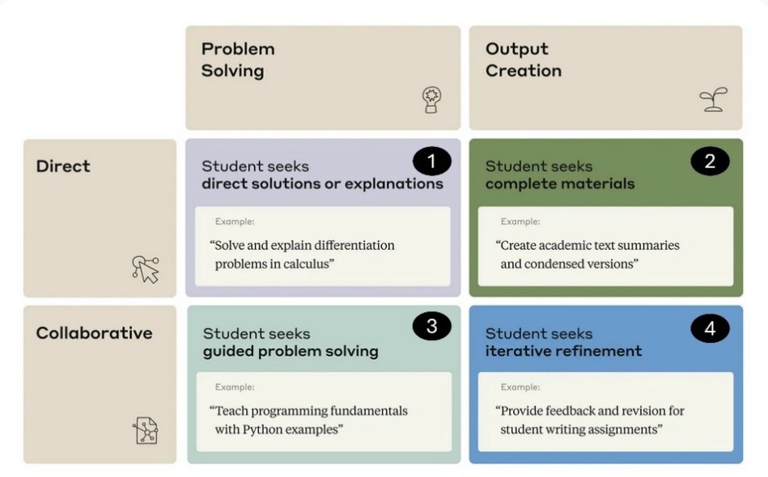
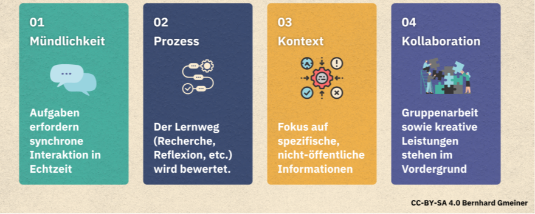

# Empfehlungen zur Umsetzung {#sec-umsetzung}
::: {.callout-note title="Lernziele"}
Nach diesem Kapitel können Sie …

- eigene Aufgaben mit einem Sprachmodell durchspielen und daraus Anpassungen für Ihren Kurs ableiten;
- eine praktische, über das Semester verteilte Einführung der Studierenden planen und einen Kurs in drei Phasen mit wechselnden Rollen der KI ergänzen;
- eine Prüfungsleistung nach den vier Säulen Mündlichkeit, Prozessorientierung, Kontextualisierung und Kollaboration umbauen und die Grenzen von KI-Detektoren begründen;
- Studierenden eine praktikable Dokumentation ihrer KI-Nutzung vorgeben, die zu den Richtlinien Ihrer Hochschule passt.
:::

::: {.callout-note .mc-block title="Probleme aus der Lehre"}
*Zu jedem dieser Probleme bietet das Kapitel Lösungsansätze. Wählen Sie eine Antwort, bevor Sie weiterlesen: Wer vorher rät, behält die Auflösung besser. Die Kernaussagen am Kapitelende greifen die Probleme in derselben Reihenfolge auf.*

::: mc-frage
Sie wollen im nächsten Semester KI in Ihren Kurs einbauen und wissen nicht, wo Sie anfangen sollen. Was ist der erste sinnvolle Schritt?

- Eine Richtlinie zur KI-Nutzung für die Studierenden schreiben.
- [Die eigenen Aufgaben in ein starkes Modell geben und die Grenzen ausloten.]{.richtig}
- Einen Tutor-Bot für die häufigsten Fragen einrichten lassen.

::: mc-rueckmeldung
Der erste Schritt ist Ausprobieren: eigene Aufgaben in ein starkes Modell geben, Input eingrenzen, Prompts anpassen und prüfen, wo die KI gut ist und wo nicht (@sec-durchspielen).
:::
:::

::: mc-frage
Eine 90-minütige Einführung in KI in der ersten Semesterwoche hat wenig bewirkt; die Studierenden nutzen KI weiter unsicher. Was wirkt besser?

- [Häufiges, über das Semester verteiltes Üben in Präsenz.]{.richtig}
- Eine längere und gründlichere Theorieeinführung.
- Ein Selbstlernkurs, den Studierende allein absolvieren.

::: mc-rueckmeldung
Studierende lernen den Umgang mit KI durch häufiges, verteiltes Üben in Präsenz: gleich anfangen, dann problembasiert erläutern (@sec-einfuehrung-studierende).
:::
:::

::: mc-frage
Ihre Hausarbeiten lassen sich zu Hause mit starken Modellen in einer Stunde schreiben. Ein Kollege will alle Abgaben durch einen KI-Detektor schicken. Was raten Sie?

- Zustimmen, denn Detektoren erkennen KI-Texte inzwischen zuverlässig.
- Hausarbeiten abschaffen und nur noch Klausuren im Antwortwahlverfahren schreiben.
- [Abraten und die Prüfung mündlicher, prozessnäher und kontextbezogener gestalten.]{.richtig}

::: mc-rueckmeldung
KI-Detektoren sind kein verlässliches Mittel. Prüfungen werden wieder aussagekräftig durch Mündlichkeit, Prozessorientierung, Kontextualisierung und Kollaboration (@sec-pruefen).
:::
:::

::: mc-frage
Sie möchten nachvollziehen, wie Studierende KI in ihren Projektarbeiten genutzt haben. Welche Dokumentation ist praktikabel?

- Ein vollständiges Protokoll jeder Interaktion mit allen Prompts.
- [Eine Stichwortliste, eine Übersicht nach Phase oder ein Reflexionstagebuch.]{.richtig}
- Keine, weil sich KI-Nutzung ohnehin nicht überprüfen lässt.

::: mc-rueckmeldung
Dokumentation muss praktikabel sein; ein vollständiges Protokoll jeder Interaktion ist es nicht (@sec-dokumentation).
:::
:::
:::

## Typische Aufgaben und Fragestellungen mit der KI durchspielen, Prompts anpassen, experimentieren {#sec-durchspielen}

Lehrende sollten zunächst Informationen sammeln, um zu verstehen, was KI mit den Aufgaben in ihrem Kurs bewirken kann [@mitteaching+learninglab2023]. Melden Sie sich bei einem der professionellen KI-Dienste wie ChatGPT oder Claude an und spielen Sie mit exemplarischen Konzepten, Fragen und Aufgabensets aus dem Kurs. Dabei ist es wichtig, nicht gleich bei der ersten schlechten Antwort aufzugeben, sondern Anpassungsmöglichkeiten durchzugehen: Lässt sich der **Input beschränken**? (Fragen auf einen Text-Input, eine gute Internetquelle oder eine hochgeladene PDF beschränken.) Lässt sich der **Prompt anpassen**? (Bearbeitung schrittweise durchführen lassen, Optionen und Szenarien durchgehen lassen usw., siehe den Abschnitt 2.5.2 zu Prompt Engineering.)

Wichtig ist, sich zu überlegen, welches Lernziel jede Aufgabe hat und wie die KI damit umgeht. Es sollte bewertet werden, bei welchen Arten von Fragen die KI gut abschneidet und wo ihre Grenzen liegen [@mollick2025d]. Diese Erkenntnisse können dann genutzt werden, um etwa Aufgabensets und andere Aufgabenstellungen besser zu strukturieren.

## Ausrichtung der Anpassungen nach Empfehlungen der Lernforschung

Um die Empfehlungen der Lernforschung in das Vorgehen mit Künstlicher Intelligenz (KI) und Aufgabensets zu integrieren, könnten folgende Schritte unternommen werden [@mitteaching+learninglab2023]:

* **Zeitliche Verteilung und inhaltliche Mischung von Lerninhalten (Spacing & interleaving)**: Die Aufgabensets sollten so gestaltet werden, dass sie über das Semester verteilt sind und eine Vielfalt an Themen abdecken. Dies fördert die Langzeiterinnerung und hilft den Studierenden, die Anwendung der Konzepte in verschiedenen Kontexten zu üben. KI kann genutzt werden, um personalisierte Lernpläne zu erstellen, die auf den individuellen Fortschritt der Studierenden abgestimmt sind und eine Mischung aus verschiedenen Aufgabentypen bieten.
* **Testgestütztes Lernen (Test-enhanced learning)**: Regelmäßige, durch KI unterstützte Quizze und Tests können in den Lehrplan integriert werden, um das Abrufen von Informationen zu fördern. Diese Tests könnten auch die kritische Bewertung von KI-generierten Antworten beinhalten, um die kritische Denkfähigkeit der Studierenden zu schärfen.
* **Fragebasierte Ausarbeitung (Explanatory questioning)**: KI-Tutor-Bots könnten entwickelt werden, um Studierende durch gezielte “Warum”-Fragen zu leiten, die ein tieferes Verständnis des Materials fördern. Diese Bots könnten in Simulationen und Rollenspielen eingesetzt werden, um die Studierenden dazu zu bringen, ihre Entscheidungen zu erklären und zu reflektieren, wodurch die Anwendung von Konzepten in realen oder simulierten Situationen vertieft wird.

## Einführung der Studierenden planen: Besser praktisch, häufig und niedrigschwellig {#sec-einfuehrung-studierende}

Den Einsatz von KI lernen die Studierenden, wenn sie häufig und über das Semester zeitversetzt damit experimentieren dürfen und müssen. Auch hier führen wieder die Empfehlungen des **Spacing & Interleaving** zu höherer Effektivität. Unterstützend können **externe Lernvideos** von seriösen Plattformen wie dem KI-Campus genutzt werden (z. B. https://ki-campus.org/videos/generativeki) oder selbst erstellte hochschulweite Angebote wie die Lehrpfade der TH Köln (https://lehrpfade.th-koeln.de/kategorie/ki/).

Um ein gemeinsames Verständnis über Grundlagen herzustellen, ist es hilfreich, **Zeit in einer der ersten Präsenzveranstaltungen einzuräumen**, um das gemeinsam zu üben. Der Sprung ins kalte Wasser ist dabei meist besser als eine lange Theorieeinführung: **Gleich anfangen**, dann problembasiert erläutern. Aspekte von **testbasiertem Lernen** und **fragebasierte Ausarbeitung** lassen sich gut über Anwendungsaufgaben in der Präsenzveranstaltung einbauen.

### Beispiel: KI-Übung in Präsenzveranstaltung am Ende eines Theorieblock zu Nachhaltigkeit in Lieferketten

**Aufgabe:** Nicht lange schnacken, gleich anpacken! Mit der KI einen Projektplan für erste konkrete Schritte einer Nachhaltigkeitsstrategie erstellen (Edge Browser, Bing Copilot = GPT-4). Prompts zum Einstieg werden den Studierenden vorgegeben. Anfang mit:

* *Prompt #1*: „KI als Tutor“ oder ähnlich (siehe Appendix: Beispiel KI als Tutor #1/ Allgemeiner Tutor. Prompts im Folgenden immer *kursiv*.)
* *Prompt #2*: *Ich will eine Cradle-to-cradle Nachhaltigkeitsstrategie für ein Unternehmen entwerfen. Helfen Sie mir, konkrete erste Schritte nach der Cradle-to-cradle Zertifizierung zu planen.*

Studierende sollen ein Unternehmen auswählen, bei dem sie schon einmal gearbeitet haben, oder das sie gut kennen. Hier ein Beispiel.

* *Prompt #3*: *Ich denke über Voss Automotive nach, die folgende Produkte herstellen: innovative Leitungs-und Verbindungssysteme, die überall auf der Welt in Pkw und Nutzfahrzeugen sowie Land- und Baumaschinen eingesetzt werden. Unser Produktportfolio umfasst dabei einbaufertige Leitungsmodule mit Rohren, Schläuchen, Verbindungselementen, Ventilen und Sensoren. Zur Verbindungstechnik gehören Stecksysteme, Verschraubungen, Mehrfachkupplungen und Verteiler.*
* *Prompt #4*: *Erstelle einen Zeitplan als Tabelle mit Aufwandsschätzungen für 3 Personen in 4 Wochen.*
* *Prompt #5*: *Mehr Details bitte: Erstelle Unteraufgaben für die jeweiligen Aufgabenpakete, jeweils auch wieder mit Aufwandsschätzungen.*

Die Studierenden sollen den Projektplan dann weiter verbessern und diskutieren. Erweiternd können sie auch z. B. Projektrisiken, Indikatoren und Gegenmaßnahmen und Szenarien erheben und diskutieren.

## Wie prüfen wir jetzt? Jenseits der Homework Apocalypse {#sec-pruefen}

Jenseits der vielen produktiven Anwendungen besteht die Gefahr, dass Studierende wichtige Teile des Denkprozesses an Sprachmodelle delegieren [@lee2025]. Klassische „Hausaufgaben“ wie **Seminararbeiten, Gruppenprojekte und Abschlussarbeiten drohen entwertet zu werden**. Ohne Anpassung der Aufgabenstellung werden die Aufgaben potenziell sinnlos, da Studierende etwa Aufsätze oder Reflexionsaufgaben einfach von Chat GPT schreiben und einreichen. Interviews mit Studierenden und Nutzungsstudien zeigen, dass diese Gefahr akut ist. Wie wir in der umfassenden empirischen Nutzungsstudie von @handa2025 sehen, nutzen Studierende Sprachmodelle speziell zur Schreibunterstützung intensiv und häufig. Das New York Magazine betitelt eine Recherche von 2025 mit „**Everyone is cheating their way through college**”, auf der Grundlage einer Vielzahl von Interviews mit desillusionierten Studierenden und Lehrenden [@walsh2025]. Ein Artikel der Fachzeitschrift Nature skizziert ebenfalls basierend auf Interviews ein breites Spektrum an aktiver Nutzung im höheren Bildungsbereich [@heidt2025].

Schon 2023 kündigte der Wharton Professor Mollick die „Homework Apocalypse“ an [@mollick2023]. Dabei geht es Mollick weniger um das Tricksen mit den neuen technischen Möglichkeiten („Cheating was already common in schools“), sondern mehr um die **empfundene Sinnlosigkeit von klassischen Hausaufgaben**. „Students will want to understand why they are doing assignments that seem obsolete thanks to AI.“. Wer gibt noch reine Rechenübungen auf, wenn alle Taschenrechner haben? Wie kann Eigen- und Fremdleistung unter diesen neuen technischen Bedingungen getrennt werden? Wie können unter diesen Bedingungen Anreize für Studierende gesetzt werden, Texte selbst zu lesen und Sätze selbst zu formulieren?

{#fig-interaction-types}

Eine Unterscheidung der empirischen Anthropic-Studie von Studierenden-Interaktionen mit Sprachmodellen ist dabei hilfreich, um das Problem einzuordnen [@handa2025]: Hier werden vier Arten von LLM-Nutzung unterschieden, je nachdem, ob ein **Problem** gelöst oder ein **Ergebnis generiert** werden soll und je nachdem, ob dies **direkt oder interaktiv** erfolgt. Kollaborative Nutzungsformen (Typ 3 und 4) sind dabei für den Lernerfolg eher hilfreich, während das direkte Bereitstellen von Problemlösungen oder Texten aufgrund mangelnder Beschäftigung der Studierenden mit den Problemen und Materialien für Hausarbeiten eher hinderlich sein könnte (anders als für die Vorbereitung von kontrollierten Tests wie Klausuren). Studierende werden so eher in eine passive Rolle gedrängt und es fehlen die erwünschten Schwierigkeiten (desirable difficulties, [@roediger2006]), das fragebasierte Durchkauen und Hin- und Herüberlegen, das die Lernforschung als wichtig für langfristiges Behalten ansieht [@roediger2012].

Grob gesagt wollen wir also **kollaborative Interaktion und Hilfestellung fördern und einfaches Übernehmen bereitgestellter Lösungen verhindern**. Wie können wir dafür die Hausarbeiten anpassen? Im Folgenden werden einige Empfehlungen zusammengefasst. Der Vier-Säulen-Ansatz nach Gmeiner bietet Orientierung. Er unterscheidet vier Gegenmaßnahmen für das Prüfen unter KI-Bedingungen: Mündlichkeit, Prozessorientierung, Kontextualisierung sowie Kollaboration [@gmeiner2025].

{#fig-gmeiner-pillars}

Die empirische Forschung der Jahre 2025 und 2026 stützt diesen Umbau in fünf Punkten.

Erstens verlieren klassische, asynchron geschriebene Aufgaben unter generativer KI ihre Aussagekraft, weil sie den Kompetenzerwerb eher verhindern als ihn nachzuweisen. @rismanchian2026 zeigen das an 3,2 Millionen Lerninteraktionen der Mathematikplattform ALEKS über zehn Jahre: Nach der Veröffentlichung von ChatGPT sinkt die Bearbeitungszeit für Aufgaben, deren Text sich in einen Chatbot kopieren lässt, um 2,8 % pro Quartal und kumuliert 26,9 % über elf Quartale bei Studierenden, und der dauerhafte Wissensgewinn aus diesen Aufgaben bleibt aus. Unter Aufsicht verschwindet der Effekt vollständig; die Zeitersparnis stammt also aus der KI-Nutzung, nicht aus schneller gewordenen Lernenden. @delikoura2025 ordnen diesen Befund in einen Rahmen ein: Ihre Synthese von 70 empirischen Studien beschreibt, wie technische Modellrisiken über die Interaktion zu Überabhängigkeit, nachlassender eigenständiger Lernfähigkeit und einem Verlust an Lernenden-Agency werden, und benennt ausdrücklich die Bedrohung der Prüfungsvalidität. Der Umbau der Prüfung ist damit kein Vorsorgeargument, sondern die Antwort auf einen gemessenen Verlust.

Zweitens hängt der diagnostische Wert einer Aufgabe an ihrem Format: Offene Begründung bleibt aussagekräftig, Reproduktion und Wiedererkennung nicht. @hou2026 trennen in einem Drei-Arm-Experiment der Bauingenieur-Ausbildung folienbasiertes Lernen, ungeführte KI-Unterstützung und eine KI-Unterstützung, die durch ein fünfschrittiges Prompting-Gerüst strukturiert ist. Der Lernvorteil zeigt sich allein bei offenen Aufgaben, die Erklärung und Begründung verlangen, und verschwindet bei Multiple-Choice-Items; die ungeführte Bedingung schlägt die passiven Folien nicht. Formate, die auf Reproduktion setzen, messen unter KI-Bedingungen wenig; der Ertrag liegt in Aufgaben, die Schlussfolgern und Begründen sichtbar machen, also in denselben prozess- und mündlichkeitsnahen Formaten, die die vier Säulen vorschlagen.

Drittens sichern Detektion und „authentische“ Aufgaben allein die Integrität nicht; der Nachweis muss von der Ausgabe zum synchronen, prozessnahen Handeln wandern. @kofinas2025 prüfen das experimentell an zwei britischen Universitäten und finden zweierlei: Prüfende können KI-gestützte Arbeiten nicht von rein menschlichen unterscheiden, und der Grad der Authentizität einer Aufgabe ändert daran nichts. Ihre Schlussfolgerung deckt sich mit der dieses Kapitels: Der Schwerpunkt muss von ausgabebasierten, asynchron geschriebenen Prüfungen zu synchronen, interpersonalen und performativen Formaten wandern. @devito2025 zeigen die soziale Kehrseite unzuverlässiger Detektion: In 1.199 Reddit-Diskussionen mit knapp 14.000 Kommentaren berichten Studierende Belastung durch falsche Betrugsvorwürfe der KI-Detektoren, während Lehrende sich um Integrität und Adoptionsdruck sorgen. Der Verzicht auf Detektionswerkzeuge, den auch @an2025 empfehlen, gründet damit nicht nur auf deren Fehleranfälligkeit, sondern auf dem Schaden, den Falsch-Positive im Vertrauensverhältnis anrichten.

Viertens lassen sich mündliche und performative Formate mit KI zugänglicher und stressärmer gestalten, ohne ihren Nachweischarakter zu verlieren. @yusuf2026 begegnen der Schwäche, die solchen Formaten am häufigsten vorgehalten wird, dem situativen Prüfungsstress. Ihr Werkzeug AIvaluate, ein LLM-gestützter Gesprächsagent für mündliche Präsentationen und Viva-voce-Prüfungen, senkt in einem Within-Subjects-Vergleich mit 35 Studierenden die Prüfungsangst gegenüber der klassischen Präsenzprüfung. Damit erweitert sich die Säule der Mündlichkeit von der Aufwands- auf die Zugänglichkeitsseite: Der interaktive Nachweis von Autorschaft und Transfer bleibt erhalten, die Hürde für ängstliche Lernende sinkt. Dass ein solcher Umbau überfällig ist, formuliert @avigad2026, Mathematiker an der Carnegie Mellon University, für die quantitativen Fächer zugespitzt: Klassische Hausaufgaben seien obsolet, und Prüfung müsse um die Tatsache herum neu konstruiert werden, dass Studierende im Berufsleben auf KI zurückgreifen.

Fünftens unterstützt KI das Bewerten, ersetzt das menschliche Urteil aber noch nicht; die Skalierung der neuen Formate bleibt an Menschen gebunden. @sapkota2026 lassen sechs LLM-Konfigurationen eine Klausur in diskreter Mathematik gegen menschliche Bewertende korrigieren. Großzügige Teilpunkt-Vorgaben senken den Fehler über alle Modellfamilien, doch Kalibrierung und Rangerhaltung fallen auseinander: Die beste mittlere Abweichung und die beste Korrelation entstehen unter verschiedenen Konfigurationen, und keine ist reif für unbeaufsichtigtes Benoten. @levine2026 untersuchen die Bewertung handschriftlicher Mathematik durch sehfähige Modelle: Die Gesamtgenauigkeit ist hoch, doch 87 % der Fehler des besten Modells stammen aus der Transkription der Handschrift, nicht aus falsch angewandten Rubriken. Der Engpass sitzt in der Erfassung, nicht im Urteil; automatisierbar ist die Rubrik-Anwendung, die Wahrnehmung des studentischen Artefakts bleibt vorerst menschliche Aufgabe (zur Verschiebung der Bewertungsarbeit vgl. @sec-hiwi).

### Formate nach den vier Säulen

Die Ratgeber der Jahre 2023 bis 2025 übersetzen die vier Säulen in konkrete Formate (@tbl-vier-saeulen). **Mündlichkeit** macht Verständnis, Transfer und Autorschaft im Gespräch sichtbar; eigene Entscheidungen müssen erläutert und verteidigt werden, und die schriftliche Arbeit wird vom Leistungsnachweis getrennt [@gmeiner2025]. **Prozessorientierung** verlagert das Gewicht vom Produkt auf den Weg dorthin und beteiligt die Prüfenden am Entstehungsprozess; die Sichtbarkeit individueller und kollaborativer Arbeitsschritte macht unreflektierte KI-Nutzung unattraktiv [@mulder2023; @hanoverresearch2024; @monashuniversity2025]. **Kontextualisierung** bindet die Leistung an reale, lokale oder persönliche Daten, Orte und Rollen; solche Aufgaben sind „un-promptbar“, weil sie nicht-öffentliche Informationen, eigene Beobachtung und Gegenwartsbezug verlangen [@mulder2023; @gmeiner2025]. **Kollaboration und Kreation** prüfen über Gruppenaufgaben in der Veranstaltung, Peer- und Selbstbeurteilung und gestufte Projekte die soziale, evaluative und kreative Seite des Lernens [@mulder2023; @hanoverresearch2024]. In allen Formaten legen Studierende ihre KI-Nutzung offen; KI darf strukturieren und sprachlich glätten, nicht aber Evidenz, Theoriebildung oder Ergebnisse ersetzen.

| Säule | Format | Artefakte | Skalierung |
|:----------|:--------------------------|:----------------------|:----------------------|
| **Mündlichkeit** | Kurzkolloquium (Viva voce): rund zehn Minuten zu zwei Kernentscheidungen der eingereichten Arbeit, dazu eine Transferfrage („Was würden Sie ändern, wenn …?“) | Schriftliche Arbeit (mit KI-Unterstützung erlaubt), Aufzeichnung des Gesprächs | Standardisierte Leitfragen, Doppelprüfung im Stichprobenprinzip, Aufzeichnung für Zweitbewertung |
| | Interaktive mündliche Prüfung: praxisnahes Szenario oder Fall im offenen Gespräch mit Prüfenden oder anderen Studierenden [@ward2024] | Gespräch, bewertet nach Rubrik (auch gemeinsam mit Studierenden entwickelt [@nibheolain2020]) | Erstsemesterkurse mit rund 200 bis 800 Studierenden und 4 bis 10 Prüfenden |
| | Posterpräsentation mit strukturierter Fragerunde zu Methode, Evidenz und Limitationen | Poster, einseitiges Handout, Frageprotokoll | Parallele Poster-Sessions mit festen Zeitslots |
| **Prozessorientierung** | Prozessjournal mit Audit-Trail: Suche, Auswahl, Analyse, Entscheidungen und Revisionen fortlaufend dokumentiert | Journal mit Versionsverlauf (Overleaf, Git), Query-Protokolle, Daten- und Code-Paket, Endprodukt | Der dokumentierte Prozess ersetzt Detektoren als Beurteilungsgrundlage |
| | Gestaffelte Hausarbeit mit Feedback nach jeder Stufe, Prozess- und Produktpunkte getrennt | Gliederung, annotierte Bibliografie, Methoden-Memo, Rohanalyse, Entwurf, Endfassung | Peer-Review nach Rubrik, stichprobenhafte Checks durch Lehrende |
| **Kontextualisierung** | Eigene Empirie: Fall auswählen, Primärdaten erheben (Interviews, Prozessanalysen, Prototyp), Entscheidungsvorlage erstellen | Datensatz, Methodenprotokoll, Analyse-Notebook, Kurzempfehlung | – |
| | Replikation einer veröffentlichten Analyse mit Robustheitsprüfung | Repro-Paket, Abweichungsprotokoll, Kurzbericht | Automatisierte Checks, präzise Rubriken |
| **Kollaboration und Kreation** | Peer-reviewtes Multimedia-Projekt (Podcast, Video, Infografik) für ein definiertes Publikum; auch Rollen- oder Planspiele [@gmeiner2025] | Produkt, Quellenliste, Peer-Feedback-Protokolle, individuelle Reflexion | Kurze Nachgespräche sichern die Autorschaft |
| | Team-Capstone mit getrennter Team- und Individualnote | Teamartefakt (Prototyp, Konzeptstudie, Policy-Brief), individueller Methoden-Anhang, Reflexion zum eigenen Beitrag und zur KI-Nutzung | Milestone-Boards, strukturierte Peer-Assessments, stichprobenhafte mündliche Abfrage pro Team |

: Prüfungsformate nach den vier Säulen. Quellen: @gmeiner2025; @mulder2023; @hanoverresearch2024; @monashuniversity2025; @ward2024 {#tbl-vier-saeulen}

Mündliche Formate verlangen vorab Bewertungsraster und bringen eigene Herausforderungen mit: situativen **Stress**, **Validität** (Form oder Inhalt, einfache oder schwere Fragen, mündliche oder schriftliche Ausdrucksfähigkeit), **Reliabilität** über verschiedene Nachfragen, Bewertende und Szenarien hinweg und **Fairness** gegenüber Sprachfähigkeit und Vorwissen. Ihr Vorteil ist die Reaktivität: Vertiefende Nachfragen legen Hintergrundwissen und Begründungen offen [@akimov2020, S. 31; @kearney2019]. Einsätze interaktiver mündlicher Prüfungen in großen Kohorten an verschiedenen Universitäten sind unter <https://sway.cloud.microsoft/yQ2s0Bm3ILkWtGll> zusammengestellt; Leitfäden mit Beispielaufnahmen und Bewertungsrubriken stellt etwa die Dublin City University bereit (<https://www.dcu.ie/sites/default/files/inline-files/interactive-oral-io-user-guide_0.pdf>, Ressourcenübersicht auf S. 11).

Für **Abschlussarbeiten** lassen sich zwei Säulen direkt in die Prüfungsordnung übertragen. Ein Entwurf an der TH Köln (Stand 2025) gewichtet die Mündlichkeit höher und verteilt sie auf zwei Termine: ein erstes Kolloquium etwa einen Monat nach Beginn zu Forschungsstand und Forschungsfragen (3 ECTS), die schriftliche Arbeit (8 ECTS) und ein zweites Kolloquium zum Ergebnis (4 ECTS); bisher waren es 12 ECTS für die schriftliche Arbeit und 3 ECTS für das Kolloquium. Die Kontextualisierung lässt sich verankern, indem reine Literatur- oder Theoriearbeiten ohne empirischen Bezug vom Prüfungsausschuss genehmigt werden müssen.

:::: {.callout-note title="Anwendungsbeispiel: Gesprächsführung zu prüfen ist aufwändig und kaum wiederholbar"}
**Problem ohne KI.** Beratungsgespräche gehören in der Sozialen Arbeit zum Kern des Berufs, ihre Prüfung aber bindet viel Personal und feste Termine. An der CBS University of Applied Sciences liefen solche Performanzprüfungen bisher mit Schauspielerinnen und Schauspielern.

**Problem mit KI.** Ein Bot kann die Klientin oder den Klienten spielen, reagiert aber in jedem Gespräch anders.

**Das Dilemma.** Im Modul Kommunikation und Gesprächsführung des Bachelors Soziale Arbeit führen die Studierenden innerhalb von zwei Wochen ein Beratungsgespräch im Chat mit einem Prüfungsbot, etwa mit einer Person, die sich wegen Überschuldung an das Sozialamt wendet, und reichen den Dialog mit einer theoriebezogenen Reflexion ein. Zum Üben gibt es Tutor-, Mentor- und Szenario-Bots; in der Prüfung ist diese Unterstützung abgeschaltet. Die Varianz macht die Prüfung schwer auswendig zu lernen und, so die Verantwortlichen, besser nachvollziehbar als die frühere Prüfung mit Schauspielern. Sie verunsichert aber: Eine Studentin schrieb, der Bot habe in der Prüfung „komplett anders“ geschrieben als in ihren Übungen, ihre Notizen hätten sich „sehr überflüssig“ angefühlt [@puchert2026pruefsim].

**Was das für wirksames Lernen heißt.** *Erfahrungsbericht mit Rückmeldungen von Lehrenden und Studierenden.* Die Lehrenden beurteilen die Reflexionen als deutlich besser als in früheren Formaten ohne vorbereitende Szenarien. Das Format verlagert den Nachweis, wie @kofinas2025 es fordern, von der Ausgabe zum performativen Handeln und dessen Analyse. Damit die Varianz nicht in Verunsicherung kippt, brauchen die Übungsfälle dieselbe Struktur und Schwierigkeit wie die Prüfung.

Quelle: @puchert2026pruefsim; @tobor2026usecases, S. 46–48.

::: {.content-visible unless-format="html"}
{width="18%"}
:::
::::

:::: {.callout-note title="Anwendungsbeispiel: Im Beruf programmieren Ingenieure mit KI, in der Prüfung nicht"}
**Problem ohne KI.** Eine Prüfung ohne Hilfsmittel misst nicht, wie Ingenieurinnen und Ingenieure heute arbeiten: Sie erzeugen und prüfen Code zunehmend mit KI.

**Problem mit KI.** KI-Code wirkt plausibel, setzt aber mitunter Randbedingungen falsch um, und identische Prompts liefern unterschiedliche Lösungswege. Auf die Ankündigung, KI in der Prüfung zuzulassen, reagierten die Studierenden zunächst verunsichert.

**Der Lösungsansatz.** Klaus Webers (Hochschule München) prüft im Master Mechatronik, Modul Simulation mechatronischer Systeme, in einer digitalen Präsenzprüfung im PC-Pool. Über die Hochschuloberfläche HAWKI ist ein Sprachmodell als Hilfsmittel zugelassen; die Studierenden erzeugen damit Code für Simulationen und führen ihn in MATLAB aus. Bewertet wird, ob sie die Aufgabe so durchdringen, dass die KI Brauchbares erzeugt, und ob sie das Ergebnis auf Plausibilität prüfen und verantworten können. Ein Prüfungsteil ohne KI sichert das Grundlagenwissen. Den Umgang mit KI-Code üben die Studierenden schon im Semester, begleitet vom Lehrenden.

**Was das für wirksames Lernen heißt.** *Erfahrungsbericht.* Die Prüfung setzt um, was @avigad2026 für die quantitativen Fächer fordert: Prüfung um die Tatsache herum zu bauen, dass im Beruf KI genutzt wird. Der Nachweis liegt nicht in der Ausgabe, sondern im Prüfen und Begründen, und damit in dem Teil, der unter KI-Bedingungen aussagekräftig bleibt [@hou2026].

Quelle: @tobor2026usecases, S. 43–45.

::: {.content-visible unless-format="html"}
{width="18%"}
:::
::::

Kombiniert ergeben die vier Säulen ein konsistentes Prüfungsdesign: Mündliche Elemente sichern Autorschaft und Transfer, prozessorientierte Formate liefern nachvollziehbare Evidenz, kontextgebundene Aufgaben prüfen Verständnis unter realen Bedingungen, und kollaborative Produkte stärken Urteilskraft und Feedbackkultur. KI-Detektoren werden überflüssig, weil der Nachweis im Prozess liegt und Prüfende interaktiv nachfragen können. Der Aufbau kostet anfangs viel Zeit, und die neuen Formate müssen evaluiert werden, damit die bekannten Probleme des Prüfens im Gespräch (Validität, Reliabilität, Fairness) beherrschbar bleiben [@akimov2020]. Auf viele Vorlagen lässt sich dabei aufbauen, und Studierende lernen nebenbei, KI verantwortlich, nachvollziehbar und wirksam einzusetzen.

## Richtlinien zur KI-Nutzung - welche Handreichungen geben Hochschulen und was wird empfohlen?

### Übersicht: Was regeln die Richtlinien der Hochschulen?

@an2025 werten die Richtlinien der 50 führenden US-Hochschulen zur Nutzung von LLM aus. Die Haltung ist insgesamt positiv, unterscheidet sich aber nach Zielgruppe. Lehrende erhalten in 94 % der Richtlinien didaktische Hinweise zu Kursdesign, Aufgaben und Prüfungsformaten, etwa gestufte Erlaubnisformen im Syllabus (verboten, erlaubt mit Dokumentation, ausdrücklich gewünscht). Für Studierende überwiegen Integritätsregeln: Nicht genehmigte Nutzung gilt als Täuschungsversuch, die Klärung, ob KI zulässig ist, liegt bei ihnen, und Anleitungen zur kompetenten Nutzung bieten nur wenige Richtlinien. Die Autor:innen empfehlen zielgruppenspezifische, laufend weiterentwickelte Richtlinien.

Für Deutschland hat das Hochschulforum Digitalisierung die Leitlinien von 27 Hochschulen ausgewertet [@tobor2024], ein Update vom Februar 2025 ergänzt neuere Entwicklungen [@tobor2025]. Tobor hebt vier bewährte Praktiken hervor:

* **Angepasste Eigenständigkeitserklärung:** Studierende erklären bei schriftlichen Prüfungen ohne Aufsicht, ob und wie sie KI-Werkzeuge genutzt haben (Vorlage etwa der Hochschule RheinMain).
* **Verdachtsfälle im Gespräch klären:** Detektoren wie GPTZero gelten als unzuverlässig. Empfohlen wird ein multifaktorielles Vorgehen mit Indikatoren wie nicht existierenden Quellen oder auffälligen Formulierungen; erhärtet sich der Verdacht, prüft ein Klärungsgespräch, ob die Studierenden ihre Arbeit verstehen (Leitfaden der Universität Vechta).
* **Keine automatisierte Bewertung:** Prüfungsordnungen verlangen eine begründete Bewertung durch eine prüfende Person; studentische Arbeiten in KI-Systeme hochzuladen gilt zudem als urheberrechtlich bedenklich.
* **Prüfungsformate didaktisch weiterentwickeln:** reflexionsorientierte Aufgaben, Zwischenfeedback und ergänzende mündliche Prüfungen (@sec-pruefen); auch der Umgang mit KI selbst wird Prüfungsgegenstand.

Im Update kritisiert Tobor die **thematische Zersplitterung** der Handreichungen, die regulatorische, didaktische und Risikofragen für viele Gruppen zugleich abdecken; zentrale Einstiegsseiten wie der KI-Hub der Universität Vechta (<https://www.uni-vechta.de/ki-hub>) bündeln sie. Wirksam werden Leitlinien erst, wenn sie **bekannt gemacht, diskutiert und weiterentwickelt** werden, am besten gemeinsam mit Studierenden, im Hochschulverbund und mit Formaten wie Prompt-Battles [@tobor2025].

### Was die KI-Verordnung von Hochschulen verlangt {#sec-ki-vo}

Richtlinien sind seit 2025 nicht mehr nur Hausordnung, sondern Teil einer Rechtspflicht. Die europäische KI-Verordnung (von lateinisch *regula*, „Richtschnur“, über das englische *regulation*) verlangt in Artikel 4 seit Februar 2025 von jeder Organisation, die KI-Systeme betreibt, Maßnahmen für die KI-Kompetenz ihres Personals; der Wissenschaftsrat stellt klar, dass Hochschulen, die Studierenden und Lehrenden Chat-Zugänge oder eigene Tutoren bereitstellen, in diesem Sinn Betreiber sind, und empfiehlt, KI-Kompetenz als Teil der Hochschulbildung selbst zu verankern statt als Zusatzschulung [@wissenschaftsrat2026]. Die Vereinfachungsverordnung vom Juli 2026, der sogenannte Digital-Omnibus, hat Artikel 4 nicht gestrichen, sondern entschärft: Organisationen müssen weiterhin Maßnahmen ergreifen, aber kein bestimmtes Kompetenzniveau jeder einzelnen Person mehr garantieren [@eu2026omnibus; @kicampus2026omnibus]. Für die Praxis der Lehre ist die Handreichung des Hochschulforums Digitalisierung der verlässlichste Wegweiser, weil sie die Rechtsfragen an Szenarien durchspielt: Wer einen eigenen Tutor mit den Kursmaterialien betreibt, bewegt sich im Szenario eines angepassten, nicht eines selbst entwickelten KI-Systems, solange die Anpassung über System-Prompt und angebundene Quellen erfolgt; erst das Nachtrainieren eines Modells macht die Hochschule zur Anbieterin mit den entsprechenden Pflichten. Für die Materialien gilt das Urheberrecht unverändert, einschließlich der Grenze von 15 Prozent eines Werks für die Nutzung in der Lehre [@baresel2026]. Für die Ausgaben der KI gilt dagegen: Urheberrechtlich geschützt ist nach § 2 Abs. 2 UrhG nur, was freie kreative Entscheidungen eines Menschen ausdrückt; das Amtsgericht München versagte deshalb 2026 drei mit KI erzeugten Logos den Schutz, weil weder ausführliche Prompts noch die Auswahl unter mehreren Vorschlägen die Gestaltung prägten [@agmuenchen2026ki]. Ob Studierende solche Texte verwenden dürfen, regelt darum nicht das Urheberrecht, sondern das Prüfungsrecht, also die Prüfungsordnung und die Eigenständigkeitserklärung mit ihrer Pflicht, Hilfsmittel anzugeben [@salden2023]. Zum Vergleich außerhalb Europas: Das MIT hat 2026 acht Prinzipien für die Lehre mit KI beschlossen, darunter mündliche Prüfungskomponenten, der Verzicht auf KI-Detektoren und eine modellunabhängige Campus-Plattform, und begründet damit dieselbe Linie wie Tobor: anleiten statt verbieten, und die Infrastruktur so bauen, dass die Wahl des Modells nicht die Lehre diktiert [@mit2026aicommittee].

::: {.callout-note title="Stand bei Drucklegung, November 2026: Hochschulen in Deutschland"}
Wo die deutschen Hochschulen beim Einsatz von KI-Tutoren und bei der Kompetenzpflicht standen, als dieses Buch in den Druck ging; die Online-Seite „Forschungsstand“ führt die Quellen fort.

- **Nutzung durch Studierende:** 81 Prozent von 28.584 Befragten an 202 Hochschulen nutzen KI-Werkzeuge mindestens wöchentlich, die Hälfte „als Tutor bzw. Lernpartner“; die Spanne reicht von 72 Prozent in der Wirtschaftsinformatik bis 19 Prozent in Jura [@horstmann2026check].
- **Angebote der Hochschulen:** 53 Prozent der befragten Hochschulleitungen haben KI-Lernassistenten in Umsetzung, an Hochschulen für angewandte Wissenschaften 63 Prozent; 13 Hochschulen melden Regelbetrieb, adaptives Lernen bieten 14 Prozent [@budde2026].
- **Lehrmaterial für eigene Tutoren:** Zwei Drittel der befragten Lehrenden würden ihre Materialien für einen Hochschul-Tutor freigeben, ein Drittel nicht; Bedingungen sind Urheberrecht und der Ausschluss des Trainings [@brandenburger2026].
- **Evaluierte Einsätze:** OneTutor in 84 Lehrveranstaltungen bayerischer Hochschulen im Sommersemester 2025, ohne Unterschied im wahrgenommenen Lernerfolg zwischen Nutzenden und Nichtnutzenden [@stumpf2026]; Sokratest an der Hochschule Rhein-Waal (@sec-tutor-betrieb) [@gerber2026]; ein Tutor für Physik, der die Antworten vollständig gab, wurde von den Studierenden entsprechend genutzt [@glomski2026]. Das bayerische Programm „KI-Tutorien“ meint dagegen menschliche Tutorinnen und Tutoren, die KI-Kompetenz vermitteln [@zhlbayreuth2026kitutorien].
- **Rechtsrahmen:** Artikel 4 KI-VO seit Februar 2025 in Kraft, durch den Digital-Omnibus vom Juli 2026 entschärft [@eu2026omnibus]; Rechtsszenarien für die Lehre in @baresel2026; Empfehlungen des Wissenschaftsrats vom Juli 2026 [@wissenschaftsrat2026].
:::

**Wie sehen solche Richtlinien aus?** Konkrete Formulierungen mit Links zu den Originaltexten stellt die Analyse des Hochschulforums Digitalisierung zusammen [@tobor2025].

## Wie können Studierende die Nutzung von LLM dokumentieren? Stichworte, nach Arbeitsphase, nach Werkzeug oder als Reflexionstagebuch {#sec-dokumentation}

**Frühe Handreichungen** zur Dokumentation von LLM in Studierendenarbeiten waren noch sehr allgemein formuliert und bestanden etwa darauf, dass **jegliche Nutzung im Schreibprozess** genau protokolliert würde. Bei täglicher und stark integrierter Nutzung ist das etwa so sinnvoll, wie die Forderung, jegliche Internetnutzung in einem Tagebuch zu erfassen. Sinnlose Forderungen führen schnell dazu, dass die dahinter stehende Forderung nach prinzipieller Nachvollziehbarkeit des Forschungsvorgehens entwertet und Umgehungshandlungen normalisiert werden.

**Neuere Empfehlungen** der Hochschulen sind hier deutlich realistischer: So bietet etwa eine Handreichung von niedersächsischen Hochschulen eine gute **Reihe von Optionen**, die von einer einfachen Stichpunktliste („elicit.com zur Literaturrecherche, perplexity.ai zur Internetrecherche, gamma.app zur Präsentationserstellung, stablediffusionweb.com zur Bildgeneration“) bis zu detaillierten Tagebüchern mit Reflexionshilfen reicht [@baresel2024a].

Dieselbe Handreichung beschreibt drei weitere Formen: die Dokumentation nach Arbeitsphasen, nach Werkzeugen und als Reflexionstagebuch [@baresel2024a].

Die Dokumentation nach **Arbeitsphasen** (s. @tbl-doc-phases) zielt auf eine strukturierte Erfassung des KI-Einsatzes entlang typischer wissenschaftlicher Arbeitsphasen (z. B. Themenfindung, Recherche, Schreiben). Studierende bewerten selbst den Grad der KI-Nutzung auf einer vierstufigen Skala von „zur Inspiration“ bis „inhaltsgestaltend“ (@tbl-llm-scale) und dokumentieren Tool, Einsatzkontext und Wirkung. Je höher die Stufe, desto stärker muss die Nutzung begründet und durch Prüfschritte abgesichert werden [@baresel2024a; @rowland2023]. Ziel ist Transparenz über den konkreten Einfluss auf das Ergebnis.

Bei der **werkzeugorientierten** Dokumentation[ (s. @tbl-doc-tools)]{.content-visible when-format="html"} werden in tabellarischer Form die verwendeten Tools (z. B. ChatGPT, DeepL Write) samt Quelle, Zweck, Funktion und Einsatzbereich gelistet. Diese Variante erleichtert die Nachvollziehbarkeit, gibt aber wenig Einblick in den Kontext oder den Einfluss der Tools auf den Arbeitsprozess.

Beim **Reflexionstagebuch**[ (s. @tbl-doc-reflection)]{.content-visible when-format="html"} steht die kontinuierliche, persönliche Auseinandersetzung mit dem eigenen KI-Einsatz im Vordergrund. Studierende führen während des Arbeitsprozesses ein Tagebuch, das später in eine prüfungsrelevante Dokumentation überführt wird. Diese Methode fördert den Aufbau von **KI-Literacy** und metakognitiver Kompetenz, ist jedoch zeitaufwändig und betreuungsintensiv.

| Phase im Arbeitsprozess | Dokumentation: Eingesetzte Tools, Verwendungszweck, Funktionsweise, Ergebnis | Grad der KI-Nutzung |
| :--- | :--- | :--- |
| **Ideenfindung/Strukturierung** | **Tools**: ChatGPT, Perplexity **Zweck**: Brainstorming zu Forschungsfragen, Gliederungsideen **Ergebnis**: 5 Themenvorschläge, davon 1 weiterverfolgt | 1 |
| **Recherche** | **Tools**: Elicit, Semantic Scholar **Zweck**: Suche nach passender Literatur **Ergebnis**: Liste mit 15 Quellen, 8 davon verwendet | 2 |
| **Schreiben/Formulieren** | **Tools**: DeepL Write **Zweck**: Verbesserung des sprachlichen Ausdrucks **Ergebnis**: Überarbeitete Einleitung | 3 |
| **Überarbeitung/Korrektur** | **Tools**: Grammarly **Zweck**: Prüfung auf Grammatik- und Rechtschreibfehler **Ergebnis**: Fehlerfreier Text | 2 |

: Beispiel arbeitsphasenorientierte Dokumentation der LLM Nutzung. Quelle: (@baresel2024a, S. 11) {#tbl-doc-phases}

| Grad der KI-Nutzung | Charakterisierung | Beispiele |
|:-----------------------|:-----------------------|:-----------------------|
| **1** | **Zur Inspiration** | Sie haben sich Vorschläge für Themen unterbreiten lassen; Tools eingesetzt, um sich aus eigenen Notizen heraus Themenschwerpunkte zu bilden; sich Formulierungen vorschlagen lassen; die Rechtschreibung-/Grammatikprüfung genutzt. |
| **2** | **Ergänzend** | Sie haben sich mögliche Fragestellungen vorschlagen lassen, einzelne Begriffe der Aufgabenstellung oder Stellen in der Literatur erklären lassen, Gliederungen der eigenen Notizen vorschlagen oder eigene Texte zusammenfassen lassen, Reverse Outline zum eigenen Text (eine basierend auf dem Geschriebenen erzeugte Gliederung) generieren lassen. |
| **3** | **Unterstützend** | Sie haben sich Anforderungen der Aufgabe (z. B. Aufbau einer HA) erklären, Literatur zusammenfassen, mögliche Gliederungen zum Thema vorschlagen lassen;  Sie haben die Fragestellung dialogisch verfeinert bzw. Textteile dialogisch verfasst und dabei LLM-Output iterativ ergänzt;  Sie haben sich Überarbeitungsvorschläge bzgl. Leserlichkeit und Stil generieren lassen. |
| **4** | **Inhaltsgestaltend** | Sie haben sich Hintergrundwissen zur Aufgabe bzw. Antworten auf Fragestellung generieren, Gliederung zum Thema vorgeben, Kürzungen und Ergänzungen vornehmen lassen oder KI-generierten Text direkt übernommen. |

: Erläuterungen zum Grad der LLM-Nutzung. Quelle: @baresel2024a, basierend auf @rowland2023 {#tbl-llm-scale}

::: {.content-visible unless-format="html"}
Beispiele für die werkzeugorientierte Dokumentation und das Reflexionstagebuch (Stand 2024) stehen in der Online-Fassung dieses Kapitels.
:::

::: {.content-visible when-format="html"}
::: {.callout-note collapse="true" title="Werkzeugliste und Reflexionstagebuch: zwei Beispiele (Stand 2024, nur online)"}
| Software / KI-Anwendung | Link / Quelle | Zweck | Genutzte Funktion | Nutzungsbeschreibung, Anwendungsbereich |
| :------ | :----- | :----- | :----- | :------- |
| **appypie** | <https://www.appypie.com/design/de/infografik/ersteller> | Info­grafiken zur Erläuterung | Entspricht Verwendungszweck | Infografik für einen Überblick in der Einleitung, S. 3 |
| **Claude** | <https://claude.ai/new> | Assistenz zur Program­mierung, Vorschläge für Gliederung | Chat und Code-Ausgabe | Program­mierung des Auswertungsprogramms, siehe S.13 Erstaufschlag der Gliederung, wurde überarbeitet |
| **DeepL Write** | <https://www.deepl.com/de/write> | Überarbeiten der Texte | Entspricht Verwendungszweck | Gesamter Text |
| **DeepL Übersetzer** | <https://www.deepl.com/de/translator> | Übersetzung von französischsprachigen Papers | Übersetzung Französisch–Deutsch | Die Paper Lacroix, 2007 & Macron, 2020 wurden übersetzt. |
| **KiCad²** | <https://www.kicad.org/> | Layout der Testplatine | PCB Layout | Layout der Platine, siehe Abb. 15 S. 20 |
| **MATLab** | Hochschul­lizenz | Simulation der Empfängerschaltung | Simulink | Schaltung xyz auf S. 14 simuliert und optimiert |
| **MaxQDA** | Hochschul­lizenz | Auswertung Interviews | MaxQDA und AI Assist | Kategorienbildung, siehe Kap 4.2 und Anhang C |
| **Open­knowledge­map** | <https://openknowledgemaps.org/> | Recherche des Forschungsfelds | Entspricht Verwendungszweck | Für die Einarbeitung wurde mit diesem Tool der Zugang zum Forschungsfeld erschlossen. |
| **SPSS** | Hochschul­lizenz | Auswertung Daten zur Gesundheitsversorgung | Hypothesen­test mittels xy | Daten­auswertung siehe S. 15 und Anhang S. 77 |
| **Visual Studio C++** | Hochschul­lizenz | Program­mierung einer Navigationslösung | Entspricht Verwendungszweck | Program­mierung des zentralen Programms der Arbeit, siehe Kap. 4 |
| **Whisper (openAI)** | <https://openai.com/index/whisper/> | Trans­kribieren von Interviews | Trans­kribieren ohne Übersetzung | Trans­kribieren der Interviews, wurden korrigierend überarbeitet. Siehe Anhang B |

: Beispiel werkzeugorientierte Dokumentation der LLM Nutzung. Quelle: (@baresel2024a, S. 8) {#tbl-doc-tools}

| Datum | Woran habe ich gearbeitet? (Stichpunkte) | Welche digitalen Tools habe ich verwendet? | Notizen zum Einsatz digitaler Tools | Reflexion | Beleg/Beispiel | Grad der Nutzung |
| :--- | :--- | :--- | :--- | :--- | :--- | :--- |
| 1.9.24 | Themenfindung | ChatGPT 3.5 über Academic Cloud | Versuch, einige Begriffe zu schärfen Fragestellungen vorschlagen lassen | Hilfreich, um Fachbegriffe zu identifizieren Aus den Begriffen mal Fragestellungen machen lassen. Das traf es aber nicht wirklich. Ich muss noch weitermachen. | | 1 2 |
| 2.9.24 | Texte lesen | ChatPDF | 2 Texte hochgeladen, geprüft, ob relevant | Toll, dass ich deutsch fragen kann, auch wenn der Text englisch/italienisch ist. Entlastet! Macht das Lesen gezielter. Merke aber auch, dass ich dann den Text nicht mehr ganz lese. | | 2 |
| 5.9.24 | Bild generieren | bing.com/create | Illustration für die Präsentation zum Projekt | Macht Spaß! Ist aber auch aufwändig, genau das zu prompten, was man haben will. Zeitfresser. | Denken findet in der Auseinandersetzung von Mensch mit Maschine statt; Künstliche Intelligenz ist ein Partner des Menschen beim Denken. Helle, motivierende Farben = 07_Denken-externalisiert_Utopie_01.jpeg | 4 |
| 10.9.24 | Text bearbeiten | ChatGPT 4.0 über Academic Cloud | Formulierungsalternativen gesucht | Unentschieden. Manches klingt gut, aber irgendwie auch nicht. Weiß nicht so recht, was ich davon halten soll. | 24-09-10_Chat-Verlauf.docx | 3 |

: Beispiel Reflexionstagebuch zur LLM Nutzung. Quelle: (@baresel2024a, S. 16) {#tbl-doc-reflection}
:::
:::

## Kurs-Integration: Drei Phasen eines Semesters {#sec-kurs-integration}

Wer KI nicht in eine einzelne Sitzung, sondern in einen ganzen Kurs einbaut, sieht die Rolle der KI mit dem Semester wandern. Zu Beginn arbeitet sie vor allem für die Lehrenden, als Hiwi, der Aufgaben und Fälle in Varianten erzeugt. In der Mitte arbeiten die Studierenden mit ihr an Anwendungsaufgaben, als Copilot oder als Simulator im Rollenspiel. Vor der Prüfung fragt sie ab und gibt Rückmeldung, als Tutor. @tbl-kurs-phasen ordnet jeder Phase das Lernprinzip zu, dem sie dient. Werkzeuge stehen bewusst nicht in der Tabelle: Sie wechseln im Halbjahrestakt, die Prinzipien seit Jahrzehnten kaum.

| Semesterphase | Rolle der KI | Was entsteht | Tragendes Lernprinzip |
|---|---|---|---|
| Woche 1–4: Vorbereitung | Hiwi | Aufgaben in mehreren Schwierigkeitsstufen, Fallstudien, Einstiegsmaterial | Vorrat für verteiltes und gemischtes Üben über das ganze Semester [@dunlosky2013] |
| Woche 5–8: Anwendung | Copilot, Simulator | Anwendungsaufgaben, deren Lösung Studierende anderen erklären; Rollenspiele mit Nachbesprechung | Ausarbeiten durch Erklären [@dunlosky2013]; Erfahrung plus Debriefing (@sec-rollenspiele) |
| Woche 9–12: Festigung | Tutor | Übungsfragen, Quiz, simulierte mündliche Prüfung | Testgestütztes Lernen: Abrufen statt Wiederlesen [@roediger2006; @dunlosky2013] |

: Drei Phasen der KI-Integration in einen Kurs; die Rollen entsprechen @sec-szenarien. Eigene Darstellung. {#tbl-kurs-phasen}

Zwei Regeln überdauern jedes Werkzeug. Erstens gibt eine verantwortliche Person frei, was die KI für Studierende erzeugt, bevor es den Kurs erreicht; bei Fallstudien aus anderen Kulturen oder Branchen gehört der Blick auf Stereotype dazu. Diese Prüfung zahlt sich aus: In einem Zwei-Kohorten-Vergleich in der Volkswirtschaftslehre senkten geprüfte, quellengebundene Lernhilfen vor allem den Anteil schwacher Prüfungsergebnisse [@dang2026verified; Preprint]. Zweitens muss der Kurs auch ohne das Werkzeug weiterlaufen. Skripte und Aufgaben liegen unabhängig vom Anbieter vor, damit ein Ausfall, eine Lizenzänderung oder eine Datenschutzentscheidung der Hochschule keine Sitzung kostet.

Wie solche Kurse in der eigenen Lehre aussehen und was sie bewirkt haben, zeigt Kapitel 6 (@sec-fallbeispiele). Die Beispiele sind dort nach der Art des Wissens geordnet, das Studierende erwerben sollen, nicht nach Semesterwochen.

::: {.content-visible when-format="html"}
::: {.callout-note collapse="true" title="Zwei ausführliche Beispielkurse (Stand 2025, nur online)"}
Die beiden Kursentwürfe stammen aus der ersten Fassung dieses Skripts. Sie beschreiben nur die KI-Ergänzung; Lehrbücher und Fachartikel bleiben selbstverständlich Grundlage. Die genannten Werkzeuge entsprechen dem Stand 2025.

**Beispielkurs Programmierung**

**Zeitliche Struktur und Inhalte (Fokus auf den Einsatz von KI-Tools)**

**Woche 1–4: Vorbereitung und KI-gestützte Materialerstellung (KI als „Hiwi“)**
* **Kursvorbereitung mit LLM**: Erstellung und Anpassung vielfältiger Programmieraufgaben an unterschiedliche Lernniveaus mithilfe von Large Language Models.
* **Deep Research**: Unterstützung bei der Recherche neuer Trends in der Programmierdidaktik und relevanter Beispiele, um realitätsnahe Aufgabenstellungen zu entwickeln.
* **NotebookLM für Podcast-Episoden**: Aus den erstellten Materialien werden mithilfe von NotebookLM kurze Podcast-Folgen generiert, die Studierende zur Einführung in die Kursstruktur, grundlegende Programmierkonzepte und organisatorische Aspekte anhören können. Dies dient als motivierende, niederschwellige Form der Wissensvermittlung.

**Woche 5–8: Vertiefung und individuelle Lernwege (KI als „Copilot“)**
* **Individuelle Programmieraufgaben**: Die Studierenden nutzen Google Colab oder ein ähnliches Tool, das KI-unterstützte Programmierung erlaubt (z. B. DeepNote). Sie lösen damit gleich am Anfang Anwendungsaufgaben und müssen die Code-Bestandteile in der Präsenzzeit anderen Gruppen erklären. Die Übungsaufgaben werden fortlaufend angepasst, indem die Lehrenden zusammen mit einem LLM bestehende Aufgaben je nach Lernfortschritt der Studierenden variieren (z. B. mehr Code-Komplexität oder zusätzliche Anwendungsfälle).
* **Voice Mode für Simulationen**: Interaktive Rollenspiele bzw. Simulationen (z. B. „Debugging-Dialog“) mit einem KI-Avatar in Voice Mode. Die Studierenden können live Fragen stellen, sich Lösungswege erklären lassen oder sich ein Code-Review im Gesprächsformat geben lassen.
* **DeepResearch**: Zur Vertiefung konkreter Themen (z. B. Algorithmendesign, Datenstrukturen) recherchieren die Studierenden mithilfe von DeepResearch in Fachartikeln, Blogposts und Dokumentationen. Sie lernen, verschiedene Quellen kritisch zu bewerten und für ihr Projekt nutzbar zu machen.

**Woche 9–12: Konsolidierung und Prüfungsvorbereitung (KI als „Lernhilfe“)**
* **NotebookLM zur Zusammenfassung**: Aus den im Kurs genutzten Lernmaterialien (Skripte, Forumsdiskussionen, Beispielcode) generiert NotebookLM automatisiert Zusammenfassungen und kurze Podcasts zu Schlüsselkonzepten. Studierende können diese unterwegs anhören oder gezielt zur Prüfungsvorbereitung nutzen.
* **LLM für Übungsfragen**: Auf Grundlage der bisherigen Lernfortschritte generiert das LLM individuelle Übungsfragen sowie Quizformate zur Selbstüberprüfung.
* **Voice Mode für Prüfungssimulation**: Studierende simulieren mündliche Prüfungssituationen oder Code-Erklärungen über Voice Mode. Dies fördert die Fähigkeit, Inhalte klar und strukturiert zu präsentieren.

**Beispielkurs: Ergänzung eines Kurses Interkulturelles Management durch KI-Unterstützung**

**Woche 1–4: KI als „Hiwi“**
* **Ziel**: Erstellung vielfältiger, kulturell spezifischer Fallstudien und Szenarien, die als Diskussions- und Analysegrundlage dienen.
* **LLM für Fallstudien & Szenarien**: Die Lehrenden nutzen LLM (z. B. ChatGPT oder andere) zur Generierung von Fallstudien, die spezifische interkulturelle Kontexte beleuchten (z. B. Verhandlungen in ostasiatischen vs. europäischen Kulturen, Führungsstile in verschiedenen Regionen etc.).
* **Gegenmaßnahme zur Qualitätssicherung**: Die Ergebnisse werden stichprobenartig auf Richtigkeit, kulturelle Sensibilität und Relevanz überprüft.
* **DeepResearch zur Materialrecherche**: Lehrende recherchieren mithilfe von DeepResearch nach relevanter Literatur, neuesten Studien und Praxisberichten im Bereich interkulturelles Management. Die gefundenen Quellen fließen ein in vorbereitende Leselisten und Hintergrundinformationen für die Studierenden.
* **NotebookLM für Podcast-Folgen**: Für einen motivierenden Einstieg ins Thema werden kurze Podcasts (ca. 5–10 Minuten) mithilfe von NotebookLM erstellt. Themen könnten sein: „Einführung in kulturelle Dimensionen“ (bspw. nach Hofstede), „Erfolgsbeispiele im interkulturellen Management“, „Warum interkulturelle Kompetenz immer wichtiger wird“. Studierende können diese Podcasts vor oder nach den Präsenz- bzw. Online-Sitzungen anhören, um zentrale Konzepte zu festigen.

**Woche 5–8: KI als „Copilot“ für Anwendungsaufgaben**
* **Ziel**: Entwicklung praxisnaher Simulationen, Rollenspiele und Fallübungen, um die Studierenden für reale interkulturelle Managementkonflikte zu sensibilisieren.
* **LLMs für Rollenspiel- und Simulationsszenarien**: Studierende entwickeln in Kleingruppen Szenarien (z. B. Konflikte in multikulturellen Teams, Verhandlungen in internationalen Projekten), wobei sie LLM nutzen, um die Settings, Dialoge oder Konfliktpunkte zu konkretisieren. Lehrende moderieren den Prozess und überprüfen die Plausibilität, sodass sichergestellt wird, dass kulturelle Nuancen realitätsnah abgebildet werden.
* **Zusätzlicher Einsatz**: Offene Sprachmodelle aus anderen Kulturräumen (etwa chinesische wie „DeepSeek“ oder japanische wie „Sakana“) werden gezielt eingesetzt, um denselben Input zu unterschiedlichen interkulturellen Situationen zu liefern. Ziel: Die Lehrenden vergleichen die Outputs in Bezug auf die verwendeten Beispiele, die Fokussierung auf kulturelle Werte (z. B. Kollektivismus, Hierarchie, Entscheidungsfindung) und die Tonalität der Texte. Daraus entstehen potenziell Fallstudien mit Abweichungen, die im Kurs aktiv diskutiert werden.
* **Voice Mode für interaktive Simulationen**: Mithilfe von Voice Mode können die Studierenden verschiedene „Akteure“ in einem simulierten interkulturellen Gespräch übernehmen. Beispielsweise könnte ein Studierender die Rolle eines japanischen Managers übernehmen, der mit einem französischen CEO verhandelt – unterstützt und angeleitet durch das KI-gestützte Voice Mode. Diese Live-Simulationen fördern besonders die Aussprache, interkulturelle Kommunikation und nonverbale Signale (sofern Video/Audio-Komponenten integriert sind).
* **DeepResearch für Problemlösungsvorschläge**: Nach durchgeführten Simulationen nutzen die Studierenden DeepResearch, um Best Practices, wissenschaftliche Artikel und Fallbeispiele zu finden, die ähnliche interkulturelle Herausforderungen beschreiben. Auf dieser Basis erstellen sie Handlungsempfehlungen für die Konfliktlösung. Die Lehrenden geben Feedback, um die studierendenzentrierte Reflexion zu stärken.

**Woche 9–12: KI als „Lernhilfe“**
* **Ziel**: Effektive Prüfungsvorbereitung, Vertiefung und Wiederholung zentraler Inhalte im interkulturellen Management.
* **LLMs für Zusammenfassungen und Wiederholungsfragen**: Studierende lassen sich von Sprachmodellen kurze Zusammenfassungen zentraler Konzepte erstellen (z. B. kulturelle Dimensionen nach Hofstede, Schein, Trompenaars). Die LLMs generieren auf Basis des bisherigen Kursverlaufs zusätzlich Quiz-Fragen oder Kurzantwortaufgaben, um das Verständnis zu überprüfen.
* **Gegenmaßnahme zur Qualitätssicherung**: Die Lehrenden behalten die Kontrolle über die Endversion der Fragen, um unsinnige oder unpassende Aufgaben zu erkennen und zu eliminieren.
* **NotebookLM für Audio-Lerninhalte**: Aus bereits vorhandenen Materialien (Skripte, Diskussionsergebnisse, Fallstudien) generiert NotebookLM weitere Podcast-Folgen, in denen Schlüsselkonzepte erläutert oder wiederholt werden. Studierende können diese Folgen gezielt zur Prüfungsvorbereitung nutzen und dadurch Zeit- und Ortsunabhängigkeit beim Lernen erlangen.
* **Voice Mode für Prüfungssimulationen**: Studierende üben z. B. mündliche Prüfungen oder Präsentationen im interkulturellen Kontext. Sie können sich von Voice Mode Fragen stellen lassen („Wie würden Sie in Situation X reagieren?“) und ihre Antwort direkt in einer realistischen Simulation üben. Dies fördert die rhetorische Sicherheit sowie das spontane Reagieren auf unvorhergesehene Fragen.

**Vorteile und Chancen der Ergänzung der Lehrmaterialien durch KI**

* **Realitätsnahe Lernsituationen**: Durch Voice Mode-Simulationen und DeepResearch-gestützte Recherche wirken die Szenarien authentisch und praxisrelevant. Studierende lernen, ihre kulturelle Sensibilität in unterschiedlichen Rollen aktiv zu trainieren.
* **Zeit- und Ressourcenersparnis**: Lehrende profitieren von teilautomatisierten Prozessen (z. B. Erstellung von Fallstudien, Zusammenfassungen, Podcasts). Studierende haben jederzeit Zugriff auf zusätzliche Lernressourcen wie Podcasts oder interaktive Übungen.
* **Adaptives Lernen und Diversität**: LLMs und DeepResearch ermöglichen personalisierte Aufgabenstellungen und themenspezifische Vertiefungen. Kulturelle Diversität kann in den generierten Szenarien leichter abgebildet werden, indem verschiedene Regionen und Blickwinkel integriert werden.

**Risiken und Gegenmaßnahmen**

* **Qualität und kulturelle Sensibilität**: *Gegenmaßnahme:* Lehrende prüfen alle generierten Inhalte (Text, Podcasts, Simulationen) auf kulturelle Stereotype und potenzielle Fehlinformationen. Durch Peer-Review unter Studierenden werden Vorurteile oder unangemessene Darstellung früh erkannt.
* **Vertrauenswürdigkeit und akademische Redlichkeit**: *Gegenmaßnahme:* Studierende werden darin geschult, die KI-generierten Inhalte kritisch zu hinterfragen und zu validieren. Sie müssen Quellen nennen und sachlich begründen, wie und warum sie bestimmte KI-Ausgaben nutzen.
* **Datenschutz und ethische Aspekte**: *Gegenmaßnahme:* Sensible Informationen werden anonymisiert, Zugriffsrechte klar geregelt. Studierende erhalten eine Einführung, wie sie KI-Tools sicher und verantwortungsbewusst einsetzen.
* **Technische Abhängigkeit**: *Gegenmaßnahme:* Lehrmaterialien sind zusätzlich offline verfügbar (Skripte, Reader). Auch ohne KI-Tools kann der Kurs fortgesetzt werden.

:::
:::

::: {.callout-tip title="Kernaussagen"}
1. Der erste Schritt ist Ausprobieren: eigene Aufgaben in ein starkes Modell geben, Input eingrenzen, Prompts anpassen und prüfen, wo die KI gut ist und wo nicht.
2. Studierende lernen den Umgang mit KI durch häufiges, über das Semester verteiltes Üben in Präsenz, nicht durch eine Theorieeinführung.
3. Die Homework Apocalypse ist real, aber beherrschbar. Prüfungen werden wieder aussagekräftig durch Mündlichkeit, Prozessorientierung, Kontextualisierung und Kollaboration. KI-Detektoren sind dafür kein Mittel.
4. Hochschulrichtlinien konvergieren: Eigenständigkeitserklärung anpassen, Verdachtsfälle im Gespräch klären, keine automatisierte Bewertung, Prüfungsformate didaktisch weiterentwickeln. Wirksam werden sie nur, wenn sie bekannt sind und diskutiert werden.
5. Dokumentation der KI-Nutzung muss praktikabel sein: eine Stichwortliste, eine Übersicht nach Arbeitsphase oder Werkzeug oder ein Reflexionstagebuch; ein vollständiges Protokoll jeder Interaktion ist es nicht.
:::

::: {.callout-note title="Lernfragen"}
**Wiederholen**

1. Nennen Sie die vier Säulen aussagekräftiger Prüfungen und je ein Prüfungsformat dazu.
2. Welche Elemente haben die meisten Hochschulrichtlinien zur KI-Nutzung gemeinsam, und warum gehört Detektionssoftware nicht dazu?
3. Welche praktikablen Formen der Dokumentation von KI-Nutzung nennt das Kapitel?

**Anwenden**

4. Nehmen Sie Ihre wichtigste schriftliche Prüfungsleistung und wenden Sie aus dem Gedächtnis die vier Säulen darauf an. Welche Säule lässt sich mit geringstem Aufwand nächstes Semester einziehen?
5. Entwerfen Sie für eine Ihrer Veranstaltungen die drei Phasen aus @tbl-kurs-phasen. Welches Lernprinzip trägt jede Phase, und wer prüft die erzeugten Aufgaben vor der Freigabe?

**Beurteilen**

6. Was steht in der Richtlinie Ihrer eigenen Hochschule zu KI in Prüfungen? Falls Sie es nicht wissen: Was müsste nach diesem Kapitel darin stehen?
7. Ein Kollege schlägt vor, Studierende sollten jeden Chatverlauf vollständig als Anhang ihrer Arbeit abgeben. Beurteilen Sie den Vorschlag.

Lösungshinweise: @sec-loesungshinweise.
:::

## Wie bleiben Sie informiert? {#sec-informiert}

Bei einem Thema, das sich so schnell wandelt, sind gute Sammelstellen wertvoller als jede gedruckte Liste von Werkzeugen. Die folgenden Quellen haben sich bewährt (Stand 10/2026):

* **Newsletter von Ethan Mollick** (Wharton School) mit sehr praktischen Übersichten und Empfehlungen: <https://www.oneusefulthing.org/>. Ein Abonnement lohnt sich.
* **Didaktische Prompts** desselben Teams: <https://www.moreusefulthings.com/prompts>. Hervorzuheben sind die „Blueprints“, Vorlagen, die sich für die eigene Lehre anpassen lassen; zwei davon für Rollenspiele stellt Anhang C vor (@sec-rs-schnellstart).
* **Hochschulforum Digitalisierung**, Beiträge zu KI in Studium und Lehre: <https://hochschulforumdigitalisierung.de/dossier/generative-ki/>
* **e-teaching.org**, Themenspecial KI in der Hochschulpraxis: <https://www.e-teaching.org/praxis/themenseiten/ki-in-studium-und-lehre>
* **Derek Bok Center der Harvard University** mit Beispielen, wie Lehrende GenAI nutzen, darunter Simulationen und Sprachdidaktik: <https://bokcenter.harvard.edu/examples-and-ideas-for-using-AI-for-your-teaching>
* **Wie Lehrende KI tatsächlich nutzen**: Anthropic hat rund 74.000 anonymisierte Unterhaltungen von Hochschullehrenden aus elf Tagen im Mai und Juni 2025 ausgewertet. Lehrende bauen darin unter anderem Simulationen, Lernspiele und Bewertungsraster selbst [@bent2025]: <https://www.anthropic.com/news/anthropic-education-report-how-educators-use-claude>
* **Fortbildungen der Anbieter** zu den technischen Seiten der KI-Nutzung in der Lehre: Google (<https://grow.google/ai-for-educators/>), Anthropic (<https://anthropic.skilljar.com/ai-fluency-framework-foundations>) und OpenAI mit einem Newsletter für Hochschullehrende (<https://edunewsletter.openai.com/>).

Wer neue Studien statt neuer Werkzeuge verfolgen will, findet den gepflegten Stand der Forschung auf der Online-Seite zu diesem Buch.
