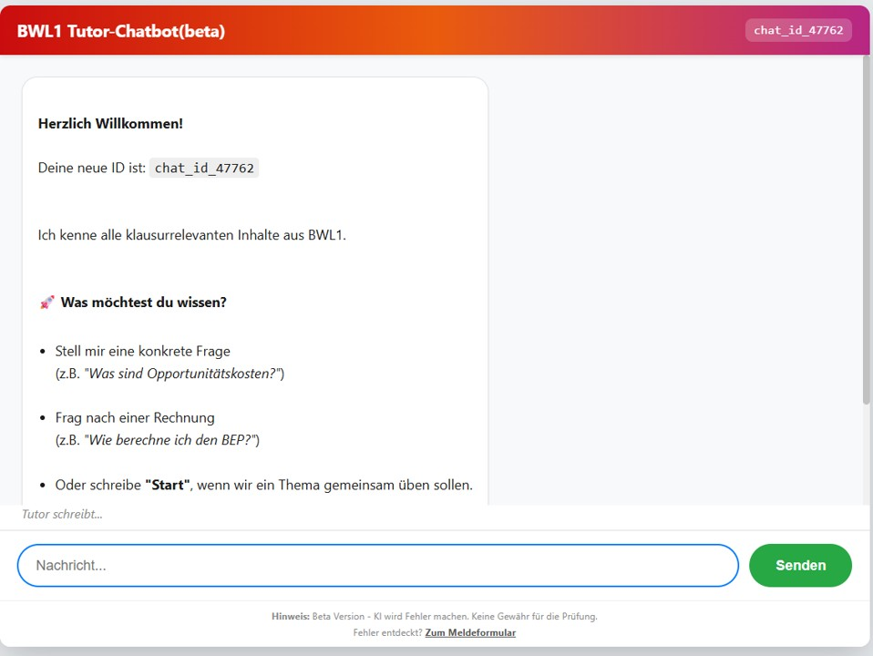

# Rollen der KI: Hiwi, Copilot, Tutor, Simulator {#sec-szenarien}

::: kapitel-gliederung
:::

Prof. Dr. Lena Hoffmeister lehrt Produktionslogistik für 90 Studierende im Maschinenbau. Für einen Forschungsantrag lässt sie einen Deep-Research-Bericht schreiben: zwölf Seiten, 40 Quellen, zehn Minuten. Im Projektmodul bauen ihre Studierenden mit einem Programmier-Agenten eine Simulation der Fertigungslinie; nach zwei Tagen läuft sie. In der Abnahme kann niemand erklären, warum sich die Warteschlange vor der Lackiererei bildet. Ein Tutor soll die Studierenden abends durch die Übungen zur Warteschlangenrechnung führen, doch im Test rechnet er eine Aufgabe überzeugend und falsch. Hoffmeister fragt sich, welchem dieser Helfer sie trauen kann und was der Tutor bräuchte, um richtig zu rechnen.

*Die Szene ist aus Gesprächen in Workshops und aus der eigenen Lehre zusammengesetzt.*



::: {.callout-note .ez-block title="Bevor Sie weiterlesen: Wie sehen Sie das?"}
*Wie sehr stimmen Sie den drei Aussagen zu? Jede Aussage wird an der Stelle im Kapitel aufgelöst, die sie beantwortet. Wer sich vorher festlegt, liest gezielter.*

::: {.einschaetzung #ez-k4-2}
Für einen Überblick über den Forschungsstand ist ein Deep-Research-Bericht die verlässlichste Form der KI-Recherche, weil er die meisten Quellen auswertet.

[Auflösung in @sec-recherche]{.ez-verweis}
:::

::: {.einschaetzung #ez-k4-3}
Studierende, die mit einem Programmier-Agenten arbeiten, kommen schneller zu einem lauffähigen Programm, verstehen ihren Code aber schlechter als Studierende, die ihn selbst schreiben müssen.

[Auflösung in @sec-coding]{.ez-verweis}
:::

::: {.einschaetzung #ez-k4-4}
Ein KI-Tutor für Rechenaufgaben sollte die Musterlösungen als Vorgabe bekommen, statt die Lösungswege selbst zu erzeugen.

[Auflösung in @sec-tutor]{.ez-verweis}
:::
:::

::: {.callout-note .lernziele title="Lernziele: Nach diesem Kapitel können Sie …"}
1. die vier Rollen Hiwi, Copilot, Tutor und Simulator unterscheiden und eigene Ideen zuordnen;
2. ein Recherchewerkzeug nach dem Muster der Aufgabe statt nach dem Markennamen wählen;
3. beurteilen, wie viel Studierende beim Schreiben und Programmieren mit KI selbst verantworten müssen, und prüfen, ob eine KI-gebaute Simulation rechnet oder nur abspielt;
4. beschreiben, was ein KI-Tutor und eine KI-Simulation brauchen, damit sie das Lernen fördern.

*Die Kernaussagen am Kapitelende sind nach diesen vier Zielen geordnet.*
:::

Wie nutzen Lehrende generative KI?
Wir sortieren die sehr vielfältigen Hilfestellungen der neuen Tools in vier Kategorien von Anwendungen: Hiwi, Copilot, Tutor, Simulator [@mollick2023a; @mollick2024a].

Hier ein Beispiel für einen Tutor-Bot, den wir seit dem Wintersemester 2025/26 als Hilfestellung für das Modul "Grundlagen der BWL" erproben; neue Themen werden laufend ergänzt.

{#fig-tutor-bot-bwl}

::: {.content-visible when-format="html"}
**Hier können Sie die Live-Version testen:** https://dev.d1czie2npcfbfs.amplifyapp.com
:::

::: {.content-visible when-format="pdf"}
Eine Testversion und der aktuelle Stand des Projekts sind über die Online-Fassung dieses Buches erreichbar; Aufbau, Betrieb und Erfahrungen beschreibt @sec-fall-tutor-bwl.
:::

## KI als Hiwi {#sec-hiwi}

Beschäftigte in Forschung und Lehre erfüllen eine Vielzahl sehr heterogener Aufgaben, mit einem wachsenden Teil an „Verwaltung“.
Wer lehrt, merkt schnell, dass die Präsenzveranstaltung nur die Spitze eines ganzen Eisbergs an Aufgaben darstellt.
Eine Umfrage unter Lehrenden in Österreich zeigt, dass sie etwa ein Drittel ihrer Zeit mit Lehraktivitäten verbringen (32 %) und etwa ein Fünftel mit Verwaltungstätigkeiten in der Hochschule (20 %) sowie ein weiteres Fünftel mit externen Verpflichtungen wie Gutachten oder Tätigkeiten in wissenschaftlichen Gesellschaften (9 %, 10 %) [@oesterreichischeruniversitaetsprofessor/innenverband2018].
Wie Unkraut im Garten wächst der Anteil, den Lehrende mit „sonstigem“ verbringen: Vor allem der Zeitaufwand für Verwaltung stieg an [@schomburg2012].

### Fachartikel finden und auswerten: Welches Werkzeug passt zu welcher Aufgabe? {#sec-recherche}

Was leisten die KI-Helfer bei der Literaturrecherche, und wie prüft man, was sie liefern?
Die besten Antworten darauf gibt der Bibliothekar Aaron Tay von der Singapore Management University, der die Werkzeuge seit Jahren systematisch testet (<https://aarontay.substack.com/>) [@tay2025agentic].
Zwei Unterscheidungen ordnen das Feld: Wird einmalig gesucht oder in mehreren Schleifen (einmalige Suche gegenüber agentischem Suchprozess)? Und bekommt man eine Trefferliste oder eine aus den Treffern erzeugte Zusammenfassung (Ergebnisliste gegenüber RAG-basierter Analyse; RAG, *Retrieval-Augmented Generation*, heißt: Das Sprachmodell schreibt seine Antwort aus den zuvor gefundenen Texten, vgl. @sec-patterns-usage)? Daraus ergeben sich vier Typen (@tbl-suchtypen); die Produkte in jedem Typ wechseln schnell, die Typen bleiben.

| Suche | Ausgabe | Typ nach Tay | Was man praktisch bekommt |
|:---------|:------------------|:--------------|:----------------------------------------|
| einmalig | Liste | Quick Search | Klassische Trefferliste mit Ranking (etwa der Bibliothekskatalog oder Google Scholar), ohne erzeugten Antworttext |
| einmalig | Zusammenfassung | Quick RAG | Kurze „Antwort mit Zitaten“ aus den obersten Treffern; meist wenige Absätze |
| iterativ | Liste | Deep Search[]{#sb-k4-deep-search} | Mehrere Suchschleifen über Minuten mit Abfragevarianten und Zitationsverfolgung; ein Sprachmodell bewertet die Relevanz; das Ergebnis bleibt eine Liste, meist eine bessere |
| iterativ | Bericht | Deep Research[]{#sb-k4-deep-research} | Deep Search plus Berichterstellung: eine längere Synthese auf Basis des iterativ gefundenen Korpus |

: Vier Typen von KI-Suchhelfern nach zwei Unterscheidungen. Quelle: @tay2025agentic {#tbl-suchtypen}


Hinter dem Wort „iterativ“ verbirgt sich die wichtigere Frage, *wie* ein Werkzeug iteriert: als fest verdrahteter Ablauf mit ein paar KI-Entscheidungspunkten oder als Agent, der eine Aufgabe flexibel zerlegen kann.
Tay beschreibt ein Agency-Spektrum (Grad der Eigenständigkeit) und ordnet die meisten akademischen Deep-Research-Tools am verdrahteten Ende ein: beeindruckend innerhalb ihrer Schablonen, spröde außerhalb [@tay2025agentic].
Sein Stresstest macht das sichtbar: „Finde Arbeiten, die Paper X hätte zitieren sollen, aber nicht zitiert hat.“ Eine menschliche Hilfskraft zerlegt das in drei Schritte (ähnliche Arbeiten finden, deren Referenzen extrahieren, die Überlappung abziehen); allgemeine Sprachmodelle mit Werkzeugen führen diese Logik eher aus, während spezialisierte Tools scheitern, weil die Aufgabe nicht in ihren eingebauten Ablauf passt.
Für die Lehre folgt daraus die Regel aus @sec-agenten-praxis: Je freier das Werkzeug arbeitet, desto klarer müssen die Kontrollpunkte sein, an denen wir das Ergebnis prüfen.

:::: {.callout-note title="Aus der Lehre: Literaturrecherche in vier Phasen"}
In unserer Übung zur Literaturrecherche im Wirtschaftsingenieurwesen arbeiten Studierende in vier Phasen: Thema eingrenzen, Quellen auswählen, suchen, auswerten [@bartnik2025recherche]. Die Werkzeugtypen haben darin feste Plätze (@tbl-werkzeugtyp-phase); die Entscheidungen fallen in den ersten beiden Phasen, bevor ein Werkzeug sucht.

Beim Eingrenzen legen die Studierenden Hauptthema, Kontext, Variablen, Stichwörter, Ausschlussbegriffe und Zeitraum fest. Beim Auswählen bestimmen sie eine Liste anerkannter Zeitschriften, etwa nach dem VHB-Rating des Verbands der Hochschullehrerinnen und Hochschullehrer für Betriebswirtschaft, und suchen in Publish or Perish über deren ISSN, die internationale Kennnummer jeder Zeitschrift; die Sortierung „nach Relevanz“ in Google Scholar ist kein Qualitätsranking.

Erst beim Suchen kommt das Sprachmodell dazu, als Übersetzer: Es schreibt aus den festgelegten Kriterien die Suchsyntax. Das ist Quick Search mit einem Sprachmodell davor, und die Suchstrategie bleibt bei den Studierenden. Gemessen ist das für systematische Reviews in der Medizin: ChatGPT schrieb Boolesche Suchanfragen mit hoher Präzision (wenig Unpassendes unter den Treffern), aber geringerem Recall (relevante Studien fehlen); wiederholte Läufe lieferten verschiedene Anfragen, ein Beispiel-Query im Prompt (der Eingabe an die KI) und mehrere Dialogrunden halfen [@wang2023boolean]. Die Nachprüfung fand den Ausschlag bei Modell- und Promptwahl und einen Vorteil durch gut gewählte Schlüsselstudien [@wang2025boolean]. Unsere Regel: Syntax lesen, Trefferzahl in einer zweiten Datenbank gegenprüfen, mit zwei bekannten Schlüsselstudien testen, ob die Suche sie findet. Fehlen sie, hat die Syntax eine Lücke, nicht die Forschung.

::::

| Phase | Werkzeugtyp | Beispiele (Stand 2026) |
|:-------------|:--------------------------------------|:---------------------------|
| Thema eingrenzen | Quick RAG: Antwort mit Zitaten zur Orientierung | Consensus, Elicit |
| Quellen auswählen | Quick Search mit Filter nach Zeitschrift oder ISSN | Publish or Perish, Google Scholar |
| Suchen | Quick Search, Sprachmodell schreibt die Syntax | Google Scholar, Publish or Perish, EBSCO |
| Suchen | Deep Search: mehrere Suchschleifen, Ergebnis ist eine Liste | Undermind |
| Suchen | Zitationsnetz: vom Startartikel zu verwandten Arbeiten | Connected Papers, Research Rabbit |
| Auswerten | Zusammenfassung und Extraktionstabelle je Artikel | Elicit, Semantic Scholar |
| Auswerten | Zitationskontext: gestützt oder bestritten? | Scite |
| Auswerten | Deep Research: Bericht, höchstes Fehlerrisiko | Deep-Research-Modi der Sprachmodelle |
| Auswerten | Datenzugriff per API (Programmierschnittstelle): eigene Auswertungen mit Code | OpenAlex, Semantic Scholar API |

: Werkzeugtypen je Phase der Literaturrecherche. Typen nach @tay2025agentic, ergänzt um drei Typen ohne erzeugten Text (Zitationsnetz, Zitationskontext, API); Produktnamen sind ein Schnappschuss (Stand 2026), die Typen bleiben. Quelle: eigene Zuordnung nach @bartnik2025recherche {#tbl-werkzeugtyp-phase}

Beim Auswerten gefundener Artikel gilt eine ähnliche Staffelung [@tay2024classifying].
Die Zusammenfassung eines einzelnen Dokuments ist am wenigsten riskant und eignet sich für die schnelle Relevanzprüfung; die sequenzielle Auswertung vieler Dokumente nach denselben Fragen (Design, Stichprobe, Befund) ergibt eine Codier-Tabelle, deren Zellen man stichprobenartig gegen das PDF prüft; die Synthese über mehrere Dokumente zu einer Frage trägt das höchste Fehlerrisiko, weil sich Suchfehler, untreue Zusammenfassung und schwache Gewichtung der Evidenz addieren.
Die Kurzform „Antwort mit Zitaten“ ist für wissenschaftliche Arbeit deshalb meist nur ein Teaser: Man braucht den Originaltext für Kontext, Operationalisierung und Geltungsgrenzen, und erzeugter Text kann Quellen etwas zuschreiben, das sie so nicht sagen [@tay2025agentic]; dann fehlt es an Quellentreue.
Ein praktisches Problem der spezialisierten Suchwerkzeuge kommt hinzu: Sie kommen nicht hinter die Bezahlschranken der Verlage und arbeiten deshalb mit Abstracts oder Open-Access-Korpora.
Akademische Konnektoren zu den großen Sprachmodellen verschieben die Arbeit hier von abstract-basiertem Raten zu passagenbasiertem Prüfen, weil das Modell über eine institutionelle Anmeldung lizenzierte Volltexte durchsuchen und Behauptungen an Fundstellen binden kann, begrenzt auf den Bestand des jeweiligen Anbieters [@tay2024mcp].

::: {.callout-tip .ez-pruefen title="Ihre Einschätzung prüfen"}
*„Für einen Überblick über den Forschungsstand ist ein Deep-Research-Bericht die verlässlichste Form der KI-Recherche, weil er die meisten Quellen auswertet.“* []{.ez-ihre data-ez="ez-k4-2"}

**Auflösung: nein.** Die Synthese über viele Dokumente trägt das höchste Fehlerrisiko, weil sich Suchfehler, untreue Zusammenfassung und schwache Gewichtung der Belege addieren. Verlässlicher ist es, das Werkzeug nach dem Muster der Aufgabe zu wählen: eine Trefferliste zum Suchen, eine Extraktionstabelle zum Auswerten, beides stichprobenartig gegen das Original geprüft.
:::

::: {.content-visible when-format="html"}
::: {.callout-note collapse="true" title="Nur online: Ausführliche Übersicht der Formen von KI-Zusammenfassungen nach Tay (2024)"}
| Form der LLM-Zusammenfassung (Tay) | Was passiert technisch/funktional? | Typische Bedienoberfläche | Beispiele (Anbieter/Produktnamen) | Nutzen in sozialwissenschaftlicher Forschung | Typische Risiken und worauf man testet |
|---|---|---|---|---|---|
| **1. Single-Document Summarisation** (ein Dokument) | Ein einzelner Text wird zusammengefasst; Tay unterscheidet innerhalb dieser Kategorie drei Varianten je nach Prompt-Freiheit: (1a) fester Button, (1b) feste, aber query-abhängige Antwort, (1c) freies Q&A/Chat über ein Dokument. Viele Implementierungen nutzen intern RAG-Muster und zeigen „Snippets“ als Beleg. | Button/Sidebar/Chat neben einem Treffer | **1a**: EBSCO „AI Insights“; **1a**: Ex Libris „Document Insights“ (Primo/ProQuest-Kontext); **1b**: ProQuest „Research Assistant“ (z. B. „Relationship to your search terms“); **1c**: JSTOR Research Tool (beta) „Chat“. | Sehr gut fürs schnelle Triage-Lesen: „Ist das Paper relevant?“; hilfreich bei überlappenden Begriffen zwischen Soziologie/Politikwissenschaft/Erziehungswissenschaft. Query-abhängige Varianten (1b) machen sichtbar, wenn ein Treffer nur semantisch „ähnlich“ ist, aber nicht zur Fragestellung passt. | Bei festen Buttons geringeres Risiko, aber oft nur „aufgebohrte Abstract-Paraphrase“; bei Chat-mit-PDF höheres Risiko durch unvorhersehbare Fragen. Tests: Stabilität (gleicher Text → ähnliche Ausgabe), Grounding-Spotchecks (Behauptungen im PDF prüfen), Negativkontrolle („steht das überhaupt drin?“), Scope-Klarheit (Abstract vs. Volltext). |
| **2. Sequential Single-Document Summarisation** (mehrere Dokumente, aber jeweils einzeln) | Mehrere Treffer werden nacheinander dokumentweise verarbeitet; typisch sind „Synthesis tables“/Matrizen. Extraktion klar definierter Variablen ist meist zuverlässiger als freie Zusammenfassung. Query-abhängige Ein-Zeilen-Zusammenfassungen dienen nebenbei als Relevanz-Signal. | Tabelle/Matrix über Top-K Treffer | **Elicit**: automatische Summary-Spalte plus frei definierbare Extraktions-Spalten (Design, Sample, Outcome etc.). | „Codier-Werkbank“: Konstrukte, Kontext, Designlogik und Findings als Spalten definieren, Paper für Paper füllen lassen; macht Muster, Cluster und Ausreißer sichtbar (wie ein standardisiertes Codebuch mit beschleunigter Erstbefüllung). | Stille Inkonsistenzen: driftende Begriffe/Einheiten, „Missingness“ wird mit Vermutungen gefüllt. Tests: Stichproben-Audit gegen PDF, Konsistenzchecks, „Missingness-Ehrlichkeit“, Provenance je Zelle (Textstelle muss rückverfolgbar sein). |
| **3. Query-based Multi-Document Summarisation** (Synthese über mehrere Dokumente) | Synthese über mehrere Dokumente zur Beantwortung einer Frage; häufig RAG. Varianten: nur Suchtreffer, nur Uploads oder Hybrid. Manche Systeme fixieren zuerst ein Korpus (z. B. Top-25) und erlauben danach Folgefragen über dieses Set. | „Answer with citations“ / Report über mehrere Papers | **Ex Libris/Primo Research Assistant**; **Google NotebookLM** (Upload-Korpus); **Elicit Systematic Review** (Hybrid); **JSTOR Research Tool (beta)** (fixes Top-K-Set); **Undermind.ai** („Ask Expert“) nach iterativer Phase. | „Narrativ-Maschine“: gut für Landschaftsskizzen (Themencluster, Mechanismen, Kontroversen). Kann beim Strukturieren eines Review-Kapitels helfen (Abschnitte nach Mechanismen, Kontexten, Messansätzen). | Höchstes Fehlerrisiko durch Kombination aus Retrieval-Fehlern, kontextuntreuer Paper-Zusammenfassung und schwacher Evidenzgewichtung. In Sozialwissenschaften heikel wegen heterogener Designs. Tests: Claim-zu-Quelle-Mapping, Coverage („Must-cite“-Set), Widerspruchstest, „Not in sources“-Test, Retraktions-/Korrekturtest. |

: Paper mit KI analysieren: Einfach oder sequenziell, ein Artikel oder Synthese mehrerer Artikel? Quelle: @tay2024classifying {#tbl-paper-analysis-types}
:::
:::

**Der 4D-Kreislauf beim Hiwi.** Beim Hiwi reißt der Kreislauf (@sec-schemas) an zwei Stellen, bei der Delegation und bei der Prüfung des Ergebnisses; die Beschreibung ist meist einfach.
*Delegation:* @tbl-acemoglu ist bereits eine Delegationsanalyse, denn sie trennt, was zur KI wandern kann, von dem, wobei sie nur hilft.
*Description* (Beschreiben): Wer Artikel auswerten lässt, legt die Spalten der Extraktion fest wie ein Codebuch; klar definierte Variablen werden zuverlässiger extrahiert als freie Zusammenfassungen [@tay2024classifying].
*Discernment* (Beurteilen): Zwei gleich eingestellte KI-Läufe kamen in einem Scoping Review (kartierende Literaturübersicht) bei 94 Datensätzen zu unterschiedlichen Urteilen [@figalova2026evaluating]; ein zweiter Lauf ist deshalb die billigste Prüfregel.
*Diligence* (Sorgfalt): Material für Studierende geht erst nach der Prüfung hinaus; geprüfte, quellengebundene Lernhilfen senkten in einem Kohortenvergleich vor allem den Anteil schwacher Prüfungsergebnisse [@dang2026verified, Preprint, also noch nicht begutachtet].
Was die Prüfung regelmäßig als unzuverlässig zeigt, wandert aus der Delegation wieder heraus.
[Den Kreislauf mit hervorgehobenem Engpass zeigt die [interaktive Fassung](interactions/4d-kreislauf.html?rolle=hiwi).]{.content-visible when-format="html"}

#### Interviews auswerten lassen – und prüfen {#sec-podcast-interviews}

Literatur ist nicht die einzige Quelle, die ein Hiwi auswertet. Interviews aus einem Lehrprojekt, Freitexte der Lehrevaluation und Feedback am Semesterende sind qualitative Daten derselben Art, und Werkzeuge wie Gemini Notebook (früher NotebookLM) machen daraus in Minuten ein Gespräch zweier Stimmen. Das folgende Hörstück entstand so: Ein KI-Agent schrieb in einem Durchgang ein Drehbuch aus 125 Interviews, in denen Forschende über ihre Arbeit mit KI berichten [@handa2025interviewer].^[Datensatz: Anthropic Interviewer, Teil der Forschenden (*scientists*), <https://huggingface.co/datasets/Anthropic/AnthropicInterviewer>, Lizenz CC BY. Alle Teilnehmenden haben der Veröffentlichung ihrer Transkripte zugestimmt.] Das Drehbuch ist absichtlich ungeprüft. Ihre Aufgabe ist die der Betreuung: vorher eine Vermutung festhalten, zuhören, dann drei Aussagen an den Originalstellen prüfen. Die Vermutung zählt mit, denn wer vorab rät, behält die Auflösung oft besser [@pan2023prequestion]. Das Ganze dauert etwa zwölf Minuten.

::: {.content-visible when-format="html"}
```{=html}
<iframe loading="lazy" id="podcast-forschende-ki" src="interactions/podcast-forschende-ki.html" width="100%" height="900px" frameborder="0" title="Hörstück mit Prüfauftrag: Was Forschende über KI sagen. Vorhersage, Hören mit Transkript, drei Aussagen prüfen, Bilanz, Prompt-Vorlage"></iframe>
<script>
/* Das Element meldet seine Inhaltshöhe (wie agenten-engpass.html); beim Wechsel der Phase rückt sein Anfang ins Bild. */
window.addEventListener("message", function (e) {
  var d = e.data; if (!d || d.id !== "podcast-forschende-ki") return;
  var f = document.getElementById(d.id); if (!f) return;
  if (d.typ === "rahmen-hoehe" && d.h > 200) f.style.height = (d.h + 2) + "px";
  if (d.typ === "rahmen-anfang" && f.getBoundingClientRect().top < 0) f.scrollIntoView({ block: "start" });
});
</script>
```
:::

::: {.content-visible unless-format="html"}
::: {.callout-note title="Prüfen Sie selbst: Ziehen Forschende der KI klare Grenzen?" appearance="simple"}
Im Hörstück sagt der Moderator: „Viele ziehen klare persönliche Grenzen.“ Eine Stichwortzählung (etwa *boundary*, *draw the line*, *would never*) findet solche Wörter in den Antworten von 12 der 125 Interviews. Zwei der Treffer, in Arbeitsübersetzung:

1. „Ich setze der KI klare Grenzen, um wesentliche Lernschritte zu bewahren.“ (Transkript science_0077)\
   *Original: „I set clear boundaries around AI to preserve essential learning steps.“*
2. „Wenn die KI zum Beispiel eigene mathematische Sätze aufstellen und die Grenzen der Wissenschaft verschieben könnte, wäre das eine große Hilfe.“ (Transkript science_0050)\
   *Original: „For example, if AI was able to produce its own mathematical theorems and push the boundaries of science, it would be a great help“*

Ihr Urteil zur Aussage: $\square$ belegt $\square$ überzogen $\square$ nicht belegt. Den Befund des Prüfagenten finden Sie in @sec-loesungshinweise.

Das Hörstück (sieben bis acht Minuten) mit Transkript und zwei weiteren Prüfaufgaben gibt es in der Online-Version: QR-Code scannen oder <https://th-koln-bartnik.github.io/genai4teaching/kapitel06-rollen.html#sec-podcast-interviews> aufrufen.

{width="25mm"}
:::
:::

Der Prüfagent, ein zweiter KI-Agent ohne Kenntnis des ersten Auftrags, zerlegte das Drehbuch in 39 Sachaussagen: 33 waren belegt, 6 überzogen, keine ohne Quelle. Die Zitate hielten, die Verallgemeinerungen nicht; aus 12 von 125 Interviews wurde „viele“. Für eigene Auswertungen heißt das: Zitate stichprobenartig prüfen, Wörter wie „viele“, „die meisten“ und „typisch“ ausnahmslos, und Zahlen nur nennen, wenn klar ist, was gezählt wurde.

::: {.callout-note title="So entstand dieses Hörstück" appearance="simple"}
Der Drehbuch-Prompt begann: „Schreibe ein deutsches Podcast-Gespräch von etwa 1.150 Wörtern (8 Minuten) zwischen zwei Moderierenden, Lea und Jonas, über die angehängten Auszüge aus 125 Interviews mit Forschenden zu ihrer Arbeit mit KI.“ Ein Skript zog dafür 93 Originalstellen und eine Stichwortzählung aus den Transkripten. Das Drehbuch schrieb ein Agent in Claude Code in 75 Sekunden, die Prüfung dauerte fünfeinhalb Minuten; gesprochen haben zwei Stimmen aus ElevenLabs v3. Die Schwäche, die tatsächlich auftrat: Der Agent übernahm Stichwortzählungen als Aussagen über die Forschenden. Drei Stellen, die Teilnehmende verkürzt wiedergaben, wurden im Drehbuch korrigiert, alles andere nicht. Dass diese Korrekturen den Weg in die Sprachsynthese nicht gefunden hatten, zeigte erst ein Abgleich der fertigen Aufnahme mit dem Drehbuch per Spracherkennung; die drei Zeilen wurden nachgesprochen. Zum Vergleich entstand dasselbe Gespräch in Gemini Notebook aus allen 125 Interviews, ohne Vorauswahl: Es dauerte fast fünfzehn Minuten, von 37 Sachaussagen waren 24 überzogen oder ohne Beleg, und vier Interviewnummern stimmten nicht. Ob das am Werkzeug lag oder an der fehlenden Vorauswahl des Materials, lässt sich aus diesem einen Versuch nicht trennen.
:::

## KI als Copilot {#sec-copilot}

In dieser Kategorie hilft das Sprachmodell uns dabei, etwas zu tun, was wir sonst nicht könnten.
@mollick2024a beschreiben mehrere solcher Ansätze: Bei der **"Case Co-Creation"** [@mollick2024a, S. 25–28] arbeiten Studierende mit der KI zusammen, um ein Fallbeispiel für Kommilitonen zu erstellen.
Dies fördert die Artikulation von Ideen und die kritische Auseinandersetzung mit dem KI-Output, da die initialen Entwürfe oft oberflächlich sind und durch studentische Expertise verbessert werden müssen.
Die Übung **"Critique the AI"** lässt die KI ein Szenario zu einem Konzept (z. B. Groupthink, Gruppendenken) erstellen, das die Studierenden dann kritisch bewerten und ggf. verbessern müssen.
Dies schult das Erkennen von Konzeptmerkmalen und die Fähigkeit, Wissen durch Korrektur zu artikulieren.
Eine Herausforderung ist, dass die KI Konzepte manchmal unvollständig oder fehlerhaft illustriert, was aber Teil des Lerneffekts sein kann [@mollick2024a].

:::: {.callout-note title="Anwendungsbeispiel: Wer nicht selbst rechnen kann, erkennt die Fehler des Copiloten nicht"}
**Problem ohne KI.** Eine Kennzahlenanalyse am echten Geschäftsbericht ist mühsam: Zahlen aus Bilanz und Gewinn- und Verlustrechnung heraussuchen, die Komponenten der Eigenkapitalrendite berechnen, das Ergebnis deuten.

**Problem mit KI.** Ein Copilot liefert die DuPont-Analyse in Sekunden und erklärt sie Schritt für Schritt. Ob sie stimmt, erkennt nur, wer den Rechenweg selbst beherrscht.

**Das Dilemma.** David Pedersen lässt Studierende die DuPont-Analyse der Eigenkapitalrendite von Coca-Cola für 2022 zuerst selbst aus dem Jahresbericht (10-K) bei der US-Börsenaufsicht berechnen und kurz deuten. Erst dann führen sie dieselbe Analyse mit Microsoft Copilot durch, stellen mindestens eine Nachfrage, reichen das Protokoll ein und reflektieren in 300 Wörtern, wie viel Führung die KI für ein richtiges Ergebnis brauchte. Die Zeitersparnis des Copiloten gibt es erst nach der eigenen Rechnung.

**Was das für wirksames Lernen heißt.** *Unterrichtsentwurf, keine Ergebnisse berichtet.* Die Reihenfolge schützt vor der Trennung von Leistung und Behalten, die im Labor gemessen ist: Mit ChatGPT lösten Informatikstudierende mehr Aufgaben, behielten den Stoff aber schlechter [@bergh2026cognition]. Und sie macht die zerklüftete Grenze (*jagged technological frontier*) der Modelle erfahrbar [@dellacqua2023]: Ob der Copilot bei dieser Rechnung zuverlässig ist, zeigt erst der Vergleich mit dem eigenen Ergebnis.

[Ablauf und Prompt: @sec-prompt-dupont-analyse.]{.content-visible when-format="html"}[Ablauf und Prompt: Online-Fassung von Anhang A.]{.content-visible unless-format="html"} Quelle: @pedersen2025 (AI Pedagogy Project, metaLAB at Harvard).

::: {.content-visible unless-format="html"}
{width="18%"}
:::
::::

Dass ein Copilot auch fehlendes Vorwissen überbrücken kann, solange die Lehrenden den Studierenden die Prüfarbeit nicht abnehmen, zeigt ein Seminar aus der Mediävistik.

:::: {.callout-note title="Anwendungsbeispiel: Fehlende Lateinkenntnisse versperren den Zugang zu den Quellen"}
**Problem ohne KI.** Wer mittelalterliche Geschichte studiert, braucht Latein und für Handschriften auch Transkriptionsfähigkeit. Nicht alle Studierenden bringen das mit, und Lehrveranstaltungen zum Mittelalter werden häufig gemieden.

**Problem mit KI.** ChatGPT, Transkribus und Google Übersetzer öffnen den Zugang zu den Quellen, machen aber Fehler, die Anfängern ohne Latein kaum auffallen.

**Das Dilemma.** Cristina Andenna und Miriam Weiss (Universität des Saarlandes) haben das Seminar „ChatGPT und Mediävistik“ als Held:innenreise in zwölf Etappen angelegt. Die Studierenden transkribieren, übersetzen und deuten einen Quellentext selbst; die Werkzeuge treten als „Mentoren“ auf, mal hilfreich, mal nicht. Die Schwierigkeit liegt bei den Lehrenden: Bei offensichtlichen Fehlern der KI greifen sie nicht ein, damit die Studierenden den Prozess selbst durchleben. Das kostet Zeit und die Gewissheit, dass am Ende alles stimmt, und es nimmt den Lehrenden keine Arbeit ab: Die Arbeit der Studierenden mit KI muss eng begleitet werden.

**Was das für wirksames Lernen heißt.** *Evaluiert über Selbsteinschätzungen vor und nach der Lehrveranstaltung.* Die Begleitforschung fand signifikante Verbesserungen der digitalen Kompetenzen und der intrinsischen Motivation; gemessen wurde die Einschätzung der Studierenden, nicht ihre Leistung [@wannemacher2025, Case 146]. Das Nicht-Eingreifen erhält eine erwünschte Schwierigkeit (*desirable difficulty*) [@bjork2011]: Den Fehler der Maschine selbst zu finden, ist die eigentliche Lernaufgabe.

Quelle: @wannemacher2025, Case 146.

::: {.content-visible unless-format="html"}
{width="18%"}
:::
::::

### Besser schreiben – als Cyborg {#sec-cyborg-writing}

Wer akademisch schreibt, lässt sich zunehmend von einer Vielzahl an unterstützenden KI-Systemen über die Schultern schauen – oder die Hand führen –, die Vorschläge zur besseren Sprachverwendung machen, wie DeepL, Grammarly, oder ChatGPT [@ou2024].
@ou2024 sprechen von KI-gestützten Sprachwerkzeugen (*AI-powered language tools*, AILT), die Studierenden dabei helfen, ihre Sprachfähigkeiten etwa von einer in die andere Sprache zu übertragen und das Sprachniveau ihrer Schreibprodukte generell zu verbessern.
In ihrer Studie analysieren sie die Kommentare von 1703 schwedischen Studierenden und stellen komplexe Muster der Nutzung fest: „…students align their own languages, writing skills and thinking with the algorithm-based language processes (e.g., lexical, grammatical, and textual corrections, word choice suggestions, language translation) within AI chatbots, writing assistance, and machine language translation to optimise the outcomes of their academic writing.
… students have become ‘spatially extended cyborg\[s\]’”.

Studierende schreiben durch die zunehmend mächtigere technische Unterstützung ihre Haus- und Abschlussarbeiten deutlich anders.
Bedeutet dies das Ende der Hausarbeit?
Wohl eher einen starken Wandel, denn es wird weiter wichtig sein, die saubere Argumentation zu üben [@friedrich2023; @klein2023].

Dafür lassen sich die einzelnen Schreibschritte gezielt trainieren, Teil für Teil.
Für den Kurs zum wissenschaftlichen Arbeiten im Wirtschaftsingenieurwesen der TH Köln haben Julia Schmid und ich acht Schreibtrainer entwickelt, die eine Abschlussarbeit vom ersten bis zum letzten Kapitel begleiten (@tbl-schreibtrainer).
Jeder Trainer ist eine ausführliche Anweisung, ein Prompt, der ein Sprachmodell in einen geduldigen Übungspartner verwandelt.

| Trainer | Teil der Arbeit | Lernziel | Übungsformat |
|:--------|:----------------|:---------|:-------------|
| 1 Einleitung | Einleitung | Hook (Aufhänger), Hintergrund mit Quelle und Forschungsfrage verbinden; erkennen, wann eine Quelle nötig ist | Quiz, Mini-Einleitung mit Feedback, Analyse einer echten Einleitung |
| 2 Forschungsstand | Stand der Forschung | Bestehende Forschung bündeln und die Lücke zeigen | Quiz, Vergleich zweier Forschungsstände, eigener Mini-Forschungsstand |
| 3 Methoden | Methodenteil | Das Vorgehen begründen statt nur beschreiben | Methodenwahl in sechs Runden, starke und schwache Passagen vergleichen |
| 4 Literature Review | Strukturierte Literaturübersicht | Literatur auswählen, auswerten und darstellen | Sechs Module mit Quiz und Mini-Fall; Punkte, Medaille, Urkunde |
| 5 Diskussion | Diskussion | Ergebnisse einordnen statt wiederholen | Sätze dem Forschungsstand oder der Diskussion zuordnen, Bausteine üben |
| 6 Artikelstruktur | Gesamtaufbau | Die Funktion jedes Abschnitts kennen | Quiz, Zuordnungsübung, eigene Gliederung |
| 7 Limitationen | Limitationen und Ausblick | Grenzen als begründete Designentscheidung mit Trade-offs darstellen | Vier Szenarien, Quiz zum Ausblick |
| 8 Absätze | Jeder Absatz | Topic Sentence (Kernsatz des Absatzes), Belege und Abschlusssatz verbinden | Drei Sortierübungen, eigener Absatz, Analyse eines echten Absatzes |

: Acht Schreibtrainer entlang der Abschlussarbeit (TH Köln, Wirtschaftsingenieurwesen; Julia Schmid und Roman Bartnik) {#tbl-schreibtrainer tbl-colwidths="[16,18,34,32]"}

Alle acht folgen demselben Muster.
Der Trainer erklärt kurz, wozu der Textteil dient, stellt Quizfragen und gibt bei falschen Antworten einen Hinweis statt der Lösung.
Dann schreiben die Studierenden einen kurzen eigenen Text, erhalten Rückmeldung und überarbeiten ihn.
Zum Schluss untersuchen sie einen echten Text und übertragen das Gelernte auf ihr eigenes Thema.
Der Trainer für Limitationen zeigt, dass ein Bot auch eine Haltung vermitteln kann: Er übt in vier Szenarien, Limitationen als bewusste Entscheidung mit Preis zu schreiben statt als Pannenbericht.
Der Trainer für Literature Reviews setzt auf Spielelemente, mit Punkten für richtige Antworten und am Ende einer Medaille und einer Urkunde.

Wie fragil solche Werkzeuge sind, zeigt ihre eigene Geschichte.
Die Trainer liefen zunächst als Custom GPTs (selbst eingerichtete Chatbots) bei OpenAI, und OpenAI stellt diese Form der Chatbots am 11. Dezember 2026 ein [@openai2026gptretirement].
Was bleibt, ist die Anweisung.
Sie funktioniert in jedem Chatwerkzeug, auch im Angebot der eigenen Hochschule, und trägt deshalb besser als jeder Link auf eine Plattform.

::: {.callout-tip title="Probieren Sie mal"}
Zwei der Trainer stehen online zum Ausprobieren bereit: der **Einleitungstrainer** und der **Absatztrainer** für Topic Sentences von Julia Schmid.
Die Anweisung kopieren, in einen neuen Chat einfügen, absenden – der Trainer beginnt von selbst.

::: {.content-visible when-format="html"}
Zur Seite mit beiden Anweisungen: [Schreibtrainer zum Kopieren](schreibtrainer.html).
:::

::: {.content-visible unless-format="html"}
{#fig-qr-schreibtrainer width="32%" fig-align="center"}
:::
:::

Wie stark die KI an einem Text mitwirkt, lässt sich auf einer vierstufigen Skala von „zur Inspiration“ bis „inhaltsgestaltend“ beschreiben; Studierende nutzen sie, um ihre KI-Nutzung zu dokumentieren (@tbl-llm-scale).

Ethan und Lilach Mollick schlagen Hausarbeiten vor, die KI nicht zur Automatisierung einsetzen, sondern für interaktivere und individuellere Lernerfahrungen: mit mehr Reflexion, verschiedenen Perspektiven, Kreativität und Kollaboration. Die Lehrenden begleiten und moderieren diese Prozesse [@mollick2023b; @mollick2023a]. Prompts für solche Aufgaben sammelt Anhang A (@sec-prompts).

Entscheidend bleibt, Didaktik und Technik auf die konkrete Kombination aus Lerninhalt und Studierendengruppe abzustimmen.
Entlastung, anspruchsvollere Aufgaben und schnellere Individualisierung führen nur dann zu besserer Lehre, wenn sich die Lehrstrategie anpasst und Lehrende sich nüchtern mit den Risiken befassen, etwa mit der Frage, wie in diesen Schreibprozessen kritisches Denken (*critical thinking*) entsteht [@lee2025].

#### Was unsere eigenen Bots über Quellentreue lehren {#sec-bots-quellentreue}

Gegen Tays Befunde aus @sec-recherche gelesen, arbeiteten die ursprünglichen Anweisungen der Schreibtrainer an drei Stellen gegen die Quellentreue [@bartnik2026schreibtrainer]; wer eigene Trainer baut, trifft dieselben Entscheidungen.

Erstens sollten Einleitungs- und Forschungsstandtrainer die vollständige Einleitung eines echten Open-Access-Artikels zeigen. Ohne hinterlegte Datei rekonstruiert ein Sprachmodell den Text aus seinen Trainingsdaten und kann einem existierenden Artikel Sätze zuschreiben, die dort nicht stehen [@tay2025agentic]; auch hier fehlt es an Quellentreue. Abhilfe ist der Schritt zum passagenbasierten Arbeiten [@tay2024mcp]: den Originaltext als Datei hochladen oder die Studierenden den Text selbst einfügen lassen. So arbeiten die kopierbaren Fassungen auf der Schreibtrainer-Seite.

Zweitens dürfen Quellen in den Schreibübungen erfunden sein. Das trennt den rhetorischen Zug, eine Quelle mit Funktion einzubauen, von der Suche. Ohne sichtbare Markierung „fiktiv“ lernen Studierende aber nebenbei, wie normal ein erfundener Beleg aussieht; die kopierbaren Fassungen verlangen die Markierung deshalb ausdrücklich. Unsere Handreichung für Abschlussarbeiten setzt den Gegenpol: Wer eine Quelle nicht erklären kann, gefährdet das Bestehen (@sec-dokumentation).

Drittens erzeugen Diskussions- und Strukturtrainer Abschnitte im Ton begutachteter Artikel samt Literaturverweisen; als Übungsmaterial taugen sie, wenn der Trainer sie als synthetisch kennzeichnet.

::: {.callout-tip title="Ausprobiert: Prüfen, ob ein Sprachmodell richtig zitiert · 4D: Discernment · für Studierende"}
**Ablauf.** Bitten Sie ein Sprachmodell ohne hochgeladene Datei, die Einleitung eines bekannten Open-Access-Artikels aus Ihrem Fach wörtlich wiederzugeben. Suchen Sie das Original in Google Scholar und gleichen Sie drei Sätze ab: einen aus dem ersten Absatz, einen mit Quellenverweis, den mit der Forschungsfrage.

**Worauf achten.** Gibt es den Artikel? Steht jeder der drei Sätze wörtlich, sinngemäß oder gar nicht im Original? Gibt es die Quelle, auf die der zweite Satz verweist, und sagt sie das?

**Was die Übung zeigt.** Tays Stichprobenaudit gegen das PDF im Kleinen [@tay2024classifying], die Prüfliste aus @sec-widget-pruefen auf Text übertragen: Überzeugend klingt jede Ausgabe; es zählt, ob sie aus der Quelle folgt. Wiederholt man den Abgleich mit dem PDF als hochgeladener Datei, wird der Unterschied selbst zum Lerngegenstand.
:::

Wie der nächste Abschnitt zeigt, findet eine ähnlich intensive Diskussion im Bereich der Informatik statt, wo speziell Programmieraufgaben ganz neu gedacht werden müssen.

### Jeder kann jetzt programmieren {#sec-coding}

Mit KI als Copilot können wir **viel umfangreicher und schneller mit Code arbeiten**. Ein Beispiel ist Programmieren: Professionelle Programmierer werden mit KI-Copiloten deutlich schneller [@peng2023], und Lehrbücher haben zunehmend Namen wie „Learn AI-assisted Python Programming“ [@porter2024].

Studierende können so zum Beispiel viel schneller ein funktionierendes Spiel oder eine Simulation erstellen, was die Motivation erhöht. Der **Raum der kreativen Möglichkeiten weitet sich deutlich aus**.

::: {.callout-tip title="Tipp: Mini-Interaktionen einfach als HTML erstellen"}
Können Sie in HTML programmieren?
Jetzt schon.
Die Lernspiele in @sec-definitionen und @sec-patterns-usage wurden mit Hilfe von Sprachmodellen erstellt (Gemini, ChatGPT, Claude), meist mit einer Variation des einfachen Prompts **„Erstelle mir ein browserbasiertes Lernspiel zum Thema / zur Illustration von …“**.
Oft steht nach fünf bis zehn Minuten eine gute erste Version.
In der Lehre mache ich das auch als Übung mit Studierenden: Sie erstellen mit der KI ein Lernspiel und bewerten dann begründet, welcher Prototyp das Konzept am besten darstellt.
Bei etwas mehr Zeit bewerten sie sich gegenseitig, entwickeln eigene Kriterien oder fügen stärkere Spielelemente hinzu.
Im Ergebnis beschäftigen sich die Teilnehmenden intensiv mit einem theoretischen Konzept; bei komplexeren Themen hilft es, einen Fachtext als Hintergrund hochzuladen.
:::
Mit KI-Unterstützung können Schüler/innen mit Sonic Pi Musikstücke programmieren [@gieselmann2024] oder mit Tools wie Violentmonkey kleine Skripte für die individuelle Anzeige von Lieblings-Websites erstellen [@eikenberg2025].

Die ersten Studien zu GitHub Copilot zeigen, wie stark solche Assistenten die Einstiegshürden senken: Studierende eines Managementstudiengangs (MBA) ohne Programmierkenntnisse wandten mit generiertem Code in der Statistiksprache R statistische Methoden eigenständig an [@bien2025], und Copilot löste etwa die Hälfte von 166 typischen Aufgaben aus Einführungskursen auf Anhieb, nach umformulierten Aufgabenbeschreibungen weitere 60 % der übrigen [@denny2023]. Studierende lösen damit einen Großteil universitärer Programmieraufgaben ganz oder teilweise, und Lehrende müssen ihre Aufgaben so anpassen, dass die Kernkompetenzen trotzdem erworben werden [@nizamudeen2024]. Grundlegende Programmierkenntnisse bleiben nötig, weil generierter Code funktionale und nicht-funktionale Anforderungen oft verfehlt und beurteilt, angepasst oder verworfen werden muss [@puryear2022; @liang2024].

**Praktisch alles, was Code ist, lässt sich mit Sprachmodellen erstellen und anpassen**.
Wir brauchen also nur Code-Schnittstellen.
Das klingt kompliziert, ist aber überall schon vorhanden.
Im Schreibprozess importieren wir Zitationen über das Bibtex-Format (.bib).
Kalendertermine werden im Kalenderstandard (.ics) geführt.
Für Flussdiagramme gibt es z. B. den Mermaid-Standard.
Wir können insofern mit Sprachmodellen:

-   Zitationen von einem Foto aus importieren („Scanne das Foto und gib mir die Quellen als Bibtex Code aus. Erkläre mir dann, wie ich ihn importiere“)
-   Kalendereinträge aus einer Liste in unser Terminprogramm überführen („Erstelle mir aus dieser Liste Einträge im ICS Standard. Erkläre mir dann, wie ich den Code in Google Calendar importiere.“)
-   Ablaufdiagramme in Mermaid visualisieren und als Grafik speichern („Erstelle mir einen typischen Kaufprozess in Mermaid. Erkläre mir dann, wie ich ihn visualisieren und als Grafik exportieren kann.“)
-   Interaktive Simulationen mit den Claude Artifacts erstellen (s. o.; selbst gebaute Beispiele stehen in @sec-widget-littles-law und @sec-widget-bullwhip)
-   Dialogbasiert Grafiken und statistische Analysen in Google Colab erstellen (s. u.)
-   (Für viele weitere Ideen für solche Hilfsmittel können wir einfach das Sprachmodell fragen.)

Wichtig für Hochschulen: Mit **Google Colab** steht eine browserbasierte Programmierumgebung mit integriertem Sprachmodell kostenlos zur Verfügung.
Visualisierungen und statistische Analysen können hier komplett dialogbasiert begonnen werden: Rechts steht der Prompt, links entstehen Code und Grafik.
Auch ohne Grundkenntnisse in Python sind Studierende so gleich handlungsfähig und bauen durch häufige Nutzung Wissen auf.
Dadurch wird es etwa möglich, von Studierenden durchgängig die Nutzung von Programmiertools zur Erstellung von Visualisierungen zu verlangen; die KI-Assistenz macht das leichter als das händische Gefrickel in den Grafiken von Excel oder gar PowerPoint.
Nachvollziehbar bleibt dabei alles, weil es im Code steht, und Anpassungen sind einfach, weil die KI sich um die Syntax kümmert.
Ein Beispiel-Notebook zeigt das: [Beispiel-Notebook](https://colab.research.google.com/drive/1mFJWvghahGor87gwkNZAqPYoejD3KDwK?usp=sharing)

**Beispiel-Prompts:**

-   Erstelle mir eine einfache Visualisierung von vertikalen und horizontalen **Balkendiagrammen** in Python.
-   **Passe die Balken so an**, dass die Prozentwerte auf den Balken sichtbar sind.
-   Füge Beispiele für **Violin Charts** mit einem etwas komplexeren **Beispieldatensatz** hinzu.
-   Erstelle jetzt einen Beispieldatensatz und führe eine einfache **Explorative Datenanalyse** (EDA) mit Visualisierungen durch.

Solche **Hilfestellungen sind Alltag** geworden: Die verbreiteten Code-Editoren, etwa PyCharm, VS Code und Cursor, bieten Programmierung mit KI-Unterstützung an.
Seit 2025 verschiebt sich dabei die Arbeitsteilung ein zweites Mal. Ein Copilot ergänzt die Zeile, die man gerade schreibt. Ein **Programmier-Agent** (*coding agent*)[]{#sb-k4-programmier-agent} wie Claude Code, Codex oder der Agentenmodus von Cursor bekommt dagegen einen Auftrag in Alltagssprache, liest die vorhandenen Dateien, ändert mehrere davon, startet Tests und meldet das Ergebnis; das ist die Schleife aus Denken, Handeln und Beobachten, die @sec-harness beschreibt. Der Mensch schreibt kaum noch Code, er beschreibt, prüft und entscheidet, und erfahrene Entwickler lassen inzwischen mehrere Agenten parallel arbeiten [@willison2025; @steinberger2025].
Für Hochschulen stellt sich damit eine doppelte Frage: wie Lehrende die Agenten für eigene Materialien nutzen und wie Studierende neben ihnen noch lernen, was sie verstehen sollen.

Wie das im Alltag aussieht, zeigt ein Making-of aus der Arbeit an diesem Buch. Claude Code schrieb das Video zu @tbl-acemoglu als Programmtext: Die Tabelle wurde zu einer Datendatei, ein Skript erzeugte daraus die Szene, und das Werkzeug HyperFrames rechnete den Film Bild für Bild aus [@heygen2026hyperframes]. Vom Auftrag bis zum fertigen Film vergingen neun Minuten, Recherche und Einrichtung eingeschlossen. Zwei Prüfschritte fanden dabei Fehler: Die automatische Prüfung meldete zu schwachen Farbkontrast, die Sichtprüfung am Standbild eine Kachel, die unter ihre Nachbarin rutschte. Beide Fehler waren in einer Minute behoben; ohne die Prüfschritte wären sie im fertigen Film geblieben. Was als Code vorliegt, kann ein Sprachmodell schreiben und ändern. Die Verantwortung für das Ergebnis bleibt bei der Lehrperson.

::: {.content-visible when-format="html"}
```{=html}
<video id="vid-making-of" controls playsinline preload="metadata" style="width:100%;height:auto" poster="interactions/media/kap04-making-of-poster.png" title="Making-of: vom Auftrag zum fertigen Video über Tabelle 4.1">
  <source src="interactions/media/kap04-making-of.mp4" type="video/mp4">
</video>
```

*Video (59 s, ohne Ton): Making-of zum Video über @tbl-acemoglu, rekonstruiert aus Versionsprotokoll und Prüfausgaben der Arbeitssitzung. Erstellt mit Claude Code und HyperFrames.*
:::

::: {.content-visible unless-format="html"}
{#fig-video-making-of width="100%"}
:::

Wie verschieden zwei solche Werkzeuge dieselbe Herleitung umsetzen, zeigt der Vergleich zur optimalen Bestellmenge. Links läuft Manim, eine Python-Bibliothek für Mathematik-Animationen, rechts HyperFrames, das Webseiten-Code in Video umwandelt; beide Fassungen schrieb Claude. Für den Lernerfolg zählt die Machart womöglich weniger als erwartet: In einem Online-Experiment mit 447 Teilnehmenden lernten diese mit KI-erzeugten Lehrvideos, darunter eines zur optimalen Bestellmenge, gleich viel wie mit menschlich produzierten, erlebten die menschlichen aber etwas positiver [@netland2025aivideos].

::: {.content-visible when-format="html"}
```{=html}
<video id="vid-eoq-vergleich" controls playsinline preload="metadata" style="width:100%;height:auto" poster="interactions/media/kap04-eoq-vergleich-poster.png" title="Optimale Bestellmenge: Manim und HyperFrames im Vergleich">
  <source src="interactions/media/kap04-eoq-vergleich.mp4" type="video/mp4">
</video>
```

*Video (30 s, ohne Ton): dieselbe Herleitung der optimalen Bestellmenge in Manim (links) und HyperFrames (rechts), beide von Claude programmiert.*
:::

::: {.content-visible unless-format="html"}
{#fig-video-eoq-vergleich width="100%"}
:::

Ob sich eine Animation überhaupt lohnt, entscheidet der Lernstoff, nicht das Werkzeug. Über 61 Studien hinweg schlugen Animationen statische Bilder nur knapp [@berney2016]; deutlich war ihr Vorteil dort, wo die Veränderung selbst Lernstoff war [@ploetzner2020]. In einem Experiment erkannten Studierende die Bewegungsabläufe eines Getriebes nach einer Animation am besten, die Anordnung der Zahnräder dagegen nach Standbildern [@ploetzner2021]. Bewegung gehört also an Prozesse, Dynamik und Wirkungsketten wie den Sägezahn des Lagerbestands, nicht an Aufbau und Struktur.

Was der Agent den Lehrenden abnimmt, kann er Studierenden beim Lernen wegnehmen. In einem Experiment bauten 54 Informatikstudierende zweier US-Hochschulen ein kleines Browserspiel, die eine Hälfte mit einem Agenten, der ihren Code direkt änderte, die andere mit einem Chatbot, der nur allgemeine Codeschnipsel lieferte, so dass sie selbst schreiben mussten; beide liefen mit GPT-4.1. Die Agentengruppe war schneller und erfüllte mehr Anforderungen, verstand ihren eigenen Code aber deutlich schlechter. Als alle das Spiel danach ohne Agent erweitern sollten, kehrte sich ihr kleiner Vorsprung um, sobald man den besseren Ausgangscode herausrechnete: Er stammte aus dem Gerüst, das der Agent gebaut hatte, nicht aus Verständnis. Weniger verstand, wer die Aufgabenstellung in den Prompt kopierte oder alle Änderungen ungesehen übernahm, am meisten, wer den Auftrag in Fachbegriffe übersetzte und jede geänderte Datei einzeln annahm. Den Agenten bevorzugten die Studierenden trotzdem, weil er schnell und bequem ist [@balepur2026agents]. Die Studie ist klein und ausdrücklich explorativ, passt aber zu dem, was @sec-evidenz für den Chat zeigt: Mit KI lösen Studierende mehr Programmieraufgaben und behalten weniger [@bergh2026cognition]. Von sich aus arbeiten sie selten anders. In den Chatprotokollen eines Semesters aus einem Informatikkurs ging es in 78,8 % der Anfragen nicht ums Verstehen; die Studierenden ließen die KI die Arbeit tun oder sich von ihr bestätigen, und nur 11,1 % der Anfragen verbanden den Wunsch zu verstehen mit eigener Begründung [@wu2026epistemic].

::: {.callout-tip .ez-pruefen title="Ihre Einschätzung prüfen"}
*„Studierende, die mit einem Programmier-Agenten arbeiten, kommen schneller zu einem lauffähigen Programm, verstehen ihren Code aber schlechter als Studierende, die ihn selbst schreiben müssen.“* []{.ez-ihre data-ez="ez-k4-3"}

**Auflösung: eher ja.** Im Experiment mit 54 Informatikstudierenden erfüllte die Agentengruppe mehr Anforderungen und verstand ihren Code deutlich schlechter; ihr Vorsprung verschwand, als alle ohne Agent weiterbauen mussten. Die Studie ist klein und explorativ, passt aber zu den Befunden für den Chat. Am meisten verstand, wer den Auftrag in Fachbegriffe übersetzte und jede Änderung einzeln annahm.
:::

Daraus folgt eine Arbeitsteilung, die sich am Lernziel ausrichtet. Wo das Produkt zählt, etwa ein Lernspiel, ein Prototyp oder eine Simulation für die eigene Lehre, darf der Agent schreiben, und die Prüfung des Ergebnisses bleibt Pflicht (@sec-widget-pruefen). Wo das Verstehen des Codes selbst Lernziel ist, gehören die Bremsen in die Aufgabe: Aufträge in Fachbegriffen statt kopierter Aufgabenstellung, jede Änderung einzeln annehmen, eine schriftliche Begründung für jede übernommene Änderung, wie sie beim Schreiben mit KI die Übernahme fehlerhafter Vorschläge senkt [@tao2026justification], und am Ende eine Erweiterung ohne Agent, die zeigt, was verstanden wurde.

#### Beispiel: Little's Law selbst nachrechnen {#sec-widget-littles-law}

Simulationen, an denen Studierende selbst drehen, haben in der Lehre zu Produktion und Logistik eine lange Tradition. @dobson2006web stellten drei Browser-Simulationen vor, eine Warteschlange, Little's Law in einem einstufigen Prozess und ein Bestellpunktsystem, alle über Schieberegler gesteuert, und erprobten sie in einer Web-Übung mit 74 Studierenden. Das R-Paket `bullwhipgame` simuliert den Bullwhip-Effekt (Peitscheneffekt) in einer vierstufigen Lieferkette, setzt aber eine eigene R-Installation voraus [@marchena2018bullwhipgame]. Solche Werkzeuge zu bauen, war lange Sache von Spezialisten. Mit einem Sprachmodell als Copilot können Lehrende sie selbst programmieren, und das folgende Widget (interaktives Lernelement) ist auf diesem Weg entstanden.

Little's Law sagt: Bestand = Durchsatz × Durchlaufzeit, kurz L = λW [@little1961]. Wer jeden Monat zehn Flaschen Wein kauft und jede ein Jahr liegen lässt, hat im Mittel 120 Flaschen im Keller, ohne je eine einzelne Flasche zu verfolgen. Das Gesetz ist eine Bilanz, und Bilanzen stimmen nur über den ganzen Zeitraum. Wer den Keller einen Nachmittag lang beobachtet, sieht vielleicht keine einzige Flasche kommen oder gehen.

::: {.content-visible when-format="html"}
Die Animation zeigt zuerst, wie man den Bestand L zählt: Aufträge kommen an, warten, werden bearbeitet und verlassen das System.

<iframe loading="lazy" src="interactions/littles-law-animation.html" width="100%" height="420px" frameborder="0" title="Animation: Little's Law zählen (Ankunft, Warteschlange, Bearbeitung, Abgang)"></iframe>

Das Widget darunter rechnet dieselbe Station über ein frei wählbares Beobachtungsfenster durch. Es vergleicht den gezählten mittleren Bestand $\bar L$ mit dem, was die Gleichung aus beobachteter Ankunftsrate $\hat\lambda$ und mittlerer Verweilzeit $\hat W$ ergibt. Geben Sie zuerst Ihre Vorhersage ab, spielen Sie dann die drei Szenarien durch und würfeln Sie neu.


:::

::: {.content-visible unless-format="html"}
{#fig-littles-law width="100%" fig-pos="H"}

{width="18%"}
:::

::: {.callout-note title="Warum die Gleichung im kurzen Fenster danebenliegt"}
Aufträge, die bei Fensterende noch im System sind, zählen im Bestand $\bar L$ mit, haben aber noch keine abgeschlossene Verweilzeit und fehlen deshalb in $\hat W$. Ist das System an beiden Fensterrändern leer, gilt $\bar L = \hat\lambda \cdot \hat W$ exakt; sonst entsteht die Abweichung am Rand. Je höher die Auslastung, desto länger die Verweilzeiten, desto breiter der Rand und desto langsamer nähert sich die Rechnung dem gezählten Bestand. Im kurzen Fenster entscheidet deshalb der Zufall, ob die Gleichung passt.
:::

::: {.callout-tip title="Probieren Sie mal" collapse="true"}
Ein Studienbüro erhält im Mittel 40 Anträge pro Woche, im Stapel liegen 120. Wie lange wartet ein Antrag im Mittel, ohne dass jemand Zeiten misst?

*Lösung:* W = L / λ = 120 / 40 = 3 Wochen. Die Rechnung gilt, wenn das Büro über die Zeit so viele Anträge abarbeitet, wie eingehen.
:::

#### Beispiel: Den Bullwhip-Effekt zerlegen {#sec-widget-bullwhip}

Eine kleine Bewegung am Griff einer Peitsche wird an der Spitze zum großen Ausschlag. In einer Lieferkette geschieht dasselbe mit den Bestellungen: Sie schwanken umso stärker, je weiter eine Stufe vom Endkunden entfernt ist, obwohl die Kundennachfrage kaum schwankt. @lee1997information nannten das den Bullwhip-Effekt und führten ihn auf vier Ursachen zurück: die laufende Aktualisierung der Prognosen, das Bündeln von Bestellungen, Preisaktionen und das Horten bei Knappheit. Das zweite selbst gebaute Widget greift die erste Ursache heraus und verbindet sie mit zwei Stellgrößen, die jede Disponentin kennt, der Lieferzeit (*lead time*) und der Frage, wer welche Daten sieht.

Das Modell hat vier Stufen: Händler, Großhandel, Verteilzentrum und Fabrik. Jede Stufe prognostiziert ihre Nachfrage als gleitenden Mittelwert (*moving average*) über die letzten $p$ Perioden und bestellt so viel, dass Bestand und offene Bestellungen die Prognose über die Lieferzeit $L$ decken. Für genau diese Kette haben @chen2000quantifying gezeigt, dass die Bestellungen des Händlers mindestens um den Faktor

$$\frac{\operatorname{Var}(q)}{\operatorname{Var}(D)} \geq 1 + \frac{2L}{p} + \frac{2L^2}{p^2}$$

stärker streuen als die Kundennachfrage $D$. Bei zwei Wochen Lieferzeit und einem Mittelwert über fünf Wochen ist das gut das Doppelte. Die Lieferzeit zählt dabei wie bei @chen1999bullwhip die Bestellperiode mit: Eine Bestellung vom Ende der Woche $t$ ist zu Beginn der Woche $t + L$ da. Ohne geteilte Information (*centralized demand information*) multiplizieren sich die Faktoren von Stufe zu Stufe; teilen alle Stufen die Kassendaten des Händlers, addieren sich nur noch die Lieferzeiten. Der Effekt wird dann kleiner, verschwindet aber nicht. Das Widget leitet sein Modell aus diesen Arbeiten ab und übernimmt keinen Code aus dem Paket `bullwhipgame`, das unter der freien Softwarelizenz GPL-3 steht.

::: {.content-visible when-format="html"}
Geben Sie zuerst Ihre Vorhersage ab. Spielen Sie dann das Grundszenario durch, verdoppeln Sie die Lieferzeit und schalten Sie schließlich auf geteilte Kassendaten. Die oberen Diagramme zeigen ein Jahr Bestellungen auf gleicher Skala, das untere das Varianzverhältnis jeder Stufe mit dem Wert nach Chen et al. als Strich.


:::

::: {.content-visible unless-format="html"}
![Bullwhip-Effekt in drei Szenarien mit derselben Kundennachfrage. Oben die Bestellungen eines Jahres auf gleicher Skala, unten das Varianzverhältnis jeder Stufe über 2000 Perioden (logarithmisch), der Strich markiert den Wert nach Chen et al. Verdoppelt sich die Lieferzeit, steigt die Varianz der Fabrikbestellungen vom 41- auf das 692-Fache der Kundennachfrage; geteilte Kassendaten senken sie auf das 9,7-Fache. Dieses interaktive Element gibt es nur in der Online-Version: QR-Code scannen oder <https://th-koln-bartnik.github.io/genai4teaching/kapitel06-rollen.html#sec-widget-bullwhip> aufrufen.](images/druck/bullwhip-szenarien.svg){#fig-bullwhip width="100%" fig-pos="H"}

{width="18%"}
:::

::: {.callout-note title="Warum die Peitsche knallt"}
Jede Bestellung besteht aus zwei Teilen: dem, was gerade verkauft wurde, und der Änderung der Bestellgrenze. Steigt die Prognose um ein Stück pro Woche, muss die Bestellgrenze um $L$ Stück steigen, weil sie $L$ Wochen abdeckt. Die Prognoseänderung kommt also mit der Lieferzeit vervielfacht in der Bestellung an. Die nächste Stufe hält diese schon verstärkte Bestellung für Nachfrage und verstärkt sie erneut. Geteilte Kassendaten unterbrechen die zweite Verstärkung, die erste bleibt.
:::

Das Modell zeigt die operativen Ursachen, nicht die menschlichen. In den Experimenten von @croson2006behavioral entstand der Bullwhip-Effekt auch dann, als Prognose, Bündelung und Preisaktionen ausgeschaltet waren, weil die Teilnehmenden die bereits bestellte, noch unterwegs befindliche Ware zu wenig berücksichtigten (*underweighting the supply line*). @sterman1989modeling hatte dieses Verhalten im Beer Game (Lieferketten-Planspiel) als Verankern und Anpassen (*anchoring and adjustment*) beschrieben. Wer das Widget allein zeigt, legt deshalb eine Fehlvorstellung nahe: dass bessere Prognoseverfahren das Problem lösten. In der Lehre passt es besser in die Nachbesprechung eines Beer Game, in der Studierende ihre eigenen Bestellkurven neben die Kurven des Modells legen. Simulationsspiele wirken als Ergänzung anderer Lehrformen stärker denn als alleinige Unterweisung [@sitzmann2011metaanalytic].

::: {.callout-tip title="Probieren Sie mal" collapse="true"}
Ein Händler bestellt bei drei Wochen Lieferzeit und prognostiziert mit dem Mittelwert der letzten sechs Wochen. Um welchen Faktor streuen seine Bestellungen mindestens stärker als die Nachfrage? Und wie viele Wochen muss er bei vier Wochen Lieferzeit mitteln, damit der Faktor unter 1,5 fällt?

*Lösung:* 1 + 2·3/6 + 2·9/36 = 2,5; die Standardabweichung ist damit gut das 1,6-Fache. Bei L = 4 fällt der Faktor erst ab p = 20 Wochen unter 1,5 (1,48). Ein so langes Fenster reagiert aber träge auf echte Trendwechsel; die Dämpfung hat ihren Preis.
:::

#### Prüfen, ob eine KI-gebaute Simulation rechnet {#sec-widget-pruefen}

Beide Widgets hat ein Sprachmodell nach meinen Vorgaben programmiert. Verlässlich macht sie die Reihenfolge, in der sie entstanden sind: zuerst das Rechenmodell als eigene Datei ohne Oberfläche, dazu Tests gegen Handrechnungen und veröffentlichte Formeln, erst danach Regler und Diagramme. Wer die Reihenfolge umkehrt, bekommt in kurzer Zeit etwas, das gut aussieht.

:::: {.callout-note title="Anwendungsbeispiel: Die KI baut überzeugende Animationen, die nichts rechnen"}
**Problem ohne KI.** Eine Prozessanimation, in der sich vor dem Engpass sichtbar eine Schlange bildet, erklärt Durchlaufzeiten besser als jede Folie. Sie zu programmieren, kostet Lehrende ohne Programmiererfahrung Wochen; deshalb bleibt es meist bei Kästchen und Pfeilen.

**Problem mit KI.** Ein Sprachmodell liefert eine solche Animation in einer Stunde. Ob dahinter ein Modell rechnet oder ein Film mit festem Drehbuch abläuft, sieht man dem Ergebnis nicht an.

**Der Lösungsansatz.** Für die Animationsbibliothek *scm-visuals* ließ ich im September 2026 sechs Prozessanimationen zu Produktion und Beschaffung von einem Sprachmodell entwerfen: einfacher Fluss, Los- gegen Einzelstückfertigung, Engpass und Warteschlange, Push gegen Pull (Fertigung auf Vorrat gegen auf Abruf) und zwei Bestellabläufe vom Bedarf bis zur Zahlung. Eine Prüfung mit Standbildfolgen und Zustandsprotokollen, also mit Listen, die für jeden Zeitpunkt festhalten, wo jedes Stück steht, ergab: Nur zwei der sechs rechneten ein Modell, Engpass und Push gegen Pull. Die übrigen vier spielten feste Zeitleisten ab, und die Animation zur Losfertigung ließ im Einzelstückmodus die Kapazität der Stationen außer Acht. Alle sechs sahen überzeugend aus. Seitdem entsteht zuerst das Modell mit seinen Tests und dann die Oberfläche; die beiden Widgets in @sec-widget-littles-law und @sec-widget-bullwhip sind so gebaut.

**Was das für wirksames Lernen heißt.** *Erfahrungsbericht aus der eigenen Entwicklung, keine Lernwirkung gemessen.* Eine Simulation lehrt Ursache und Wirkung nur, wenn die Wirkung aus der Ursache folgt. Spielt sie ein festes Drehbuch ab, zeigt sie nach jeder Änderung dasselbe, und wer seine Vorhersage prüft, prüft sie gegen einen Film. Studierende können das nicht erkennen, Lehrende nur am Modell, nicht am Bild. Ein Sprachmodell baut eine glaubwürdige Oberfläche schneller als ein korrektes Modell; die Grenze seiner Leistung verläuft hier mitten durch eine einzige Aufgabe [@dellacqua2023].
::::

::: {.callout-note title="Prüfliste: Rechnet die Simulation, oder spielt sie ab?"}
Die fünf Prüfungen brauchen keine Programmierkenntnisse, nur die Regler und einen Taschenrechner. Beide Widgets dieses Abschnitts bestehen sie, und ihre Tests im Repositorium prüfen dieselben Punkte bei jeder Änderung automatisch.

1. **Andere Eingabe, anderer Verlauf.** Wer einen Parameter ändert, muss eine andere Kurve sehen, nicht nur andere Zahlen an derselben Kurve. Im Bullwhip-Widget ändert die doppelte Lieferzeit die Form der Fabrikbestellungen, nicht nur ihre Höhe.
2. **Grenzfälle.** Kommen fast keine Aufträge an, bleibt das System leer. Liegt die Auslastung bei 100 % oder darüber, warnt das Little's-Law-Widget, statt ein Gleichgewicht vorzutäuschen. Schwankt die Kundennachfrage nicht, bestellt im Bullwhip-Widget jede Stufe genau 100 Stück.
3. **Eine Handrechnung.** Mindestens ein Fall muss sich auf Papier nachrechnen lassen. Im Little's-Law-Modell sind es zwei Aufträge, im Bullwhip-Modell ein Nachfragesprung von 100 auf 120 Stück: Bei zwei Perioden Lieferzeit und einem Mittel über vier Perioden bestellt der Händler 130 Stück, der Großhandel 145. Wo es eine veröffentlichte Formel gibt, muss das Modell sie treffen, hier die von @chen2000quantifying.
4. **Gleicher Startwert, gleiches Ergebnis.** Ein Szenario mit demselben Startwert läuft zweimal identisch ab. Neu gewürfelt ändert sich der Verlauf, das Muster bleibt.
5. **Genannte Annahmen.** Das Widget sagt, was es vereinfacht. Bei beiden Widgets stehen die Annahmen in einem aufklappbaren Kasten unter den Diagrammen.
:::

::: {.callout-tip title="Ausprobiert: Eine Simulation bauen lassen, die rechnet · 4D: Description, Discernment · für Lehrende"}
**Ziel.** Das Sprachmodell baut ein Widget zu Little's Law und liefert die Mittel, es zu prüfen, gleich mit.

**Prompt.**

```
Baue ein interaktives Widget zu Little's Law
(L = λW) für Studierende im ersten Semester.
Gehe in zwei Schritten vor.
Schritt 1: Schreibe das Modell als reine
Funktion ohne Oberfläche.
Eingaben: λ, mittlere Bearbeitungszeit,
Fensterlänge, Startwert für den
Zufallsgenerator.
Ausgaben: mittlerer Bestand L̄, beobachtete
Ankunftsrate λ̂, mittlere Verweilzeit Ŵ. Nenne
alle Annahmen. Schreibe drei Tests:
(1) Ist das System zu Beginn und am Ende leer,
gilt L̄ = λ̂·Ŵ exakt.
(2) Bei Auslastung 0,6 und langem Fenster liegt
die Abweichung unter 2 %.
(3) Derselbe Startwert liefert dasselbe
Ergebnis.
Schritt 2: Erst wenn alle Tests bestehen, baue
Regler und Diagramm.
Erkläre mir danach in drei Sätzen, wie ich ohne
Programmierkenntnisse prüfe, dass das Widget
rechnet und nicht nur abspielt.
```

**Worauf achten.** Hält das Modell die Reihenfolge ein, oder liefert es sofort Regler? Rechnen die Tests das Modell durch, oder vergleichen sie fest eingetragene Zahlen miteinander? Lässt sich die Erklärung am Ende mit der Prüfliste oben abgleichen?

**Variante mit Studierenden (4D: Discernment).** Lassen Sie das Sprachmodell eine zweite Fassung bauen, die nur eine feste Zeitleiste abspielt, und geben Sie beide Fassungen ohne Kennzeichnung aus. Die Studierenden finden mit der Prüfliste heraus, welche rechnet, und begründen es.
:::

**Der 4D-Kreislauf beim Copilot.** Beim Copilot entscheidet die innere Schleife aus Beschreiben und Prüfen, weil Mensch und KI im Wechsel an derselben Aufgabe arbeiten.
*Delegation:* Was eigene Arbeit bleibt, hängt am Lernziel; wer den Code verstehen soll, gibt das Schreiben nicht ganz ab [@balepur2026agents].
*Description:* Beschrieben wird der Arbeitsweg, nicht nur das Produkt: Aufträge in Fachbegriffen, Änderungen einzeln annehmen, Erklärungen statt fertiger Fassungen anfordern.
*Discernment:* Eine Begründungspflicht für jede übernommene Änderung senkt die Übernahme fehlerhafter Vorschläge [@tao2026justification], und der Abgleich mit dem eigenen Ergebnis zeigt, wo die zerklüftete Grenze verläuft (@sec-capabilities).
*Diligence:* Studierende dokumentieren, wie stark die KI mitgewirkt hat, etwa mit der Skala in @tbl-llm-scale.
Die Begründungspflicht aus dem Prüfen wird so zur Regel der Delegation: Abgegeben wird nur, was man begründet übernehmen kann.
[Den Kreislauf mit hervorgehobenem Engpass zeigt die [interaktive Fassung](interactions/4d-kreislauf.html?rolle=copilot).]{.content-visible when-format="html"}

## KI als Tutor {#sec-tutor}

Diese Kategorie umfasst KI-Systeme, die Studierende direkt beim Lernen anleiten, beraten oder ihnen Feedback geben. Sogenannte intelligente Tutorsysteme (*Intelligent Tutoring Systems*, ITS) werden in der Didaktik schon länger diskutiert, sie wurden klassischerweise regelbasiert als Entscheidungsbäume aufgebaut, ähnlich einem Fortsetzungs-Kinderbuch (A la: "Wenn Du die Tür öffnen willst, lies weiter auf S.145" ). Durch generative KI entstehen breitere Möglichkeiten der Interaktion, jedoch führt das "generative" Element auch etwas Unsicherheit in die Dialogsteuerung ein [@latif2026systematic].

Wo der Mehrwert eines solchen Tutors liegt, zeigt die Harvard-Studie zum Physik-Tutor PS2 Pal [@kestin2025]. Die Studierenden lernen **im eigenen Tempo**: Wer den Stoff schon kennt, kommt schneller durch die Aufgaben, wer mehr Zeit braucht, nimmt sie sich. Sie bekommen **Rückmeldung auf Abruf**: Während Lehrende in großen Veranstaltungen nur auf wenige Fragen eingehen können, antwortet der Tutor allen sofort und auf die konkrete Frage. Sie fühlten sich mit dem Tutor **stärker eingebunden und motivierter** als in der aktiven Präsenzstunde (*in-class active learning*). Und für die Lehrenden **verschiebt sich die Arbeit**: Die Einführung in die Grundlagen übernimmt der Tutor vor der Präsenzzeit, die Zeit im Hörsaal gehört anspruchsvolleren Aufgaben, das Einrichten des Tutors kostet dafür Vorarbeit (@sec-complex-tutors). Eine Diagnose des Lernstands, etwa über typische Fehler, beschreibt die Studie dagegen nicht; individuell sind Tempo und Rückmeldung, nicht der Stoff.
Allerdings behält die Lehrkraft jederzeit die Oberaufsicht, indem sie zum Beispiel relevante KI-Antworten stichprobenartig überprüft oder spezielle Fälle selbst übernimmt (z. B. wenn die KI Auskünfte gibt, die nicht zur jeweiligen Kursstruktur passen).

Dass ein Tutor sich darüber hinaus an den Gesprächsverlauf anpassen kann, zeigt ein Feldexperiment, in dem er diese Anpassung **selbst lernt**. Ein Prompt-Router, der aus vierzehn pädagogischen Merkmalen des Gesprächsverlaufs die Tutoring-Strategie wählt (eher analytisch oder eher gerüstbauend, *scaffolding*), schlug im A/B-Test (Zufallsvergleich zweier Varianten) mit 359 Oberstufenschülern statische Prompts bei gehaltener pädagogischer Qualität; die Variante, die zwischen Strategien streut, statt stur die beste zu wählen, hob die Quote begonnener Übungen von 19,6 auf 28,1 % [@chang2026]. Zusammen mit dem Musterlösungs-Ansatz von @kestin2025 ergeben sich damit zwei komplementäre Stellschrauben: Musterlösungen kontrollieren den **Inhalt**, adaptives Prompt-Routing die **Strategie**.

Generell ist bei KI-Tutoren die **Gefahr von Fehlinformationen und Halluzinationen** zu beachten.
Hierfür gibt es jedoch gute Gegenmaßnahmen, vor allem durch Kontrolle des Inputs und systematische Qualitätstests der LLM-Tools.
Eine interessante Möglichkeit, die beim Physik-Tutor der Harvard Studie besprochen wird [@kestin2025], ist die **Bereitstellung von Musterlösungen als Input** (nicht nur der Fragen): Das Modell soll die Lösungswege nicht selbst erzeugen, damit Ungenauigkeiten, Halluzinationen und Inkonsistenzen gar nicht erst entstehen.
Der Aufwand für die Erstaufsetzung steigt hier zwar, im Gegenzug sinkt die Qualitätsunsicherheit, die individuelle Anleitung durch ein Sprachmodell sonst begleitet.
Insgesamt ist eine solche Durchsicht und intensive Qualitätskontrolle klar zu empfehlen (dieser Aspekt der intensiven Qualitätstests wird bei der Kurzvorstellung einiger deutscher Fallstudien in @wannemacher2025 vernachlässigt).

::: {.callout-tip .ez-pruefen title="Ihre Einschätzung prüfen"}
*„Ein KI-Tutor für Rechenaufgaben sollte die Musterlösungen als Vorgabe bekommen, statt die Lösungswege selbst zu erzeugen.“* []{.ez-ihre data-ez="ez-k4-4"}

**Auflösung: ja.** Erzeugt das Modell die Lösungswege selbst, entstehen Ungenauigkeiten und Halluzinationen, die im Tutorgespräch überzeugend klingen. Der Physik-Tutor der Harvard-Studie bekam deshalb zu jeder Aufgabe eine ausführliche Musterlösung; das kostet mehr Aufwand beim Einrichten und senkt die Qualitätsunsicherheit. Systematische Tests vor dem Einsatz bleiben trotzdem nötig.
:::

### Beispiele für einfache Tutoren {#sec-simple-tutors}

@mollick2024a beschreiben eine Reihe allgemeiner Tutorenkonzepte: Der **"Integration Agent"** [@mollick2024a, S. 31–33] fordert Studierende durch offene Fragen heraus, Verbindungen zwischen verschiedenen Kurskonzepten herzustellen, was vernetztes Denken fördert.
Der **"Reflection Coach"** [@mollick2024a, S. 30] regt zur Reflexion über Erfahrungen an, um das Gelernte zu konsolidieren.
Der **"AI Tutor Blueprint"** [@mollick2024a, S. 38–40] ermöglicht es Lehrenden, eigene, auf ihre spezifischen Themen zugeschnittene Tutoren-Prompts zu erstellen.

An deutschen Hochschulen unterstützt etwa **„LISA“** (Hochschule Hof) die Prüfungsvorbereitung mit Lernplänen, Übungsaufgaben und Feedback auf Basis hochgeladener Materialien [@wannemacher2025, Case 208]; an der FernUniversität in Hagen gibt **„COFFEE“** kriterienbasiertes Feedback zu Freitextaufgaben und **„MIND“** Feedback zu Lernaktivitäten, das die Selbstreflexion fördern soll [@wannemacher2025, Case 61]. Als Hürden nennen die Projekte die Bekanntmachung, den Implementierungsaufwand und den Datenschutz [@wannemacher2025].

Für all diese allgemeinen Tutoren gilt: Ihre Effektivität hängt von der Qualität des Prompts und der Fähigkeit der KI ab, die Tutor-Rolle konsistent und pädagogisch sinnvoll auszufüllen, was nicht immer gegeben ist und von Modell zu Modell variieren kann [@mollick2024a, S. 36].
Die KI kann oberflächlich bleiben oder halluzinieren [@mollick2024a, S. 36].

Über solche einzeln erdachten Prompts hinaus gibt es inzwischen systematisches Gestaltungswissen. @banh2026 leiten aus Interviews, Literatur und einem erprobten Prototyp drei übergeordnete Anforderungen an GenAI-Lernagenten ab, Selbststeuerung, Kollaboration und Assessment (von lateinisch *assidēre*, „sich danebensetzen“), sowie neun Design-Prinzipien; die beiden Feedback-Prinzipien geben den Fällen COFFEE und MIND nachträglich eine theoretische Grundlage: Antworten weisen ihre Quelle im Lernmaterial aus, und Feedback benennt Stärken und macht Wissenslücken sichtbar, um die Selbstbewertung der Lernenden zu stützen. Die Wirksamkeit hat allerdings eine Grenze, die im Modell selbst liegt. @perczel2025 messen die dialogische Qualität heutiger Sprachmodelle an echten Eins-zu-eins-Tutorien und finden sie systematisch schwächer als die menschlicher Tutorinnen und Tutoren: Die Modelle lassen Lernenden nur 5 bis 15 Prozent der Redezeit statt rund 30, stellen drei bis vier Fragen auf einmal und drängen früh zur Lösung. Die Ursache ist strukturell: Standard-Modelle sind darauf optimiert, als hilfreiche Assistenten Reibung zu minimieren, während gutes Unterrichten Reibung gezielt erzeugt. Prompt Engineering, das Feinschleifen der Anweisungen an das Modell, bleibt deshalb ein Notbehelf; erst das Nachtrainieren (*fine-tuning*) auf 100.000 Stunden echter Tutorien verdoppelte in der Studie die Redezeit der Lernenden. Für die Praxis schärft das den Vorbehalt dieses Abschnitts: Die Qualität eines GenAI-Tutors hängt am Prompt *und* am Modell, und die zuverlässigsten Gegenmaßnahmen liegen jenseits des Prompts, von Musterlösungen als Input bis zu systematischen Testläufen vor dem Einsatz.

Die Regel „Hinweise vor Lösungen“ hat inzwischen selbst eine Grenze bekommen. Der größte Anbieter eines Schul-Tutors hat nach einem zweijährigen Feldexperiment ohne messbaren Zusatzeffekt (@sec-evidenz) öffentlich eingeräumt, dass ein Tutor, der neben der Aufgabe wartet, kaum angesprochen wird, und ihn umgebaut: in die Aufgabe hinein, keine Antwort vor dem ersten eigenen Versuch, aktives Eingreifen nach dem Fehler [@khan2026firstchapter, Herstellerangabe]. Was nach dem Fehler geschehen soll, zeigt eine Auswertung von 20.462 Tutor-Beiträgen in Sackgassen-Situationen (*impasses*): Bei festgefahrenen Lernenden hilft jede weitere Rückfrage weniger, das Benennen des Fehlers mehr [@ahtisham2026impasses]. Ein Tutor, der sein Gerüst kontingent eskaliert und abbaut, also mehr hilft, wenn die Person stockt, und weniger, sobald sie trägt, schlägt im Vergleich beide starren Varianten, den Lösungsgeber wie den Dauerfrager [@hou2026comet]. Die Gestaltungsregel für KI-Tutoren lautet deshalb: Hinweise vor Lösungen, aber mit Eskalation bei Sackgassen, und ohne die Erwartung, dass der Prompt sie allein durchsetzt (@sec-evidenz).

**Sprachen lernen und Gespräche üben** lässt sich mit dem Sprachmodus der großen Chat-Anwendungen: Die KI spricht über ein beliebiges Thema in einer beliebigen Sprache und gibt etwa Feedback auf eine englische Präsentation [@jurran2025]. Für den Sprachunterricht an Hochschulen empfiehlt @tutton2025, Stärken und Schwächen solcher Werkzeuge gemeinsam mit den Studierenden zu erproben und den Unterricht so anzulegen, dass sich KI und Präsenzlehre ergänzen.

::: {.callout-note title="Stand bei Drucklegung, November 2026: Tutor-Angebote der Anbieter"}
Welche Tutor-Funktionen die großen Anbieter bei Drucklegung in ihren Bildungsprodukten boten, als historischer Schnappschuss; alle Angaben stammen von den Anbietern selbst. Die Online-Seite „Forschungsstand“ führt die Liste fort.

- **OpenAI:** quellengebundener Tutor für Studierende als Erweiterung in ChatGPT Edu, der aus den freigegebenen Kursmaterialien antwortet [@openai2026plugins]; ein „Learning Lab“ für Studien mit Hochschulen, das die Evidenzlage zu den eigenen Produkten verbessern soll [@devani2026learninglab]; die eigene Studie zum Lernmodus fand einen Gewinn in Mikroökonomie und keinen in Neurowissenschaft [@openai2026studymode].
- **Google:** Gemini im Google Classroom für alle Altersstufen mit kursbezogenen Startprompts [@google2026classroom]; die bisher für Tutoren genutzten „Gems“ werden im Bildungsbereich frühestens zum 1. Juni 2027 abgeschaltet und durch Skills und Guided Learning ersetzt [@google2026skills], ein Beispiel dafür, warum Tutoren nicht an ein einzelnes Produktmerkmal gebunden sein sollten.
- **Anthropic:** ein Lernmodus, der Hinweise vor Lösungen setzt, und seit Juli 2026 ein Angebot für Lehrende mit Vorlagen für Rückmeldung und Kursmaterial [@anthropic2026teachers].
- **Khan Academy:** Umbau von Khanmigo nach dem zweijährigen Feldexperiment ohne messbaren Zusatzeffekt: Tutor in der Aufgabe, keine Antwort vor dem ersten Versuch, Eingreifen nach dem Fehler [@khan2026firstchapter; @oreopoulos2026khanmigo].
:::

### Komplexer Physik Tutor mit Musterlösungen {#sec-complex-tutors}

Wie ein solcher Tutor im Kurs arbeitet, zeigt der Physik-Tutor **„PS2 Pal“** der Harvard University [@kestin2025], dessen Evaluation @sec-evidenz einordnet. Im Einführungskurs Physical Sciences 2 arbeiten die Studierenden in jeder Stunde eine Folge von Aufgaben durch, sonst in Kleingruppen im Hörsaal, im Experiment allein mit dem Tutor; die beiden untersuchten Stunden behandelten Oberflächenspannung und Strömungen. Der Tutor kennt die Musterlösungen, beantwortet Fragen, gibt bei Bedarf Hinweise und bestätigt richtige Lösungsschritte, ohne die komplette Lösung vorwegzunehmen.

Technisch ist PS2 Pal schlicht. Es nutzt GPT-4 mit einem System-Prompt (dauerhafte Grundanweisung), der die Didaktik festlegt: die Studierenden aktiv halten, die kognitive Belastung (*cognitive load*) dosieren und ein Wachstumsdenken (*growth mindset*) fördern. Zu jeder Aufgabe enthält der Prompt eine ausführliche Schritt-für-Schritt-Lösung; sie soll verhindern, dass das Modell falsche Lösungswege erfindet. Weil der Prompt allein mehrteilige Aufgaben nicht verlässlich portionierte, führt die Plattform selbst von Teilaufgabe zu Teilaufgabe. Von einer automatischen Anpassung des Schwierigkeitsgrads berichtet die Studie nichts; individuell sind das Tempo und die Rückmeldung auf die Fragen der Studierenden. Sie arbeiten zu Hause: Vorab-Test, kurzes Einführungsvideo, Aufgaben mit dem Tutor, Abschluss-Test. Im Crossover-Experiment (beide Gruppen durchliefen beide Formate) mit 194 Studierenden lag der Median im Abschlusstest bei 4,5 gegenüber 3,5 nach der aktiven Präsenzstunde, bei einem gemeinsamen Ausgangswert von 2,75; der Lernzuwachs war damit mehr als doppelt so hoch. Die Studierenden brauchten im Median 49 Minuten, für die Präsenzstunde setzt die Studie 60 Minuten an. Gemessen wurde direkt nach der Stunde; ob der Vorsprung anhält, lässt die Studie offen [@kestin2025].

::: {.content-visible when-format="html"}
```{=html}
<video id="vid-ps2pal-ablauf" controls playsinline preload="metadata" style="width:100%;height:auto" poster="interactions/media/kap04-ps2pal-ablauf-poster.png" title="Ablauf des Physik-Tutors PS2 Pal">
  <source src="interactions/media/kap04-ps2pal-ablauf.mp4" type="video/mp4">
</video>
```

*Video (44 s, ohne Ton): Ablauf des Physik-Tutors PS2 Pal nach @kestin2025. Lehrende legen Regeln und Musterlösungen im Prompt fest, Studierende arbeiten zu Hause Schritt für Schritt mit dem Tutor; der Dialog ist ein sinngemäßes Beispiel. Erstellt mit Claude Code und HyperFrames.*
:::

::: {.content-visible unless-format="html"}
{#fig-video-ps2pal-ablauf width="100%"}
:::

### Vom Prototyp zum Betrieb: Tutoren mit eigenen Quellen {#sec-tutor-betrieb}

Die bisher gezeigten Tutoren sind Prompts in einem Chat-Interface. Ein Tutor, der einen ganzen Kurs über ein Semester begleiten soll, braucht mehr: eine **Wissensbasis** aus den eigenen Kursmaterialien, damit er aus dem Skript antwortet statt aus dem Netz (das Verfahren dahinter heißt Retrieval-Augmented Generation); eine **Dialogschicht**, die Fragen entgegennimmt und die Antwort an die Studierenden zurückgibt; **Leitplanken**, die bei offensichtlichen Prüfungsfragen auf Lernmaterial verweisen statt zu lösen; und ein **Gedächtnis** über Sitzungen hinweg, damit der Tutor weiß, was eine Person zuletzt geübt hat und Wiederholungsfragen zum passenden Zeitpunkt stellen kann (verteiltes Üben, @sec-lerntechniken). Alle großen Cloud-Anbieter stellen diese vier Bausteine inzwischen als konfigurierbare Dienste bereit, so dass ein erster Tutor mit den eigenen Skripten an einem Nachmittag steht; Referenzarchitekturen für Hochschulen beschreibt zum Beispiel Amazon Web Services (AWS) für seine Dienste Bedrock, Lex und AgentCore [@aws2025agentcore; @aws2025companion]. Der BWL-Tutor aus der Kapiteleinleitung läuft als Web-Anwendung in einer solchen Cloud-Umgebung. Die Kosten eines Pilotbetriebs mit einem Kurs liegen bei kleinen Modellen im niedrigen zweistelligen Eurobereich pro Monat; die eigentliche Investition ist organisatorisch: digital vorliegende Materialien, ein didaktisch durchdachter System-Prompt, ein Datenschutzkonzept für studierendenbezogene Daten und ein Testplan, bevor Studierende den Tutor sehen. Wie das in konkreten Modulen gelaufen ist, zeigen die Fallbeispiele in @sec-fallbeispiele.

Drei Betriebserfahrungen aus dem Jahr 2026 zeigen, woran ein solcher Tutor im Semester scheitert oder gelingt, und keine davon liegt in der Technik. An der University of Maryland lief genau diese Architektur, ein Tutor über die Kursmaterialien im Lernmanagementsystem, in den Kursen von 30 Lehrenden; nur 15 Prozent der berechtigten Studierenden nutzten ihn, drei Viertel ihrer Anfragen verlangten eine fertige Antwort, und die Noten der Berechtigten sanken (@sec-evidenz). Der Grund war der Standardmodus: Die Lehrenden hatten den Tutor überwiegend als Antwortmaschine konfiguriert, und wer ihn nutzte, ersetzte damit das eigene Arbeiten am Material [@liu2026courseintegrated]. Das deutsche Gegenstück ist ein sokratisch gebauter Tutor mit eigenen Quellen auf einem lokal betriebenen offenen Modell an der Hochschule Rhein-Waal: Nach einem Semester mit 62 Studierenden war die Bereitschaft, Fragen zu stellen, gestiegen, die Neugier auf das Warum gesunken; die Studierenden nutzten auch den sokratisch gebauten Tutor als Antwortmaschine, sobald er es zuließ [@gerber2026]. Dass es anders geht, zeigt ein Assistent mit eigenen Quellen in einem Planspiel zum Operations Management: 61 Prozent der Teams nutzten ihn, seine Antworten waren zu 90 bis 95 Prozent korrekt, und ein Zusammenhang zwischen Nutzung und Note fehlte, weil die Nutzung über Teamvertreter lief und der Assistent die Regeln des Spiels erklärte statt die Entscheidungen zu treffen [@tani2026]. Die drei Fälle messen am selben Maßstab: Entscheidend ist nicht, ob der Tutor aus den eigenen Quellen antwortet, sondern was die Lehrenden als Standardverhalten eingestellt haben und welche Operationen er den Lernenden abnimmt.

:::: {.callout-note title="Anwendungsbeispiel: Ein Tutor-Bot liefert Lösungen, statt das Lernen zu begleiten"}
**Problem ohne KI.** In einer großen Grundlagenvorlesung erreichen Lehrende die Fragen der einzelnen Studierenden kaum.

**Problem mit KI.** Ein Chatbot, der als Experte auftritt, liefert fertige Lösungen und nimmt den Studierenden das Lernen ab.

**Der Lösungsansatz.** An der Universität Kiel hat Jan Steinkühler die Entwicklung des Tutors selbst zur Lernaufgabe gemacht. Masterstudierende betreiben ihn lokal mit OpenWebUI, schreiben den System-Prompt, binden die Lernmaterialien per RAG ein und vergleichen verschiedene Modelle darauf, welche Antworten tatsächlich tutoriell helfen. Der Tutor soll schrittweise begleiten, Reflexion und Transfer anregen und keine Lösungen liefern; eingesetzt wird er in der Bachelorvorlesung Grundlagen der Elektrotechnik I. Aus den anonym protokollierten Chats lassen sich die häufigsten Fragen ablesen und in der nächsten Vorlesung aufgreifen.

**Was das für wirksames Lernen heißt.** *Erfahrungsbericht; eine systematische Evaluation ist angekündigt.* Die Gestaltung setzt dort an, wo der Tutor in Maryland scheiterte: am Standardmodus als Antwortmaschine [@liu2026courseintegrated]. Ob die Leitplanken halten, sollen künftig die Studierenden mitbewerten: Was hilft wirklich weiter, wo bleibt der Tutor zu allgemein? Einen verwandten Ansatz aus der eigenen Lehre beschreibt @sec-fall-tutor-bwl.

Quelle: @tobor2026usecases, S. 34–35.

::: {.content-visible unless-format="html"}
{width="18%"}
:::
::::

Offen bleibt bei alledem, wer den Tutor im Hörsaal steuert. Eine Design-Studie aus dem Labor von Vincent Aleven zu ko-orchestrierter Lehre (*co-orchestration*)[]{#sb-k4-co-orchestrierung}, in der die KI vorschlägt, wann Lernende zwischen Einzel- und Partnerarbeit wechseln, zeigt, dass Lehrendenkontrolle und studentische Agency (Entscheidungsspielraum der Studierenden) **kein einzelner Schieberegler** sind, sondern phasenweise variieren: Lehrende wollen ein Echtzeit-Vetorecht beim Wechsel selbst, akzeptieren aber Systemvorschläge für dessen Timing; Studierende wollen Mitsprache bei der Partnerwahl, erwarten die finale Autorität aber bei den Lehrenden [@yang2026orchestration]. Orchestrierungswerkzeuge, die einen einzigen Autonomiewert festlegen, werden deshalb beiden Seiten nicht gerecht.

::: {.callout-tip title="Einen Tutor vor der Freigabe testen: das Überhilfe-Audit"}
Sprachmodelle helfen zu früh und zu viel. @lee2026llm ordneten 14.637 Antworten von KI-Tutoren je einer von vier Stufen zu, Frage, Hinweis, Erklären oder Lösen, und fanden über 95 Prozent auf den Stufen Erklären oder Lösen; ein Benchmark kommt zum selben Befund [@teo2026ai]. Beide Arbeiten sind Preprints und messen das Verhalten der Modelle, nicht das Lernen. Ob ein eigener Tutor so arbeitet, zeigt ein Test von 35 Minuten zu dritt: Eine Person spielt die Studierenden, zwei bewerten getrennt.

1. **Mini-Goldstandard.** Drei gespielte Studierendentypen (unsicher; solide und will prüfen; „Gib mir einfach die Lösung“) mal zwei Aufgaben aus dem eigenen Fach, je mit dem erwarteten Verhalten, dazu eine Frage außerhalb des Stoffs: sieben Testfälle.
2. **Audit.** Beide Bewertenden ordnen jede Antwort einer Hilfestufe zu und vergleichen. Erwartet sind Frage oder Hinweis; bei der Frage außerhalb des Stoffs sagt der Tutor, dass er es nicht weiß.
3. **Testplan.** Dieselben sieben Fälle laufen nach jeder Änderung am Prompt erneut, wie ein TÜV-Termin nach jeder Reparatur.

Der Prompt ist dabei nur eine Prüfschicht von mehreren. Wie im Schweizer-Käse-Modell der Sicherheitsforschung hat jede Schicht Löcher an anderer Stelle [@reason2000]: Ein Skript prüft mechanisch, ob die Antwort die Endzahl verrät, der Goldstandard fängt die fachlichen Fehler. Bauen Studierende selbst einen Tutor, geben sie drei Versionen ab, ein Änderungsprotokoll, das zu jeder Version sagt, welche Regel warum geändert wurde, und das Testprotokoll gegen den Goldstandard.
:::

**Der 4D-Kreislauf beim Tutor.** Der Tutor wird einmal eingerichtet und dann von anderen genutzt; der Kreislauf hängt deshalb an der Beschreibung seines Verhaltens und an der Sorgfalt beim Einsatz, und er hat zwei Adressaten.
*Delegation* betrifft die Studierenden: Was frage ich den Tutor, was löse ich selbst? Ermutigung allein ändert wenig, eine Anleitung zur tutoriellen Nutzung hob in einem Ökonometrie-Kurs die Prüfungsleistung [@gallegos2026].
*Description* ist Sache der Lehrenden: Musterlösungen als Input (@sec-complex-tutors) und ein Verhalten, das Lösungen zurückhält. Unterschiedliche didaktische System-Prompts änderten in einem großen Experiment nichts am Lernergebnis [@barth2026steering]; die Zurückhaltung gehört deshalb zusätzlich in eine Aufsichtsinstanz (*supervisor*), die jede Antwort vor dem Versand prüft [@pisan2026withhold].
*Discernment:* Vor der Freigabe muss der Tutor an einem Goldstandard bestehen, an von Fachleuten geprüften Musterantworten.
*Diligence:* Wer Studierenden einen Tutor bereitstellt, ist Betreiber im Sinn der KI-Verordnung [@wissenschaftsrat2026] (@sec-ki-vo), und der Tutor wirkt nur so gut, wie er in den Kurs eingebettet ist (@sec-evidenz).
Ohne diese Einbettung sollte der Tutor nicht an Studierende gehen.
[Den Kreislauf mit hervorgehobenem Engpass zeigt die [interaktive Fassung](interactions/4d-kreislauf.html?rolle=tutor).]{.content-visible when-format="html"}

## KI als Simulator {#sec-simulator}

Hier erstellt die KI interaktive Umgebungen für praxisnahes Training.
In einfachen Rollenspielen simuliert das Sprachmodell ein Gegenüber, um z. B. Analyse- oder Verhaltensmuster einzuüben.
Was generative KI dem Rollenspiel hinzufügt, lässt sich an sechs Stellen festmachen. Sie spielt ein Gegenüber, das konsistent genug bleibt, um Druck und Entscheidungslagen zu erzeugen, etwa im Bewerbungsgespräch [@nofal2025]; sie passt ihre Hinweise dem Vorwissen und dem Spielverlauf an [@goslen2025]; sie spricht die Zielsprache und senkt die Sprechangst [@lee2025a]; sie erzeugt mit wenigen Änderungen am Prompt neue Fallvarianten mit gesteuerter Schwierigkeit [@mollick2024a]; sie gibt bereitgestellte Quellen verlässlich wieder [@huffman2024]; und sie macht Szenen mit Stimme, Bild und Klang plastischer. Jede dieser Stärken hat eine Kehrseite, die @sec-sim-echtheit prüft.

@mollick2024a unterscheiden dabei **Role Play** (Rollenspiele) und **Goal Play** (zielgerichtete Spiele).

### Role Play {#sec-role-play}

[]{#sb-k4-role-play}**Rollenspiel-Simulationen** lassen Studierende eine fremde Rolle einnehmen und risikofrei üben, etwa Verhandlungen, Mitarbeitergespräche oder Zeugenbefragungen; die KI spielt das Gegenüber. Rechtsreferendarinnen und -referendare üben die Zeugenbefragung im Rollenspiel mit Brillen für virtuelle Realität (VR) [@heetkamp2023], an der Wharton School trainiert der Simulator **„Pitch Quest“** Venture-Capital-Pitches (Kurzpräsentationen vor Investoren) mit mehreren KI-Agenten als Mentor, Investor und Bewerter [@mollick2024, S. 5–10]. Die Grenzen sind bei allen Formaten ähnlich: Die KI hält ihre Rolle nicht immer konsistent, neigt zu Bias (Verzerrungen) und Halluzinationen, und Konfiguration und Entwicklung kosten Aufwand [@mollick2024, S. 2–3; @wannemacher2025]. Sprachmodi, die mit Stimme statt Text arbeiten, machen solche Simulationen realistischer [@barra2024].

:::: {.callout-note title="Anwendungsbeispiel: Im Rollenspiel üben wenige Studierende, der Rest schaut zu"}
**Problem ohne KI.** Im klassischen Rollenspiel üben nur zwei bis vier Studierende aktiv, die anderen beobachten. Beobachtung und Bewertung erzeugen Rollenstress und dämpfen die Lust am Ausprobieren, und manche Rollen liegen weit von der Lebenswelt der Studierenden entfernt.

**Problem mit KI.** Eine KI-Persona kann jedes Gegenüber spielen, verfällt aber in Argumentationsschleifen und überzeichnet Skepsis und Eskalation.

**Der Lösungsansatz.** Michael Barton (Universität Leipzig) macht in einer Übung zur Personal- und Organisationsökonomik im BWL-Master die Prinzipal-Agent-Theorie erfahrbar. Die Studierenden spielen die Führungskraft, die einen erfahrenen Mitarbeiter über 50 von einer Schulung zur Digitalisierung überzeugen soll; die KI spielt den skeptischen Mitarbeiter, samt Hinweisen auf Mimik und Gestik. Ein rund zweiseitiger System-Prompt regelt Rolle, Gesprächsphasen, Schwierigkeit und das Feedback am Ende, eine Info-Karte gibt den Studierenden den Rahmen. Ein Durchlauf dauert fünf bis zehn Minuten und lässt sich wiederholen; danach reflektieren die Studierenden das Gespräch in einem Fragebogen.

**Was das für wirksames Lernen heißt.** *Erfahrungsbericht mit offener Befragung (Wintersemester 2024/25: 17, 2025/26: 9 Studierende).* Alle Studierenden rücken von der passiven Beobachtung in die interaktive Übung, die nach dem ICAP-Modell (interaktiv vor konstruktiv, aktiv und passiv) am stärksten wirkt [@chi2018]. Die Befragten lobten Realitätsnähe und überwiegend hilfreiches Feedback; die genannten Grenzen zeigen, dass der Prompt laufend überarbeitet werden muss und eine abschließende Reflexion der Methode dazugehört [@barton2026poster].

[Prompt zum Nachnutzen: [System-Prompt und Anleitung (PDF)](https://hochschulforumdigitalisierung.de/wp-content/uploads/2025/01/2285-Tag-der-Lehre-Rollenspiel-Prompt-Barton.pdf).]{.content-visible when-format="html"}[Prompt zum Nachnutzen über den QR-Code.]{.content-visible unless-format="html"} Quelle: @barton2026poster; @tobor2026usecases, S. 40–42.

::: {.content-visible unless-format="html"}
{width="18%"}
:::
::::

### Goal Play – zielgerichtete Spiele {#sec-goal-play}

In **zielgerichteten Spielen** ("Goal Play", @mollick2024a)[]{#sb-k4-goal-play} bleiben Studierende in ihrer normalen Rolle und wenden in einer Situation bestimmtes Wissen oder theoretische Konzepte an (z. B. Zielsetzung, Selbst-Distanzierung oder Analyseraster wie Transaktionskostenanalyse), indem sie einen KI-Charakter anleiten.
Wichtig dabei: Die Studierenden wissen etwas, das das KI-Gegenüber im Spiel nicht weiß.

So nehmen etwa bei dem einfachen Rollenspiel **"Teach the AI"** [@mollick2024a, S. 21–23] Studierende die Rolle des Lehrenden ein und erklären der KI (die einen unwissenden Studenten spielt) ein Konzept.
Der Mehrwert liegt im vertieften Lernen durch Lehren (Protégé-Effekt[]{#sb-k4-protege}) und dem Aufdecken eigener Wissenslücken.
Als Herausforderung kann die KI manchmal vom Thema abweichen oder Fragen stellen, die die Studierenden an ihre Grenzen bringen; zudem ist die Simulation eines "Novizen" durch die KI nur begrenzt realistisch [@mollick2024a, S. 24].

::: {.callout-tip title="Ein Rollenspiel bauen: klein anfangen, klarer Ablauf"}
**Gestuft einsteigen.** Am Anfang steht ein vorbereiteter, klar gerahmter Chat mit Rollenprompt, Lernziel und Reflexionsfragen. Im zweiten Schritt entwerfen Studierende in Präsenz selbst kleine Rollenspiele und testen sie gegenseitig; Lehrende stellen Zielkriterien, Rollenbriefe und ein Feedback-Raster bereit. Erst danach bauen Teams über mehrere Wochen komplexe Simulationen, mit Testprotokoll und dokumentierten Änderungen [@mollick2024a; @mollick2024].

**Ablauf einer Runde** [nach @mollick2024]:

1. Ein KI-Mentor begrüßt, erhebt Erfahrung und Kontext und passt die Schwierigkeit an.
2. Die KI bietet mehrere Szenarien zur Zielkompetenz an und setzt die Bühne: Rollen, Ziele, Konflikt.
3. Gespielt wird in abgegrenzten Zügen; die KI gibt sparsame Hinweise.
4. Gegen Ende verlangt die Szene eine folgenschwere Entscheidung, damit das Gelernte angewendet wird.
5. Die KI gibt zielbezogenes Feedback mit Stärken und Entwicklungsfeldern; das Debriefing in der Gruppe führen die Lehrenden.

**Vor dem Einsatz testen.** Testläufe prüfen, ob die Figur konsistent bleibt, die Schritte einhält, bei Grenzfällen nicht aus der Rolle fällt und Schwierigkeitsstufen trennt. Gezielte Angriffstests (*red teaming*) suchen nach Bias und nach einem Erzählfaden, der sich vom Lernziel entfernt.
:::

### Wie echt ist das Gegenüber? {#sec-sim-echtheit}

Ein Rollenspiel übt nur, was das simulierte Gegenüber glaubhaft vorgibt. Wie weit Sprachmodelle Menschen tatsächlich nachbilden, prüfen seit 2026 Studien aus der Nutzer- und Umfrageforschung, die Sprachmodelle als Ersatz für Befragte (*synthetic participants*) einsetzen; in der Lehre ist keine von ihnen entstanden, ihr Befund lässt sich aber auf Rollenspiele übertragen. In zwölf Klicktests aus der Praxis der Nutzerforschung mit 3.431 Teilnehmenden sollte GPT vorhersagen, wohin Menschen auf einer Bildschirmseite zuerst klicken und warum; in 53 % der Aufgaben wich die Verteilung der simulierten Klicks deutlich von der echten ab. Ausführliche Personas, schrittweises Nachdenken des Modells und andere Zufallseinstellungen änderten daran wenig, sie machten die Antworten nur glaubwürdiger [@kuric2026synthetic]. Woran das liegt, zeigt eine Auswertung von vier Datensätzen mit über 400.000 Befragten und über 6.000 Fragen. Im Mittel treffen die Modelle die menschlichen Antworten gut. Wie eine bestimmte Person vom Mittel abweicht, erklären sie aber nur zu 3 %, obwohl die Wiederholungsbefragung derselben Menschen zeigt, dass 54 % dieser Abweichung stabil und damit vorhersagbar wären. Reichere Personabeschreibungen und Nachtraining schließen die Lücke nicht, und die simulierten Antworten streuen weniger als die echten [@ahn2026surrogates].

Für ein Rollenspiel heißt das: Die KI spielt verlässlich den typischen Kunden, die typische Patientin, den typischen skeptischen Mitarbeiter. Den eigenwilligen Einzelfall, an dem Gesprächsführung erst schwierig wird, spielt sie schlechter, und dass sie dabei überzeugend klingt, belegt keinen Realismus. Lehrende sagen den Studierenden deshalb, dass sie mit einem Durchschnitt üben, und fragen in der Nachbesprechung, wie ein echtes Gegenüber anders hätte reagieren können.

Gut trainieren kann ein Simulator trotzdem, wenn die Rollen sauber getrennt sind. In einem randomisierten Experiment mit 100 Medizinstudierenden in China übte die Versuchsgruppe Anamnesegespräche mit drei Agenten: einem Patienten, einem Tutor, der mit sokratischen Fragen zu Anamnese, klinischem Denken und Empathie anregte, ohne die Diagnose zu verraten, und einem Bewerter, der den Fortschritt verfolgte, ohne Punkte zu zeigen. Die Kontrollgruppe arbeitete die Fälle ohne Sprachmodell durch, mit schrittweise freigegebenen Informationen. In der Abschlussprüfung, einem Gespräch mit dem Patienten-Agenten allein, erreichte die Agentengruppe 71,8 % der Punkte gegenüber 55,6 %; den größten Vorsprung hatte sie in der Gesprächsführung, beim Ausdruck von Empathie lag sie 31 Prozentpunkte vorn. Die richtige Diagnose stellten beide Gruppen gleich oft (84 gegenüber 86 %) [@yang2026clinical]. Der Simulator trainiert also, was im Gespräch geübt wird, nicht das Fachwissen dahinter. Sein Bauprinzip kennt schon Pitch Quest: Wer spielt, lehrt nicht, und wer lehrt, bewertet nicht.

Für Role Play wie Goal Play gilt: Die KI kann von der Rolle abweichen oder inkonsistent agieren, und die Qualität der Erfahrung kann variieren.
Eine **sorgfältige Einbettung und Reflexion** durch Lehrende ist entscheidend [@mollick2024a].
Bei allen Simulatoren ist die Notwendigkeit einer klaren didaktischen Rahmung und eines Debriefings (Nachbesprechung)[]{#sb-k4-debriefing} durch Lehrende (Mensch in der Schleife, *human in the loop*) zentral, um den Lernerfolg zu sichern und die Grenzen sowie potenzielle Fehler der KI zu reflektieren [@mollick2024a, S. 16].

Der Simulator dieses Abschnitts ist ein Sprachmodell, das eine Rolle spielt, und deshalb nie ganz vorhersagbar. Für Zusammenhänge, die sich berechnen lassen, etwa Warteschlangen oder den Bullwhip-Effekt in einer Lieferkette, ist ein rechnendes Widget das verlässlichere Übungsfeld; zwei Beispiele und eine Prüfliste stehen am Ende von @sec-coding. Auch dort entscheidet die Nachbesprechung, was gelernt wird.

**Der 4D-Kreislauf beim Simulator.** Beim Simulator hängt der Kreislauf an der Beschreibung der Figur und an der Prüfung, wie echt sie ist.
*Delegation:* Welche Übung verträgt ein simuliertes Gegenüber, und welche braucht Menschen?
*Description:* Rolle, Wissensstand und Verhalten der Figur festlegen und die Rollen trennen; mit getrennten Agenten für Patient, Tutor und Bewertung übten Medizinstudierende Gesprächsführung wirksamer als die Kontrollgruppe [@yang2026clinical].
*Discernment:* Vor dem Einsatz prüfen, ob die Figur mehr als den Durchschnitt spielt, denn Sprachmodelle treffen das mittlere Verhalten von Menschen, nicht den Einzelfall [@kuric2026synthetic; @ahn2026surrogates].
*Diligence:* Den Studierenden sagen, dass sie mit einem simulierten Durchschnitt üben, und das Debriefing selbst führen [@mollick2024a].
Was die Prüfung der Echtheit nicht trägt, wird nicht als Übungsgegenüber delegiert.
[Den Kreislauf mit hervorgehobenem Engpass zeigt die [interaktive Fassung](interactions/4d-kreislauf.html?rolle=simulator).]{.content-visible when-format="html"}

::: {.callout-tip title="Kernaussagen"}
**Zu Lernziel 1: Rollen und Aufgaben**

1. Vier Rollen ordnen die Praxis: Als Hiwi nimmt die KI Arbeit ab, als Copilot ermöglicht sie, was wir allein nicht könnten, als Tutor begleitet sie Lernende, als Simulator stellt sie Übungssituationen bereit.
2. Welche Aufgaben mit einer Rolle wegfallen, schneller werden oder neu entstehen, ordnet das Aufgabenmodell in @sec-aufgaben; ob am Ende Zeit gespart wird, ist offen.

**Zu Lernziel 2: Recherchewerkzeuge**

3. Bei der Literaturrecherche entscheidet nicht der Markenname, sondern das Muster: einmalige Suche oder iterativer Prozess, Trefferliste oder zusammenfassende Analyse.

**Zu Lernziel 3: Schreiben, Programmieren, Simulationen bauen**

4. Schreiben und Programmieren mit KI sind Cyborg-Tätigkeiten. Der Lernwert hängt davon ab, wie viel die Studierenden selbst verstehen und verantworten müssen. Wer eine Simulation von KI bauen lässt, prüft das Modell, nicht das Bild. Programmier-Agenten liefern schneller fertigen Code und weniger Verständnis; wo der Code Lernziel ist, gehören Prüfschritte in die Aufgabe.

**Zu Lernziel 4: Tutor und Simulator**

5. Ein guter KI-Tutor lässt Lernende im eigenen Tempo arbeiten, gibt sofort Rückmeldung, hält sie aktiv und verschiebt die Arbeit der Lehrenden von der Einführung zur Vertiefung. Er braucht Musterlösungen als Input und systematische Qualitätstests, sonst produziert er überzeugende Fehler.
6. Simulationen wirken, wenn Lehrende sie rahmen und nachbesprechen. Ein simuliertes Gegenüber trifft den typischen Fall, nicht den Einzelfall, und kann aus der Rolle fallen; der Mensch bleibt in der Schleife.
:::

::: {.callout-note .schluesselbegriffe title="Schlüsselbegriffe"}
::: sb-begriffe
::: {.sb-begriff begriff="k4-automatisierung"}
Automatisierung (*automation*)

Eine Aufgabe wandert vom Menschen zur Technik. In der Lehre betrifft das vor allem Standardisiertes, etwa die Aufbereitung von Materialien oder Verwaltungsarbeit.
:::

::: {.sb-begriff begriff="k4-augmentierung"}
Augmentierung (*labor-augmenting technology*)

Die Aufgabe bleibt beim Menschen, der sie mit technischer Unterstützung schneller oder besser erledigt, etwa beim Schreiben, Recherchieren oder Programmieren.
:::

::: {.sb-begriff begriff="k4-neue-aufgaben"}
Neue Aufgaben (*new tasks*)

Technik schafft Aufgaben, die es vorher nicht gab, in der Lehre etwa die Qualitätskontrolle von KI-Materialien oder die Entwicklung KI-gestützter Lehrkonzepte. Sie kosten Zeit; ob am Ende Zeit gespart wird, ist deshalb offen.
:::

::: {.sb-begriff begriff="k4-deep-search"}
Deep Search

Suchhelfer-Typ nach Tay: mehrere Suchschleifen über Minuten mit Abfragevarianten und Zitationsverfolgung, ein Sprachmodell bewertet die Relevanz. Das Ergebnis bleibt eine Liste, meist eine bessere.
:::

::: {.sb-begriff begriff="k4-deep-research"}
Deep Research

Deep Search plus Berichterstellung: eine längere Synthese auf Basis des iterativ gefundenen Korpus. Der Typ mit dem höchsten Fehlerrisiko, weil der Bericht mehr behauptet als eine Liste.
:::

::: {.sb-begriff begriff="k4-programmier-agent"}
Programmier-Agent (*coding agent*)

Bekommt einen Auftrag in Alltagssprache, liest die vorhandenen Dateien, ändert mehrere davon, startet Tests und meldet das Ergebnis. Der Mensch schreibt kaum noch Code, er beschreibt, prüft und entscheidet.
:::

::: {.sb-begriff begriff="k4-co-orchestrierung"}
Co-Orchestrierung (*co-orchestration*)

Lehrende, Studierende und KI teilen sich die Steuerung des Unterrichts, etwa wenn die KI vorschlägt, wann Lernende von Einzel- zu Partnerarbeit wechseln. Wer wie viel bestimmt, variiert je Phase; Lehrende wollen ein Vetorecht behalten.
:::

::: {.sb-begriff begriff="k4-role-play"}
Role Play (Rollenspiel)

Studierende nehmen eine fremde Rolle ein und üben risikofrei, etwa Verhandlungen oder Mitarbeitergespräche; die KI spielt das Gegenüber.
:::

::: {.sb-begriff begriff="k4-goal-play"}
Goal Play (zielgerichtetes Spiel)

Studierende bleiben in ihrer eigenen Rolle und wenden Wissen oder ein Analyseraster an, indem sie einen KI-Charakter anleiten, dem dieses Wissen fehlt.
:::

::: {.sb-begriff begriff="k4-protege"}
Protégé-Effekt (*protégé effect*)

Wer anderen etwas erklären muss, lernt selbst am meisten und deckt dabei eigene Wissenslücken auf. Im Goal Play spielt die KI den Schützling, den die Studierenden anleiten.
:::

::: {.sb-begriff begriff="k4-debriefing"}
Debriefing (Nachbesprechung)

Die Nachbesprechung einer Simulation durch Lehrende, in der Verlauf, Fehler der KI und Lernertrag reflektiert werden. Sie hält den Menschen in der Schleife (*human in the loop*).
:::
:::

::: {.sb-spiel modus="fall" kapitel="4"}
::: {.sb-aufgabe loesung="k4-automatisierung" ablenker="k4-augmentierung k4-neue-aufgaben k4-co-orchestrierung"}
Die Rückmeldetexte zu den Einsendungen eines wöchentlichen Online-Quiz schrieb bisher eine studentische Hilfskraft; jetzt erzeugt sie ein Skript mit Sprachmodell, und die Hilfskraft ist dafür nicht mehr eingeplant.

::: sb-herkunft
Herkunft: konstruiert nach dem Aufgabenmodell in @tbl-acemoglu.
:::

::: sb-begruendung
Die Aufgabe ist vollständig vom Menschen zur Technik gewandert. Bei Augmentierung schriebe die Hilfskraft weiter, nur schneller mit KI-Entwürfen.
:::
:::

::: {.sb-aufgabe loesung="k4-neue-aufgaben" ablenker="k4-automatisierung k4-augmentierung k4-debriefing"}
Vor dem Semester verbringt ein Dozent zwei Tage damit, den Tutor-Bot mit typischen Fragen aus früheren Sprechstunden zu testen und die Antworten gegen seine Musterlösungen zu prüfen. In seinem Stundenbudget kam diese Arbeit bisher nicht vor.

::: sb-herkunft
Herkunft: konstruiert nach @tbl-acemoglu und dem Prüfkriterium in @sec-fall-tutor-bwl.
:::

::: sb-begruendung
Qualitätskontrolle von KI-Werkzeugen ist eine Aufgabe, die erst mit der Technik entsteht. Sie gehört in jede Rechnung, ob KI am Ende Zeit spart.
:::
:::

::: {.sb-aufgabe loesung="k4-deep-research" ablenker="k4-deep-search k4-programmier-agent k4-co-orchestrierung"}
Für den Literaturteil ihrer Projektarbeit lässt eine Gruppe ein Werkzeug eine halbe Stunde lang suchen und bekommt einen zwölfseitigen Text mit Fußnoten zurück. Welcher Typ von Suchhelfer ist das?

::: sb-herkunft
Herkunft: konstruiert nach @tbl-suchtypen.
:::

::: sb-begruendung
Iterative Suche und ein erzeugter Bericht: Das ist Deep Research. Er verlangt die gründlichste Prüfung, weil jede Aussage im Text auf ihre Quelle zurückgeführt werden muss; Deep Search hätte eine Liste geliefert.
:::
:::

::: {.sb-aufgabe loesung="k4-programmier-agent" ablenker="k4-deep-search k4-deep-research k4-co-orchestrierung"}
Im Simulationsprojekt beauftragt ein Team ein Werkzeug in einem Satz, das Lagermodell um eine zweite Lieferstufe zu erweitern. Es ändert vier Dateien, lässt die Tests laufen und meldet, dass alle bestehen.

::: sb-herkunft
Herkunft: konstruiert nach @sec-coding und dem Gruppenprojekt in @sec-bsp-simulationen-studierende.
:::

::: sb-begruendung
Auftrag in Alltagssprache, Änderungen über mehrere Dateien, eigener Testlauf: Das ist die Schleife eines Programmier-Agenten. Ob das Team den Code versteht, sagt das Testergebnis nicht.
:::
:::

::: {.sb-aufgabe loesung="k4-goal-play" ablenker="k4-role-play k4-co-orchestrierung k4-debriefing"}
Im Einkaufsseminar beraten Studierende eine KI-Figur, einen Jungunternehmer, der nicht weiß, ob er ein Bauteil selbst fertigen oder zukaufen soll; sie bleiben dabei sie selbst und müssen die Transaktionskostenanalyse anwenden. Welche Form der Simulation ist das?

::: sb-herkunft
Herkunft: konstruiert nach @sec-goal-play.
:::

::: sb-begruendung
Die Studierenden übernehmen keine fremde Rolle, sie wenden ihr Wissen an, indem sie eine KI-Figur anleiten. Im Role Play spielten sie selbst eine Rolle, etwa die Einkäuferin.
:::
:::

::: {.sb-aufgabe loesung="k4-debriefing" ablenker="k4-role-play k4-goal-play k4-co-orchestrierung"}
Nach der KI-Verhandlungssimulation fragt die Dozentin im Plenum, an welcher Stelle der simulierte Lieferant zu schnell nachgegeben hat und wie ein echter Verkaufsleiter reagiert hätte. Wie heißt dieser Schritt?

::: sb-herkunft
Herkunft: konstruiert nach @sec-sim-echtheit und @sec-bsp-simulationen-lehrende.
:::

::: sb-begruendung
Die Lehrende bespricht Verlauf und Fehler der KI nach und sichert so den Lernertrag. Ohne diesen Schritt bliebe ungeklärt, was am simulierten Gegenüber typisch und was falsch war.
:::
:::
:::

::: {.sb-wiederkehr quellen="kapitel01-einleitung.html kapitel02-grundlagen.html kapitel04-lernmechanismen.html" druck="k1-leitplanke k2-werkvertrag k3-gemischtes-ueben"}
:::
:::

::: {.callout-note title="Lernfragen"}
**Wiederholen**

1. Nennen Sie die vier Rollen und je eine typische Anwendung.
2. Was bezeichnen Automatisierung, Augmentierung und neue Aufgaben? Nennen Sie je ein Beispiel aus der Lehre.
3. Nach welchen zwei Fragen ordnet das Kapitel Recherchewerkzeuge, und welche vier Typen ergeben sich daraus?
4. Was unterscheidet Role Play von Goal Play?

**Anwenden**

5. Nehmen Sie Ihre eigene Aufgabenliste einer typischen Semesterwoche und sortieren Sie jede Aufgabe nach Automatisierung, Augmentierung oder neuer Aufgabe. Welche neue Aufgabe kommt bei Ihnen dazu, die Sie heute noch nicht einplanen?
6. Entwerfen Sie aus dem Gedächtnis einen Tutor-Prompt für ein Konzept Ihres Fachs. Welche drei didaktischen Bremsen bauen Sie ein, und woher bekommt der Tutor seine Musterlösungen?
7. Welche Berufssituation Ihrer Absolventinnen und Absolventen eignet sich für ein Role Play, welche für ein Goal Play? Was muss im Debriefing unbedingt zur Sprache kommen?

**Beurteilen**

8. Ob KI Lehrenden am Ende Zeit spart, bleibt nach diesem Kapitel offen. Welche neuen Aufgaben machen Sie skeptisch, und unter welcher Bedingung würden Sie trotzdem netto Zeit gewinnen?

Lösungshinweise: @sec-loesungshinweise.
:::
