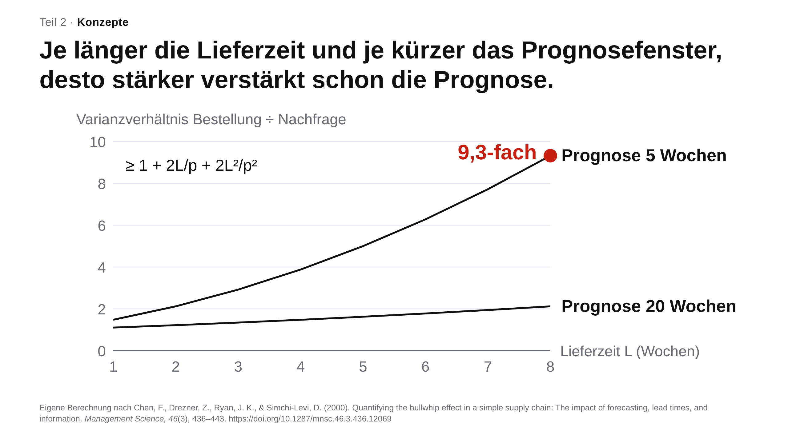

# Praxisbeispiele im Überblick {.unnumbered #sec-praxisbeispiele}

<!-- Erzeugt von scripts/praxisbeispiele.py (Claude, 02.11.2026, Auftrag Roman; Stand nach den Kapitelsitzungen 13.11.2026). Nicht von Hand ändern, sondern das Skript anpassen. Nur online (_quarto-web.yml). -->

::: {.content-visible when-format="html"}
In diesem Buch stecken 40 Beispiele, die Sie nicht lesen, sondern ansehen, hören und ausprobieren: Filme mit Haltepunkten, ein Lernsong, Spiele, Rechner und Animationen. Alle habe ich mit Sprachmodellen und anderen KI-Werkzeugen gebaut und geprüft, einige für meine eigene Lehre in Supply Management, die meisten für dieses Buch. Hier stehen sie ohne den Kapiteltext, nach Format geordnet; der Link unter jedem Beispiel führt zur Stelle im Buch, die erklärt, wofür es gedacht ist und was es nicht leistet. Einige Beispiele stehen nur hier; unter ihnen führt der Link zum Abschnitt, der ihr Thema behandelt. Wer so einsteigt, folgt dem Lernpfad „Anwendungsbeispiele ansehen“ aus dem [Vorwort](index.qmd#sec-lernpfade) und kehrt von hier aus in die Kapitel zurück, die neugierig machen.

```{=html}
<script>
/* Eingebettete Seiten melden ihre Inhaltshöhe; so entsteht kein Scrollbalken im Rahmen. */
window.addEventListener("message", function (e) {
  var d = e.data; if (d && d.typ === "onet-heatmap-hoehe") d = { id: "onet-heatmap", h: d.h };
  else if (!d || (d.typ !== "rahmen-hoehe" && d.typ !== "galerie-hoehe")) return;
  var f = document.getElementById(d.id); if (f && f.tagName === "IFRAME" && d.h > 200) f.style.height = (d.h + 2) + "px";
});
</script>
```

## Filme, Hörstück und Erklärvideos {#sec-pb-filme .unnumbered}

Die meisten Filme entstanden als Programmtext: Ein Sprachmodell schrieb Szenen, Daten und Prüfungen, ein Werkzeug rechnete den Film Bild für Bild aus. Der Teaser zur Fallstudie ist ein KI-generiertes Video, die Musik des Lernsongs stammt von Suno, das Drehbuch des Hörstücks schrieb ein KI-Agent.

### Das nächste Token in neun Genres {.unnumbered}

Ein Film von gut drei Minuten erklärt in neun Stilen, vom Film noir bis zum Märchen, wie ein Sprachmodell das nächste Token wählt, und fragt vor dem Start nach Ihrer Vorhersage.

```{=html}
<iframe loading="lazy" id="genrefilm-kap02-token-genres" src="interactions/genrefilm-player.html?film=kap02-token-genres" width="100%" height="900px" frameborder="0" title="Das nächste Token in neun Genres"></iframe>
```

Im Buch: [Kapitel 2, Tokens, Zahlen, Aufmerksamkeit](kapitel02-grundlagen.qmd#vid-naechstes-token-genres)

### Stützräder: wie die Prompting-Ratschläge kamen und gingen {.unnumbered}

Ein Film von gut zweieinhalb Minuten erzählt in neun Genres, woher die Zeilen alter Prompts stammen und warum viele heute entfallen; an drei Stellen hält er an und fragt nach.

```{=html}
<iframe loading="lazy" id="genrefilm-kap02-stuetzraeder" src="interactions/genrefilm-player.html?film=kap02-stuetzraeder" width="100%" height="900px" frameborder="0" title="Stützräder: wie die Prompting-Ratschläge kamen und gingen"></iframe>
```

Im Buch: [Kapitel 1, Einleitung](kapitel01-einleitung.qmd#vid-stuetzraeder)

### Every Forecast Is Wrong: ein Lernsong zu fünf Prognoseverfahren {.unnumbered}

Fünf Verfahren an den Kaffeebechern eines erfundenen Campus-Cafés, gesungen auf Englisch, mit Rechenpausen und mitlaufendem Diagramm (5:15).

```{=html}
<video id="pb-lernsong" controls playsinline preload="none" style="width:100%;height:auto" poster="interactions/media/lernsong-forecast-poster.webp" title="Every Forecast Is Wrong: ein Lernsong zu fünf Prognoseverfahren">
  <source src="interactions/media/lernsong-forecast.mp4" type="video/mp4">
  <track kind="subtitles" srclang="en" label="English (lyrics)" src="interactions/media/lernsong-forecast.vtt" default>
</video>
```

Im Buch: [Kapitel 7, Lernsongs](kapitel07-artefakte.qmd#sec-bsp-lernsong-forecast)

### Teaser zur Fallstudie Backhaus Kaya {.unnumbered}

Fünf Sekunden KI-generierter Film ohne Ton eröffnen eine Fallstudie: Aylin Kaya nachts in der Backstube; Bäckerei und Figuren sind erfunden.

```{=html}
<video id="pb-kaya-teaser" controls playsinline preload="none" loop muted style="width:100%;height:auto" poster="interactions/media/kaya-teaser-poster.webp" title="Teaser zur Fallstudie Backhaus Kaya">
  <source src="interactions/media/kaya-teaser.mp4" type="video/mp4">
</video>
```

Im Buch: [Kapitel 7, Fallstudien generieren](kapitel07-artefakte.qmd#sec-bsp-fallstudie)

### Der Aufgaben-Mix der Lehrenden ändert sich {.unnumbered}

Vier Aufgaben wandern zur KI, fünf schrumpfen, fünf neue kommen hinzu: Automatisierung, Augmentierung und neue Aufgaben als Kachelbild (60 s, ohne Ton).

```{=html}
<video id="pb-acemoglu-restrepo" controls playsinline preload="none" style="width:100%;height:auto" poster="interactions/media/kap04-acemoglu-restrepo-poster.png" title="Der Aufgaben-Mix der Lehrenden ändert sich">
  <source src="interactions/media/kap04-acemoglu-restrepo.mp4" type="video/mp4">
</video>
```

Im Buch: [Kapitel 3, Was sind unsere Aufgaben?](kapitel03-automation.qmd#vid-acemoglu-restrepo)

### Making-of: vom Auftrag zum fertigen Video {.unnumbered}

Auftrag, Datendatei, Code, automatische Prüfung, Sichtprüfung, Rendern, rekonstruiert aus dem Versionsprotokoll einer echten Arbeitssitzung (59 s, ohne Ton).

```{=html}
<video id="pb-making-of" controls playsinline preload="none" style="width:100%;height:auto" poster="interactions/media/kap04-making-of-poster.png" title="Making-of: vom Auftrag zum fertigen Video">
  <source src="interactions/media/kap04-making-of.mp4" type="video/mp4">
</video>
```

Im Buch: [Kapitel 6, Jeder kann jetzt programmieren](kapitel06-rollen.qmd#sec-coding)

### Dieselbe Herleitung, zwei Werkzeuge {.unnumbered}

Die optimale Bestellmenge links in Manim, rechts in HyperFrames, beide Fassungen von Claude programmiert (30 s, ohne Ton).

```{=html}
<video id="pb-eoq-vergleich" controls playsinline preload="none" style="width:100%;height:auto" poster="interactions/media/kap04-eoq-vergleich-poster.png" title="Dieselbe Herleitung, zwei Werkzeuge">
  <source src="interactions/media/kap04-eoq-vergleich.mp4" type="video/mp4">
</video>
```

Nur auf dieser Seite. Zum Thema im Buch: [Kapitel 6, Jeder kann jetzt programmieren](kapitel06-rollen.qmd#sec-coding)

### Ablauf des Physik-Tutors PS2 Pal {.unnumbered}

Lehrende legen Regeln und Musterlösungen im Prompt fest, Studierende arbeiten zu Hause Schritt für Schritt mit dem Tutor (44 s, ohne Ton).

```{=html}
<video id="pb-ps2pal-ablauf" controls playsinline preload="none" style="width:100%;height:auto" poster="interactions/media/kap04-ps2pal-ablauf-poster.png" title="Ablauf des Physik-Tutors PS2 Pal">
  <source src="interactions/media/kap04-ps2pal-ablauf.mp4" type="video/mp4">
</video>
```

Im Buch: [Kapitel 6, Komplexer Physik-Tutor](kapitel06-rollen.qmd#sec-complex-tutors)

### Hörstück mit Prüfauftrag: Was Forschende über KI sagen {.unnumbered}

Zwei Stimmen sprechen über 125 Interviews, in denen Forschende von ihrer Arbeit mit KI berichten; Sie sagen vorher ein Ergebnis voraus und prüfen danach drei Aussagen am Transkript.

```{=html}
<iframe loading="lazy" id="podcast-forschende-ki" src="interactions/podcast-forschende-ki.html" width="100%" height="900px" frameborder="0" title="Hörstück mit Prüfauftrag: Was Forschende über KI sagen"></iframe>
```

Im Buch: [Kapitel 6, Interviews auswerten lassen](kapitel06-rollen.qmd#sec-podcast-interviews)

## Spiele und Selbsttests {#sec-pb-spiele .unnumbered}

In jedem Spiel geben Sie zuerst eine Vermutung ab; die Auflösung wirkt am stärksten dort, wo Sie sich sicher waren und falsch lagen.

### Höher oder tiefer: Wofür Menschen KI tatsächlich nutzen {.unnumbered}

Welche von zwei Arbeitsaufgaben kommt in Gesprächen mit Claude häufiger vor? Die Daten stammen aus dem Anthropic Economic Index.

```{=html}
<iframe loading="lazy" id="pb-hoeher-tiefer" src="interactions/hoeher-tiefer-ki-aufgaben.html" width="100%" height="900px" frameborder="0" title="Höher oder tiefer: Wofür Menschen KI tatsächlich nutzen"></iframe>
```

Im Buch: [Kapitel 1, Höher oder tiefer](kapitel01-einleitung.qmd#sec-spiel-ki-aufgaben)

### Die Bibliothek der Prompts {.unnumbered}

Ein begehbarer Raum mit 22 Regalen, eines je Berufsgruppe: Sie schätzen zuerst, wie breit das Regal der Bildung ist; dann zeigen Daten des Anthropic Economic Index, welche Aufgaben darin stehen.

```{=html}
<iframe loading="lazy" id="pb-bibliothek" src="interactions/bibliothek-der-prompts.html" width="100%" height="1250px" frameborder="0" title="Die Bibliothek der Prompts"></iframe>
```

Nur auf dieser Seite. Zum Thema im Buch: [Kapitel 3, Was sind unsere Aufgaben?](kapitel03-automation.qmd#sec-aufgaben)

### Detektor-Duell: Mensch oder KI? {.unnumbered}

Acht Auszüge aus Erörterungen, vier von Schülerinnen und Schülern, vier von einem Sprachmodell; erst urteilen Sie, dann ein kleiner Lehr-Detektor.

```{=html}
<iframe loading="lazy" id="detektor-duell" src="interactions/detektor-duell.html" width="100%" height="1100px" frameborder="0" title="Detektor-Duell: Mensch oder KI?"></iframe>
```

Im Buch: [Kapitel 5, Selbsttest Detektor](kapitel05-4d-phasen.qmd#sec-detektor-duell)

### Der Streich-Test: Was würden Sie heute streichen? {.unnumbered}

Zehn Zeilen eines Prompts von 2024: Sie entscheiden, ob Sie sie streichen würden, und nennen Ihre Sicherheit.

```{=html}
<iframe loading="lazy" id="streich-test" src="interactions/streich-test-prompting.html" width="100%" height="1500px" frameborder="0" title="Der Streich-Test: Was würden Sie heute streichen?"></iframe>
```

Im Buch: [Kapitel 2, Streich-Test](kapitel02-grundlagen.qmd#sec-streichtest)

### Welche Grundbegriffe kennen Sie schon? {.unnumbered}

Ein Zuordnungsspiel in zwei Stufen: Begriffe zu Definitionen, die zweite Stufe mit Agenten und einer Diagnoserunde.

```{=html}
<iframe loading="lazy" id="pb-lernspiel-grundbegriffe" src="interactions/llm-game-standalone.html" width="100%" height="700px" frameborder="0" title="Welche Grundbegriffe kennen Sie schon?"></iframe>
```

Im Buch: [Kapitel 2, Grundbegriffe](kapitel02-grundlagen.qmd#sec-definitionen)

### LLM, RAG oder Agent? {.unnumbered}

Dieselbe Frage an drei Systeme: Das Spiel zeigt, warum ein Sprachmodell, ein Abruf eigener Quellen und ein Agent verschieden antworten.

```{=html}
<iframe loading="lazy" id="pb-lernspiel-rag-agent" src="interactions/llm-rag-agent-game.html" width="100%" height="700px" frameborder="0" title="LLM, RAG oder Agent?"></iframe>
```

Im Buch: [Kapitel 2, Welches Setup](kapitel02-grundlagen.qmd#sec-patterns-usage)

### Agenten-Muster erkennen {.unnumbered}

Beispielantworten den passenden Mustern zuordnen, von Werkzeugnutzung bis Planung.

```{=html}
<iframe loading="lazy" id="pb-agenten-muster" src="interactions/llm-agent-patterns-matching.html" width="100%" height="760px" frameborder="0" title="Agenten-Muster erkennen"></iframe>
```

Nur auf dieser Seite. Zum Thema im Buch: [Kapitel 2, Welches Setup](kapitel02-grundlagen.qmd#sec-patterns-usage)

## Durchspiele, Rechner und Widgets {#sec-pb-widgets .unnumbered}

Hier verändern Sie selbst Zahlen, Rollen und Arbeitsweisen und sehen sofort, was daraus folgt.

### Dieselbe Aufgabe in fünf Arbeitsweisen {.unnumbered}

Vom Centaur bis zur dunklen Fabrik: Je mehr die KI übernimmt, desto weniger spricht der Mensch und desto mehr sprechen die Agenten miteinander.

```{=html}
<iframe loading="lazy" id="pb-arbeitsweisen-durchspiel" src="interactions/ki-arbeitsweisen-durchspiel.html" width="100%" height="1500px" frameborder="0" title="Dieselbe Aufgabe in fünf Arbeitsweisen"></iframe>
```

Im Buch: [Kapitel 3, Arbeitsweisen](kapitel03-automation.qmd#sec-arbeitsweisen)

### Semester-Simulator: Sie sind Professorin Albers {.unnumbered}

Zwölf Wochen, 120 Studierende, je Woche eine Entscheidung: Sie schätzen den Klausurschnitt und sehen am Ende, was Ihre Züge im Lehrmodell bewirkt haben.

```{=html}
<iframe loading="lazy" id="pb-semester-simulator" src="interactions/semester-simulator.html" width="100%" height="2350px" frameborder="0" title="Semester-Simulator: Sie sind Professorin Albers"></iframe>
```

Im Buch: [Kapitel 4, Was die Forschung seit 2025 zeigt](kapitel04-lernmechanismen.qmd#semester-simulator)

### Was ein Tutor-Bot im Semester kostet {.unnumbered}

Tragen Sie Ihre Kursgröße ein: Von rund 8.800 US-$ im Januar 2025 fielen die Semesterkosten bis Juli 2026 auf rund 12 US-$.

```{=html}
<iframe loading="lazy" id="pb-tutor-kosten" src="interactions/tutor-kosten.html" width="100%" height="950px" frameborder="0" title="Was ein Tutor-Bot im Semester kostet"></iframe>
```

Im Buch: [Kapitel 5, Was die Modelle können](kapitel05-4d-phasen.qmd#sec-capabilities)

### Linien-Widget: den Engpass finden {.unnumbered}

Pizzalinie oder Brötchenlinie: Arbeitsschritte, Personal und Öfen verändern und Kapazität und Durchlaufzeit sofort ablesen (englisch).

```{=html}
<iframe loading="lazy" id="pb-linien-widget" src="interactions/line-widget.html" width="100%" height="1150px" frameborder="0" title="Linien-Widget: den Engpass finden"></iframe>
```

Im Buch: [Kapitel 7, Interaktive Widgets](kapitel07-artefakte.qmd#sec-bsp-widgets)

### Little's Law zählen {.unnumbered}

Ankunft, Warteschlange, Bearbeitung, Abgang: Die Animation zählt mit, bis Bestand, Durchsatz und Durchlaufzeit zusammenpassen.

```{=html}
<iframe loading="lazy" id="pb-littles-law" src="interactions/littles-law-animation.html" width="100%" height="420px" frameborder="0" title="Little's Law zählen"></iframe>
```

Nur auf dieser Seite. Zum Thema im Buch: [Kapitel 7, Little's Law selbst nachrechnen](kapitel07-artefakte.qmd#sec-widget-littles-law)

### Little's Law selbst nachrechnen {.unnumbered}

Ein Rechner direkt im Kapitel: Er vergleicht für eine Bearbeitungsstation den gezählten Bestand mit Durchsatz mal Durchlaufzeit und zeigt, wie weit die Gleichung in einem kurzen Beobachtungsfenster danebenliegt.

Im Buch: [Kapitel 7, Little's Law selbst nachrechnen](kapitel07-artefakte.qmd#sec-widget-littles-law)

### Welches Modell für welche Aufgabe? {.unnumbered}

Drei Fragen zu Daten, Aufgabe und Häufigkeit führen zu Modellklasse und Preisstufe.

```{=html}
<iframe loading="lazy" id="pb-modellwahl" src="interactions/modellwahl-baum.html" width="100%" height="820px" frameborder="0" title="Welches Modell für welche Aufgabe?"></iframe>
```

Im Buch: [Kapitel 2, Welches Modell?](kapitel02-grundlagen.qmd#sec-model-choice)

### Der 4D-Kreislauf {.unnumbered}

Zwei Schleifen, vier Kompetenzen; wählen Sie eine Rolle der KI, um zu sehen, wo der Kreislauf am ehesten reißt.

```{=html}
<iframe loading="lazy" id="pb-4d-kreislauf" src="interactions/4d-kreislauf.html" width="100%" height="760px" frameborder="0" title="Der 4D-Kreislauf"></iframe>
```

Im Buch: [Kapitel 5, Das 4D-Modell](kapitel05-4d-phasen.qmd#sec-4d)

### Den Bullwhip-Effekt zerlegen {.unnumbered}

Ein Rechner direkt im Kapitel: Wie sich Bestellschwankungen entlang einer Lieferkette aufschaukeln.

Im Buch: [Kapitel 7, Den Bullwhip-Effekt zerlegen](kapitel07-artefakte.qmd#sec-widget-bullwhip)

## Animationen zum Durchklicken {#sec-pb-animationen .unnumbered}

Jede Animation baut ein Bild Schritt für Schritt auf und fragt vorher nach Ihrer Vorhersage.

### Ein Zwischenschritt, der nie im Text steht {.unnumbered}

Aus „Dallas“ wird intern „Texas“ und daraus „Austin“; ersetzen Forschende „Texas“ durch „California“, antwortet das Modell „Sacramento“.

```{=html}
<iframe loading="lazy" id="pb-zwischenschritt" src="interactions/zwischenschritt-texas.html" width="100%" height="820px" frameborder="0" title="Ein Zwischenschritt, der nie im Text steht"></iframe>
```

Nur auf dieser Seite. Zum Thema im Buch: [Kapitel 2, Blick ins Modell](kapitel02-grundlagen.qmd#sec-blick-ins-modell)

### Seit 2022 ist die Schicht um das Modell gewachsen {.unnumbered}

Werkzeuge, Gedächtnis und eine Arbeitsschleife legen sich als Harness um das Modell.

```{=html}
<iframe loading="lazy" id="pb-harness" src="interactions/harness-schichten.html" width="100%" height="820px" frameborder="0" title="Seit 2022 ist die Schicht um das Modell gewachsen"></iframe>
```

Im Buch: [Kapitel 2, Was sich seit 2022 geändert hat](kapitel02-grundlagen.qmd#sec-harness)

### Sechs Stufen der Selbstständigkeit {.unnumbered}

Von der Handkorrektur ohne KI bis zum Agenten, der eine Aufgabe allein erledigt, mit Beispielen aus der Hochschullehre.

```{=html}
<iframe loading="lazy" id="pb-autonomiestufen" src="interactions/autonomiestufen.html" width="100%" height="860px" frameborder="0" title="Sechs Stufen der Selbstständigkeit"></iframe>
```

Nur auf dieser Seite. Zum Thema im Buch: [Kapitel 2, Was sich seit 2022 geändert hat](kapitel02-grundlagen.qmd#sec-harness)

### Drei Labore, ein Bauplan {.unnumbered}

Modell, Werkzeuge und eine Schleife darum: Google, OpenAI und Anthropic bauen ihre Agenten nach demselben Muster.

```{=html}
<iframe loading="lazy" id="pb-drei-labs" src="interactions/drei-labs-ein-bauplan.html" width="100%" height="900px" frameborder="0" title="Drei Labore, ein Bauplan"></iframe>
```

Nur auf dieser Seite. Zum Thema im Buch: [Kapitel 2, Was sich seit 2022 geändert hat](kapitel02-grundlagen.qmd#sec-harness)

### Vom Chatbot zum Agenten {.unnumbered}

Gewachsen ist vor allem der Spielraum des Modells über den Ablauf, vom festen Weg bis zur Schleife aus Denken, Handeln und Beobachten.

```{=html}
<iframe loading="lazy" id="pb-chatbot-agent" src="interactions/chatbot-zu-agent.html" width="100%" height="1050px" frameborder="0" title="Vom Chatbot zum Agenten"></iframe>
```

Im Buch: [Kapitel 2, Welches Setup](kapitel02-grundlagen.qmd#sec-patterns-usage)

### Ein Skill lädt sein Wissen erst, wenn es gebraucht wird {.unnumbered}

Erst Name und Kurzbeschreibung, dann die Anleitung, Zusatzdateien nur bei Bedarf, wie Inhaltsverzeichnis, Kapitel und Anhang eines Handbuchs.

```{=html}
<iframe loading="lazy" id="pb-skills" src="interactions/skills-handbuch.html" width="100%" height="820px" frameborder="0" title="Ein Skill lädt sein Wissen erst, wenn es gebraucht wird"></iframe>
```

Im Buch: [Kapitel 2, Agenten in der Praxis](kapitel02-grundlagen.qmd#sec-agenten-praxis)

### Vom Spickzettel zum prüfbaren Archiv {.unnumbered}

Vier Stufen des Agenten-Gedächtnisses, von der Anleitungsdatei bis zum durchsuchbaren Ordner.

```{=html}
<iframe loading="lazy" id="pb-agenten-gedaechtnis" src="interactions/agenten-gedaechtnis.html" width="100%" height="620px" frameborder="0" title="Vom Spickzettel zum prüfbaren Archiv"></iframe>
```

Im Buch: [Kapitel 2, Gedächtnis](kapitel02-grundlagen.qmd#sec-agenten-gedaechtnis)

### Die Sitzung schreibt alles mit, das Gedächtnis behält das Verdichtete {.unnumbered}

Ein Statistik-Tutor holt am vierten Abend nur das Passende aus drei früheren Sitzungen zurück.

```{=html}
<iframe loading="lazy" id="pb-sitzung-gedaechtnis" src="interactions/sitzung-und-gedaechtnis.html" width="100%" height="880px" frameborder="0" title="Die Sitzung schreibt alles mit, das Gedächtnis behält das Verdichtete"></iframe>
```

Nur auf dieser Seite. Zum Thema im Buch: [Kapitel 2, Gedächtnis](kapitel02-grundlagen.qmd#sec-agenten-gedaechtnis)

### Zwei Skalierungsgesetze {.unnumbered}

Modelle werden verlässlicher durch mehr Rechnen beim Training und durch mehr Nachdenken beim Antworten.

```{=html}
<iframe loading="lazy" id="pb-scaling-laws" src="interactions/scaling-laws.html" width="100%" height="1460px" frameborder="0" title="Zwei Skalierungsgesetze"></iframe>
```

Im Buch: [Kapitel 5, Was die Modelle können](kapitel05-4d-phasen.qmd#sec-capabilities)

## Diagramme mit echten Daten {#sec-pb-diagramme .unnumbered}

Vier Diagramme zeigen, welche Aufgaben von Lehrenden schon in Gesprächen mit KI auftauchen und wie schnell sich Fähigkeiten und Preise der Modelle verschieben.

### Welche Aufgaben Lehrender schon bei der KI landen {.unnumbered}

25 Aufgaben von Hochschullehrenden, einmal nach ihrer Häufigkeit im Beruf (O*NET), einmal nach ihrem Anteil an Gesprächen mit Claude (Anthropic Economic Index).

```{=html}
<iframe loading="lazy" id="onet-heatmap" src="interactions/onet-heatmap.html" width="100%" height="1340px" frameborder="0" title="Welche Aufgaben Lehrender schon bei der KI landen"></iframe>
```

Im Buch: [Kapitel 3, Was sind unsere Aufgaben?](kapitel03-automation.qmd#sec-aufgaben)

### KI-Agenten bewältigen immer längere Aufgaben {.unnumbered}

Der Zeithorizont der Modelle von 2019 bis 2026 nach METR, mit Lehraufgaben ähnlicher Dauer zur Orientierung.

```{=html}
<iframe loading="lazy" id="pb-zeithorizont" src="interactions/ki-entwicklung.html?zeige=zeithorizont" width="100%" height="1000px" frameborder="0" title="KI-Agenten bewältigen immer längere Aufgaben"></iframe>
```

Im Buch: [Kapitel 5, Was die Modelle können](kapitel05-4d-phasen.qmd#sec-capabilities)

### Expertenwissen wird 725-mal billiger {.unnumbered}

Niedrigste Kosten je Frage, mit denen ein Modell 75 % des GPQA Diamond richtig beantwortet, Januar 2025 bis Juli 2026, nach Epoch AI.

```{=html}
<iframe loading="lazy" id="pb-kosten" src="interactions/ki-entwicklung.html?zeige=kosten" width="100%" height="1100px" frameborder="0" title="Expertenwissen wird 725-mal billiger"></iframe>
```

Im Buch: [Kapitel 5, Was die Modelle können](kapitel05-4d-phasen.qmd#sec-capabilities)

### Wer übernimmt welchen Arbeitsschritt? {.unnumbered}

Das Schema der Arbeitsweisen von Centaur bis dunkle Fabrik als Diagramm zum Umschalten.

```{=html}
<iframe loading="lazy" id="pb-arbeitsweisen-schema" src="interactions/ki-entwicklung.html?zeige=arbeitsweisen" width="100%" height="820px" frameborder="0" title="Wer übernimmt welchen Arbeitsschritt?"></iframe>
```

Nur auf dieser Seite. Zum Thema im Buch: [Kapitel 3, Arbeitsweisen](kapitel03-automation.qmd#sec-arbeitsweisen)

## Folie und Rollenspiel {#sec-pb-praxis .unnumbered}

Zwei Formate ohne eigenes Beispiel im Kapitel: eine Präsentationsfolie, die ein Sprachmodell nach einem Regelwerk gebaut hat, und die Szenario-Karte eines KI-Rollenspiels.

### Mit Regelwerk belegt die Folie ihren Titel mit einem Diagramm {.unnumbered}

Eine Aussage zum Bullwhip-Effekt: Aussagetitel, ein Liniendiagramm mit direkt beschrifteten Kurven, kaum Text; die Erklärung übernimmt die Stimme. Gebaut von Claude nach einem Regelwerk für evidenzbasierte Folien, mit der Formel von @chen2000quantifying, geprüft von mir.

{fig-alt="Folie mit Aussagetitel zu Lieferzeit und Prognosefenster, Liniendiagramm mit zwei direkt beschrifteten Kurven, ein roter Punkt markiert den Wert 9,3; kaum Text." width="100%"}

Nur auf dieser Seite.

### Die KI spielt den skeptischen Mitarbeiter, alle Studierenden üben {.unnumbered}

Szenario-Karte eines KI-Rollenspiels an der Universität Leipzig: Statt zwei Aktiven und vielen Zuschauern übt jede und jeder selbst [@barton2026poster; @tobor2026usecases, S. 40–42].

| | |
|---|---|
| **Studierende spielen** | die Führungskraft, die überzeugen soll |
| **Die KI spielt** | einen erfahrenen Mitarbeiter über 50, skeptisch gegenüber einer Schulung zur Digitalisierung, mit Hinweisen auf Mimik und Gestik |
| **Gesteuert durch** | einen rund zweiseitigen System-Prompt: Rolle, Gesprächsphasen, Schwierigkeit, Feedback am Ende |
| **Ablauf** | fünf bis zehn Minuten, wiederholbar; danach Reflexion im Fragebogen |
| **Lernziel** | Prinzipal-Agent-Theorie erfahren (BWL-Master, Personal- und Organisationsökonomik) |

Nur auf dieser Seite. Zum Thema im Buch: [Kapitel 6, Role Play](kapitel06-rollen.qmd#sec-role-play)

:::
