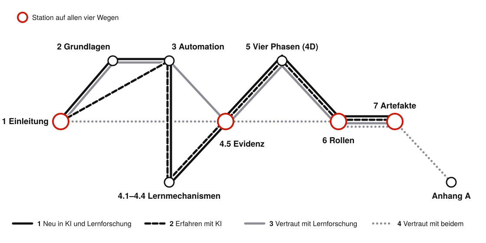

# Vorwort {.unnumbered #sec-vorwort}

Dieses Buch ist aus einem Skript gewachsen. Als die ersten Kolleginnen und Kollegen fragten, wie man die neuen Sprachmodelle (*Large Language Models*) eigentlich sinnvoll in der Lehre einsetzt, habe ich meine Notizen aus dem eigenen Unterricht in Supply Management und Projektmanagement am Campus Gummersbach der TH Köln zusammengeschrieben. Daraus wurde ein Workshop, aus dem Workshop eine Reihe von Kursen im Netzwerk für hochschuldidaktische Weiterbildung (hdw nrw) an Hochschulen in ganz Nordrhein-Westfalen, und aus den Fragen der Teilnehmenden immer neue Abschnitte. Parallel entstand an der TH Köln die Taskforce GenAI in der Lehre, in der wir seit 2026 regelmäßig darüber diskutieren, was in Lehre und Prüfung funktioniert und was nicht.

<!-- Lernpfade (Claude, 01.11.2026; am 01.11. auf Wunsch Roman aus Kapitel 1 ins Vorwort verschoben) nach Entscheidung Roman: Option b, U-Bahn-Plan als Buchlandkarte, Selbsttest. Karte und Widget werden aus scripts/lernpfade/ erzeugt. -->

## Wählen Sie Ihren Lernpfad {#sec-lernpfade .unnumbered}

Nicht jede Leserin braucht jede Etappe. Lehrende bringen zwei Arten von Vorwissen mit, die wenig miteinander zu tun haben: Erfahrung mit KI-Werkzeugen und Kenntnis der Lernforschung, also ihrer Befunde zu den Wirkmechanismen des Lernens, der Wege, sie in der Lehre umzusetzen, und der erprobten Formen des KI-Einsatzes. Lehrerfahrung allein bringt diese Kenntnis nicht mit sich: In einer Befragung kannten Hochschullehrende wirksame Lernstrategien etwas besser als ihre Studierenden, teilten mit ihnen aber verbreitete Fehlannahmen [@morehead2016]. Ein Informatiker, der täglich mit Agenten (eigenständig handelnden KI-Systemen) arbeitet, hat womöglich nie gehört, warum verteiltes Üben länger hält; eine Kollegin, die die Befunde zu Abrufübungen kennt, weiß nicht unbedingt, was einen Agenten von einem Chatbot unterscheidet. Beiden kostet die vollständige Strecke mehr als Zeit, denn Erklärungen, die Neulingen helfen, belasten Erfahrene, die Bekanntes ein zweites Mal verarbeiten müssen (Expertise-Umkehreffekt, *expertise reversal effect*) [@kalyuga2003]. @fig-lernpfade zeigt die vier Kombinationen als Liniennetz.

::: {.content-visible when-format="html"}
::: {#fig-lernpfade}
```{=html}
<iframe loading="lazy" id="lernpfade" src="interactions/lernpfade.html" width="100%" height="1000px" frameborder="0" title="Selbsttest und Liniennetz: Wählen Sie Ihren Lernpfad"></iframe>
<script>
/* Das Lernpfad-Widget meldet seine Höhe; so entsteht kein Scrollbalken im Rahmen. */
window.addEventListener("message", function (e) {
  var d = e.data; if (!d || d.typ !== "galerie-hoehe") return;
  var f = document.getElementById(d.id); if (f && d.h > 200) f.style.height = d.h + "px";
});
</script>
```

Lernpfade durch das Buch. Nach den sechs Antworten tritt die passende Linie hervor; jede Station führt zum Kapitel. Eigene Darstellung.
:::
:::

::: {.content-visible unless-format="html"}
{#fig-lernpfade width="100%" fig-pos="htbp"}

::: {.callout-note title="Selbsttest: Welche Linie passt?"}
**Erfahrung mit KI.** (a) Ich nutze ein Sprachmodell mindestens einmal pro Woche für meine Arbeit. (b) Ich habe einen eigenen Assistenten eingerichtet, etwa ein Projekt mit festen Anweisungen und eigenen Dateien. (c) Ich habe einer KI eine mehrschrittige Aufgabe übertragen, bei der sie selbst sucht, Dateien liest oder Code ausführt.

**Kenntnis der Lernforschung.** (d) Ich kenne zentrale Wirkmechanismen aus der Lernforschung und kann erklären, warum etwa Abrufübungen, verteiltes Üben und Selbsterklären das Behalten stärken. (e) Ich weiß, wie sich solche Mechanismen in einer Lehrveranstaltung umsetzen lassen, etwa mit kurzen Abfragen zu Beginn, Wiederholung über das Semester oder Aufgaben, in denen Studierende einander erklären. (f) Ich kenne erprobte Einsatzformen und Befunde zu KI in der Lehre, etwa wann ein KI-Tutor das Lernen stärkt und wann er es durch Auslagerung des Denkens schwächt.

Höchstens eine Zustimmung je Gruppe: Linie 1. Zwei oder mehr nur bei KI: Linie 2. Nur bei Lernforschung: Linie 3. In beiden Gruppen: Linie 4. Online prüft der Selbsttest die Antworten und hebt die Linie hervor: <https://th-koln-bartnik.github.io/genai4teaching/vorwort.html#sec-lernpfade>.
:::
:::
